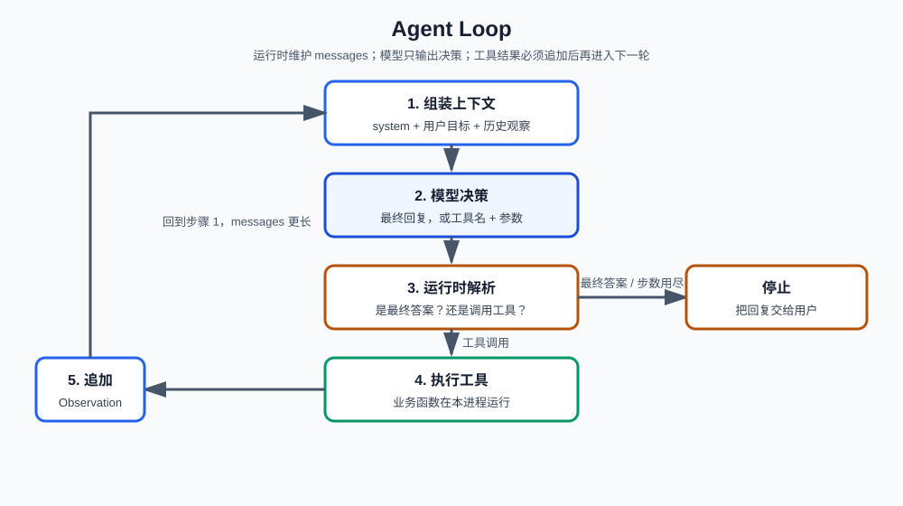

# 第2课:Agent Loop

第一课把 Agent 定义成“模型选下一步、运行时执行工具”。本课把这句话展开成一轮接一轮的循环：上下文怎么组装、模型输出什么、谁执行工具、何时停止。

**学习目标：**

1. 能按顺序列出 Agent Loop 的步骤，并指出每一步是模型还是运行时在工作；
2. 能说明为什么模型不能直接改数据库，Observation 必须写回上下文；
3. 能区分“向 messages 追加”和“覆盖状态”；
4. 能解释最大步数等停止条件为什么必须由运行时执行。

## 1. 循环解决什么问题

第一课的 Agent 只做了**一步选择**：模型给出动作名，运行时调用一次函数就结束。用户如果说“先查这周运动，不够再加今晚跑步”，一步不够。

Agent Loop 把“决策 → 行动 → 观察”重复执行，直到模型给出最终回复，或运行时判定必须停。判断标准：

```text
还在循环里    模型刚输出了工具调用，或还没给出最终回复
该停止        模型输出最终回复，或命中运行时的停止条件
```

一次 Chat Completions 调用只是 Loop 里的第 2 步。把单轮聊天接口连上工具，不等于已经有了 Loop。

## 2. 标准步骤



```text
1. 接收目标，初始化 messages（system + user）
2. 把当前 messages 发给模型
3. 运行时解析输出
   - 最终回复 → 停止，把文本交给用户
   - 工具调用 → 在本进程执行对应函数
4. 把工具结果写成 Observation，追加进 messages
5. 回到第 2 步
```

| 步骤 | 谁做 | 输入 | 输出 / 副作用 |
| --- | --- | --- | --- |
| 组装上下文 | 运行时 | 目标、历史 messages | 本轮要发给模型的列表 |
| 模型决策 | LLM | messages | 文本，或 `{name, arguments}` |
| 解析输出 | 运行时 | 模型原始输出 | “停”或“调哪个工具” |
| 执行工具 | 运行时 + 业务函数 | 工具名和参数 | 改数据库等；返回结果字符串 |
| 写回观察 | 运行时 | 工具结果 | messages 变长，不覆盖旧轮 |

模型始终看不见数据库连接。它最多输出意图；`search_records` / `add_plan` 只在你的进程里运行。

## 3. 运行时要维护的状态

循环里有两类东西，不要混：

**追加型（messages）**  
每一轮用户话、助手决策、工具观察都**接到列表末尾**。下一轮模型必须看见“已经查过运动记录”，否则会再查一次或谎称写过计划。第一课的多轮对话就是这种结构；Loop 只是在 `assistant` 之外多了一种观察消息。

本课把观察也做成一条消息，便于打印：

```python
{"role": "tool", "content": "查询结果：['周一慢跑']"}
```

真实接口里工具结果的 `role` 可能是 `tool`，并带 `tool_call_id`。本课不展开协议字段，只要求：**观察是追加，不是把 user 那一条改掉。**

**覆盖型（任务状态）**  
例如 `step_count`、`done`、当前计划是否已写入。这些是运行时变量，每轮**更新同一个字段**，不是往列表里再堆一份。面试可以说：对话历史用追加，计数器和标志位用覆盖。

不要把 `step_count` 交给模型“自己记住第几步”。模型会数错；停止条件必须由运行时判断。

## 4. 停止条件

运行时至少要有这些闸门（本课示例实现前两条）：

| 条件             | 谁检查         | 作用           |
| -------------- | ----------- | ------------ |
| 模型给出最终回复       | 解析输出之后      | 正常结束         |
| 达到 `max_steps` | 进入下一轮模型调用之前 | 防止同一工具反复调用   |
| 超时、用户取消        | 运行时         | 生产环境需要，本课不实现 |

经验范围：简单工具组合常把 `max_steps` 设在 8～20。没有上限的 Loop 不是不完整实现，是缺陷。

工具失败时：把错误写成 Observation 追加进去，让模型决定重试或向用户说明，而不是让整个进程崩溃。如何校验参数、如何鉴权，第 3 课再讲；本课只演示“失败也是一条观察”。

## 5. 本课的循环函数

课程代码在 `code/ai-agent/02-agent-loop.py`，不依赖 `openai` 包。假模型按预设脚本吐出决策，用来观察 Loop，不是用来冒充真实推理。

### 5.1 决策的数据结构

```python
@dataclass
class Decision:
    kind: str
    text: str = ""
    tool_name: str = ""
    tool_args: dict[str, str] = field(default_factory=dict)
```

`kind` 只能是 `"final"` 或 `"tool"`。`final` 时用 `text` 作为给用户的话；`tool` 时用 `tool_name` 和 `tool_args`。这是教学用的结构化输出，对应真实接口里的 `message.content` 或 `message.tool_calls`。

### 5.2 `run_loop`

教学签名（本课子集）：

```python
def run_loop(
    goal: str,
    llm: ScriptLLM,
    tools: dict[str, object],
    max_steps: int = 6,
) -> str:
    ...
```

| 参数 | 类型 | 必填 | 默认 | 含义 |
| --- | --- | --- | --- | --- |
| `goal` | `str` | 是 | 无 | 用户目标，会成为第一条 user 消息 |
| `llm` | `ScriptLLM` | 是 | 无 | 决策器。`decide(messages)` 只读消息，返回 `Decision`，不执行工具 |
| `tools` | `dict[str, object]` | 是 | 无 | 名字到可调用对象。运行时按 `tool_name` 查找 |
| `max_steps` | `int` | 否 | `6` | 最多向模型询问的次数 |

返回值：最终给用户的字符串。副作用：可能调用工具（例如往计划列表里追加）；会打印每一步的决策和观察。

内部顺序与第 2 节表格一致：先把 `goal` 放进 `messages`，再进入 `for step in range(1, max_steps + 1)`。每轮先打印当前 `messages` 条数，再 `decide`，再分支。

工具调用后追加的是观察，不是覆盖 `goal`：

```python
result = tools[decision.tool_name](**decision.tool_args)
messages.append({"role": "tool", "content": result})
```

`ScriptLLM.decide` 不接收 `step` 参数——步数只存在运行时。脚本用“已经出现过哪些 tool 观察”来决定下一句，用来模拟“模型看见了上一步结果”。

达到 `max_steps` 仍没有 `final` 时，返回说明未能完成，而不是再偷偷调一次模型。

## 6. 运行课程代码

```bash
cd <本仓库根目录>
conda run -n agent_dev python code/ai-agent/02-agent-loop.py
```

会跑两条路径：

1. 先 `search_records` 再 `add_plan`，然后最终回复；计划列表从空变为有一条。
2. 假模型每次都要再查一次，命中 `max_steps=3` 后停止，避免死循环。

作业默认不运行。

## 7. 课后作业

作业在同一文件下半部分。场景换成**学习资料**：工具是 `search_notes` 和 `add_review`，不要复用运动记录的脚本。

需要完成 `run_study_loop(goal, llm, tools, max_steps)`：

1. 初始化 `messages` 为一条 user（内容是 `goal`），可选一条简短 system；
2. 每轮调用 `llm.decide(messages)`，打印步号、`kind`、工具名或最终文本；
3. `kind == "tool"` 时执行工具，把返回值以 `role="tool"` 追加进 `messages`；
4. `kind == "final"` 时返回 `text`；
5. 达到 `max_steps` 仍未结束，返回 `"已达最大步数"` 这类说明，不要抛异常中断 `homework()`；
6. 工具名不存在时，把 `"未知工具：..."` 当成观察追加，继续循环，不要崩溃。

`homework()` 里已准备：目标“先找没掌握的概念，再生成一条复习计划”；脚本为先 `search_notes` 再 `add_review` 再 `final`。完成后取消注释，应能看到两条工具观察和一份最终回复。

思考：如果把工具结果写进变量却不 `append` 到 `messages`，下一轮 `decide` 还能不能选对 `add_review`？

## 8. 验收问题

1. 按顺序列出 Agent Loop。哪几步是模型做的，哪几步是运行时做的？
2. 为什么模型输出 `{name: add_plan, arguments: {...}}` 之后，数据库还不一定被改写？
3. 工具结果为什么必须追加进上下文？只保存在局部变量里会怎样？
4. `messages` 追加和 `step_count` 覆盖有什么差别？步数为什么不能交给模型记？
5. `max_steps` 在哪一层检查？没有它会出现什么现象？

## 9. 面试高频考点

- Agent Loop 的完整流程是什么？一次 LLM 调用在 Loop 里处于哪一步？
- 为什么模型不能直接改数据库？运行时解析、执行、写回各负责什么？
- 循环里哪些状态必须由运行时维护（步数、停止标志、messages）？
- Observation 不写回上下文会怎样？
- 如何防止死循环？最大步数、重复调用检测、超时分别挡什么。
- 工具失败时为什么要写成观察而不是让进程退出？
