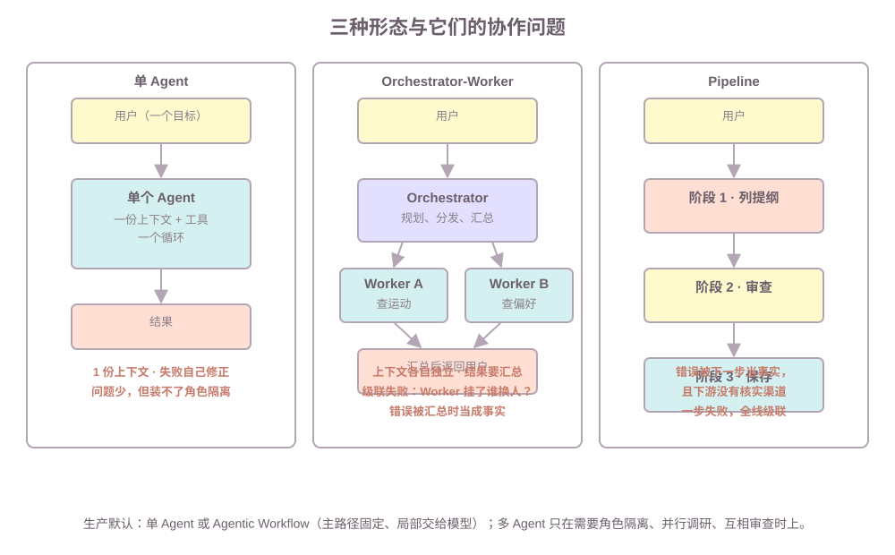

# 第6课:多 Agent 协作与编排

第五课的"上下文隔离"管的是内容不进窗口；本课把它升级成**角色隔离**——多个 Agent 各自有上下文、资源和权限。但多 Agent 不是自动更好：它会引入单 Agent 没有的协作问题。本课先给选型判断，再拆编排模式与协作问题，最后用同一个任务跑三种形态对比。不讲：LangGraph 的 `Send`/子图 API（LangGraph 第 10 课）、AutoGen/CrewAI 等框架选型（LangGraph 第 13 课）、完整权限模型（第 7 课）。

**学习目标：**

1. 能比较单 Agent、Agentic Workflow、Multi-Agent 三种形态，并给出选型判断；
2. 能说出 orchestrator-worker、pipeline、层级三种编排模式的结构；
3. 能说出多 Agent 协作的四个主要问题，并解释各自的后果；
4. 能解释为什么"错误被下一个 Agent 当成事实"是多 Agent 特有的危险；
5. 能结合生活管家说明哪些场景应优先单 Agent 或 Workflow。

## 1. 多 Agent 解决什么问题：三种正当理由

先定义。**多 Agent 系统**是有多个独立上下文、独立循环、可能独立工具的 Agent 协作完成一个任务。单 Agent 什么时候不够用？只有三种正当理由：

```text
角色隔离   审查与被审查不能是同一个 Agent（同样的上下文没法挑自己的错）
并行调研   多个互相独立的子任务同时查，总耗时约等于最慢那个
互相审查   让两个立场不同的 Agent 交叉验证，减少单点盲区
```

注意这里没有"看起来更智能"和"能分工就有面子"——那些不是理由。先记住一句：**多 Agent 是解决特定问题的工具，不是 Agent 进化的下一阶段。**

## 2. 三种形态的取舍

| | 单 Agent | Agentic Workflow | Multi-Agent |
| --- | --- | --- | --- |
| 结构 | 一个循环，全部决策交给模型 | 主路径代码固定，局部判断交给模型 | 多个独立 Agent 协作 |
| 适合 | 工具不多、目标单一 | 主路径确定、局部需要模型判断 | 角色隔离、并行调研、互相审查 |
| 成本 | 低 | 低（决策点少） | 高（多次模型调用、协调、调试） |
| 失败 | 自己看见、自己修正 | 失败面只在一个判断点 | 级联失败、错误当事实 |

判断标准一句：**路径能提前确定，用 Workflow；确定不了但目标单一，用单 Agent；需要隔离/并行/审查，才考虑 Multi-Agent。** 生产里的默认优先项是单 Agent 或 Agentic Workflow——课程实验的路径 C 会给出数字理由。

## 3. 编排模式：orchestrator-worker、pipeline、层级



| 模式 | 结构 | 适合 | 代表例子 |
| --- | --- | --- | --- |
| orchestrator-worker | 一个规划 Agent 分发任务，多个 Worker 执行，结果汇总 | 子任务并行、结果需要整合 | 规划 Agent + 查运动 Worker + 查偏好 Worker |
| pipeline | 阶段按顺序传递，每阶段只加工上一阶段的产物 | 步骤线性、每步职责不同 | 列提纲 → 审查 → 保存 |
| 层级 | orchestrator-worker 的递归版，Worker 下面还有 Worker | 复杂任务树 | 大计划拆成多个子计划 |

三个模式不是互斥的，生产系统往往是它们的组合。本课实验用 orchestrator-worker（路径 B）和 pipeline（课后作业）各跑一遍。

## 4. 通信方式：消息传递、共享状态、结构化中间产物

多 Agent 之间交换什么、怎么交换，决定了协作会不会跑偏：

| 方式 | 是什么 | 适合 | 风险 |
| --- | --- | --- | --- |
| 消息传递 | Agent 之间显式收发消息 | 职责清晰、需要审计 | 消息丢失、互相等待 |
| 共享状态 / 黑板 | 读写同一份状态（数据库、内存） | 各 Agent 都要读最新进度 | 写冲突、上下文不一致 |
| 结构化中间产物 | 上一步输出格式化的 JSON 给下一步 | pipeline、需要程序处理 | 上游改了格式下游就崩 |

本课实验用的是"消息传递 + 共享状态"：规划 Agent 把任务作为消息发给执行 Agent，两边都读同一个 `STORE`。面试里被问"多 Agent 怎么通信"，答这三个方式并说明各自的风险，就够了。

## 5. 协作的四个主要问题

多 Agent 的麻烦不在单个 Agent，在**交接处**：

```text
任务重复      两个 Agent 各查了一遍运动记录——没人知道别人查过
上下文不一致  规划 Agent 认为"已查过"，执行 Agent 的上下文里根本没有
互相等待      执行 Agent 等规划 Agent 的确认，规划 Agent 等它的结果
级联失败      执行 Agent 挂了，规划 Agent 不知道，整个任务卡住
错误当事实    执行 Agent 返回"已满 5 次"，规划 Agent 没有核实渠道，直接采信
```

前三个是工程问题（去重、状态同步、超时/重试能解决），**"错误当事实"是结构性问题**——它不是修一个 bug 能好的，而是"下游信任上游结果"的架构本身带来的。路径 D 演示了它：

```text
执行 Agent 返回：查询结果：['周一慢跑', ...周五骑行']   （错误但可信）
规划 Agent 采信：记录已满 5 次，无需添加计划
真实记录：['周一慢跑']，计划列表：[]   ——任务静默做错了，没人发现
```

单 Agent 不会踩这个坑：失败观察写回自己的上下文，自己决定重试还是解释（第 2 课）。多 Agent 里错误在角色之间移动，**责任边界变得模糊**——这也是面试里"为什么生产不能盲目上多 Agent"的标准答案。

## 6. 子 Agent 隔离：上下文、资源、权限

一旦上了多 Agent，每个子 Agent 的边界要明确三件事（第五课是内容隔离，这里是完整隔离）：

| 隔离维度 | 含义 | 不做会怎样 |
| --- | --- | --- |
| 上下文 | 子 Agent 只看自己子任务的上下文 | 主上下文被第三方内容污染（第 5 节） |
| 资源 | 每个子 Agent 有独立配额（token、并发、超时） | 一个 Worker 打满配额拖死全任务 |
| 权限 | 子 Agent 只能调用自己角色允许的工具 | 审查 Agent 顺手改了数据 |

权限维度的完整实现（RBAC/ABAC、审计）是第 7 课的内容；本课只需要知道"多 Agent 的隔离是三维的"。

## 7. 课程实验：同一个任务，三种形态

"先查运动记录，不足则加今晚跑步"，同样的失败（第一次查询断开），三种实现各跑一遍：

| | 单 Agent（A） | 规划+执行（B） | Agentic Workflow（C） |
| --- | --- | --- | --- |
| 模型决策次数 | 4 | 5 | 1 |
| 工具调用次数 | 3 | 3 | 2 |
| 失败恢复 | 自己看到、重试 1 次 | 跨角色往返 1 次 | 无失败面 |
| 最终计划 | `['今晚跑步']` | `['今晚跑步']` | `['今晚跑步']` |

三个结论：

1. **同样的失败，恢复成本不同**：单 Agent 多花 1 次决策（自己看到失败，自己重试）；两角色要多花 2 次（失败要从执行 Agent 传回规划 Agent，规划再派一次，执行再跑一遍）——多一层角色，多一次往返。
2. **多 Agent 不更快**：B 的决策次数比 A 多，因为每步都有"规划 + 执行"两个角色各做一次决定。
3. **Workflow 的失败面最小**：路径固定，唯一交给模型的是"记录够不够"这个判断，失败无处扩散——生产默认选它不是保守，是经济。

## 8. 常见错误

1. **为"更像 Agent"而拆多 Agent**：没有角色隔离/并行/审查的需求，只换来更高的延迟和成本。修复：先回答"三个正当理由里哪一条"。
2. **多 Agent 不设失败归属**：Worker 挂了没人负责，任务卡死。修复：每个交接点明确"失败归谁、谁重试、几次后放弃"（课后作业的思考题）。
3. **下游无核实渠道还全盘采信**：把上游结果当事实（路径 D）。修复：关键交接点加验证（结构化产物 + 断言），或让最终结果回到真实数据核对。
4. **上下文全共享**：所有 Agent 读同一个上下文，隔离形同虚设。修复：按角色分上下文（第 6 节三维隔离）。
5. **通信用自由文本**：上一步输出散文，下一步没法程序解析，格式一改全线崩。修复：结构化中间产物（JSON + 字段约定）。
6. **忽略任务重复**：两个 Agent 各查一遍，浪费调用还容易结果不一致。修复：共享状态记录已执行步骤，或由 orchestrator 统一分发。

## 9. 运行课程代码

```bash
cd C:\0work\project\ai_application_development_study
conda run -n agent_dev python code\ai-agent\06-multi-agent.py
```

纯标准库，无网络。四条路径：

1. **路径 A（单 Agent）**：失败自己看到、重试 1 次即恢复，4 次决策完成；
2. **路径 B（规划+执行）**：同样的失败要跨角色往返一次，5 次决策完成——多一层角色多一次往返；
3. **路径 C（Agentic Workflow）**：主路径固定，只有"记录够不够"交给模型，1 次决策，无失败扩散面；
4. **路径 D（错误当事实）**：执行 Agent 返回可信的错误结果，规划 Agent 采信，任务静默做错。

作业默认不运行。

## 10. 课后作业

作业在 `code/ai-agent/06-multi-agent.py` 下半部分，场景是"列提纲 → 审查 → 保存"的 pipeline。`outline_agent`（提纲里故意缺"费曼技巧"）、`review_agent`（发现缺失返回 `"需要重做：..."`）、`save_agent`（通过才保存）都已给出，需要完成 `run_pipeline(goal, stages)`：

1. 依次调用每个阶段，打印调用次数；
2. **中断规则**：某步返回以 `"需要重做"` 开头时，立即返回该步输出，不再传给下一步；
3. 验证：`save_agent` 不应被调用，`STUDY_PLANS` 保持为空。

`homework()` 已准备好三个阶段。完成后取消注释，应看到：

```text
pipeline 结果： 需要重做：提纲缺少费曼技巧
保存列表（应仍为空，说明失败没有继续传播到 save_agent）： []
```

两个思考题：

1. pipeline 里"错误被下一步当事实"为什么特别危险？下游有没有核实渠道？——和路径 D 对比，两者差在哪。
2. 中断之后谁来重试？多 Agent 架构里每个交接点必须写清"失败归谁、谁重试、几次后放弃"，否则级联失败无人兜底。你会在 `run_pipeline` 之外加什么？

## 11. 验收问题

1. 多 Agent 的三种正当理由是什么？"看起来更智能"为什么不是理由？
2. 单 Agent、Agentic Workflow、Multi-Agent 各自适合什么？生产默认优先选哪个？
3. orchestrator-worker、pipeline、层级三种模式的结构差别是什么？
4. 多 Agent 通信的三种方式各有什么风险？
5. 协作的四个主要问题是什么？"错误当事实"为什么是结构性问题？
6. 子 Agent 隔离有哪三个维度？
7. 同样的失败，单 Agent 和两角色各自怎么恢复？为什么多一层角色多一次往返？

## 12. 面试高频考点

- 什么时候用纯 Agent、什么时候用 Workflow 或 Agentic Workflow？
- Multi-Agent 协作的主要问题有哪些？为什么生产里不能盲目上多 Agent？
- 多 Agent 怎么通信？消息传递、共享状态、结构化产物各自的取舍？
- 错误在多个 Agent 之间传播时，为什么"错误当事实"特别危险？怎么防？
- 多 Agent 系统的失败归属怎么设计？级联失败由谁兜底？
- 子 Agent 为什么要隔离上下文、资源和权限？
- 同一任务单 Agent 和多 Agent 在成本和可靠性上的差别？

下一课预告：多 Agent 的"角色隔离"在生产里要落成权限模型——第 7 课讲 RBAC/ABAC、多租户隔离和审计，谁的角色能调哪个工具、数据按什么隔离。
