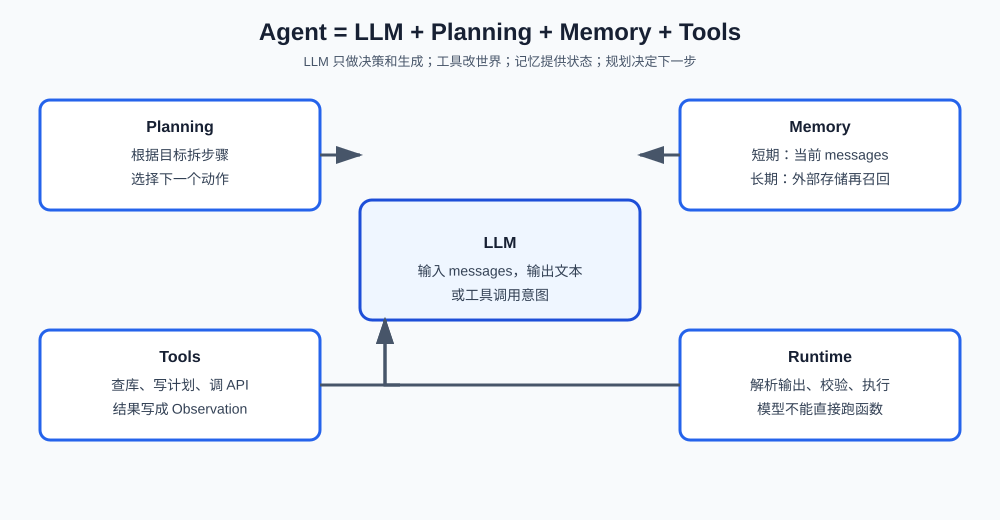

# 第一课：Agent 是什么

本课分三块：Agent 和相邻概念的差别；四个组成部件；用 OpenAI 兼容接口调用 LLM。Loop、ReAct、工具注册放到后面的课。不引入 LangChain 或 LangGraph。

**学习目标：**

1. 能定义 AI Agent，并说明它和 Chatbot、传统程序、Workflow 的差别；
2. 能按 `LLM + Planning + Memory + Tools` 说出每个部件做什么、输入输出是什么；
3. 能写出 `OpenAI` 构造器和 `chat.completions.create` 的常用签名，组装 Prompt（`messages`），并从返回值取出助手文本。

## 1. Agent 是什么，以及和相邻概念的区别

AI Agent 是能感知当前状态、做出决策并执行动作、直到任务结束的软件系统。用户给出目标；模型选择下一步；后端工具真正改外部世界。

生活管家的一句请求就够用来对照：“帮我看看这周运动够不够，不够就加一条今晚跑步的计划。” 这里既要理解句子，也可能要查记录、写计划。

判断标准只有一句：**下一步由谁决定，以及会不会改外部世界。**

```text
传统程序   开发者写死调用哪个函数。可预测，处理不了开放目标。
Chatbot    模型只生成文本。默认不查库、不写入。
Workflow   开发者写死步骤图。节点里可以调用 LLM，边是固定的。
Agent      模型选择下一步。运行时执行工具，把观察写回后再决策。
```

和 Chatbot 的差别不在“会不会说话”，而在会不会根据观察继续行动。Prompt 里写“你是管家”不会变成 Agent。

和传统程序的差别：程序的 `if/else` 在编码时写死；Agent 的分支在运行时由模型选择。

和 Workflow 的差别：Workflow 也可以在某个节点调用 LLM（例如把自然语言解析成查询条件），但“先查再写、失败去哪”仍由开发者画边。**用了 LLM ≠ 是 Agent。** 路径能提前确定，用 Workflow；确定不了，用 Agent；两者都有，用 Agentic Workflow（主路径固定，局部允许选择）。

## 2. Agent 的组成

常用拆分：

```text
Agent = LLM + Planning + Memory + Tools
```

这是四个职责，不是四个要安装的库。缺 Tools，系统停在给建议；缺 Memory，稍长的任务就会忘前面说过什么；缺 Planning，模型只会一次生成，不会根据观察改方向。LLM 本身仍然不能直接执行你的 Python 函数，中间要有运行时。



### 2.1 LLM

负责在当前上下文里做决策和生成。它只看见文本和结构化消息。

- 输入：系统规则、用户目标、历史消息、工具定义、上一步观察。
- 输出：最终回复，或一次工具调用意图（名称 + 参数）。
- 副作用：无。

第 3 节的 `chat.completions.create` 就是把 LLM 接到你代码里的那一层。

### 2.2 Planning

负责“下一步做什么”。可以每步只选一个动作，也可以先列出计划再执行。规划来自提示词、输出格式、工具列表和循环策略，不是模型内部的独立模块。具体策略（ReAct、Plan-and-Execute）第 2 课再讲。

### 2.3 Memory

- 短期记忆：当前 `messages`、本轮工具结果，用来保持对话连续。
- 长期记忆：跨会话的偏好和事实，存在外部，用时再放进 Prompt。

把聊天记录无筛选地全部拼进 Prompt，还不是一套记忆系统。写入、召回、过期第 4 课展开。

### 2.4 Tools

负责查数据、写计划、调外部 API。模型只输出意图；运行时校验并执行；结果必须写成 Observation 追加进上下文，否则下一步没有依据。因此模型返回的 JSON 不是函数调用。

## 3. 调用 LLM：OpenAI 兼容接口和 Prompt

Agent 每一轮决策，工程上都落成一次 Chat Completions 请求。DeepSeek 兼容 OpenAI 的请求格式：Python 使用 `openai` 包，关键是改 `base_url`、`api_key` 和 `model`。

`openai` 不是标准库：

```bash
conda run -n agent_dev pip install openai
```

密钥放环境变量 `DEEPSEEK_API_KEY`，不要写进仓库。

### 3.1 模块和对象关系

```text
openai.OpenAI
  -> chat
       -> completions
            -> create(...)   发一次对话请求，返回 ChatCompletion
```

`OpenAI` 是客户端，构造时不访问网络。真正发请求的是 `client.chat.completions.create`。

### 3.2 构造客户端

这是 `openai.OpenAI` 的构造方法，不是你自己定义的函数。SDK 里还有 `timeout`、`max_retries`、`organization` 等参数；本课只用下面两个。写成教学子集如下（完整签名以你安装的 `openai` 包为准）：

```python
class OpenAI:
    def __init__(
        self,
        api_key: str | None = None,
        *,
        base_url: str | httpx.URL | None = None,
    ) -> None: ...
```

| 参数 | 类型 | 默认 | 含义 |
| --- | --- | --- | --- |
| `api_key` | `str \| None` | 环境变量 `OPENAI_API_KEY` | 调用 DeepSeek 时应显式传入 `os.environ["DEEPSEEK_API_KEY"]`，不要依赖默认的 OpenAI 变量名 |
| `base_url` | `str \| None` | OpenAI 官方地址 | DeepSeek 为 `"https://api.deepseek.com"` |

返回值标注是 `None`：构造器初始化实例，真正拿到的是 `OpenAI` 对象。构造时不发网络请求。只换 Key、不换 `base_url`，后续请求仍打到 OpenAI。

```python
import os
from openai import OpenAI

client = OpenAI(
    api_key=os.environ["DEEPSEEK_API_KEY"],
    base_url="https://api.deepseek.com",
)
```

### 3.3 `create`：发一轮对话

完整常用形式：

```python
def create(
    self,
    *,
    messages: list[dict[str, str]],
    model: str,
    temperature: float | None = None,
    max_tokens: int | None = None,
    stream: bool | None = False,
) -> ChatCompletion: ...
```

实际 SDK 还有更多关键字参数；本课只用上面这些。参数必须用关键字传入。

| 参数            | 类型                     | 必填  | 默认      | 含义                                                                      |
| ------------- | ---------------------- | --- | ------- | ----------------------------------------------------------------------- |
| `messages`    | `list[dict[str, str]]` | 是   | 无       | Prompt，见下一小节                                                            |
| `model`       | `str`                  | 是   | 无       | 必须是当前 `base_url` 下真实存在的 id。DeepSeek 常用 `"deepseek-chat"`，也可用下一小节的列表接口核对 |
| `temperature` | `float \| None`        | 否   | 模型默认    | 越大越发散，生活管家短答可用 `0` 或 `0.3`                                              |
| `max_tokens`  | `int \| None`          | 否   | 模型默认    | 限制本次生成长度，防止回复过长                                                         |
| `stream`      | `bool \| None`         | 否   | `False` | `True` 时返回的是流，不是一次性 `ChatCompletion`。本课保持 `False`                       |

返回值类型是 `ChatCompletion`，不是 `str`。助手文本在：

```python
text: str | None = completion.choices[0].message.content
```

| 路径 | 含义 |
| --- | --- |
| `choices` | 候选列表，非流式通常只有一项 |
| `choices[0].message.role` | 一般为 `"assistant"` |
| `choices[0].message.content` | 生成的文本，偶发为 `None` |

密钥无效、余额不足、网络失败时 SDK 抛异常，不要假设一定有 `content`。本课示例在 `content is None` 时抛 `RuntimeError`。

### 3.4 列出当前 `base_url` 下的可用模型

`model` 不能随便写。客户端已经绑定了 `base_url` 和 `api_key` 之后，用同一套凭据请求 **List Models**，看这个供应商当前允许哪些 id。

HTTP 形态（OpenAI 兼容，DeepSeek 文档为 `GET https://api.deepseek.com/models`）：

```text
GET {base_url}/models
Authorization: Bearer <api_key>
```

SDK 对应：

```python
def list(self) -> SyncPage[Model]: ...
```

无必填参数。返回可迭代的模型页，每一项至少有 `id`（字符串，可原样传给 `create` 的 `model`）。

```python
def list_model_ids(client: OpenAI) -> list[str]:
    """列出当前客户端 base_url 下的模型 id。

    使用构造 client 时的 api_key 与 base_url，不会改用别的供应商。
    失败时由 SDK 抛异常（密钥错误、网络错误等）。
    """
    return [item.id for item in client.models.list()]
```

换供应商时先换 `base_url` 再 `list()`，不要把 OpenAI 的模型名拿到 DeepSeek 上用。列表里出现的 id 也不等于都适合 Chat Completions，仍以供应商文档为准。

### 3.5 Prompt 的形式：`messages`

对 Chat Completions 来说，Prompt 不是单独一个长字符串，而是 **消息列表**。每一项至少两个键：

```python
{"role": "system" | "user" | "assistant", "content": "..."}
```

| `role` | 谁在说话 | 放什么 |
| --- | --- | --- |
| `system` | 开发者设定的规则 | 身份、任务、输出格式、禁止事项。相对稳定，不要每轮改成长文 |
| `user` | 用户 | 本轮问题或新指令 |
| `assistant` | 模型已经说过的话 | 多轮对话时，必须把上一轮助手回复原样加回去，模型才能“记得” |

一问一答：

```python
messages = [
    {"role": "system", "content": "你是生活管家。只用一两句中文回答，不要列表。"},
    {"role": "user", "content": "这周只跑了一次，还要不要加今晚的计划？"},
]
```

多轮必须按时间顺序追加，不能只发最新一句：

```python
messages = [
    {"role": "system", "content": "你是生活管家。只用一两句中文回答。"},
    {"role": "user", "content": "这周跑了一次。"},
    {"role": "assistant", "content": "偏少。要不要今晚补一次慢跑？"},
    {"role": "user", "content": "好，帮我拟一条计划标题。"},
]
```

写 `system` 时可以用四要素检查是否写全，但发给接口的仍是上面的列表，不是四段标题：

```text
Role    你是谁
Task    这一次要完成什么
Context 已知事实（也可放在后续 user 消息里）
Format  短答、JSON、禁止事项
```

工具结果以后会作为新消息进列表；本课先掌握 `system` / `user` / `assistant`。

### 3.6 最小可运行调用

```python
completion = client.chat.completions.create(
    model="deepseek-chat",
    messages=messages,
    temperature=0.3,
)
text = completion.choices[0].message.content
```

课程示例里的 `demo_chat(messages)` 把“创建客户端、调用 `create`、取出文本”收成一步，输入是已经组好的 `messages`，返回 `str`。它仍然只生成文本：没有 Tools，就还不是 Agent。作业中的 `chat` 需要你补上参数校验后再做同样的调用。

未设置 `DEEPSEEK_API_KEY` 或未安装 `openai` 时，默认入口会跳过真实请求并打印原因。

## 4. 运行课程代码

```bash
cd /Users/yyma/workspace/agents/lifestyle-manager-study
export DEEPSEEK_API_KEY=你的密钥
conda run -n agent_dev python code/ai-agent/ai_agent_lesson01.py
```

设置密钥后，会打印一轮 `system` + `user` 的请求，以及模型返回的一句话。作业默认不运行。

## 5. 课后作业

作业在 `code/ai-agent/ai_agent_lesson01.py` 下半部分。完成一个 **两轮** 生活运动对话，而不是再抄一遍单轮示例。

需要完成：

1. `chat(messages: list[dict[str, str]]) -> str`  
   - `messages` 不能为空，否则 `ValueError`；  
   - 每条必须含 `role`、`content`，`role` 只能是 `system` / `user` / `assistant`；  
   - 从 `DEEPSEEK_API_KEY` 读密钥，缺失则 `RuntimeError`；  
   - `base_url="https://api.deepseek.com"`，`model="deepseek-chat"`；  
   - 返回助手文本，`content` 为 `None` 时 `RuntimeError`。
2. `build_second_turn(first_user: str, first_reply: str, second_user: str) -> list[dict[str, str]]`  
   - 组出四条消息：固定中文短答的生活管家 `system`，再按顺序接上第一轮 user、第一轮 assistant、第二轮 user；  
   - 任一字符串去空白后为空则 `ValueError`。
3. 在 `homework()` 里：第一轮问“这周只跑步一次，够不够”；把回复和“那帮我起一个今晚补练的标题”交给 `build_second_turn`，再 `chat` 一次并打印两轮原文。

不要在 `chat` 里写死用户问题。思考：第二轮如果不把 `assistant` 历史加回去，模型还知不知道“只跑了一次”？

## 6. 验收问题

1. Agent 和 Chatbot、Workflow 的差别分别是什么？判断标准是哪一句？
2. 缺 Tools、缺 Memory、缺 Planning 时，系统会退化成什么样？
3. 为什么 LLM 返回的文本或 JSON 不能直接当成 Python 函数已经执行？
4. `OpenAI(...)` 和 `chat.completions.create(...)` 各自的必填参数、返回值是什么？文本从哪条路径取出？
5. Prompt 在这个接口里为什么是 `messages` 列表而不是一个字符串？`system`、`user`、`assistant` 分别何时出现？
6. 多轮对话时，为什么必须把上一轮助手回复追加进下一次请求？

## 7. 面试高频考点

- AI Agent 是什么？和 Chatbot 的核心差别是什么？
- Agent 和传统程序、Workflow 怎么区分？“用了 LLM”是不是就是 Agent？
- 什么时候用 Agent，什么时候用 Workflow 或 Agentic Workflow？
- `Agent = LLM + Planning + Memory + Tools` 怎么理解？缺 Tools / Memory / Planning 分别会怎样？
- 模型为什么不能直接执行后端函数？工具结果为什么必须写成 Observation？
- 调用 DeepSeek 时为什么要改 `base_url`？只换 `api_key` 会请求到哪里？
- `OpenAI(...)` 和 `chat.completions.create(...)` 各自做什么、返回什么？助手文本从哪取？
- Chat Completions 的 Prompt 为什么是 `messages`？`system` / `user` / `assistant` 分别放什么？
- 多轮对话为什么必须把上一轮 `assistant` 加回去？
- 如何列出某个 `base_url` 下的可用模型？`model` 写错通常是什么现象？
