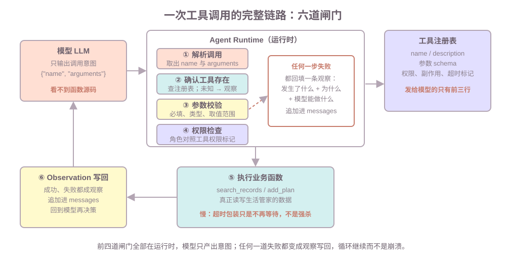

# 第三课：工具系统：注册、描述、调用链路与可靠性

第二课的循环里，`tools` 只是一个 `dict[str, object]`——名字到函数。真实生产里这不够：模型怎么知道有哪些工具？参数错了谁拦？谁能调删除？执行卡住怎么办？本课把那个 dict 补成工具系统。不讲：完整权限体系（第 7 课）、进程级强杀与沙盒（第 8 课）、多 Agent 编排（第 6 课）、`ToolNode` 等 LangGraph API（LangGraph 第 4、8 课）。

**学习目标：**

1. 能列出一次工具调用经过的六个环节，并指出每一步由谁负责；
2. 能说明模型"看得到什么、看不到什么"，写出含"何时用、何时不用、失败语义"的工具描述；
3. 对参数错误、无权限、执行异常、超时四类失败，能说明各自回填什么观察、什么时候改用快速失败；
4. 能给有副作用的工具设计幂等键，并解释它挡住了什么；
5. 能区分 Function Calling、MCP、Skills 三个词。

## 1. 工具系统是什么：模型与业务函数之间的一层

第一课说过：模型只输出意图，真正执行的是运行时。第二课把这句话落成了循环，但循环里的工具调用只有一行：

```python
func = tools.get(decision.tool_name)          # 只检查"存不存在"
observation = func(**decision.tool_args)      # 直接执行，没有任何防护
```

生产里这段代码会撞上四个真实问题：

```text
模型怎么知道有哪些工具、每个工具干什么？      -> 需要注册与描述
模型给的参数少了、取值离谱怎么办？            -> 需要参数校验
谁能调 delete_records 这种危险工具？          -> 需要权限检查
工具执行三秒没返回、或者被重试了两次怎么办？  -> 需要超时与幂等
```

**工具系统就是模型与业务函数之间的一层，负责"查得到、验得过、打得通、败得起"。** 它不是某个框架的类名——本课用普通的 `dict` 加函数实现同样的机制。判断标准：模型侧永远只产出意图；查、验、打、败四件事全部由这一层完成。

## 2. 工具注册：模型只看得到三样东西

先定义两个词。**schema**（结构说明）：描述参数有哪些字段、什么类型、哪些必填、取值范围，它和函数源码是两回事。**副作用**：会改变外部世界的操作（写库、删数据、发消息），与只读相对。

课程代码里的注册信息是一个 `ToolSpec`，六个字段各有用途：

| 注册项                                 | 给谁看      | 作用                          |
| ----------------------------------- | -------- | --------------------------- |
| `name`                              | 模型 + 运行时 | 调用意图里的工具名，运行时靠它查函数          |
| `description`                       | 模型       | 何时用、何时不用、参数含义、失败语义——选型的唯一依据 |
| 参数 schema（`required`、`value_rules`） | 模型 + 校验  | 有哪些参数、必填、取值范围               |
| `permission`                        | 运行时      | 什么角色能调；第 7 课展开成完整权限体系       |
| `side_effects`                      | 运行时      | 是否写数据；决定要不要幂等键、要不要审批        |
| `timeout_s`                         | 运行时      | 执行最多等多久                     |

关键机制一句话：**发给模型请求的只有 name、description 和参数 schema；函数源码、数据库、注册表其余字段一概不出进程。** 模型选工具靠的是"读说明书"，不是"看代码"。

所以 description 是唯一依据，它必须写四件事：

| 必须写 | 反例 | 为什么 |
| --- | --- | --- |
| 何时用 | "查询记录" | 模型不知道它覆盖什么 |
| 何时不用 | 不写 | 和相邻工具分不开，会选错或犹豫 |
| 参数含义与格式 | 不写参数说明 | 模型只能猜 `kind` 该填什么 |
| 失败语义 | 不写 | 模型不知道失败后该重试还是放弃 |

同一个查询，两份描述放在一起对比：

| | 含糊描述 | 清晰描述 |
| --- | --- | --- |
| `search_records` | 查询记录 | 查询运动记录，例如跑步、健身的条数与明细；**不查询用户偏好** |
| 模型面对"查一下这周运动" | 两个工具都不像，选不出或瞎选 | 命中 `search_records` |
| 模型面对"查偏好设置" | 同样含糊 | 被显式排除，转向 `search_preferences` |

课程代码路径 A 会把这个差别演示出来：假模型只在描述里找关键词——真实模型靠语义，机制相同，依据都只有描述。

## 3. 一次工具调用的完整链路：六道闸门



```text
模型输出 {name, arguments}
    -> ① 解析调用         运行时：取出工具名与参数
    -> ② 确认工具存在      运行时：查注册表
    -> ③ 参数校验          运行时：必填、类型、取值范围
    -> ④ 权限检查          运行时：角色对照权限标记
    -> ⑤ 执行业务函数      业务函数：真正读写数据（带超时）
    -> ⑥ 包装 Observation  运行时：成功失败都写成观察，追加进 messages
```

| 环节 | 谁做 | 失败时返回给模型 |
| --- | --- | --- |
| ① 解析调用 | 运行时 | 输出非法 JSON 或未知字段 → 解析失败观察（本课假模型直接给结构化输出，真实接口由 SDK 解析 `tool_calls`） |
| ② 确认工具存在 | 运行时 | `"未知工具：xxx"`（第二课已见） |
| ③ 参数校验 | 运行时 | `"参数校验失败：缺少必填参数 title"` |
| ④ 权限检查 | 运行时 | `"权限不足：… 需要 admin 权限"` |
| ⑤ 执行业务函数 | 业务函数 | 异常 → `"工具执行失败：…"`；超时 → `"工具超时：…"` |
| ⑥ 包装 Observation | 运行时 | 成功结果也走这一步；追加、不覆盖（第二课的规则） |

对照第二课：`run_loop` 里的 `tools.get(...)` 只做了第②步，③④和超时、幂等全都没有。**第二课的循环是骨架，本课补上闸门。** 前四道闸门全部在运行时——"模型不能直接执行后端函数"就是在这里变成代码的。

课程代码的 `execute_tool` 教学签名（本课子集）：

```python
def execute_tool(
    registry: dict[str, ToolSpec],
    name: str,
    args: dict[str, str],
    user_role: str = "member",
    strict: bool = False,
) -> str: ...
```

| 参数 | 类型 | 必填 | 默认 | 含义 |
| --- | --- | --- | --- | --- |
| `registry` | `dict[str, ToolSpec]` | 是 | 无 | 工具注册表 |
| `name` | `str` | 是 | 无 | 模型想调的工具名 |
| `args` | `dict[str, str]` | 是 | 无 | 模型给的参数 |
| `user_role` | `str` | 否 | `"member"` | 当前用户角色，和 `spec.permission` 对照 |
| `strict` | `bool` | 否 | `False` | `True` 时执行异常向上抛出（见第 4 节） |

返回值：写回上下文的观察字符串。副作用：可能调用工具改 `STORE`。配套的 `validate_args(spec, args)` 按 `spec.required` 查缺漏、按 `spec.value_rules` 查取值范围，通过返回 `None`。

## 4. 失败处理：回填观察与快速失败

第二课说过"失败也是一条观察"。本课把"失败"拆开——四类失败在六道闸门的不同位置被拦下：

| 失败         | 在哪道闸门被拦 | 回填示例                                             |
| ---------- | ------- | ------------------------------------------------ |
| 缺必填 / 取值非法 | ③ 校验    | `参数校验失败：参数 kind='运动' 不在允许范围 ('health', 'study')` |
| 无权限        | ④ 权限    | `权限不足：delete_records 需要 admin 权限，当前角色 member`    |
| 业务异常       | ⑤ 执行    | `工具执行失败：ValueError: 数据库连接断开`                     |
| 等不到结果      | ⑤ 超时包装  | `工具超时：slow_search 超过 0.5 秒未返回（副作用可能已发生）`         |

处理失败有两种策略，先给判断标准：**模型还能为这次失败做点什么——能，就回填；不能，就抛出。**

|        | 回填观察（默认）             | 快速失败（抛出）              |
| ------ | -------------------- | --------------------- |
| 循环是否继续 | 继续，模型可以换参数、换工具或向用户解释 | 终止，交给人处理              |
| 适合的失败  | 参数错、权限不足、业务异常、超时     | 密钥无效、配额烧尽、数据损坏、内部 bug |
| 谁来处理   | 模型                   | 人                     |

回填不是把错误原样丢回去，一段合格的失败观察包含三件事：**发生了什么、为什么、模型能做什么**。只回一个 `"error"`，模型只能瞎猜；把完整堆栈塞回去，既泄露内部路径又占上下文——提炼成一句话。

超时值得单独说。代码里的包装机制：

```python
pool = ThreadPoolExecutor(max_workers=1)   # 标准库线程池：开一个单线程池
future = pool.submit(spec.func, **args)    # 提交执行，立即返回 future（还没完成的执行凭证）
result = future.result(timeout=0.5)        # 最多等 0.5 秒，超时抛 TimeoutError
pool.shutdown(wait=False)                  # 不等后台线程收尾
```

诚实地说：**超时只是运行时不再等待，不是强杀。** 后台线程还会继续跑完，副作用可能已经发生。两个补救：写工具配幂等键（下一节），进程级强杀交给第 8 课的沙盒。

## 5. 幂等键：让重试不重做

先看重试从哪来——它不是小概率事件：

```text
模型把同一次调用又输出了一遍     第二课路径 B 的 repeat 现象
网络层自动重试                   HTTP 客户端、SDK 都会做
用户重复提交                     手抖、刷新页面
```

没有防护时，`add_plan("今晚跑步")` 被重试两次，计划列表里就有两条。先定义：**幂等**——同一请求执行一次和执行多次，结果相同；**幂等键**——请求自带的唯一编号，运行时靠它认出"这是刚才那次"。

```text
首次  request_id=req-001  查重：没有   -> 执行写入 -> 记下 req-001 -> 已添加计划
重试  request_id=req-001  查重：命中   -> 不执行   -> 返回"重复请求，已有计划"
```

课程代码的 `add_plan_idem` 就是这套逻辑：`_PROCESSED` 字典记下处理过的请求号，命中直接返回上次结果，不重复写入。

设计幂等键只有一条铁则：**键必须来自请求本身**——客户端生成的 UUID，或随模型输出一起携带。不能由运行时自增生成：重试一次就变成一个新键，等于白做。键的生命周期覆盖"同一次用户意图"：这个意图被重试多少次，键都不变。

哪些工具需要配：`side_effects=True` 的写工具必配；查询天然幂等，查三次和查一次结果一样。生产里"查重表"常放在 Redis（`SET NX` + 过期时间），机制细节是 redis 第 10 课的内容。

还有一个设计选择：幂等检查放**工具内部**（像 `add_plan_idem`）还是放**链路层**（像课后作业要求的 `execute_study_tool`）——两种都对，差别在第 10 节思考题里。

## 6. 工具结果处理与编排

**结果处理。** 上下文是稀缺资源（第 5 课展开），工具返回值直接进 `messages`，所以：

- **截断**：几千行的查询结果压成"前 20 条 + 共 N 条"，模型需要更多时带过滤条件二次查询；
- **结构化**：返回一行 JSON（`{"count": 3, "items": [...]}`）而不是散文，模型取字段不靠猜。

**编排**：一次任务里多个工具调用怎么组织，由运行时完成：

| 编排  | 适合          | 生活管家的例子             |
| --- | ----------- | ------------------- |
| 串行  | 后一步需要前一步的结果 | 先查记录，再决定写什么计划       |
| 并行  | 几个查询互不依赖    | 同时查运动和偏好，总耗时约等于最慢那个 |
| 条件  | 查到了才写       | 查到未掌握的概念才加复习        |

并行多说一句：模型可以一次输出多个工具调用，运行时并行执行、按 `tool_call_id` 一一对应回填——机制见 LangGraph 第 4 课，`Send` 并行编排见 LangGraph 第 10 课。分工仍然是：**模型声明"要哪些"，运行时决定"怎么跑"。**

## 7. Function Calling、MCP、Skills 的边界

这三个词面试里经常被放在一起问，它们的层次完全不同：

| | 是什么 | 谁提供 | 解决什么问题 |
| --- | --- | --- | --- |
| Function Calling | 模型输出结构化调用意图的协议 | 模型厂商 | "模型怎么说要调工具" |
| MCP | 把外部工具/资源以标准协议暴露给运行时的连接规范 | 开放协议，工具方实现服务端 | M 个应用 × N 个工具，不用两两定制对接 |
| Skills | 可复用的任务说明书 / 能力包 | 开发者编写 | 把"某类任务怎么做"沉淀下来，给模型读 |

一句话判断：**FC 管"怎么说"，MCP 管"从哪来、怎么连"，Skills 管"怎么做"。** 无论工具来自哪里，本课的六道闸门都一样：模型仍只输出意图，运行时仍要查、验、鉴、执行、回填。

## 8. 常见错误

1. **description 缺"何时不用"**：现象是两个相似工具来回横跳或选错。原因：模型只有描述可读。修复：每份描述写明覆盖范围和排除项（路径 A 的对比）。
2. **只查存在、不校验取值**：`kind="运动"` 落库变成脏数据，后患在查询时才爆。修复：注册表带 `required` 和 `value_rules`，闸门③统一拦。
3. **把异常堆栈原样回填**：泄露内部路径，还占掉几百 token 上下文。修复：提炼成"异常类型 + 一句话原因"。
4. **以为超时 = 任务停止**：线程还在跑，计划被写了两次。修复：写工具配幂等键；真要强杀用第 8 课的沙盒。
5. **幂等键由运行时自增**：重试一次生成一个新键，防了个寂寞。修复：键来自客户端 UUID 或模型输出，重试不变。
6. **工具整表返回**：几千行直接进 `messages`，后面的决策质量随上下文一起劣化。修复：截断 + 结构化 + 带过滤二次查询。

## 9. 运行课程代码

```bash
cd C:\0work\project\ai_application_development_study
conda run -n agent_dev python code\ai-agent\ai_agent_lesson03.py
```

纯标准库，不装 `openai`、不访问网络。四条路径：

1. **路径 A（描述决定选工具）**：同一目标，含糊描述选不出工具，清晰描述命中 `search_records`；
2. **路径 B（失败也是观察）**：取值非法、缺参数、无权限、执行异常各回填一条观察，最后演示 `strict=True` 快速失败；
3. **路径 C（超时包装）**：慢查询被 0.5 秒超时打断，打印"后台线程还会收尾一会儿"——运行时会停顿约 1.5 秒才退出，这正好说明超时不是强杀；
4. **路径 D（幂等键）**：同一请求号重试不重复执行，新请求号正常写入，计划列表最终两条。

作业默认不运行。

## 10. 课后作业

作业在 `code/ai-agent/ai_agent_lesson03.py` 下半部分，场景换成学习资料（延续第二课作业的 `search_notes` / `add_review`）。`STUDY_REGISTRY` 已经配好（描述、必填项、副作用标记都齐了），需要完成 `execute_study_tool(name, args)`，把六道闸门自己走一遍：

1. 查 `STUDY_REGISTRY`，未知工具返回 `"未知工具：..."`；
2. 参数校验：按 `spec.required` 检查，缺参或空白返回 `"参数校验失败：..."`；
3. **幂等检查**：`add_review` 的 `request_id` 已在 `STUDY_PROCESSED` 里时，返回 `"重复请求：...（不重复执行）"`；
4. 执行前先把 `request_id` 从 `args` 里取出——它是链路层字段，不要传给 `add_review` 本身；
5. 工具抛异常时返回 `"工具执行失败：..."`，不要让 `homework()` 崩溃。

完成后取消注释 `homework()`，应看到五次调用的观察：一次校验失败、两次 `req-001`（第二次是重复请求）、一次正常写入、一次异常回填；复习列表最终只有两条。

两个思考题：

1. `request_id` 为什么不能用"模型第几步"生成？提示：重试发生在第几步会变吗？
2. 主示例把幂等放在工具内部（`add_plan_idem`），作业要求放在链路层——两种各保护到谁？换成团队里十个人写的工具，你会选哪种？

## 11. 验收问题

1. 列出一次工具调用的六个环节。哪几步模型参与了？——答案是零步，解释为什么。
2. 模型看得到工具的什么、看不到什么？description 里缺"何时不用"会发生什么？
3. 参数错误、无权限、执行异常分别该回填什么？什么样的失败应该改成快速失败？
4. 一段合格的失败观察包含哪三件事？为什么不能只回 `"error"`？
5. 超时之后任务真的停止了吗？副作用靠什么兜底？
6. 幂等键为什么必须来自请求本身？查询工具需不需要配幂等键？
7. Function Calling、MCP、Skills 分别解决什么问题？一句话说出三者的差别。

## 12. 面试高频考点

- 一次工具调用由哪些组件完成？模型在链路里负责哪一步？
- 工具 description 为什么关键？合格的描述要包含哪四件事？
- 工具调用失败后应该返回给模型什么？为什么不能只返回 `"error"` 或原样堆栈？
- 什么时候回填观察、什么时候快速失败？判断标准是什么？
- 工具超时是怎么实现的？超时后副作用怎么处理？
- 工具幂等怎么设计？幂等键为什么必须来自请求本身？重试场景下它挡住了什么？
- Function Calling、MCP、Skills 的边界？MCP 解决了什么问题？
- 工具返回结果很长怎么处理？为什么上下文是稀缺资源？
- 多个工具能并行调用吗？由谁声明、由谁执行？

下一课预告：工具结果只是短期记忆的一小块。第 4 课讲记忆系统——跨会话的偏好和事实怎么存、怎么召回，以及一条错误的长期记忆为什么会带偏后面所有的决策。
