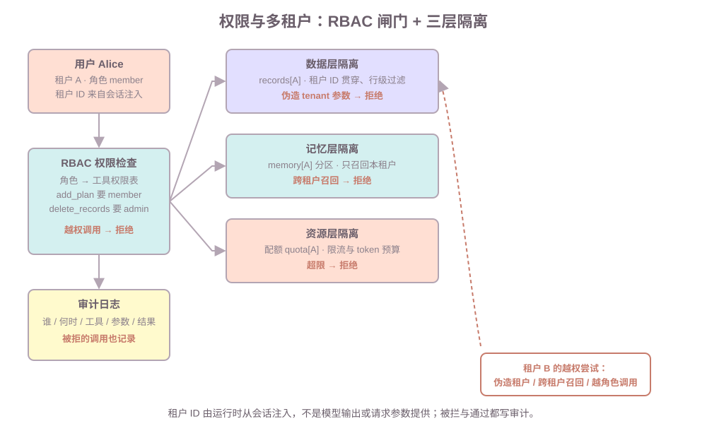

# 第七课：权限、多租户与安全

第三课的工具闸门④只有一行"权限检查"；第五课的注入防护到"结果当数据"为止。本课把这两处展开成完整体系：谁的角色能调哪个工具（权限模型）、数据按什么隔离（多租户）、被拦和通过怎么留痕（审计）、对抗性输入的最后一道防线。不讲：完整审批流与 HITL（第 9 课）、沙盒执行环境与资源强杀（第 8 课）、KMS/传输加密细节（点到，部署课展开）、联邦身份与 OIDC。

**学习目标：**

1. 能说明 RBAC 与 ABAC 的区别，并给工具级、数据级权限各举一例；
2. 能说出多租户在数据、记忆、资源三层的隔离做法；
3. 能解释"租户 ID 贯穿"是什么意思，以及为什么租户 ID 不能由模型或请求参数提供；
4. 能设计审计日志的字段清单，并说明审计为什么必要；
5. 能说出 Prompt 注入三级防护的层级，以及本课补上的第三级。

## 1. 权限解决什么问题：多用户、多租户、多工具的 Agent

单用户单机的 Agent 不需要权限。生产 Agent 有至少三个维度需要"谁能不能做"：

```text
多用户    同一系统的不同人，能调的工具不一样（普通用户 vs 管理员）
多租户    不同企业/团队的数据互相看不见（你们公司的运动记录，我公司不能查）
多工具    工具本身有危险性分级（查询无妨，删除要谨慎）
```

先定义：**权限（authorization）**回答"谁可以做什么"；**多租户（multitenancy）**回答"不同客户的数据如何互相隔离"。两者合起来，是 Agent 系统的"能调哪个工具 + 看哪份数据"的总闸门。第三课链路里的第④道闸门，本课展开成完整模型。

## 2. RBAC 与 ABAC：两种权限模型的取舍

先定义。**RBAC（Role-Based Access Control，基于角色的访问控制）**：权限不直接挂到用户身上，而是先定义角色、把权限挂在角色上，再把用户放进角色——"member 能调 `add_plan`"这句话里的主体是**角色**，不是某个用户。**ABAC（Attribute-Based Access Control，基于属性的访问控制）**：用"用户 + 资源 + 环境的属性条件"拼出规则，条件满足才放行——"记录的所有者能删自己的记录"里的"所有者"是**资源属性**，不是角色。两者的差别一句话：**RBAC 问"你是谁的角色"，ABAC 问"这次操作的属性满不满足条件"。**

|      | RBAC（基于角色）                                      | ABAC（基于属性）                 |
| ---- | ----------------------------------------------- | -------------------------- |
| 判断依据 | 用户属于哪个角色                                        | 用户 + 资源 + 环境的属性组合          |
| 例子   | member 能调 `add_plan`，admin 才能调 `delete_records` | "记录的所有者能删自己的记录"；"上班时间才能外发" |
| 优点   | 直观、易维护、好审计                                      | 细粒度、动态、无需为每个组合造角色          |
| 缺点   | 组合多时角色爆炸（"能查又能审"要造角色）                           | 规则复杂、难调试、性能开销大             |
| 适合   | 工具权限、粗粒度职责                                      | 数据级权限、动态条件                 |

判断标准一句：**权限组合稳定且数量少，用 RBAC；判断依赖资源属性（是不是自己的、什么时间），用 ABAC。** 生产里两者通常混用：工具级权限走 RBAC，数据级权限走 ABAC（"只能操作自己的记录"本质上是数据属性判断）。

课程代码用 RBAC 做工具级权限：`ToolSpec.permission` 写最小角色，`User.roles` 是角色集合，链路上"角色是否包含该权限"决定放行：

```text
alice(member) 调 delete_records -> 权限不足：delete_records 需要 admin 角色
admin(member, admin) 调 delete_records -> 通过 RBAC，进入下一步
```

## 3. 权限的作用范围：工具级、数据级、API 级

权限不只在工具一层。三个层级，面试按这个顺序讲：

| 层级    | 管什么       | 例子                           |
| ----- | --------- | ---------------------------- |
| 工具级   | 能不能调这个工具  | member 不能调 `delete_records`  |
| 数据级   | 能看/改哪些行和列 | 只能查自己租户的记录（行级）；敏感字段脱敏后可见（列级） |
| API 级 | 能不能调这个接口  | `/admin/tenants` 只对 admin 开放 |

本课重点在工具级 + 数据级：工具级由 RBAC 闸门完成；数据级由"租户 ID 贯穿 + 行级过滤"完成（下一节）。

## 4. 多租户三层隔离：数据、记忆、资源



多租户隔离是 Agent 特有的难点，因为 Agent 比普通后端多出"记忆"和"模型调用"两个维度。标准做法分三层：

| 层 | 隔离什么 | 怎么做 | 课程代码 |
| --- | --- | --- | --- |
| 数据层 | 业务数据 | 租户 ID 贯穿所有表/记录，查询按租户过滤；重负载租户可用独立 schema/库 | `records[A]` |
| 记忆层 | 长期记忆 | 记忆按租户分区，召回只查本租户；**严禁跨租户召回** | `memory[A]` 分区 + 召回拦截 |
| 资源层 | 模型调用与配额 | 每租户配额（调用次数、token 预算、并发）；超限限流或拒绝 | `quota[A]` |

**租户 ID 贯穿**是关键机制：它不是一个"额外参数"，而是每条记录、每次查询、每段记忆都带的行级属性。课程代码路径 B 演示了两条硬规则：

```text
参数里带 tenant=B（用户其实是 A）-> 租户不符：请求中的租户 B 与当前会话租户 A 不一致，拒绝执行
A 召回「夜跑」 -> 拒绝跨租户召回：关键词 夜跑 命中租户 ['B'] 的记忆（严禁跨租户召回）
```

为什么租户 ID 不能由模型或请求参数提供？两个理由：**模型可能幻觉**（把别的租户填进参数）；**用户可篡改**（请求里改 `tenant=B` 就拿到 B 的数据）。所以**租户 ID 由运行时从会话上下文注入**（登录态/网关已解析），参数里的 `tenant` 只用来做一致性校验，不一致即拒绝。这是面试加分点。

## 5. 资源层配额：限流、token 预算、优先级

多租户的资源隔离不止"次数上限"：

```text
调用次数限流   每租户每分钟/每天最多 N 次（课程代码的 quota.calls）
token 预算     每租户每天 token 上限，防止一个租户烧完预算
优先级        付费高者优先，高峰期低优先级租户排队或降级
```

课程代码路径 C：租户 A 配额 `limit=2`，前两次放行，第三次被拦。配额拦截和权限拦截一样**要写审计**（allowed=False），否则没法区分"被限流"和"系统故障"。

## 6. 敏感操作二次确认：危险工具的闸门

有些工具 RBAC 都不够——admin 也会误操作。做法：危险工具打 `confirm_required` 标记，链路在 `confirm_required` 时**不执行、返回"需要人工确认"**：

```text
admin 调 delete_records -> 需要人工确认：delete_records 是危险操作，未执行
```

本课只做到"拦截 + 占位"；完整的审批流（挂起、审批队列、超时策略、结果回写）是第 9 课"人工介入"的内容。面试回答"什么时候需要二次确认"：不可逆、涉及资金/删除/外发、高不确定度的操作。

## 7. 审计日志：谁在何时做了什么

审计（audit）是权限体系的另一半：没有审计，"权限被正确执行"就无法被证明。课程代码的 `AuditRecord` 字段清单就是面试答案：

```text
序号 / 租户 / 用户 / 角色 / 工具 / 参数 / 结果 / 是否放行
```

三个关键点：

1. **被拒的调用也记录**——路径 D 的恶意参数被拦，审计里依然有一条 `allowed=False`；只看放行记录会漏掉攻击尝试；
2. **参数原样入账**——追查时能还原"那次调用到底传了什么"；
3. **结果留痕**——badcase 定位（第 10 课）靠它：记忆污染、错误当事实都能从审计对账。

## 8. 数据安全：PII、加密与 secrets

权限管"谁能看"，数据安全管"看到了也不能泄露"：

```text
PII 脱敏   日志和记忆里不落明文手机号/身份证，落到需要脱敏或加密
加密      数据静态加密 + 传输加密（TLS）；密钥管理走 KMS，不写进代码
secrets    API Key、数据库密码只走环境变量/secrets 管理，禁止进仓库和日志
```

课程里点到为止：secrets 进环境变量（第一课的 `DEEPSEEK_API_KEY` 就是这个），密钥管理的部署细节在第 11 课。面试被问"Agent 系统怎么保护密钥"，答案骨架：环境变量/secrets 服务 + 不落日志 + 不落代码仓库。

## 9. 对抗性输入：注入三级防护汇总

第五课讲了两级，本课补上第三级。Prompt 注入的完整防护层级：

| 层级 | 做法 | 在哪课 |
| --- | --- | --- |
| 一、系统隔离 | 系统指令与不可信内容分角色放 | 第 5 课 §6 |
| 二、结果当数据 | 工具结果/网页/记忆不当指令 | 第 5 课 §6 |
| 三、Runtime 权限 | 即使被注入"骗"到，工具级 RBAC + 数据级租户隔离 + 二次确认兜底 | 本课 |

第三级的价值：**注入防护的目标不是"模型永远不被骗"，而是"被骗了也做不了危险的事"**。恶意工具参数（路径 D 的 SQL 注入字符串）被闸门③按枚举校验拦下；越权调用被 RBAC 拦下；跨租户被租户校验拦下——对抗输入在每一层都有代价。面试回答"注入怎么防到底"，按这三层讲，就比只讲 Prompt 防护高一截。

## 10. 常见错误

1. **租户 ID 由模型/参数提供**：模型幻觉或用户篡改就能跨租户。修复：运行时从会话注入，参数只做一致性校验。
2. **记忆层忘了隔离**：数据层做了租户过滤，召回记忆时全库搜——跨租户泄露比数据泄露更隐蔽。修复：记忆按租户分区 + 召回拦截。
3. **权限只查工具、不查数据**：member 能调 `search_records`，但没按租户过滤，等于能看全部。修复：数据级权限（行级过滤）与工具级权限分开设。
4. **审计只记成功**：攻击尝试全在 allowed=False 里，不记等于没有。修复：被拒也入账。
5. **危险操作只靠 RBAC**：admin 也会误删。修复：`confirm_required` 标记 + 第 9 课审批流。
6. **配额和故障混在一起**：限流报错和系统错误同文案，排查分不清。修复：配额拦截写明确原因 + 审计留痕。

## 11. 运行课程代码

```bash
cd C:\0work\project\ai_application_development_study
conda run -n agent_dev python code\ai-agent\ai_agent_lesson07.py
```

纯标准库，无网络。四条路径：

1. **路径 A（RBAC）**：member 调 `delete_records` 被角色闸门拦下；admin 通过 RBAC 后撞上二次确认；
2. **路径 B（三层隔离）**：A 查自己的记录正常；参数伪造 `tenant=B` 被拒；A 召回「夜跑」命中 B 的记忆被拦截；
3. **路径 C（资源配额）**：租户 A 配额 2 次，第三次调用被限流拒绝；
4. **路径 D（对抗输入）**：SQL 注入字符串参数被枚举校验拦下，且审计里留下 `allowed=False` 记录。

最后 dump 审计日志，可看到每次调用的字段清单。作业默认不运行。

## 12. 课后作业

作业在 `code/ai-agent/ai_agent_lesson07.py` 下半部分，场景是学习资料工具（`search_notes` / `add_review` / `delete_notes`，注册表已配好角色与确认标记）。需要完成 `run_guarded(user, name, args, audit)`，把第七课的链路自己走一遍：

1. 存在性 → 参数校验 → RBAC → 租户一致 → 配额 → 二次确认 → 执行 → 审计（顺序照抄 `execute`，注册表换成 `STUDY_REGISTRY`）；
2. `add_review` 的 `request_id` 是链路层字段，执行前取出，不传给函数本身；
3. 被拦的每一步写审计（`allowed=False`）。

`homework()` 里已准备五次调用。完成后取消注释，应看到：

```text
alice('member',) search_notes -> 笔记摘要（租户 A）：记忆方法 尚未掌握间隔重复
alice('member',) add_review -> 已加入复习：间隔重复 20 分钟
alice('member',) delete_notes -> 权限不足：delete_notes 需要 admin 角色
admin('member', 'admin') delete_notes -> 需要人工确认：delete_notes 是危险操作，未执行
alice('member',) search_notes（tenant=B） -> 租户不符：…不一致，拒绝执行
复习列表：['间隔重复 20 分钟']
审计记录：…
```

两个思考题：

1. 为什么租户 ID 由会话注入、而不是让模型在参数里填？模型幻觉和用户篡改各造成什么后果？
2. "记录的所有者能删自己的记录"——这是 RBAC 还是 ABAC？为什么？

## 13. 验收问题

1. RBAC 和 ABAC 的区别？判断标准是什么？各举一个例子。
2. 工具级、数据级、API 级权限分别管什么？
3. 多租户三层隔离是哪三层？每层隔离什么？
4. "租户 ID 贯穿"是什么意思？为什么不能由模型或请求参数提供？
5. 危险操作为什么要有二次确认？RBAC 为什么不够？
6. 审计日志至少要有哪些字段？为什么被拒的调用也要记录？
7. 注入三级防护是哪三级？第三级（Runtime 权限）兜底的是什么？

## 14. 面试高频考点

- RBAC 和 ABAC 的区别？什么时候用哪个？
- 多租户在数据、记忆、资源三层怎么做隔离？记忆层为什么最容易漏？
- Agent 系统怎么做权限？工具级和数据级权限各自怎么落地？
- 租户 ID 由谁提供？为什么不能让模型填？
- 审计为什么必要？审计日志的字段清单怎么设计？
- 敏感操作什么时候要二次确认？不可逆/资金/外发/高不确定度分别指什么？
- Prompt 注入的三级防护是什么？"模型被骗了也做不了危险的事"怎么实现？
- 配额和计费怎么隔离？token 预算和调用次数限流各解决什么？

下一课预告：权限管"能不能调"，第 8 课管"在哪调"——沙盒与执行环境：隔离技术选型、资源限制、资源池调度，以及为什么超时强杀必须发生在沙盒里。
