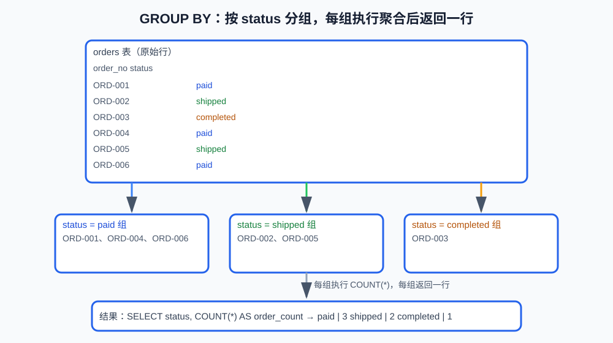
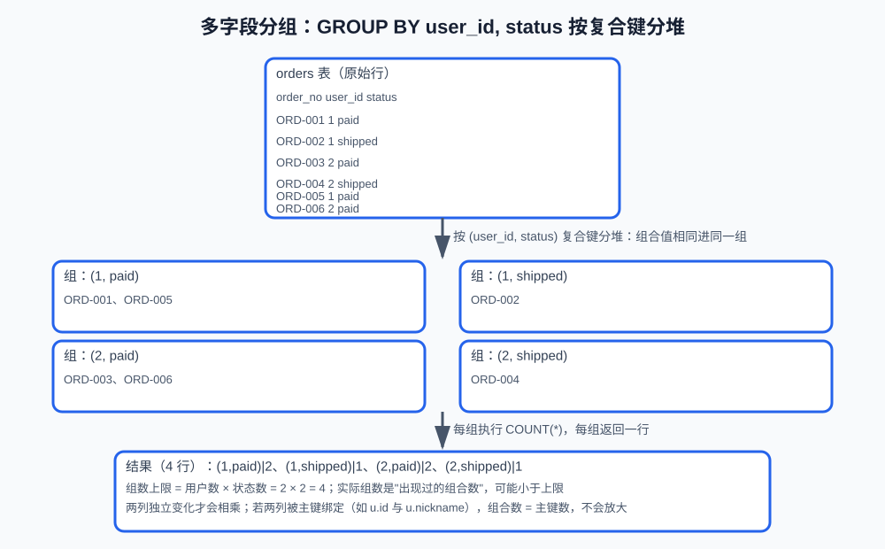
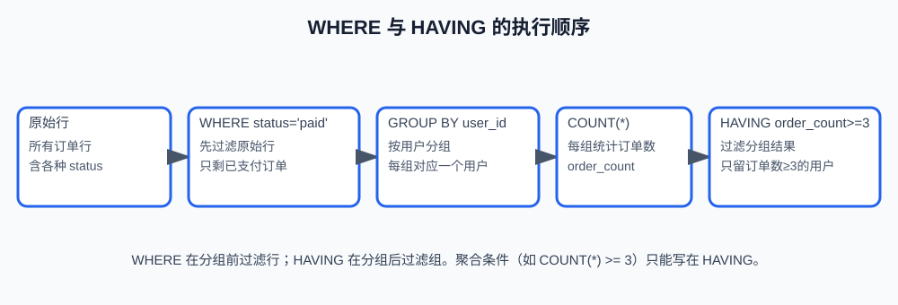

# 第6课:聚合、JOIN、子查询与 CTE

> 前两课分别学习了单表查询和数据修改。这一课把多行和多层查询组合起来，完成单表统计、子查询和 CTE；多张表的关联查询在下一篇《05-JOIN》。
>
> 本课的完整可执行示例见 `code/database/05-aggregation-subquery-cte.sql`。理论文档只保留用于解释概念的关键 SQL 片段。

## 一、这一课要解决什么问题

真实业务很少只查询一张表的一行数据，常见需求包括：

```text
每个用户有多少订单？
没有下过订单的用户有哪些？
每种商品卖了多少？
哪些用户至少有一笔已支付订单？
```

这些问题分别会用到：

```text
聚合函数：把多行压缩成统计结果
GROUP BY：按照某个维度分组
子查询 / EXISTS：用另一个查询的结果作为条件
CTE：给复杂查询划分清晰的中间步骤
```

多张表如何关联（JOIN）在下一篇《05-JOIN》，本课先解决单表统计和多层查询。

**学习目标：**

1. 能写出带聚合函数和 `GROUP BY` / `HAVING` 的统计查询，说清 `COUNT(*)` 与 `COUNT(列)` 的区别；
2. 能区分 `WHERE` 与 `HAVING`，知道聚合条件为什么只能放 `HAVING`；
3. 能使用标量子查询、`IN`、`EXISTS`、`NOT EXISTS` 解决“属于、存在、不存在”类查询；
4. 能用 CTE 拆分复杂查询；
5. 能解释 NULL 对 `COUNT`、`NOT IN` 和聚合结果的影响。

（多表关联统计在下一篇《05-JOIN》）

## 二、查询的结果也是表

SQL 里输入是表，输出也是表。任何一条 `SELECT` 的返回结果都是行 + 列的二维结构——即使 `SELECT COUNT(*)` 只返回一行一列，它也是一张"一行一列的表"。

```text
SELECT email, nickname FROM users        -> 一张只含两列的 users 子表
WHERE status = 'paid' AND amount >= 100  -> 从 orders 筛出的一张子表
GROUP BY status 每组一行                 -> 一张"状态统计表"
JOIN users 和 orders（见《05-JOIN》）      -> 一张"用户-订单关联表"
```

这意味着查询可以继续被查询：把上一次的结果当成下一次的输入。子查询、CTE 就是利用这一点给中间结果"贴名字"再使用：

```text
子查询：写在括号里的一次性查询
CTE（WITH）：给一次查询内部的中间结果起名
视图：给查询结果起名并存入数据库（第 8 课展开）
```

所以本课不是在"查询原始数据"和"查询特殊内容"之间切换，而是始终在做**表 → 表**的变换：`GROUP BY` 造出统计表，`JOIN` 造出关联表，子查询和 CTE 让中间表可以命名、复用。

## 三、聚合函数

### 1. 为什么需要聚合

`orders` 表里一行是一条订单，但业务要的往往是"总数、总额、平均值"这类统计值。原始数据和业务问题的形态不同：

```text
原始数据：一行一条订单（8 行）
业务问题：一共有多少订单？总金额是多少？平均金额是多少？
```

这些问题需要把**多行压缩成一个统计值**——这就是聚合。**聚合函数（aggregate function）** 把多行输入转换成一个结果。常用聚合函数：

| 函数 | 作用 | 示例 |
|---|---|---|
| `COUNT` | 计数 | `COUNT(*)` 订单总数 |
| `SUM` | 求和 | `SUM(total_amount)` 总金额 |
| `AVG` | 平均值 | `AVG(total_amount)` 平均金额 |
| `MIN` | 最小值 | `MIN(created_at)` 最早时间 |
| `MAX` | 最大值 | `MAX(price)` 最高价格 |

### 2. 语句模板

带聚合的查询沿用 SELECT 模板，可再加 `GROUP BY` / `HAVING`：

```sql
SELECT 聚合函数(列) AS 别名, ...
FROM 表名
[WHERE 条件]
[GROUP BY 列]
[HAVING 条件];
```

统计订单总数和总金额：

```sql
SELECT
    COUNT(*) AS order_count,
    SUM(total_amount) AS total_amount
FROM orders;
```

### 3. 没有 GROUP BY 时发生了什么

没有 `GROUP BY` 时，整张结果集被视为**一个组**，聚合对全部输入执行一次，输出一行：

```text
orders 的 8 行订单
    -> COUNT(*) = 8，SUM(total_amount) = 全部订单金额之和
    -> 结果：一行两列
```

结合"查询的结果也是表"（第二节）：这一行结果也是一张"一行两列的表"。如果 SELECT 里只有一个聚合项，这一行就只有一列，此时才是一个单值（标量）——"标量子查询"用的就是这种形态（见"子查询"一节）。如果希望"按某个维度每组出一个结果"，用下一节的 `GROUP BY`。

### 4. COUNT 的区别

```sql
SELECT
    COUNT(*) AS all_rows,
    COUNT(phone) AS rows_with_phone,
    COUNT(DISTINCT phone) AS distinct_phones
FROM users;
```

三种写法的统计对象和 NULL 行为不同：

| 写法 | 统计内容 | 遇到 NULL |
|---|---|---|
| `COUNT(*)` | 行数 | 不忽略，每行都算 |
| `COUNT(列)` | 该列不为 NULL 的行数 | 忽略 NULL |
| `COUNT(DISTINCT 列)` | 该列不重复且不为 NULL 的值个数 | 忽略 NULL |

因此，如果要统计用户总数，通常使用 `COUNT(*)`；如果要统计填写了手机号的用户，使用 `COUNT(phone)`。

### 5. NULL 对聚合的影响

除了 `COUNT(*)` 以外，聚合函数通常忽略 NULL：

| 函数 | 对 NULL 的处理 |
|---|---|
| `AVG(列)` | 只对非 NULL 值计算 |
| `SUM(列)` | 忽略 NULL |
| `MIN` / `MAX` | 忽略 NULL |

如果参与计算的值全部是 NULL，`SUM` / `AVG` 的结果是 NULL 而不是 0。需要展示默认值时，可以套一层 `COALESCE`（第 4 课学过）：

```sql
SELECT COALESCE(SUM(total_amount), 0) AS total_amount
FROM orders
WHERE status = 'paid';
```

## 四、GROUP BY：按照维度分组

### 1. 为什么需要分组

上一节的聚合函数只能对整张表出一个总数。真实需求几乎总带一个"按什么统计"的维度：按状态、按用户、按商品。比如"每种订单状态有几单"，答案不是一个数字，而要把订单行**按状态分堆，再对每一堆分别计数**——这就是分组。

```text
没有 GROUP BY：聚合对整张表执行，结果一行
有 GROUP BY：先分堆，再对每堆执行聚合，结果一组一行
```

### 2. 语句模板

**GROUP BY（分组）** 把行按某一列的值分成若干组。语句模板：

```sql
SELECT 分组列, 聚合函数(列) AS 别名
FROM 表名
GROUP BY 分组列1, 分组列2, ...;
```

统计每种订单状态的数量：

```sql
SELECT
    status,
    COUNT(*) AS order_count
FROM orders
GROUP BY status;
```



### 3. "每组返回一行"是什么意思

分堆之后，每一堆叫一个**组**。聚合函数的作用对象是"组"而不是单行：每组各执行一次 `COUNT(*)`，得到这一组自己的行数。因为每个组只输出一个统计值，所以**结果里每组恰好一行**：

```text
原始 6 行订单
    -> 按 status 分成 3 组（paid 3 行、shipped 2 行、completed 1 行）
    -> 每组执行 COUNT(*) -> 3 行结果：
       paid | 3      shipped | 2      completed | 1
```

"返回一行"不是丢弃数据，而是把一组的原始行**压缩成该组的一条统计摘要**：结果行数 = 组数，不是原始行数。这和上图一一对应。

### 4. 多个字段一起分组

`GROUP BY 列1, 列2` 是按 **(列1, 列2) 的复合键**分堆：组合值相同的行进同一组。统计每个用户每种状态的订单数：

```sql
SELECT
    user_id,
    status,
    COUNT(*) AS order_count
FROM orders
GROUP BY user_id, status;
```



**组数怎么算**：两个分组列相互独立变化时，组数上限 ≈ 列1 的去重数 × 列2 的去重数（上图 2 个用户 × 2 种状态，最多 4 组；实际组数是"出现过的组合数"，可能小于上限）。如果两列被主键绑定（如 `GROUP BY u.id, u.nickname`，id 唯一决定 nickname），组合数 = 主键数，不会相乘——见《05-JOIN》聚合组合一节。

### 5. 分组后 SELECT 里能放什么

分组查询每组只返回一行，所以 SELECT 的每一列都必须能在组内确定一个唯一值。可以放三类：

```text
分组列（在 GROUP BY 里出现的列）：组内值唯一，例如 user_id
聚合函数：对整组计算出一个值，例如 COUNT(*)、SUM(total_amount)
常量：每行都一样
```

不能放：既不在 `GROUP BY` 中、又没被聚合函数包裹的普通列。一个用户可能对应多个订单号，组内无法确定返回哪一个，语义不明确：

```sql
-- 错误：user_id 组内有多条 order_no，不知道返回哪一条
SELECT user_id, order_no, COUNT(*)
FROM orders
GROUP BY user_id;
```

MySQL 5.7.5 起默认开启 `ONLY_FULL_GROUP_BY` 严格模式，这类查询会直接报错；即使某些旧配置允许执行，结果也是不确定的。

`SELECT` 不一定要包含分组列：可以只写聚合，例如 `SELECT COUNT(*) FROM orders GROUP BY status;`——只是通常把分组列一起选中，结果更好读。

## 五、WHERE 和 HAVING

### 1. 为什么需要两个过滤

分组查询里有两层"过滤"要做：分组前过滤**原始行**，分组后过滤**组**。

```text
只看已支付订单的统计      -> 先过滤行（WHERE status = 'paid'）
只保留订单数 >= 3 的用户  -> 后过滤组（HAVING COUNT(*) >= 3）
```

`WHERE` 发生在分组之前，`HAVING` 发生在分组之后，两者的作用对象不同：

| 对比 | `WHERE` | `HAVING` |
|---|---|---|
| 执行时机 | 分组之前 | 分组之后 |
| 过滤对象 | 原始行 | 分组结果 |
| 能否使用聚合函数 | 不能 | 可以，如 `COUNT(*) >= 3` |
| 是否必须配合 `GROUP BY` | 否 | 是 |

### 2. 语句模板

```sql
SELECT 分组列, 聚合函数(列) AS 别名
FROM 表名
WHERE 原始行条件
GROUP BY 分组列
HAVING 组条件;
```

示例：每个已支付订单数不少于 3 的用户。

```sql
SELECT
    user_id,
    COUNT(*) AS order_count
FROM orders
WHERE status = 'paid'
GROUP BY user_id
HAVING COUNT(*) >= 3;
```

### 3. 执行过程



```text
WHERE：先筛出已支付订单
    -> GROUP BY：按用户分组
    -> COUNT：统计每组订单数
    -> HAVING：只保留订单数 >= 3 的组
```

### 4. 两条规则

能写在 `WHERE` 中的条件，通常应尽量写在 `WHERE` 中，因为可以在分组前减少进入分组的行数：

```sql
-- 推荐：分组前就过滤掉非 paid 订单
WHERE status = 'paid'
```

聚合结果不能写进 `WHERE`，因为 `WHERE` 执行时聚合还没有完成：

```sql
-- 错误思路：WHERE 执行时还没有完成 COUNT
WHERE COUNT(*) >= 3
```

补充一个易混点：`HAVING COUNT(*) >= 3` 里的聚合值**每组只计算一次**，写条件不会"再算一遍"。MySQL 也允许写成 `HAVING order_count >= 3`（引用 SELECT 别名，MySQL 扩展），但标准 SQL 不允许——逻辑执行顺序里 `HAVING` 在 `SELECT` 之前，别名还没生成。跨数据库时重复聚合表达式本身更稳妥。

## 六、子查询

### 1. 为什么需要子查询

有些查询的"输入"本身来自另一个查询：例如"金额高于平均金额的订单"——先要知道平均金额是多少，才能筛选订单。子查询把两步合并成一条 SQL：括号里的查询先执行，结果供外层使用。**子查询（subquery）** 是嵌套在另一个 SQL 中的查询，通常写在括号里。

本课用到三种形式：

| 形式 | 模板 | 返回内容 | 典型用途 |
|---|---|---|---|
| 标量子查询 | `(SELECT 单列 FROM 表 WHERE ...)` | 单个值 | 与 `>`、`<`、`=` 比较 |
| `IN` 子查询 | `列 IN (SELECT 列 FROM 表 ...)` | 一组值 | 判断"属于这个集合" |
| `EXISTS` | `EXISTS (SELECT 1 FROM 表 WHERE 关联条件)` | TRUE / FALSE | 判断"是否存在" |

子查询里引用外层查询的列时，称为**相关子查询**，`EXISTS` 的写法通常就是相关子查询。

### 2. 标量子查询

查询金额高于平均订单金额的订单：

```sql
SELECT id, order_no, total_amount
FROM orders
WHERE total_amount > (
    SELECT AVG(total_amount)
    FROM orders
);
```

执行顺序：先执行括号里的 `AVG`，得到一个数，再逐行比较 `total_amount > 该数`。**标量子查询必须返回单行单列**（一个值），返回多行会报错；如果 `orders` 是空表，`AVG` 结果是 NULL，`total_amount > NULL` 对每行都是 UNKNOWN，查询返回空。

### 3. IN 子查询

查询下过订单的用户：

```sql
SELECT id, nickname
FROM users
WHERE id IN (
    SELECT user_id
    FROM orders
);
```

子查询返回一组值，`IN` 判断外层列是否属于这个集合，重复值不影响判断（"属于"只看有没有）。注意候选值不能混入 NULL：`IN` 遇到 NULL 不报错，但 `NOT IN` 遇到 NULL 会整体返回空（第 4 课陷阱）。

### 4. EXISTS

同样的需求可以写成：

```sql
SELECT u.id, u.nickname
FROM users AS u
WHERE EXISTS (
    SELECT 1
    FROM orders AS o
    WHERE o.user_id = u.id
);
```

`EXISTS` 判断"是否存在至少一条匹配记录"：对每个用户，去 orders 里找有没有自己的订单，找到一条即可停。它只判断存在性、不展开订单字段，所以子查询里写 `SELECT 1` 就够了。子查询引用外层 `u.id`，是相关子查询。

### 5. NOT EXISTS：判断不存在

查询没有订单的用户：

```sql
SELECT u.id, u.nickname
FROM users AS u
WHERE NOT EXISTS (
    SELECT 1
    FROM orders AS o
    WHERE o.user_id = u.id
);
```

`NOT EXISTS` 通常比 `NOT IN` 更稳妥：`NOT IN` 遇到 NULL 会整体返回空（第 4 课讲过），`NOT EXISTS` 判断"不存在"，不受 NULL 影响。

## 七、CTE：用 WITH 拆分复杂查询

### 1. 为什么需要 CTE

查询一复杂，嵌套括号会很难读，读者要从最里层往外理清：

```text
SELECT ... FROM (SELECT ... FROM (SELECT ... WHERE ...) ...) ...
```

CTE 把每一步中间结果**起一个名字**，主查询按名字引用，像写代码一样分步。**CTE（Common Table Expression，公共表表达式）** 用 `WITH` 给中间结果命名，再在后面的查询里引用。

### 2. 语句模板

```sql
WITH 名称 AS (
    子查询
)
SELECT ... FROM 名称 ...;
```

| 部分 | 含义 |
|---|---|
| `WITH 名称 AS` | 给子查询结果起一个临时名字 |
| `子查询` | 中间结果的定义 |
| 主查询 | 引用 `名称` 继续查询 |

示例：

```sql
WITH paid_orders AS (
    SELECT user_id, total_amount
    FROM orders
    WHERE status = 'paid'
)
SELECT
    user_id,
    SUM(total_amount) AS paid_amount
FROM paid_orders
GROUP BY user_id;
```

### 3. 它和子查询的关系

子查询直接嵌在括号里、只能用一次；CTE 把同一段中间结果**提取出来命名**，主查询里像查真表一样引用它，还可以被多个后续查询复用。本质上是第二节"查询的结果也是表"的命名用法：先造出一张 `paid_orders` 中间表，再对它继续查询。

```text
先定义 paid_orders（中间表）
    -> 主查询按名字引用，继续聚合
```

### 4. 多个 CTE 组合

```sql
WITH paid_orders AS (
    SELECT user_id, total_amount
    FROM orders
    WHERE status = 'paid'
), user_amounts AS (
    SELECT user_id, SUM(total_amount) AS paid_amount
    FROM paid_orders
    GROUP BY user_id
)
SELECT u.nickname, a.paid_amount
FROM users AS u
JOIN user_amounts AS a ON a.user_id = u.id;
```

第二个 CTE 可以引用第一个 CTE 的名字，像流水线一样逐段加工。

### 5. 边界

CTE 不是临时永久表，通常只在当前 SQL 中有效。是否物化、如何执行仍由优化器和 MySQL 版本决定，不能因为写成 CTE 就默认性能更好。

## 八、常见错误自查清单

- 忽略 NULL 对 NOT IN 的影响：子查询返回 NULL 时可能过滤掉所有结果，判断不存在优先用 `NOT EXISTS`。
- 把 CTE 当成性能优化开关：CTE 主要改善组织和可读性，性能要结合执行计划和索引验证。

## 九、验收问题

1. `COUNT(*)`、`COUNT(列)`、`COUNT(DISTINCT 列)` 各统计什么？遇到 NULL 分别怎样？
2. 聚合函数遇到 NULL 会怎样？`SUM` 参与的值全为 NULL 时结果是什么？
3. `WHERE` 和 `HAVING` 有什么区别？为什么 `COUNT(*) >= 3` 不能写进 WHERE？
4. 标量子查询、`IN` 子查询、`EXISTS` 各自适合什么场景？
5. `NOT IN` 遇到 NULL 会怎样？更稳妥的替代写法是什么？
6. CTE 解决什么问题？它能保证查询性能更好吗？

## 十、面试回答模板

### 题目：WHERE 和 HAVING 有什么区别？

> WHERE 在分组前过滤原始行，HAVING 在 GROUP BY 之后过滤分组结果。能提前用 WHERE 过滤的条件应尽量提前过滤，聚合结果例如 COUNT(*) >= 3 则应使用 HAVING。

### 题目：EXISTS 和 IN 如何选择？

> 如果只关心关联数据是否存在，EXISTS 更直接；如果要表达一个值是否属于一个集合，IN 更直观。实际性能不能只靠语法判断，还要结合数据量、索引、NULL 行为和 EXPLAIN 验证。判断不存在时要特别小心 NOT IN 遇到 NULL 的问题。

## 十一、这一课学到什么程度可以继续

```text
能使用 COUNT、SUM、AVG、MIN、MAX
能按一个或多个字段 GROUP BY
能区分 WHERE 和 HAVING
能使用 IN、EXISTS 和 NOT EXISTS
能使用 CTE 拆分复杂查询
能解释 NULL 对 COUNT、NOT IN 和聚合结果的影响
```

下一篇《05-JOIN》讲多张表的关联查询；之后是第 8 课 MySQL 8 高级查询语法（`UNION`、窗口函数、排名和每组 Top N）。
