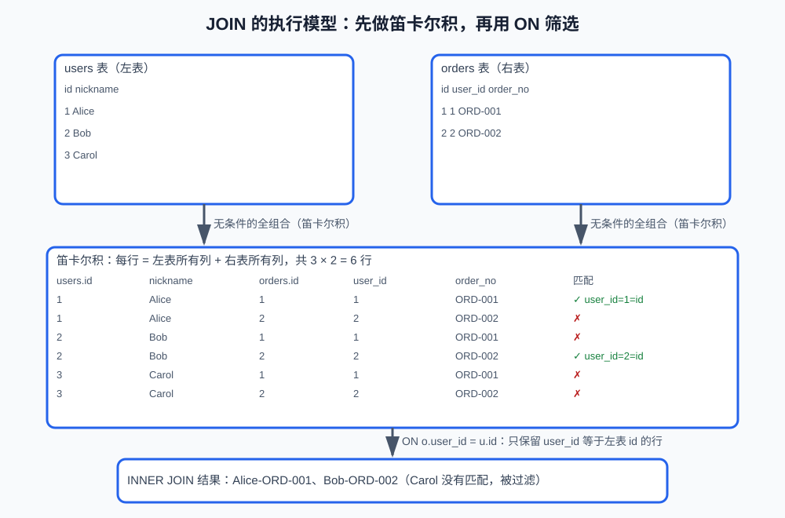
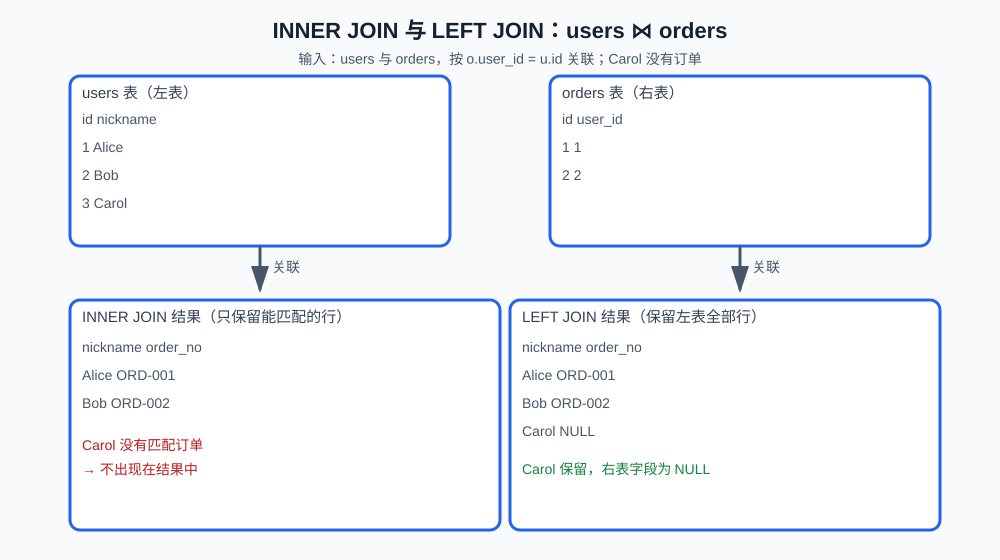
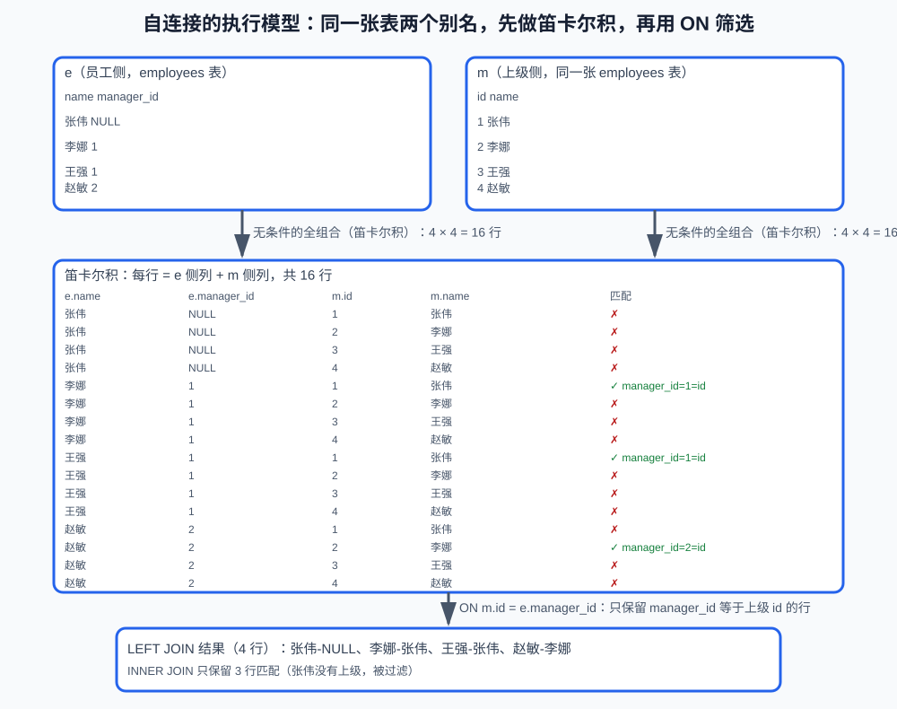

# 第7课:JOIN：多表关联查询

> 《05-聚合、子查询与 CTE》解决了单表统计和多层查询。这一课解决多张表的问题：两张表怎么关联起来、INNER 和 LEFT 的结果差异、多表 JOIN 和自连接。
>
> 本课的完整可执行示例见 `code/database/05-join.sql`。理论文档只保留用于解释概念的关键 SQL 片段。
>
> 聚合语法（`GROUP BY`、`COUNT`、`SUM` 等）在《05-聚合、子查询与 CTE》，本课会用到。

**学习目标：**

1. 能说清为什么需要 JOIN，用 `users` 和 `orders` 两张表的定义讲出关联关系；
2. 能写 `INNER JOIN` 和 `LEFT JOIN`，说清两者结果的差异；
3. 能说清 `ON` 与 `WHERE` 的位置差异，尤其是 LEFT JOIN 的陷阱；
4. 能解释一对多 JOIN 为什么产生多行；
5. 能写三张表的多表 JOIN 和一张表的自连接；
6. 能组合 JOIN 与聚合统计每个用户的订单数和金额，正确处理 NULL。

## 一、这一课要解决什么问题

单表查询只能看到一张表的内容：

```text
单独查 users：知道用户是谁，看不到他的订单
单独查 orders：知道订单是谁的，看不到用户昵称
```

真实需求几乎都是跨表的：

```text
每个用户有哪些订单？
没有下过订单的用户有哪些？
每个订单里买了哪些商品？
每个员工的上级是谁？
```

这些问题都需要把多张表的行按关联条件组合起来——这就是 **JOIN（连接）**。

## 二、为什么需要 JOIN：先看两张表的定义

业务数据通常拆在多张表里。先看 `users` 和 `orders` 的定义（只列关联相关的列）：

```sql
CREATE TABLE users (
    id BIGINT PRIMARY KEY,      -- 用户 ID
    email VARCHAR(255) NOT NULL,
    nickname VARCHAR(100) NOT NULL
);

CREATE TABLE orders (
    id BIGINT PRIMARY KEY,      -- 订单 ID
    user_id BIGINT NOT NULL,    -- 外键：指向 users.id
    order_no VARCHAR(40) NOT NULL,
    total_amount DECIMAL(12, 2) NOT NULL,
    CONSTRAINT fk_orders_user
        FOREIGN KEY (user_id) REFERENCES users(id)
);
```

关联关系是一条外键线：

```text
users.id
    <- orders.user_id
```

订单通过 `orders.user_id` 指向用户：一个用户可以有多个订单（一对多，第 3 课的外键关系）。JOIN 做的就是沿这条线把两表的行配对：**对左表的每一行，去右表找满足 `ON` 条件的行，每找到一对就组合成一条结果行**。

## 三、JOIN 的语句模板

```sql
SELECT 列...
FROM 左表 [AS 别名]
[INNER | LEFT] JOIN 右表 [AS 别名]
    ON 关联条件;
```

| 部分 | 含义 |
|---|---|
| `FROM 左表` | 查询的主表 |
| `[INNER \| LEFT] JOIN 右表` | `INNER` 只保留能匹配的行；`LEFT` 额外保留左表全部行 |
| `ON 关联条件` | 两张表如何对应，例如 `o.user_id = u.id` |

### ON 条件的常用写法

```sql
-- 等值：最常见
ON o.user_id = u.id

-- 多条件：例如多租户场景，租户条件也要参与关联
ON o.user_id = u.id AND o.tenant_id = u.tenant_id

-- 非等值：范围匹配
ON o.created_at < p.updated_at
```

理解 `ON` 的一个常用模型：JOIN 先做**无条件的全组合（笛卡尔积）**，再用 `ON` 条件筛选出有效配对：



`INNER JOIN` 只保留筛中的组合（上图的 ✓）；`LEFT JOIN` 还会把左表没筛中的行补回结果、右表字段填 NULL（第五节）。把"全组合再筛选"记在心里，`ON` 和 `WHERE` 的分工、多表 JOIN 的逐表扩展就都顺理成章。

## 四、INNER JOIN：只保留匹配数据

执行过程：对左表逐行去右表找匹配。

```text
Alice（users 一行）
    -> 在 orders 里找 user_id = Alice.id 的行
    -> 找到 ORD-001 -> 结果行（Alice, ORD-001）
    -> 找到 ORD-004 -> 结果行（Alice, ORD-004）
Bob ...
Carol -> orders 里没有 Carol 的订单 -> 不产生结果行
```

`INNER JOIN` 只返回两边能够匹配的记录，没有订单的用户不会出现在结果中：

```sql
SELECT
    u.id AS user_id,
    u.nickname,
    o.order_no,
    o.status
FROM users AS u
INNER JOIN orders AS o
    ON o.user_id = u.id;
```

### 1. ON 和 WHERE 的区别

`ON` 描述两张表如何关联，`WHERE` 通常用于过滤关联后的结果：

```sql
SELECT u.nickname, o.order_no
FROM users AS u
INNER JOIN orders AS o
    ON o.user_id = u.id
WHERE o.status = 'paid';
```

对于 `INNER JOIN`，某些条件放在 `ON` 或 `WHERE` 中可能得到相同结果，但语义上仍建议区分"如何匹配"和"匹配后过滤"。对于 `LEFT JOIN`，两者的位置可能直接改变结果（第五节）。

### 2. 一对多 JOIN 会产生多行

一个用户有三笔订单，JOIN 后这个用户会出现三行：

```text
Alice - order-001
Alice - order-002
Alice - order-003
```

这不是数据库重复了用户，而是查询结果表示用户和每一笔订单的关联：因为"Alice 和 ORD-001""Alice 和 ORD-002"是三条不同的关联事实。若只想要每个用户一行，应使用聚合（第八节）或其他明确的查询语义。

## 五、LEFT JOIN：保留左表全部记录

`INNER JOIN` 会把"没有订单的用户"直接过滤掉。但很多需求要求**保留左表全部行**：例如"所有用户及其订单"——没下过单的用户也要列出来，订单列显示 NULL。这就是 `LEFT JOIN`。

执行完 INNER 式的匹配后，把左表里没匹配上的行也补进结果，右表字段填 `NULL`：

```text
INNER 结果：Alice-ORD-001、Bob-ORD-002
LEFT 补上：Carol 没有匹配订单 -> Carol | NULL（order_no 为 NULL）
```



```sql
SELECT
    u.id AS user_id,
    u.nickname,
    o.order_no
FROM users AS u
LEFT JOIN orders AS o
    ON o.user_id = u.id;
```

即使用户没有订单，用户也会保留，右表字段显示为 `NULL`。

### 1. 查询没有订单的用户

```sql
SELECT u.id, u.nickname
FROM users AS u
LEFT JOIN orders AS o
    ON o.user_id = u.id
WHERE o.id IS NULL;
```

这是一个常见模式：左连接后检查右表主键为 NULL，表示没有匹配记录。

### 2. ON 和 WHERE 的陷阱

同一个条件放 `ON` 还是 `WHERE`，在 LEFT JOIN 下会得到不同结果。用一组数据演示：Carol 没有订单，Bob 有一笔 shipped 订单和一笔 paid 订单。

```text
users：Alice(1)、Bob(2)、Carol(3)
orders：ORD-001(1, paid)、ORD-002(2, shipped)、ORD-003(2, paid)
```

条件放 `ON`——"已支付"成为匹配条件的一部分，匹配不到的左表行仍然保留：

```sql
SELECT u.nickname, o.order_no
FROM users AS u
LEFT JOIN orders AS o
    ON o.user_id = u.id
   AND o.status = 'paid';
```

```text
结果：Alice-ORD-001、Bob-ORD-003、Carol-NULL（3 行，所有用户都在）
```

条件放 `WHERE`——先按 user_id 匹配全部订单，再统一过滤已支付；Carol 那行 `o.status` 是 NULL，被 WHERE 滤掉，左表行跟着消失：

```sql
SELECT u.nickname, o.order_no
FROM users AS u
LEFT JOIN orders AS o
    ON o.user_id = u.id
WHERE o.status = 'paid';
```

```text
结果：Alice-ORD-001、Bob-ORD-003（2 行，Carol 消失）
```

| 位置 | 作用 | 对 LEFT JOIN 的影响 |
|---|---|---|
| `ON` | 决定右表哪些记录参与匹配 | 匹配不到的左表行保留（右表为 NULL） |
| `WHERE` | 在连接结果生成后继续过滤 | 不满足条件的左表行会被整体滤掉 |

## 六、多表 JOIN：三张表逐表扩展

真实的关联往往不止两张表。例如订单明细 `order_items` 关联订单和商品：

```sql
CREATE TABLE order_items (
    id BIGINT PRIMARY KEY,          -- 明细 ID
    order_id BIGINT NOT NULL,       -- 外键：指向 orders.id
    product_id BIGINT NOT NULL,     -- 外键：指向 products.id
    quantity INT NOT NULL,
    price DECIMAL(12, 2) NOT NULL,
    CONSTRAINT fk_oi_order
        FOREIGN KEY (order_id) REFERENCES orders(id),
    CONSTRAINT fk_oi_product
        FOREIGN KEY (product_id) REFERENCES products(id)
);
```

查询每个订单里买了哪些商品：

```sql
SELECT o.order_no, p.name, oi.quantity
FROM orders AS o
JOIN order_items AS oi ON oi.order_id = o.id
JOIN products AS p ON p.id = oi.product_id;
```

JOIN 的写法就是"逐表扩展"：先关联一张，结果再关联下一张，每步都用一条外键线作为 `ON` 条件。链上的任何一环断了（例如 `order_items` 指向不存在的商品），INNER JOIN 会整行过滤掉。

## 七、自连接：一张表和自己 JOIN

有些关系在同一张表里。例如员工表，`manager_id` 指向自己的上级：

```sql
CREATE TABLE employees (
    id BIGINT PRIMARY KEY,
    name VARCHAR(100) NOT NULL,
    manager_id BIGINT NULL,          -- 指向 employees.id（自引用外键）
    CONSTRAINT fk_emp_manager
        FOREIGN KEY (manager_id) REFERENCES employees(id)
);
```

查询每个员工和他的上级：

```sql
SELECT e.name AS employee, m.name AS manager
FROM employees AS e
LEFT JOIN employees AS m ON m.id = e.manager_id;
```



关键点：**给同一张表起两个不同的别名**（`e` 员工侧、`m` 上级侧），LEFT 保证没有上级的老板也出现（manager 为 NULL）。

## 八、聚合和 JOIN 组合

"统计每个用户的订单数"同时要用户信息（在 users，要 JOIN）和订单数量（在 orders，要聚合）。先 JOIN 组合，再 GROUP BY 分组：

```sql
SELECT
    u.id,
    u.nickname,
    COUNT(o.id) AS order_count
FROM users AS u
LEFT JOIN orders AS o
    ON o.user_id = u.id
GROUP BY u.id, u.nickname;
```

这里按 `u.id, u.nickname` 两列分组：分组发生在 JOIN 后的结果集上，组数 = 用户数（id 是主键，nickname 由 id 唯一决定，两列不是两个独立的分组维度）。SELECT 里的非聚合列要进 GROUP BY，把两列都写上是跨数据库稳妥的写法；只写 `GROUP BY u.id` 时，MySQL 也会靠函数依赖放行 `u.nickname`。

用 LEFT JOIN 是为了没下过单的用户也出现（订单数为 0）。这里必须用 `COUNT(o.id)` 而不是 `COUNT(*)`：

```text
COUNT(o.id)：没有订单时 o.id 为 NULL，结果是 0
COUNT(*)：LEFT JOIN 后用户仍有一行，可能得到 1
```

`COUNT(*)` 会把"用户 + 右表 NULL"的那一行也算进去，得到错误的 1，所以统计关联记录数量时必须数右表的非空列。

统计每个用户的已支付金额：

```sql
SELECT
    u.id,
    u.nickname,
    COALESCE(SUM(o.total_amount), 0) AS paid_amount
FROM users AS u
LEFT JOIN orders AS o
    ON o.user_id = u.id
   AND o.status = 'paid'
GROUP BY u.id, u.nickname;
```

两个细节：

- 状态条件写在 `ON` 而不是 `WHERE`：这样没有已支付订单的用户仍然保留（右表为 NULL），而不是被过滤掉；
- `SUM` 对 NULL 组结果是 NULL，用 `COALESCE`（《05-聚合》讲过）展示成 0。

## 九、常见错误自查清单

- 用 `COUNT(*)` 统计 LEFT JOIN 的关联数量：没有匹配时左表仍保留一行，统计右表记录应使用 `COUNT(o.id)`。
- 把 LEFT JOIN 条件写到 WHERE：会过滤掉右表没有匹配的左表记录，先想清楚条件放 `ON` 还是 `WHERE`。
- JOIN 条件不完整：关联条件过少会产生笛卡尔式的数据膨胀，多租户数据还要确认租户条件是否参与 JOIN。
- 用 DISTINCT 掩盖重复行：先判断重复是真实的一对多关系还是 JOIN 条件写错，再决定是否去重。
- 忘记给自连接的两个别名：同一张表 JOIN 自己必须用两个不同的别名，否则无法区分两侧。

## 十、验收问题

1. 为什么需要 JOIN？`users` 和 `orders` 是靠哪条外键线关联的？
2. `INNER JOIN` 和 `LEFT JOIN` 的结果有什么区别？
3. 一对多 JOIN 为什么产生多行？这是数据库出错吗？
4. LEFT JOIN 时，条件放在 `ON` 和 `WHERE` 会改变结果吗？举例说明。
5. 查询没有订单的用户，为什么用 `LEFT JOIN ... WHERE o.id IS NULL`？
6. 三张表 JOIN 的写法是什么？每一步的 `ON` 对应什么？
7. 自连接的关键是什么？
8. 统计每个用户的订单数，为什么用 `COUNT(o.id)` 而不是 `COUNT(*)`？

## 十一、面试回答模板

### 题目：INNER JOIN 和 LEFT JOIN 有什么区别？

> INNER JOIN 只保留两边能够匹配的记录，没有关联数据的左表记录会被过滤；LEFT JOIN 保留左表全部记录，右表没有匹配时对应字段为 NULL。查询"所有用户及其订单"或"没有订单的用户"时通常使用 LEFT JOIN。

### 题目：为什么 LEFT JOIN 后 COUNT(o.id) 和 COUNT(*) 不一样？

> LEFT JOIN 即使没有右表匹配，也会保留一行左表数据。COUNT(*) 会把这行算进去，而 COUNT(o.id) 会忽略右表主键为 NULL 的行，所以统计关联记录数量时通常使用 COUNT(o.id)。

### 题目：同一需求，用 JOIN、IN、EXISTS 怎么写？怎么选？

> 例如"有订单的用户"：JOIN 适合需要同时取出订单字段的场景；IN 适合"一个值属于一个集合"的判断；EXISTS 适合只关心"是否存在"、不关心匹配内容的场景。实际取舍还要结合数据量、索引和执行计划（EXPLAIN 在第 10 课）。

### 题目：自连接是什么？

> 一张表和自己 JOIN，常用于同一张表内的层级关系（如员工-上级）。关键是给同一张表起两个不同的别名，分别代表"父行"和"子行"，再用 LEFT JOIN 保证没有上级的根节点也出现。

## 十二、这一课学到什么程度可以继续

```text
能用两张表的定义讲出 JOIN 的关联关系
能写 INNER JOIN 和 LEFT JOIN，说清结果差异
能解释一对多 JOIN 为什么产生多行
能处理 LEFT JOIN 的 ON/WHERE 陷阱
能写三张表的多表 JOIN 和一张表的自连接
能组合 JOIN 与聚合统计订单数、金额
```

下一课将学习 MySQL 8 高级查询语法，包括 `UNION`、窗口函数、排名和每组 Top N。
