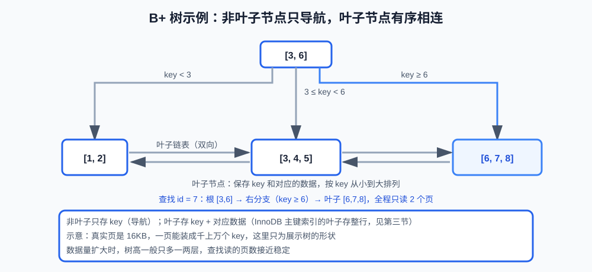

# 第9课:InnoDB 索引与索引设计

> 前六课学习了如何定义、修改和查询数据。从这一课开始进入 MySQL 的核心：数据库如何更快地找到需要的数据。
>
> 本课重点是 MySQL 8 的 InnoDB。完整可执行示例见 `code/database/07-index.sql`，课文只保留解释索引原理的关键片段。

**学习目标：**

1. 能画出 InnoDB 的主键索引（聚簇索引）和二级索引，说出叶子节点各保存什么；
2. 能解释 B+ 树的形状，并说清 B 树与 B+ 树的区别、B+ 树为什么适合等值、范围、排序和分页；
3. 能解释回表和覆盖索引，说出回表何时是代价；
4. 能解释联合索引的最左前缀和范围条件的影响；
5. 能根据真实查询设计初步的联合索引，说清低区分度和索引冗余的代价；
6. 能识别函数、隐式转换、前置通配符等让索引失效的写法。

## 一、索引：定位数据的有序结构

### 1. 没有索引时：全表扫描

数据库查询时，如果没有索引，服务器可能逐行检查整张表：

```text
第 1 行是否匹配？
第 2 行是否匹配？
第 3 行是否匹配？
...
```

这叫**全表扫描（full table scan）**：数据越多，需要检查的行越多，耗时线性增长。

### 2. 索引是什么

**索引（index）** 是为数据建立的额外有序结构，让数据库不必逐行检查，而是先在索引中定位范围，再找到对应记录：

```text
查询条件
    -> 在索引中定位范围
    -> 找到对应记录
    -> 返回结果或读取完整数据
```

可以类比书的目录：目录本身占几页，但能让你直接翻到目标章节，不用从头扫到尾。

### 3. 索引不是免费的

索引会带来成本：

- 占用磁盘和内存；
- 插入、更新、删除时都要同步维护索引；
- 索引设计错误时，既不能加速，还增加维护成本。

所以"建索引"是有代价的加速手段，设计要服务于真实查询（第七节）。

## 二、InnoDB 的索引数据结构：B+ 树

### 1. 出发点：磁盘页和磁盘 IO

数据库数据存放在磁盘上，读取按**页（page）**为单位——InnoDB 默认一页 16KB。一次磁盘页读取（磁盘 IO）比一次内存比较慢几个数量级，所以对查询来说，**减少磁盘页访问次数比减少比较次数更重要**：

```text
一次磁盘页读取的代价
    > 一次内存中的比较
    >> 一次 CPU 指令
```

### 2. 为什么用多路树：让树更矮

如果数据用单链表或数组组织，查找要沿着顺序走很多步。树结构用"多分支"把查找路径变短：

```text
一个节点保存很多 key
    -> 分支数更多
    -> 树的高度更低
    -> 查找时访问的页更少
```

**树的高度**就是从根走到叶子要经过的层数——层数越少，要读取的磁盘页越少，IO 越少。

### 3. B+ 树的形状

**B+ 树**是一种多路平衡树，两个关键特征：

```text
非叶子节点：保存 key，用于分支导航
叶子节点：保存实际数据（或指向数据的指针），按 key 有序，并用链表连起来
```

叶子有序且互相连接，是 B+ 树区别于普通树的关键：既支持定位，又支持连续扫描。

### 4. 一棵具体的 B+ 树

只讲形状不够直观。假设一张表有 8 行数据、主键 id 为 1~8，简化示意如下：



从根往下看这棵树：

```text
根节点 [3, 6]
    -> 左边分支里的 key 都小于 3
    -> 中间分支里的 key 在 3 和 6 之间
    -> 右边分支里的 key 都不小于 6
```

叶子节点按 key 从小到大排列，且用链表互相连接。

查找 `id = 7` 时：

```text
根 [3, 6]：7 ≥ 6，走右分支
    -> 叶子 [6, 7, 8]：找到 7
```

整个过程只读 2 个页（根页 + 叶子页）。数据量扩大很多倍时，树一般也只是多长一两层——这就是"树矮"带来的 IO 优势。

### 5. B 树与 B+ 树：面试常考的对比

面试常问"为什么用 B+ 树，不用 B 树"，先把两者定义清楚：

**B 树（B-Tree）**：每个节点都保存 key 和数据（或指向数据的指针），查找可能在某一层直接命中并返回，不必走到叶子。

**B+ 树（B+-Tree）**：只有叶子节点保存数据，非叶子节点只保存 key 用于导航，查找必须走到叶子。

| 对比点 | B 树 | B+ 树 |
|---|---|---|
| 非叶子节点保存什么 | key + 数据 | 只保存 key |
| 数据保存在哪里 | 每个节点都可能保存 | 只有叶子节点 |
| 叶子节点是否相连 | 不相连 | 有序链表相连 |
| 等值查找 | 可能在中层命中就返回 | 必须走到叶子 |
| 范围 / 排序 | 需要在中层间往返 | 顺着叶子链表顺序扫描 |
| 同样数据量下的树高 | 较高（一页要装 key + 数据） | 较低（一页能装更多 key） |

InnoDB 选 B+ 树的原因可以串成一条链：

```text
磁盘页是 IO 单位，IO 是主要代价
    -> 希望一页装下更多 key，让树更矮
    -> 非叶子只存 key、不存数据（B+ 树的特征）
    -> 树更矮，查找路径上的页更少，IO 更少
    -> 叶子有序相连，范围 / 排序 / 分页可以顺序扫描
```

B 树点查理论上可能少读一层（中层命中即返回），但业务里范围查询和排序很常见，B+ 树在这两类查询上明显更优；索引页也更小、更容易在内存缓存中命中。综合下来 InnoDB 选择 B+ 树。

### 6. B+ 树适合的查询类型

由于叶子有序，B+ 树适合：

```text
等值查询：WHERE id = 10
范围查询：WHERE id BETWEEN 10 AND 20
排序：ORDER BY created_at
范围分页：WHERE id > 100 LIMIT 20
```

**哈希结构**适合等值查找，但不擅长范围和排序；B+ 树适用的查询类型更广，所以 InnoDB 的常规索引使用 B+ 树结构。

## 三、聚簇索引：主键索引的叶子保存整行

B+ 树只规定了树的形状；InnoDB 用它组织数据时，叶子节点保存什么由实现决定。

在 InnoDB 中，主键索引的叶子节点保存整行数据：

```text
主键 B+ 树
    -> 叶子节点：主键 + 完整数据行
```

这种组织方式叫**聚簇索引（clustered index）**：数据行按主键顺序物理地"聚集"在叶子节点里。由于一行数据只能按照一种主要顺序组织，一张 InnoDB 表通常只有一个聚簇索引（就是主键索引）。

主键设计因此很重要：

- 为业务表设置明确主键；
- 主键尽量短（主键会被复制进每个二级索引，见第四节）；
- 写入量大时优先考虑递增主键；
- 不要把经常变化的业务字段作为主键。

如果没有显式主键，InnoDB 会选择合适的唯一非空索引；如果没有合适索引，则可能生成隐藏的聚簇索引。不要依赖这种兜底行为，业务表应明确设计主键。

## 四、二级索引与回表

主键索引之外建立的索引叫**二级索引（secondary index）**。假设给 email 建索引：

```sql
CREATE INDEX idx_users_email
ON users(email);
```

InnoDB 的二级索引叶子节点保存：

```text
索引列（email）+ 主键值（id）
```

执行下面的查询时：

```sql
SELECT *
FROM users
WHERE email = 'alice@example.com';
```

可能经历两步：

```text
先在 email 索引中找到 email
    -> 得到对应主键 id
    -> 再到主键索引（聚簇索引）中读取完整数据行
```

第二次根据主键获取整行的过程叫**回表（table lookup）**。

回表不是错误，但如果一次命中很多记录，就可能产生大量随机访问。索引设计时要同时考虑过滤条件和返回字段。

## 五、覆盖索引

如果查询需要的字段都包含在二级索引中，就不需要再回表：

```sql
CREATE INDEX idx_users_email_nickname
ON users(email, nickname);

SELECT email, nickname
FROM users
WHERE email = 'alice@example.com';
```

这个查询可以直接从索引返回所需字段，称为**覆盖索引（covering index）**。

这个例子里 email、nickname 两个列放在同一棵索引里——多列放进一棵索引的规则，就是下一节要讲的联合索引。

覆盖索引的价值：

- 减少回表；
- 减少数据页访问；
- 可能减少磁盘 IO。

但不能为了覆盖所有查询而把大量字段都塞进索引。索引过宽会增加空间、写入和缓存成本，最终要结合 `EXPLAIN` 和真实查询验证。

## 六、联合索引与最左前缀

### 1. 出发点：查询经常同时过滤多个列

上一节的覆盖索引例子 `(email, nickname)` 已经出现过多列放进一棵索引的写法，但当时没有展开"多个列在一棵树里如何排序、查询如何使用"的规则。为什么需要多列索引？真实查询经常同时过滤多个列：

```sql
SELECT *
FROM orders
WHERE user_id = 1
  AND status = 'paid';
```

只给 `user_id` 建单列索引：能先定位到用户 1 的订单，但 `status` 仍要在这批行里逐行检查。分别给两列各建一棵单列索引也不理想：两棵树的排列顺序互不相同，无法用一棵树同时按两列定位，另一列的条件仍要回到数据行逐行过滤。于是需要一种把多个列"放到一起排序"的索引，这就是联合索引。

### 2. 联合索引：把多个列按顺序放进同一棵 B+ 树

**联合索引（composite index）**：把多个列按指定顺序放进同一棵 B+ 树。例如给 orders 表的 `(user_id, status, created_at)` 建联合索引：

```sql
CREATE INDEX idx_orders_user_status_time
ON orders(user_id, status, created_at);
```

它不是三棵互相独立的索引，而是一棵树，记录整体按列顺序排列，类似字典序：

```text
先按 user_id 排序
    -> user_id 相同，再按 status 排序
        -> 前两列相同，再按 created_at 排序
```

因为多列在叶子节点里整体有序，查询可以在这棵树上一次定位到"同时满足多列条件"的范围，不必再逐行过滤。

### 3. 最左前缀：条件要覆盖索引的最左连续列

正因为记录按"先 user_id、再 status、再 created_at"的顺序整体有序，查询能否顺着树的顺序定位，取决于条件是否从最左列开始、连续覆盖若干列。这个性质叫**最左前缀（leftmost prefix）原则**——把索引的列顺序看成一串字符，能利用的条件就是这串字符"从头开始的一段前缀"。

从最左列开始连续使用的查询，通常能充分利用这棵索引：

```sql
WHERE user_id = 1
WHERE user_id = 1 AND status = 'paid'
WHERE user_id = 1 AND status = 'paid'
  AND created_at >= '2026-01-01'
```

这三条分别覆盖了索引的前 1、2、3 列。跳过中间列、或从非最左列开始的条件，无法顺着树的顺序定位：

```sql
WHERE status = 'paid'
WHERE created_at >= '2026-01-01'
```

### 4. 范围条件：范围之后的列不能精确定位

```sql
WHERE user_id = 1
  AND status = 'paid'
  AND created_at > '2026-01-01'
```

前面的等值条件帮助定位，`created_at` 进行范围扫描。**范围条件之后的列通常不能继续用于精确定位**，因此联合索引的列顺序要结合真实查询设计（见第七节）。

### 5. 满足最左前缀只是必要条件

满足最左前缀只说明有机会利用索引。最终是否使用索引、是否更快，还取决于：

- 数据分布；
- 查询返回行数；
- 统计信息；
- 优化器成本判断；
- 是否需要排序或覆盖；
- MySQL 版本。

"有机会利用"不等于一定使用，也不等于一定更快，最终要用执行计划验证（下一课）。

## 七、索引设计原则

### 1. 从真实查询出发

不要先建立一堆索引再等待业务适配。应该先收集高频 SQL：

```text
WHERE 使用哪些字段？
ORDER BY 使用哪些字段？
返回哪些字段？
查询返回多少行？
写入和更新频率如何？
```

### 2. 联合索引考虑等值、范围和排序

例如经常查询：

```sql
SELECT id, order_no, created_at
FROM orders
WHERE user_id = ?
  AND status = ?
ORDER BY created_at DESC
LIMIT 20;
```

可以考虑：

```sql
CREATE INDEX idx_orders_user_status_time
ON orders(user_id, status, created_at);
```

但是否真的合适，仍要使用执行计划验证。索引列顺序不是只看"哪个字段区分度最高"，还要看查询条件和排序需求。

### 3. 低区分度字段不能机械建索引

如果一列只有两个值：

```text
is_deleted：0 或 1
```

单独索引可能无法有效减少扫描量，尤其当绝大多数记录都是 `0`。但它仍可能在联合索引、覆盖索引或特定数据分布下有价值，不能仅凭字段取值数量决定。

### 4. 索引不是越多越好

每增加一棵索引，都可能增加：

- 插入成本；
- 更新索引列的成本；
- 删除成本；
- 磁盘空间；
- Buffer Pool 压力（**Buffer Pool** 是 InnoDB 缓存数据页的内存区域，索引越多，可缓存的页越分散）；
- 重建和维护成本。

还要检查重复索引和被更宽联合索引覆盖的冗余索引。

## 八、主键设计与随机主键

InnoDB 的主键会影响聚簇数据的组织方式，二级索引叶子节点也需要保存主键值。因此**主键过长会放大所有二级索引**。

递增主键通常有这些优点：

- 新记录倾向于写入索引末端；
- 页分裂相对少（**页分裂**：数据页写满后，需要把一部分记录拆到新页，是插入时的额外成本）；
- 二级索引保存的主键值较稳定；
- 更适合常见的范围查询。

随机 UUID 等主键并非不能使用，但可能导致：

- 插入位置分散；
- 页分裂和页移动更多；
- 索引缓存局部性较差；
- 主键本身和二级索引更大。

是否使用 UUID，要综合考虑分布式生成、暴露安全性、存储空间和写入模式，而不是简单地认为一种方案永远正确。

## 九、索引可能无法充分使用的写法

### 1. 对索引列使用函数

```sql
WHERE YEAR(created_at) = 2026
```

对列套函数后，索引里保存的是原始值，无法直接定位计算结果。更容易利用索引的写法是范围查询：

```sql
WHERE created_at >= '2026-01-01'
  AND created_at < '2027-01-01'
```

### 2. 前置通配符

```sql
WHERE email LIKE '%example.com'
```

没有确定的开头，普通 B+ 树难以直接定位范围。

### 3. 隐式类型转换

索引列是数字，却把字符串作为参数传入，可能发生转换并影响索引使用。应用参数类型应和字段类型保持一致。

### 4. 返回数据量过大

即使索引能够找到记录，如果结果占整张表很大，优化器也可能认为全表扫描更便宜。

### 5. 查询条件跳过最左列

联合索引 `(tenant_id, status)` 通常不能独立高效支持只按 `status` 查询。需要根据真实查询增加合适索引，而不是强行复用不匹配的联合索引。

## 十、常见错误

### 1. 看到慢查询就直接加索引

慢的原因可能是锁等待、返回数据过多、排序、深分页或执行计划选择错误。应先使用 `EXPLAIN` 找证据。

### 2. 认为有索引就一定使用

优化器会基于成本选择全表扫描或其他索引。要看实际使用的 `key`，不能只看 `possible_keys`。

### 3. 把联合索引当成多个单列索引

`(a, b, c)` 和分别建立 `(a)`、`(b)`、`(c)` 不是一回事，查询能否使用取决于列顺序和条件。

### 4. 为每个字段都建立单列索引

这会增加写入成本，也不一定匹配真实查询。索引应该服务于查询模式。

### 5. 为覆盖索引加入过多字段

覆盖索引可以减少回表，但索引过宽会增加存储和维护成本。只覆盖有价值的高频查询。

## 十一、验收问题

1. 没有索引时查询为什么会慢？索引的代价有哪些？
2. B+ 树的叶子节点有什么特点？B 树与 B+ 树有什么区别？为什么 InnoDB 选 B+ 树？
3. InnoDB 聚簇索引的叶子保存什么？为什么一张表只有一个聚簇索引？
4. 二级索引的叶子保存什么？什么是回表？什么时候回表是代价？
5. 什么是覆盖索引？它为什么能减少回表？
6. 联合索引的最左前缀是什么？范围条件之后为什么不能精确定位？
7. 索引列顺序怎么定？低区分度字段为什么不能机械建索引？
8. 主键过长和随机主键有什么代价？
9. 哪些写法会让索引无法充分使用？

## 十二、面试回答模板

### 题目：为什么 InnoDB 使用 B+ 树？

> B+ 树的非叶子节点只保存 key、不保存数据，所以同样一页能装下更多 key，树高更低，查找时访问的磁盘页更少；叶子节点按 key 有序并用链表相连，范围查询和排序可以顺序扫描。相比 B 树：B 树每个节点都保存数据，点查可能在中层命中，但范围查询需要在中层间往返，且同样的数据量树更高；B+ 树点查必须走到叶子，但业务里范围查询和排序更常见，整体 IO 更少。相比哈希结构，B+ 树适用的查询类型更广。

### 题目：什么是回表和覆盖索引？

> InnoDB 二级索引叶子节点通常保存索引列和主键值。通过二级索引找到主键后，再到聚簇索引中读取完整行，叫回表。如果查询需要的字段都包含在二级索引中，就可以直接从索引返回结果，叫覆盖索引。

### 题目：联合索引的最左前缀是什么？

> 联合索引按照列顺序组织数据，查询通常要从最左列开始使用。前面的等值条件可以帮助定位，范围条件之后的列通常不能继续用于精确定位。最终是否使用索引还要结合数据分布和执行计划判断。

## 十三、这一课学到什么程度可以继续

```text
能解释索引解决的问题和 B+ 树的基本优势
能对比 B 树与 B+ 树，说出 InnoDB 选择 B+ 树的原因
能画出 InnoDB 聚簇索引和二级索引
能解释回表和覆盖索引
能解释联合索引的最左前缀
能根据查询条件初步设计联合索引
能说出索引过多、主键过长和随机主键的代价
能识别函数、隐式转换、前置通配符等风险
知道索引是否生效必须通过执行计划验证
```

下一课将学习 `EXPLAIN`、慢查询与查询优化。
