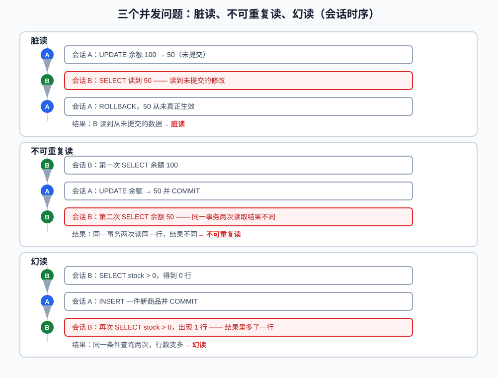

# 事务、ACID 与隔离级别

> 前一课讲了如何通过执行计划分析查询性能。这一课转向数据正确性：当一个业务包含多条 SQL，或者多个请求同时读写数据库时，如何保证操作不会只完成一半，也不会读到不应该看到的数据。
>
> 本课完整可执行示例见 `code/database/09-transaction-isolation.sql`。观察并发行为需要两个独立数据库会话，课文中的结果以 MySQL 8.x InnoDB 为准。

**学习目标：**

1. 能用 `START TRANSACTION`、`COMMIT` 和 `ROLLBACK` 控制一组 SQL 的整体提交或回滚；
2. 能解释自动提交，以及为什么多条 SQL 必须放在同一个事务、同一个连接里；
3. 能解释 ACID，并说出 InnoDB 分别用什么机制支撑；
4. 能区分脏读、不可重复读和幻读；
5. 能说出四种隔离级别的差异和 InnoDB 的默认级别；
6. 能用两个会话观察未提交修改、提交可见性和同一事务两次读取的差异；
7. 能说明长事务和连接池归还连接的风险。

## 一、事务：把多条操作组成一个整体

假设转账包含两步：

```text
账户 A 扣除 100
账户 B 增加 100
```

如果第一步成功后服务崩溃，第二步没有执行，就会出现资金凭空减少。**事务（transaction）** 就是为解决这类问题提出的执行单元：一组 SQL 操作要么全部成功提交，要么全部回滚，不会只完成一半。

```text
开始事务
    -> 执行多条 SQL
    -> 全部成功：COMMIT
    -> 任一步失败：ROLLBACK
```

事务主要解决的是"多条操作如何作为一个整体提交或撤销"，但它不会自动保证所有业务逻辑正确。字段约束、锁、MVCC 和应用幂等仍然需要配合。

## 二、事务的基本语法

开始事务：

```sql
START TRANSACTION;
```

也可以使用：

```sql
BEGIN;
```

提交：

```sql
COMMIT;
```

撤销当前事务中尚未提交的修改：

```sql
ROLLBACK;
```

### 1. 转账示例

```sql
START TRANSACTION;

UPDATE accounts
SET balance = balance - 100
WHERE id = 1;

UPDATE accounts
SET balance = balance + 100
WHERE id = 2;

COMMIT;
```

如果第二条更新失败，应用应该回滚第一条修改，而不是继续提交部分结果。

### 2. 保存点

事务中可以设置保存点，只回滚保存点之后的操作：

```sql
START TRANSACTION;

UPDATE accounts
SET balance = balance - 100
WHERE id = 1;

SAVEPOINT after_debit;

-- 后续操作出现问题
ROLLBACK TO SAVEPOINT after_debit;

COMMIT;
```

保存点不会结束事务。实际应用中更常见的是由事务管理框架统一提交或回滚，保存点主要用于需要部分撤销的复杂流程。

## 三、自动提交

MySQL 默认通常开启自动提交：

```sql
SELECT @@autocommit;
```

**自动提交（autocommit）**：一条语句执行成功后立即生效的模式。当 `autocommit = 1` 时，一条独立的 `INSERT`、`UPDATE` 或 `DELETE` 执行成功后，通常会自动提交。

这意味着下面两条 SQL 默认不一定属于同一个事务：

```sql
UPDATE accounts SET balance = balance - 100 WHERE id = 1;
UPDATE accounts SET balance = balance + 100 WHERE id = 2;
```

如果它们必须一起成功，就要显式开启事务。`START TRANSACTION` 会开始一个事务，并让后续语句暂时不自动提交，直到执行 `COMMIT` 或 `ROLLBACK`。

## 四、ACID

事务通常用 ACID 描述目标：

```text
Atomicity：原子性，一组操作要么全部成功，要么全部回滚
Consistency：一致性，事务前后满足约束和业务规则
Isolation：隔离性，并发事务之间按照规则互相可见
Durability：持久性，提交成功后即使异常重启也应能够恢复
```

ACID 不是四个独立的 SQL 命令，而是由多种机制共同实现：

```text
原子性：undo log、事务回滚
一致性：约束、事务、应用业务规则
隔离性：锁、MVCC、隔离级别
持久性：redo log、刷盘策略和恢复机制
```

一致性尤其不能只理解成"数据库自动保证一切正确"。例如数据库可以保证金额字段是合法数字，但"扣款后必须创建一笔支付记录"仍需要事务和业务代码共同保证。

## 五、并发事务的问题：脏读、不可重复读与幻读

两个并发事务同时读写时，可能出现三类经典问题。下面的时序图以会话 A（写）和会话 B（读）为例：



### 1. 脏读

事务 A 修改数据但还没有提交，事务 B 就读到了这个修改；随后 A 回滚，B 读到的内容从未真正生效：

```text
A：余额 100 -> 50，未提交
B：读到 50
A：ROLLBACK
实际余额：100
```

B 读到了脏数据。

### 2. 不可重复读

同一个事务中，两次读取同一行得到不同结果：

```text
B：第一次读取余额 100
A：修改余额为 50 并提交
B：第二次读取余额 50
```

这通常表示另一个事务已经提交了对同一行的修改。

### 3. 幻读

一个事务按条件查询一组记录，另一个事务插入了符合条件的新记录并提交，前一个事务再次按条件查询时发现行数增加：

```text
B：查询 stock > 0，得到 0 行
A：插入一件 stock > 0 的商品并提交
B：再次查询，出现新的一行
```

它像查询结果中出现了"幻影"。幻读涉及范围和新插入记录，不能简单等同于不可重复读。

三个问题对照：

| 问题 | 一句话定义 | 涉及的数据 |
|---|---|---|
| 脏读 | 读到另一个事务未提交、随后可能回滚的修改 | 单行（未提交） |
| 不可重复读 | 同一事务两次读同一行，结果不同 | 单行（已提交的修改） |
| 幻读 | 同一条件查询两次，行数变多 | 范围（新插入的行） |

## 六、四种隔离级别

**隔离级别（isolation level）**：规定一个事务能看到其他并发事务的哪些修改、看不到哪些修改的标准。SQL 标准定义了四种常见隔离级别：

| 隔离级别 | 可能出现的问题 | 直观理解 |
|---|---|---|
| READ UNCOMMITTED | 脏读、不可重复读、幻读 | 几乎不隔离 |
| READ COMMITTED | 不可重复读、幻读 | 只能读到已提交数据 |
| REPEATABLE READ | 标准定义下可能有幻读 | 同一事务普通读取尽量稳定 |
| SERIALIZABLE | 基本避免上述问题 | 并发能力最低 |

查看当前会话隔离级别：

```sql
SELECT @@transaction_isolation;
```

设置当前会话的隔离级别：

```sql
SET SESSION TRANSACTION ISOLATION LEVEL READ COMMITTED;
```

通常应该在开启下一次事务前设置，并使用独立会话验证行为。

### 1. READ UNCOMMITTED

事务可以读取其他事务尚未提交的修改，因此可能产生脏读。并发能力较高，但数据可靠性较弱，业务系统通常很少选择它。

### 2. READ COMMITTED

普通读取只能看到已经提交的数据，但同一事务的不同语句可能看到不同的已提交版本，因此可能出现不可重复读。很多数据库把它作为常用默认级别，但 MySQL InnoDB 的默认级别通常不是它。

### 3. REPEATABLE READ

InnoDB 默认通常是 `REPEATABLE READ`。普通一致性读会借助 MVCC 和读取视图，尽量让同一事务中的读取保持稳定。InnoDB 还会结合当前读和间隙锁处理范围并发，因此不能只背标准表格来推断所有行为。

### 4. SERIALIZABLE

它要求更强的串行化效果，可能让普通读也参与更严格的锁竞争，并发能力和吞吐通常最低。只有在确实需要更强隔离时才考虑，不能因为"越安全越好"就默认使用。

## 七、两个会话观察隔离行为

下面的实验需要打开会话 A 和会话 B。两边连接同一个 InnoDB 数据库，但每个连接都是独立会话。

### 实验 1：未提交修改

会话 A：

```sql
START TRANSACTION;

UPDATE accounts
SET balance = 50
WHERE id = 1;
```

暂时不要提交。会话 B 执行普通查询：

```sql
START TRANSACTION;

SELECT balance
FROM accounts
WHERE id = 1;
```

在 InnoDB 常见默认配置下，B 通常读不到 A 未提交的 50，而是读到上一次已提交的值。A 执行：

```sql
COMMIT;
```

A 提交后，B 开启的新事务可以读到 50。B 已经开启的事务能否看到新值，取决于隔离级别和读取时机——这正是实验 2 要观察的。

### 实验 2：同一事务中的两次读取

初始余额为 100。在 REPEATABLE READ（InnoDB 默认）下，会话 B 在同一事务中读取两次，中间让会话 A 修改并提交：

```sql
-- 会话 B：开启事务并第一次读取
START TRANSACTION;
SELECT balance FROM accounts WHERE id = 1;   -- 第一次：100

-- 会话 A：修改并提交
START TRANSACTION;
UPDATE accounts SET balance = 50 WHERE id = 1;
COMMIT;

-- 会话 B：同一事务中第二次读取
SELECT balance FROM accounts WHERE id = 1;   -- 第二次：仍 100
COMMIT;
```

REPEATABLE READ 下，B 的普通读取保持稳定：第二次仍读到 100（不可重复读被避免）。把会话 B 改成 `READ COMMITTED` 再重复一次：

```sql
-- 会话 A：把余额恢复成 100 并提交，供下一个实验使用
UPDATE accounts SET balance = 100 WHERE id = 1;
COMMIT;

-- 会话 B：改为 READ COMMITTED
SET SESSION TRANSACTION ISOLATION LEVEL READ COMMITTED;
START TRANSACTION;
SELECT balance FROM accounts WHERE id = 1;   -- 第一次：100

-- 会话 A：再次把余额改成 50 并提交
START TRANSACTION;
UPDATE accounts SET balance = 50 WHERE id = 1;
COMMIT;

-- 会话 B：同一事务中第二次读取
SELECT balance FROM accounts WHERE id = 1;   -- 第二次：50
COMMIT;
```

同一事务两次读取结果不同，这就是第五节定义的不可重复读。普通读取保持稳定的机制（快照读和读取视图）属于 MVCC，下一课展开。

## 八、事务边界和应用连接

应用事务有一个关键前提：相关 SQL 必须使用同一个数据库连接。

```text
连接 1：START TRANSACTION
连接 2：UPDATE
连接 1：COMMIT
```

这不是同一个事务。连接 2 上的 SQL 不属于连接 1 的事务。

使用连接池时尤其要注意：

- 成功路径必须提交；
- 异常路径必须回滚；
- 连接归还池前不能遗留未结束事务；
- 连接再次借出时不能带着上一次请求的会话状态；
- 事务边界应由明确的服务方法管理。

## 九、长事务和大事务

事务持续时间越长，通常越容易造成：

- 锁持有时间变长；
- 其他事务等待；
- undo log 历史版本无法及时清理；
- 冲突和死锁概率增加；
- 回滚时间变长；
- 连接长期被占用。

事务中不应该执行：

- 网络请求；
- 文件操作；
- 人工等待；
- 长时间计算；
- 与当前业务无关的大量查询。

推荐把事务缩短到真正需要原子性的数据库操作范围内。

## 十、DDL 与事务

表结构变更和普通数据修改的事务行为不同。某些 DDL 可能触发隐式提交，不能简单认为下面的所有语句都能通过一次 `ROLLBACK` 撤销：

```sql
START TRANSACTION;
UPDATE users SET nickname = 'New Name' WHERE id = 1;
ALTER TABLE users ADD COLUMN remark VARCHAR(255);
ROLLBACK;
```

DDL 是否隐式提交、如何执行，还涉及元数据锁和在线变更，后续线上排查课程会继续讨论。实际变更前必须查清 MySQL 版本和具体语句的事务行为。

## 十一、常见错误

- 以为关闭自动提交后所有连接都共享一个事务；
- 事务中的 SQL 使用了不同连接；
- 异常路径没有回滚，连接直接归还连接池；
- 把隔离级别标准表格直接当成 InnoDB 的所有行为；
- 认为 `REPEATABLE READ` 等于所有查询永远读取同一份数据；
- 在事务中执行网络请求，长时间持有锁；
- 为了"绝对安全"直接使用 `SERIALIZABLE`，忽略吞吐和锁等待；
- 以为 `ROLLBACK` 能撤销所有 DDL。

## 十二、面试回答模板

### 题目：事务的 ACID 是什么？

> 原子性表示一组操作要么全部成功，要么全部回滚；一致性表示事务前后满足约束和业务规则；隔离性表示并发事务按照隔离级别互相可见；持久性表示提交成功后异常重启仍能恢复。InnoDB 通过事务、undo log、redo log、锁和 MVCC 等机制共同实现这些目标。

### 题目：四种隔离级别有什么区别？

> READ UNCOMMITTED 可能读到未提交数据；READ COMMITTED 只能读已提交数据，但同一事务两次读取可能不同；REPEATABLE READ 让普通一致性读更稳定，InnoDB 默认通常使用它；SERIALIZABLE 隔离最强，但锁竞争和并发损耗通常也最大。具体行为还要结合 InnoDB 的 MVCC 和当前读理解。

### 题目：脏读、不可重复读和幻读有什么区别？

> 脏读是读到另一个事务未提交、随后可能回滚的修改；不可重复读是同一事务两次读同一行结果不同（另一个事务已提交了对该行的修改）；幻读是同一条件查询两次行数变多（另一个事务插入了符合条件的新行）。关键区别：脏读针对未提交数据，不可重复读针对已提交的单行修改，幻读针对范围里新插入的行。隔离级别越高，能避免的问题越多。

### 题目：长事务有什么问题？

> 长事务会长时间占用连接和锁，阻塞其他事务，并使 undo log 历史版本不能及时清理；发生冲突或回滚时成本也更高。事务中不应执行网络请求和长时间计算，应该缩短事务边界，并确保连接归还连接池前已经提交或回滚。

## 十三、这一课学到什么程度可以继续

```text
能使用 START TRANSACTION、COMMIT 和 ROLLBACK
能解释自动提交和事务必须绑定同一个连接
能解释 ACID 及 InnoDB 的支撑机制
能区分脏读、不可重复读和幻读
能说出四种隔离级别的基本差异
知道 InnoDB 默认通常是 REPEATABLE READ
能用两个会话观察未提交修改、提交可见性和两次读取的差异
能说明长事务和连接池归还连接的风险
知道 DDL 可能涉及隐式提交
```

下一课将学习 MVCC、快照读、当前读与锁。
