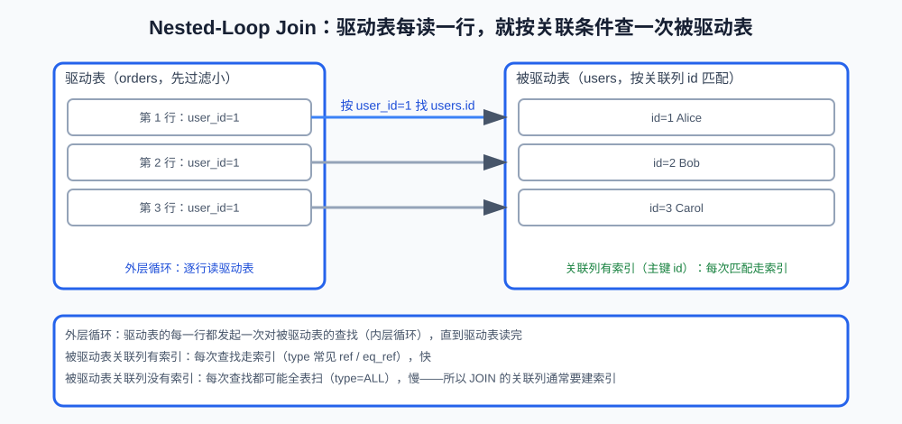

# 第10课:EXPLAIN、慢查询与查询优化

> 上一课学习了索引结构和设计。这一课学习如何确认 SQL 实际做了什么：是否使用了索引、扫描了多少行、是否回表、排序或创建临时表。
>
> 本课完整可执行示例见 `code/database/08-explain-slow-query.sql`。执行计划会受到数据量、统计信息、索引和 MySQL 版本影响，文中的结果都是典型示例。

**学习目标：**

1. 能按"拿证据 → 看计划 → 修改 → 验证"走完一次慢查询排查；
2. 能读懂一份 EXPLAIN 输出：实际索引、访问类型、预计扫描行数和常见 Extra；
3. 能区分 `possible_keys` 与 `key`、普通 EXPLAIN 与 EXPLAIN ANALYZE 的差别；
4. 能从执行计划中识别索引没被用上、回表过多、额外排序和深分页成本；
5. 能解释 JOIN 计划中的驱动表、被驱动表和关联索引的作用；
6. 知道统计信息变化会让同一 SQL 的执行计划改变，排查时不只看 SQL 文本。

## 一、慢查询排查的流程：先拿证据再修改

SQL 慢了，不应该直接凭感觉加索引。更可靠的流程是：

```text
监控或慢查询日志发现问题
    -> 获取真实 SQL 和参数
    -> EXPLAIN 查看执行计划
    -> 判断扫描、回表、排序、临时表、JOIN 或分页问题
    -> 修改 SQL 或索引
    -> 重新执行并验证耗时和计划
```

"慢"没有固定的绝对时间。几十毫秒对一个接口可能已经不可接受，几秒对离线报表却可能正常。应结合接口目标、数据量和同类请求的基线判断。

## 二、EXPLAIN：查看执行计划

上一节的流程里，判断"扫描、回表、排序、临时表"靠的就是执行计划。**执行计划（execution plan）**：优化器为一条 SQL 选定的具体执行方式——走哪棵索引、预计扫描多少行、是否要额外排序或建临时表。

**EXPLAIN** 是 MySQL 查看执行计划的语句前缀：在 SELECT 前加上它，MySQL 返回优化器预计采用的计划，不真正执行查询（`EXPLAIN ANALYZE` 除外，见第四节）。

```sql
EXPLAIN
SELECT *
FROM orders
WHERE user_id = 1
  AND status = 'paid';
```

典型输出（实际列更多，这里只保留常用列）：

```text
table   type  possible_keys                   key                         rows  filtered  Extra
orders  ref   idx_orders_user_status_time     idx_orders_user_status_time 12    100.00
```

这份输出说明：实际用了联合索引 `(user_id, status, created_at)`（看 `key`），访问方式是 ref（按索引定位多行），预计检查 12 行。各字段的含义见第三节。

## 三、EXPLAIN 重点字段

### 1. `possible_keys` 和 `key`

```text
possible_keys：优化器认为可能使用的索引
key：实际选择使用的索引
```

`possible_keys` 不为空，不代表查询真的使用了索引。判断时首先看 `key`。

`key_len`：实际使用的索引长度，可以用来确认联合索引用到了第几列（配合第 9 课的最左前缀）。

### 2. `type`：访问方式

**访问方式（access type）**：优化器定位数据的方式，粗略反映成本高低。常见类型：

| 访问方式 | 含义 | 常见场景 |
|---|---|---|
| const | 按主键或唯一索引定位到一行 | `WHERE id = 1` |
| eq_ref | JOIN 中按唯一索引匹配一行 | 被驱动表每次只匹配一行 |
| ref | 按普通索引匹配多行 | `WHERE user_id = 1` |
| range | 索引范围扫描 | `BETWEEN`、`>`、`LIKE 'abc%'` |
| index | 扫描整个索引 | 遍历整棵索引树 |
| ALL | 全表扫描 | 逐行扫数据，通常最慢 |

`const`、`eq_ref`、`ref`、`range` 通常比 `index`、`ALL` 更理想。但不能只看 `type` 下结论，还要结合 `rows`、返回数据量和实际耗时。

### 3. `rows` 和 `filtered`

`rows` 是优化器估计需要检查的行数，不是一定准确的实际行数。`filtered` 表示经过当前条件过滤后大致剩余的比例。

如果 `rows` 很大，即使最终只返回几行，也可能意味着扫描成本很高。需要结合数据分布和 `EXPLAIN ANALYZE` 进一步验证。

### 4. `Extra`：额外执行信息

| Extra 信息 | 含义 | 说明 |
|---|---|---|
| Using index | 覆盖索引，不需要回表 | 对应第 9 课覆盖索引 |
| Using where | 还需要根据条件过滤 | 索引不能完全消除过滤 |
| Using filesort | 需要额外排序 | 不一定真的使用磁盘文件 |
| Using temporary | 使用临时表 | 常见于某些分组或排序 |

`Using filesort` 不是"必然非常慢"，`Using index` 也不是"必然整体很快"。应结合扫描行数和业务数据量判断。

## 四、EXPLAIN ANALYZE：实际执行并验证

MySQL 8 可以使用：

```sql
EXPLAIN ANALYZE
SELECT id, order_no
FROM orders
WHERE user_id = 1;
```

它会实际执行查询，并展示实际行数和耗时等信息，因此更接近真实情况。和普通 EXPLAIN 的区别：

| 对比点 | EXPLAIN | EXPLAIN ANALYZE |
|---|---|---|
| 是否执行查询 | 不执行，只给预计计划 | 真实执行 |
| 输出 | 优化器估计的 rows、filtered | 实际行数、实际耗时 |
| 适用场景 | 先快速看计划 | 可控环境中验证预计与实际的偏差 |

使用 EXPLAIN ANALYZE 要注意：

- 它会真正执行语句；
- 不能随意对有副作用的修改语句使用；
- 线上执行前要评估额外负载；
- 实际耗时会受到缓存、并发和数据状态影响。

## 五、建了索引仍然慢：从执行计划找证据

建了索引还慢，问题不一定在"有没有索引"，而在"索引有没有被用上、用上之后成本是否可接受"。这一节把常见情况分类，每类先说 EXPLAIN 里怎么看出来；写法和原理的详细说明回指第 9 课。

### 1. 索引没被用上：先看 key 和 type

`possible_keys` 有候选、`key` 却是空的，说明优化器认为不值得用；`type=ALL` 说明在走全表扫描。上一课讲过这些写法的原理，这里补上它们在 EXPLAIN 里的表现：

| 常见写法 | EXPLAIN 里怎么看出来 |
|---|---|
| 跳过最左列（如只按 status 查） | 该联合索引不出现在 possible_keys，或 key 为空、type=ALL |
| 对索引列使用函数（如 YEAR(created_at)） | key 为空：索引存的是原始值，无法定位计算结果 |
| 隐式类型转换 | 可能放弃索引或扫描更多行 |
| 前置通配符（LIKE '%example.com'） | 没有确定开头，无法定位范围，key 为空 |
| 返回数据量过大 | 优化器认为全表扫描更便宜，key 为空、type=ALL |

写法和原理详见第 9 课第九节。判断标准是看执行计划里的证据，而不是背"哪些写法会失效"的清单。

### 2. 回表次数太多

走二级索引命中很多记录、查询又是 `SELECT *` 时，每一行都要回聚簇索引取完整数据（回表的概念见第 9 课）。EXPLAIN 里表现为：`key` 是二级索引、`Extra` 没有 `Using index`，同时 `rows` 很大。

可以考虑：

- 只返回真正需要的字段；
- 为高频小结果查询设计覆盖索引；
- 避免一次取出大量数据。

### 3. 排序无法使用索引：Using filesort

过滤条件能用索引，不代表 `ORDER BY` 也能直接用索引。比如只有 `(user_id, status, created_at)` 索引，却按 `status` 查再按 `created_at` 排——跳过了最左列，索引既不能定位也不能排序：

```sql
EXPLAIN
SELECT id, order_no
FROM orders
WHERE status = 'paid'
ORDER BY created_at DESC
LIMIT 20;
```

```text
table   type  possible_keys   key   rows   filtered  Extra
orders  ALL   (空)            (空)  全部行  10.00     Using where; Using filesort
```

`Using filesort` 说明要额外排序。排序字段能否利用索引，取决于列顺序和索引的最左前缀是否匹配（第 9 课第六节）。

### 4. 深分页：用执行计划验证成本

深分页的原理（被跳过的行也要被扫描）和键集分页在第 4 课分页节已经讲过，这里看它在执行计划里的表现：

```sql
EXPLAIN
SELECT id, order_no
FROM orders
ORDER BY id
LIMIT 1000000, 20;
```

```text
rows 接近全表行数，且可能伴随 Using filesort
```

如果排序字段有索引，优化器还是要先扫到第 100 万行之后。改成键集分页后，`WHERE id > 上一页游标` 直接定位起点，`rows` 明显变小。

### 5. OR 条件

```sql
WHERE indexed_col = 1 OR non_indexed_col = 2
```

复杂 OR 可能导致索引利用不充分。是否改写成 `UNION ALL`，必须根据语义和执行计划验证，不能机械套用。

## 六、JOIN 的执行计划

多表查询中，优化器通常会选择一个表作为驱动表，再根据关联条件查找另一张表：



```text
读取驱动表的一行
    -> 根据 JOIN 条件访问被驱动表
    -> 得到匹配结果
    -> 处理驱动表下一行
```

这种模型叫 **Nested-Loop Join（嵌套循环连接）**：外层循环读驱动表的行，内层循环在被驱动表里找匹配。被驱动表的关联列通常需要索引，否则每次匹配都可能扫描大量数据。

检查 JOIN 时要关注：

- 驱动表是否先过滤出较少数据；
- 被驱动表的关联字段是否有索引；
- JOIN 后是否产生大量重复行；
- 是否因为类型不一致发生转换；
- 执行计划中的访问类型和扫描行数。

## 七、慢查询日志：发现超过阈值的 SQL

慢查询日志用于发现超过阈值的 SQL。可以查看相关配置：

```sql
SHOW VARIABLES LIKE 'slow_query_log';
SHOW VARIABLES LIKE 'long_query_time';
```

临时调整需要权限，并且会影响实例：

```sql
SET GLOBAL long_query_time = 1;
```

生产环境还需要考虑日志量、磁盘空间、采样、脱敏和集中分析。慢查询日志只是发现问题的入口，真正定位仍需要 SQL、参数、执行计划和运行环境。

## 八、统计信息与执行计划变化

优化器会根据统计信息估算数据分布和访问成本。如果数据大量变化、统计信息过期，优化器可能选择不理想的索引或全表扫描。

因此遇到"以前很快、现在突然变慢"时，不能只看 SQL 文本，还要检查：

- 数据量是否明显增长；
- 数据分布是否变化；
- 索引是否被删除或失效；
- 统计信息和执行计划是否变化；
- 是否出现锁等待或资源争用；
- 是否发生了参数分布变化。

查询优化是证据驱动的过程，不是看到某个关键字就套固定结论。

## 九、常见错误

- 只看 `possible_keys`，误以为已经使用索引；
- 只看 `type`，不看 `rows`、`Extra` 和实际耗时；
- 看到 `Using filesort` 就认为一定需要修复；
- 看到全表扫描就机械加索引；
- 使用 `EXPLAIN ANALYZE` 时忘记它会真正执行查询；
- 只在开发环境验证，没有使用真实参数和数据分布；
- 只优化 SQL，不检查锁等待、连接池和数据库资源；
- 用 `DISTINCT`、`FORCE INDEX` 等手段掩盖根本问题。

## 十、面试回答模板

### 题目：SQL 慢了怎么排查？

> 我会先从监控或慢查询日志拿到真实 SQL 和参数，然后使用 EXPLAIN 查看实际使用的索引、访问类型、预计扫描行数和 Extra。如果发现全表扫描、联合索引使用不充分、回表过多、额外排序、临时表、JOIN 扫描或深分页，再根据证据调整 SQL 或索引。修改后重新验证耗时、执行计划和数据正确性，不能只凭感觉加索引。

### 题目：`key` 和 `possible_keys` 有什么区别？

> possible_keys 是优化器认为可能使用的索引，key 是实际选择的索引。判断 SQL 是否真正使用了索引要看 key，不能只看到 possible_keys 不为空就下结论。

### 题目：为什么加了索引仍然慢？

> 要看索引有没有被用上、用上之后成本是否可接受。先看 EXPLAIN 的 key 和 type：key 为空或 type=ALL 说明没走索引，常见原因是跳过最左列、对索引列用函数、隐式类型转换、前置通配符或返回数据量过大。如果走了索引仍然慢，再看 rows、Extra 和回表：命中行数很多时回表成本高，出现 Using filesort 说明排序没利用索引，深分页则要算被跳过的行数。优化不是盲目加索引，而是根据执行计划里的证据调整 SQL 或索引。

### 题目：`Using filesort` 一定代表性能问题吗？

> 不一定。它表示需要额外排序，不等于一定使用磁盘文件，也不等于一定很慢。要结合排序数据量、扫描行数、实际耗时和执行计划整体判断。小结果集的额外排序可能完全可以接受。

## 十一、这一课学到什么程度可以继续

```text
能使用 EXPLAIN 查看一条 SQL 的执行计划
能区分 possible_keys 和 key
能解释 type、rows 和常见 Extra
能识别全表扫描、回表、排序、临时表和深分页
能按证据排查一条慢 SQL
能说明 EXPLAIN ANALYZE 会实际执行查询
能从 JOIN 执行计划中关注驱动表和关联索引
知道慢查询也可能来自锁等待、数据分布和资源争用
```

下一课将学习事务、ACID 与隔离级别。
