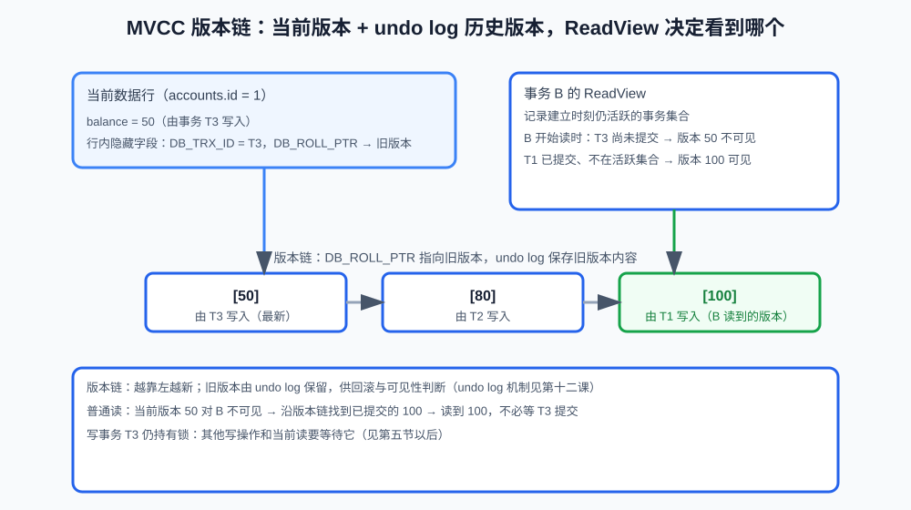

# 第12课:MVCC、快照读、当前读与锁

> 上一课介绍了事务和隔离级别。这一课继续回答一个核心问题：多个事务同时读写同一份数据时，InnoDB 如何决定谁能看到什么、谁需要等待谁？
>
> 本课完整实验见 `code/database/10-mvcc-locks.sql`。锁和可见性都以 MySQL 8.x 的 InnoDB 为前提，实际现象还会受到索引、隔离级别和事务时机影响。

**学习目标：**

1. 能区分隔离级别、MVCC 和锁三者的职责；
2. 能画出 MVCC 的版本链，解释 undo log 和 ReadView 的基本作用；
3. 能区分快照读和当前读，说出各自的典型语句、业务用途，以及在四种隔离级别下的行为差异；
4. 能区分行锁、表锁、共享锁和排他锁；
5. 能解释间隙锁、临键锁和索引对锁范围的影响；
6. 能用两个会话制造锁等待和死锁，并区分两者、完成排查；
7. 能说出降低死锁概率的方法。

## 一、三个概念的分工：隔离级别、MVCC 与锁

隔离级别、MVCC 和锁经常一起出现，但职责不同：

```text
隔离级别：规定事务之间应该看到什么
MVCC：通过多个版本帮助普通查询实现可见性
锁：控制修改、当前读和范围操作的互斥
```

**多版本并发控制（MVCC，Multi-Version Concurrency Control）**：让普通查询在多个版本中选择可见版本，而不是必须等待写事务完成。

可以把数据库并发理解成两条线：

```text
普通查询读哪个版本？ -> MVCC、ReadView、undo log
修改和当前读能否同时进行？ -> 行锁、间隙锁、临键锁
```

并发要处理的不止"读和写"这一种组合。按组合看，机制完全不同：

| 并发组合 | 由谁处理 | 行为 |
|---|---|---|
| 读 vs 写 | MVCC | 读走历史版本，不等待，也不阻塞写 |
| 写 vs 写 | 行锁 | 后到者等待，对方提交后才能继续 |
| 写 vs 当前读（FOR UPDATE 等） | 行锁 | 等待 |

所以 MVCC 的价值不在"让写不冲突"——写和写之间本来就靠锁排队；它的价值是把占绝大多数的"读"从锁里解放出来：读永远不排队等写，写也永远不排队等读，只有写和写之间才等待。

不能因为普通 `SELECT` 通常不等待写入，就认为数据库没有锁；也不能因为使用了 MVCC，就认为所有读写都不会互相阻塞。

## 二、MVCC：用多个版本让普通读不必等写

如果数据库只保存数据的一个当前版本，写事务修改一行时，其他查询可能必须等待：

```text
事务 A 修改余额
    -> 锁住记录
    -> 事务 B 等待
    -> A 提交
    -> B 才能读取
```

MVCC 的基本思想是保留必要的历史版本：

```text
当前版本：50
历史版本：100
```

读事务根据自己的读取规则选择可见版本。这样，普通读通常不需要直接读取未提交的新版本，也不必和普通写操作完全互相阻塞。

### 1. 版本链和 undo log

一行数据可能经历：

```text
余额：100 -> 80 -> 50
```

可以粗略理解为当前记录和历史版本通过版本链关联：



版本链靠行内的隐藏字段串起来。InnoDB 每一行除了业务字段，还维护几个对用户不可见的字段：

| 隐藏字段 | 含义 |
|---|---|
| DB_TRX_ID | 最近一次修改这一行的事务 ID |
| DB_ROLL_PTR | 回滚指针，指向 undo log 中旧版本的位置 |
| DB_ROW_ID | 隐藏行 ID，没有主键时用作聚簇索引键 |

以余额变化为例：事务修改后，新版本的行会带上"由哪个事务修改"（DB_TRX_ID）和"旧版本在哪里"（DB_ROLL_PTR）；沿着 DB_ROLL_PTR 找到 undo log 里的旧版本，再从旧版本继续向前，就形成完整版本链。undo log 保存的是旧版本内容本身，供回滚和可见性判断使用。（undo log 的完整机制在第 14 课展开。）

事务读取当前版本时，如果发现它对当前事务不可见，就沿着版本链寻找合适的旧版本。

### 2. ReadView

`ReadView` 可以理解为事务在一致性读时使用的一份"可见性判断依据"。它记录**视图建立那一刻仍在活跃（未提交）的事务集合**，帮助 InnoDB 判断：

- 某个版本由哪个事务产生（看行的 DB_TRX_ID）；
- 产生这个版本的事务是否已经提交；
- 当前事务是否应该看到这个版本。

判断规则本质上只有一句话：一个版本可见，当且仅当产生它的事务**已经提交**，并且**不在视图记录的活跃事务集合里**。展开成比较流程：

```text
读版本的 DB_TRX_ID，和 ReadView 记录的事务信息比较：
    -> 事务 ID 比所有活跃事务都小：早已提交，可见
    -> 事务 ID 在活跃集合里：尚未提交，不可见，沿链往前找
    -> 事务 ID 比视图建立时所有事务都大：视图之后才开始的，不可见
    -> 不在活跃集合里、但 ID 介于两者之间：已提交，可见
```

`ReadView` 里保存活跃事务 ID 集合（m_ids）、集合中最小的 ID（min_trx_id）和下一个要分配的事务 ID（max_trx_id），上面的比较就是拿 DB_TRX_ID 和它们对照。不需要把 ReadView 简化成"数据库拍了一张完整数据快照"——它更接近基于事务状态和版本链进行可见性判断的机制。

## 三、快照读

在 InnoDB 中，普通的非锁定 `SELECT` 通常是**一致性读**，也常被称为**快照读（snapshot read）**：按当前事务的读取视图选择可见版本。

```sql
SELECT balance
FROM accounts
WHERE id = 1;
```

它通常不会读取其他事务尚未提交的修改，也通常不会因为普通写事务持有行锁就直接等待。

### 1. 快照读读到的是旧版本：卖的是"一致"，不是"最新"

快照读返回的不一定是当前最新的值。先分清两种"不对"：

```text
脏数据：读到从未提交、随后被回滚的修改 —— 真正的错误
旧版本：读到曾经提交过的状态 —— 合法，只是不新鲜
```

已提交的旧版本不是错误：在并发数据库里，"最新"是移动靶（A 提交前是 100，提交后是 50），一个事务的正确性由它的读取规则决定，而不是由磁盘上最新的字节决定。

MVCC 真正的价值是**一致性**：让一个事务看到的版本稳定且自洽——要么全看到某次提交之前，要么全看到之后，不会出现"一半新一半旧"的自相矛盾拼盘。数据库宁可给一份一致的旧快照，也不给一份混乱的最新拼盘。

```text
旧但一致 > 新但混乱
```

需要基于最新值做决策的业务（扣库存、扣款）不能用快照读，要改用当前读或条件更新（第四节、第 13 课）。展示和报表类查询通常只需要一致、可用，不需要最新。

### 2. 读取视图的建立时机

上一课实验 1 已经演示过：A 修改 50 未提交，B 的普通 SELECT 读到已提交的 100（第 11 课第七节）。这一课要补的是机制：B 读到的是读取视图允许它看到的版本——这里的"读取视图"就是上一小节的 ReadView。

一个容易被问到的细节：在 `REPEATABLE READ` 下，一致性读的读取视图**在第一次快照读时建立**（不是 `START TRANSACTION` 时）。视图建立之后其他事务的提交，对 B 后续的普通读不可见：

```text
B 开启事务（视图尚未建立）
    -> B 第一次 SELECT：建立读取视图
    -> A 修改并提交
    -> B 第二次 SELECT：仍看到视图建立时的版本
```

如果 B 在 A 提交之后才第一次读取，视图里就会包含 A 的提交，读到新值。所以"可重复读"的边界取决于第一次读取的时机，实际实验时必须严格记录两个会话的操作顺序。

## 四、当前读

有些业务不能读取历史版本，而必须读取最新版本并根据它继续修改。这类读取通常称为**当前读（current read）**：

```sql
SELECT balance
FROM accounts
WHERE id = 1
FOR UPDATE;
```

常见当前读包括：

- `SELECT ... FOR UPDATE`；
- `SELECT ... FOR SHARE`；
- `UPDATE`；
- `DELETE`。

`FOR UPDATE` 通常读取最新版本，并对符合条件的记录加排他锁。若另一事务正在修改目标记录，当前读可能等待对方提交或回滚。

快照读和当前读对照：

| 对比点 | 快照读（普通 SELECT） | 当前读（FOR UPDATE 等） |
|---|---|---|
| 读取的版本 | 按读取视图选可见版本 | 最新版本 |
| 是否加锁 | 通常不加锁 | 加共享锁或排他锁 |
| 是否等待写事务 | 通常不等待 | 目标记录被锁时可能等待 |
| 典型语句 | `SELECT` | `SELECT ... FOR UPDATE / FOR SHARE`、`UPDATE`、`DELETE` |

### 1. 快照读和当前读的业务区别

展示页面上的订单列表通常可以使用普通快照读：

```sql
SELECT id, status
FROM orders
WHERE user_id = 1;
```

扣库存前必须确认最新库存，就不能只依赖普通快照读：

```sql
SELECT stock
FROM products
WHERE id = 1
FOR UPDATE;
```

但"读取最新版本"不等于"业务一定正确"。仍然需要事务边界、库存校验、影响行数和幂等设计。

### 2. 两种读在四种隔离级别下的行为

第 11 课讲过四种隔离级别，这里把"快照读 / 当前读 × 隔离级别"合起来看：

| 隔离级别 | 快照读（普通 SELECT） | 当前读（FOR UPDATE 等） |
|---|---|---|
| READ UNCOMMITTED | 非锁定读，无一致视图；InnoDB 的普通 SELECT 实际不产生脏读 | 读最新已提交 + 加锁，不读脏数据 |
| READ COMMITTED | 语句级快照：每条语句看到最新已提交，同一事务两次读可能不同 | 读最新已提交 + 加锁（无间隙锁） |
| REPEATABLE READ | 事务级快照：第一次读建立视图，事务内复用，两次读一致 | 读最新已提交 + 加锁 + 间隙锁/临键锁（见第六节） |
| SERIALIZABLE | 普通 SELECT 自动转成当前读（加共享锁），不再走快照 | 读最新已提交 + 加锁 |

从这张表可以抽出三条主线：

- **当前读在任何隔离级别下都读"最新已提交"**——因为它必须先拿锁，撞上对方未提交的锁就等待，永远读不到对方未提交的修改。隔离级别改变的不是"当前读读什么"，而是"锁的范围"；
- **快照读的变量是视图范围**：READ COMMITTED 是语句级，REPEATABLE READ 是事务级，SERIALIZABLE 没有快照读；
- **当前读的变量是锁范围**：READ COMMITTED 只有记录锁，REPEATABLE READ 加间隙锁/临键锁，所以 RR 的锁定读能防幻读。

一个 InnoDB 特殊性（常考）：标准里的 READ UNCOMMITTED 允许脏读，但 InnoDB 的普通 SELECT 仍走非锁定的一致性读机制，实际几乎不会读到未提交数据（只是没有一致的视图）。

## 五、锁的基本分类

### 1. 行锁和表锁

行锁只影响符合条件的记录，理论上并发度较高：

```sql
SELECT *
FROM products
WHERE id = 1
FOR UPDATE;
```

修改商品 1 通常不应阻塞修改商品 2。

表锁影响整张表，并发度较低。InnoDB 主要使用行级锁，但这不代表每条语句都只锁一行。实际锁范围取决于：

- 使用的索引；
- 查询条件；
- 是否是唯一索引精确匹配；
- 是否是范围查询；
- 当前隔离级别；
- 读操作属于快照读还是当前读。

没有合适索引时，当前读可能扫描并锁住大量记录，表现得像大范围锁甚至"像表锁"。

### 2. 共享锁和排他锁

```text
共享锁（S 锁）：多个事务可以持有共享锁，但和排他修改存在冲突
排他锁（X 锁）：用于修改，通常不允许其他事务同时修改同一记录
```

在 MySQL 8 中，可以使用：

```sql
SELECT stock
FROM products
WHERE id = 1
FOR SHARE;
```

读取并准备修改时，常见的是 `FOR UPDATE`：

```sql
SELECT stock
FROM products
WHERE id = 1
FOR UPDATE;
```

业务上更重要的是说明"哪条语句、在什么事务中、对什么范围加了什么锁"，而不是只背锁的名称。

## 六、间隙锁和临键锁

InnoDB 在 `REPEATABLE READ` 下，为了控制范围并发，可能使用间隙锁和临键锁。

### 1. 间隙锁

间隙锁锁住索引记录之间的空隙，主要用于阻止其他事务在范围内插入新记录：

```text
索引值：10      20      30
          ^间隙^
```

它不一定锁住某一条已经存在的记录，而是限制某个范围内的插入。

### 2. 临键锁

临键锁（next-key lock）可以粗略理解为"记录锁 + 前面的间隙锁"，保护一条记录及其前方范围。它是 InnoDB 在范围查询中控制幻读的一种实现机制。

例如：

```sql
SELECT *
FROM products
WHERE stock BETWEEN 10 AND 20
FOR UPDATE;
```

实际锁住哪些索引记录和间隙，取决于索引、数据分布、查询条件和隔离级别。不能从 SQL 表面简单断言"必然锁住某几行"。

## 七、索引影响锁范围：扫得少，锁得少

假设有索引：

```sql
CREATE INDEX idx_products_stock
ON products(stock);
```

当前读按索引范围查找时，数据库可以在索引上更精确地定位目标范围。没有合适索引时，数据库可能需要扫描更多记录，锁竞争范围也可能扩大。

因此，索引不仅影响查询速度，还影响并发时的锁范围：

```text
索引命中更准确
    -> 扫描记录更少
    -> 当前读锁住的范围通常更小
    -> 其他事务等待更少
```

这也是"查询条件和加锁范围"必须一起分析的原因。

## 八、锁等待和锁等待超时

如果事务 A 已经持有一行的排他锁，事务 B 修改同一行时通常需要等待：

```text
A：UPDATE id=1，持有锁
B：UPDATE id=1，等待 A
A：COMMIT 或 ROLLBACK
B：继续执行
```

### 实验 1：制造一次锁等待

会话 A 修改后暂不提交：

```sql
START TRANSACTION;
UPDATE accounts SET balance = 50 WHERE id = 1;
-- 暂不提交
```

会话 B 修改同一行：

```sql
START TRANSACTION;
UPDATE accounts SET balance = 80 WHERE id = 1;
-- 此时 B 通常等待，直到 A 提交或回滚
```

B 通常卡在等待 A 释放锁。让 A 执行：

```sql
COMMIT;
```

B 继续完成修改。这就是锁等待：B 等待 A，没有形成循环。如果等待时间超过配置，B 可能收到锁等待超时错误。

锁等待不一定是死锁：

```text
锁等待：B 等待 A，通常没有形成循环
死锁：A 等待 B，同时 B 等待 A，形成循环
```

查看等待和事务信息可以使用：

```sql
SHOW PROCESSLIST;
```

MySQL 8 还可以查询 Performance Schema：

```sql
SELECT *
FROM performance_schema.data_locks;

SELECT *
FROM performance_schema.data_lock_waits;
```

`SHOW ENGINE INNODB STATUS` 也会输出锁相关信息，适合需要查看 InnoDB 内部状态时使用。不同版本中字段和输出可能不同，排查时要结合事务 ID、线程、表名、索引和锁模式阅读。

## 九、死锁

死锁是多个事务互相持有对方需要的锁：

```text
事务 A：持有记录 1，等待记录 2
事务 B：持有记录 2，等待记录 1
```

### 实验 2：制造一次死锁

会话 A 和会话 B 都以当前读锁住一行，再互相请求对方持有的行：

```sql
-- 会话 A
START TRANSACTION;
SELECT * FROM accounts WHERE id = 1 FOR UPDATE;
-- 不提交

-- 会话 B
START TRANSACTION;
SELECT * FROM accounts WHERE id = 2 FOR UPDATE;
-- 不提交
```

然后两个会话交换请求：

```sql
-- 会话 A
SELECT * FROM accounts WHERE id = 2 FOR UPDATE;   -- 等待 B

-- 会话 B
SELECT * FROM accounts WHERE id = 1 FOR UPDATE;   -- 等待 A，形成循环
```

InnoDB 通常会检测到循环等待，主动回滚其中一个事务（通常报死锁错误），让另一个继续。被回滚的一方收到死锁错误，需要应用配合：

- 捕获数据库异常；
- 限制重试次数；
- 使用退避等待；
- 保证操作幂等；
- 记录 SQL、事务和业务上下文。

降低死锁概率的方法：

```text
统一多个事务的访问顺序
缩短事务持有锁的时间
使用合适索引减少扫描范围
避免在事务中执行网络请求
```

死锁不是简单地"把数据库配置成不检测"就能解决，应该从事务访问顺序和锁范围分析原因。

## 十、常见错误

- 把 MVCC 当成完全没有锁；
- 认为 MVCC 保存了每行数据的完整历史副本（实际靠隐藏字段 DB_TRX_ID、DB_ROLL_PTR 和 undo log 按需回溯）；
- 认为普通 `SELECT` 一定读取最新数据；
- 认为 `FOR UPDATE` 无论条件如何都只锁一行；
- 没有索引却以为 InnoDB 一定能精确加行锁；
- 把锁等待超时和死锁混为一谈；
- 发生死锁后无限重试；
- 只看表名，不查看具体索引和锁范围；
- 把 `REPEATABLE READ` 下的所有读都理解成同一张静态快照。

## 十一、面试回答模板

### 题目：快照读和当前读有什么区别？

> 普通 SELECT 通常是一致性读或快照读，根据事务的读取视图选择可见版本，通常不会直接读取其他事务未提交的修改；SELECT ... FOR UPDATE、SELECT ... FOR SHARE、UPDATE 和 DELETE 属于当前读，通常读取最新版本并参与锁竞争。隔离级别影响的是快照读的视图范围（READ COMMITTED 是语句级、REPEATABLE READ 是事务级）和当前读的锁范围（REPEATABLE READ 下带间隙锁、SERIALIZABLE 下连普通 SELECT 都会变成加锁读）；当前读在任何隔离级别下都读最新已提交版本。需要根据最新数据继续修改时，应该使用当前读和明确的事务边界。

### 题目：MVCC 是如何实现的？

> InnoDB 通过行内隐藏字段、undo log 和 ReadView 实现多版本并发控制。每行记录有 DB_TRX_ID（最近修改它的事务 ID）和 DB_ROLL_PTR（指向 undo log 旧版本的指针），当前版本沿着 DB_ROLL_PTR 和 undo log 串成版本链。一致性读开始时创建 ReadView，记录当时活跃的未提交事务集合；判断一个版本是否可见，就是看产生它的 DB_TRX_ID 是否已提交、且不在活跃集合里——不可见就沿版本链往前找。这样普通读直接读历史版本，不必等写事务提交。

### 题目：`SELECT ... FOR UPDATE` 一定只锁一行吗？

> 不一定。它是当前读，会对符合条件的范围加锁，实际范围取决于索引、查询条件、是否是唯一索引精确匹配、隔离级别和数据分布。没有合适索引或使用范围条件时，可能扫描并锁住较多记录，甚至涉及间隙锁和临键锁。

### 题目：死锁是怎么产生的？怎么排查和处理？

> 死锁是多个事务互相持有对方需要的锁、形成循环等待。排查时先确认每个事务持有哪把锁、在等哪把锁，看事务 ID、持锁和等待关系（SHOW PROCESSLIST、performance_schema.data_lock_waits、SHOW ENGINE INNODB STATUS 都有相关信息）。处理：InnoDB 检测到循环等待后会回滚其中一个事务，应用捕获死锁错误后按业务重试（有限次数 + 退避 + 幂等）；降低概率靠统一访问顺序、缩短事务、减少扫描范围，而不是关闭检测。

## 十二、这一课学到什么程度可以继续

```text
能区分隔离级别、MVCC 和锁的职责
能解释 undo log、ReadView 和版本链的基本作用
能区分快照读和当前读
能说明 FOR UPDATE 为什么会等待或加锁
能区分行锁、表锁、共享锁和排他锁
能解释间隙锁和临键锁的基本目的
知道索引会影响当前读的锁范围
能区分锁等待超时和死锁
能用两个会话制造锁等待和死锁并完成排查
```

下一课将把这些机制用于下单、库存和账户等业务并发控制。
