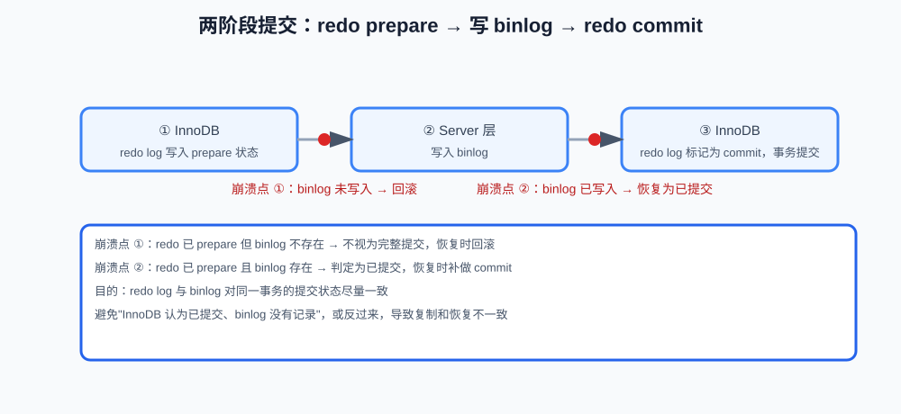

# undo log、redo log 与 binlog

> 前面几课讨论了事务、MVCC、锁和业务并发。这一课回答另一个核心问题：事务提交后，数据如何持久化；数据库异常重启后，如何恢复已经提交的修改；主从复制和时间点恢复又依赖什么？
>
> 本课完整可执行的只读检查和时序示例见 `code/database/12-logs-recovery.sql`。日志涉及存储引擎、Server 层和磁盘刷盘，具体行为以 MySQL 8.x 配置和官方文档为准。

**学习目标：**

1. 能说出 undo log、redo log、binlog 的所属层级、内容和用途；
2. 能解释 undo log 如何支持回滚和 MVCC，以及长事务为什么影响它；
3. 能解释"先写日志、后刷数据页"和 redo log 的崩溃恢复过程；
4. 能解释 binlog 的用途和 STATEMENT / ROW / MIXED 格式的差别；
5. 能解释 redo log 与 binlog 为什么需要两阶段提交协调；
6. 能用 `SHOW VARIABLES` 做基础日志配置检查；
7. 知道日志不能替代全量备份，复制也不是备份。

## 一、三类日志的分工：undo log、redo log 与 binlog

数据库修改一行数据时，不一定立刻把对应的数据页写入磁盘：

```text
修改内存中的数据页
    -> 后续再刷入磁盘
```

如果修改刚发生数据库就异常退出，内存中的数据可能还没有写入数据文件。另一方面，事务回滚和 MVCC 又需要知道旧版本，主从复制还需要知道数据库发生了哪些逻辑变更。

因此，MySQL 中常见的三类日志各自负责不同问题：

```text
undo log：撤销修改、保存历史版本
redo log：重做修改、保证崩溃恢复
binlog：记录逻辑变更、用于复制和恢复
```

不要把它们都简单叫成“操作日志”。它们的记录层级、内容和用途不同。

## 二、undo log：回滚和历史版本

**undo log**：InnoDB 保存旧版本和撤销信息的日志，用于事务回滚和 MVCC 历史版本。

### 1. 事务回滚

假设原值是 100，事务把它修改成 50：

```text
原值：100
新值：50
```

如果事务还没有提交就执行 `ROLLBACK`，数据库需要知道如何撤销这次修改，恢复到 100。`undo log` 保存回滚所需的旧版本信息。

```sql
START TRANSACTION;

UPDATE accounts
SET balance = 50
WHERE id = 1;

ROLLBACK;
```

回滚并不是简单地从应用内存恢复变量，而是数据库根据事务修改记录撤销已经发生的数据变更。

### 2. MVCC 历史版本

undo log 还参与 InnoDB 的 MVCC：

```text
当前版本：50
    -> undo log 中的旧版本：100
```

如果某个事务按照自己的 ReadView 不能看到当前版本，就可以沿着历史版本链寻找它应该看到的版本。因此：

```text
undo log = 回滚信息 + MVCC 所需的历史版本信息
```

### 3. 长事务为什么影响 undo log

只要某些事务仍然可能需要读取旧版本，数据库就不能过早清理相关历史版本。长事务可能导致：

- undo log 持续增长；
- 历史版本保留时间变长；
- purge 清理受到影响；
- 存储空间和读写开销增加。

因此，长事务不仅会持有锁，还可能影响版本清理和整体性能。

## 三、redo log：崩溃恢复

**redo log**：InnoDB 记录"数据页做了哪些物理修改"的日志，用于数据库异常重启后的重做恢复。**刷盘（flush）**：把内存中的数据页写入磁盘的过程。

### 1. 为什么不每次直接刷数据页

如果每次修改都立即把随机位置的数据页刷入磁盘，写入成本可能很高。InnoDB 通常采用先记录日志、后异步刷数据页的方式：

```text
修改 Buffer Pool 中的数据页
    -> 写入 redo log
    -> 事务提交
    -> 后续再把数据页刷盘
```

这里的 redo log 属于 InnoDB 存储引擎。它更接近“对数据页做了哪些物理层面的修改”，用于数据库异常重启后的重做。

### 2. 异常重启时发生什么

简化理解：

```text
事务修改数据页
    -> redo log 已经持久化
    -> 数据页还没有刷盘
    -> MySQL 异常退出
    -> 重启时根据 redo log 重做修改
```

这样，已经满足提交持久化条件的修改，即使当时数据页还没有写入最终位置，也能够在恢复阶段重新应用。

redo log 主要解决：

```text
本机 InnoDB 数据页如何在崩溃后恢复
```

它不是用来替代备份的，也不是主要为主从复制设计的。

## 四、binlog：逻辑变更、复制和恢复

### 1. binlog 位于哪一层

`binlog` 是 MySQL Server 层的二进制日志，记录数据库发生的逻辑变更，例如：

```text
哪张表发生了 INSERT
哪些行被 UPDATE
哪些记录被 DELETE
```

它可以使用不同格式：

```text
STATEMENT：记录 SQL 语句
ROW：记录行变化
MIXED：根据情况混合使用
```

现代业务通常重点关注 ROW 格式，因为它对很多非确定性语句的复制更明确，但具体配置仍应结合版本和运维要求决定。

### 2. binlog 的用途

binlog 常用于：

- 主从复制；
- 增量备份；
- 时间点恢复；
- 数据同步和变更订阅。

例如，恢复到某个备份之后的时间点，通常需要：

```text
恢复全量备份
    -> 按顺序应用备份之后的 binlog
    -> 回放到目标时间点
```

binlog 主要解决的是“数据库发生了哪些逻辑变更、如何传播和回放”，与 redo log 的本机崩溃恢复职责不同。

## 五、三类日志对比

| 日志 | 所属层级 | 主要内容 | 主要用途 |
|---|---|---|---|
| undo log | InnoDB | 旧版本和撤销信息 | 回滚、MVCC |
| redo log | InnoDB | 数据页修改的重做信息 | 崩溃恢复 |
| binlog | MySQL Server | 逻辑变更事件 | 复制、备份、时间点恢复 |

可以用三个问题记忆：

```text
想撤销当前事务？ -> undo log
本机突然宕机后重做？ -> redo log
把变更复制到其他实例或按时间回放？ -> binlog
```

## 六、redo log 与 binlog 都需要：一个管本机恢复，一个管逻辑传播

它们记录的内容和服务对象不同：

```text
redo log：InnoDB 引擎层，偏向本机数据页恢复
binlog：Server 层，偏向逻辑变更传播和恢复
```

如果只有 redo log：

- 可以帮助本机 InnoDB 恢复；
- 但不适合作为统一的主从复制日志；
- 也不方便按逻辑事件进行时间点回放。

如果只有 binlog：

- 可以记录逻辑变化；
- 但不能替代 InnoDB 面向数据页的快速崩溃恢复机制。

所以两者需要协调，既保证本机恢复，也保证复制和逻辑恢复的一致性。

## 七、事务提交和两阶段提交

一次事务提交涉及 InnoDB 的 redo log 和 Server 层 binlog。为了避免两边状态不一致，可以用简化的两阶段提交理解：

```text
1. InnoDB 将 redo log 写入 prepare 状态
2. Server 写入 binlog
3. InnoDB 将 redo log 标记为 commit
```



异常时可能出现不同阶段：

```text
redo log 已 prepare，binlog 已存在
    -> 根据 binlog 等信息判断事务是否应该提交

redo log 已 prepare，但 binlog 不存在
    -> 通常不能把它当成完整提交事务
```

这里只需要掌握设计目的：

```text
让 redo log 和 binlog 对同一个事务的提交状态尽量一致
```

不需要在本阶段深入源码中的 LSN、页结构和所有崩溃时序。

## 八、刷盘和持久性

“执行了 `COMMIT`”和“数据页已经写到最终数据文件”不是同一件事。持久性依赖日志刷盘和存储设备确认等多个环节。

可以这样理解：

```text
提交成功的关键修改
    -> 相关日志按配置持久化
    -> 数据页可以稍后异步刷盘
    -> 异常重启时使用日志恢复
```

具体持久性和性能之间的取舍会受到配置影响，例如：

- redo log 刷盘策略；
- binlog 刷盘策略；
- 操作系统和文件系统缓存；
- 磁盘设备是否真正持久化；
- MySQL 版本和部署架构。

不要只根据某个参数就绝对断言“数据一定不会丢”或“提交一定已经写入物理盘”。

## 九、如何查看相关配置

可以使用只读语句查看日志是否启用：

```sql
SHOW VARIABLES LIKE 'log_bin';            -- binlog 是否启用
SHOW VARIABLES LIKE 'binlog_format';      -- binlog 格式：STATEMENT / ROW / MIXED
SHOW VARIABLES LIKE 'log_bin_basename';   -- binlog 文件路径前缀
SHOW VARIABLES LIKE 'innodb_log%';        -- InnoDB redo log 相关配置
```

查看 binlog 文件和位置：

```sql
SHOW BINARY LOG STATUS;
```

在部分 MySQL 版本或兼容环境中，也可能使用：

```sql
SHOW MASTER STATUS;
```

查看具体事件通常需要使用 `mysqlbinlog` 等日志读取工具，而不是直接把二进制文件当成文本打开。生产环境查看和清理 binlog 还要结合备份、复制和保留策略。

## 十、备份、恢复与日志的关系

日志不能替代完整备份。一个基本恢复流程可以是：

```text
最近一次全量备份
    -> 应用备份之后的 binlog
    -> 回放到目标时间点
```

三者职责不同：

```text
redo log：实例崩溃后的快速恢复
全量备份：恢复一份完整数据基线
binlog：从基线继续应用增量变化
```

主从复制也不是备份的替代品：如果误删操作被复制到从库，从库同样可能执行误删。需要独立备份和恢复演练。

## 十一、常见错误

- 把 undo log、redo log、binlog 都理解成同一种日志；
- 认为 binlog 可以直接替代 redo log；
- 认为有 redo log 就不需要备份；
- 把主从复制当成备份；
- 以为事务提交后数据页一定立刻刷入最终数据文件；
- 忽略长事务对 undo log 清理的影响；
- 直接删除 binlog 文件，不考虑复制和备份状态；
- 只配置备份，不做恢复演练。

## 十二、面试回答模板

### 题目：undo log、redo log、binlog 有什么区别？

> undo log 位于 InnoDB，主要用于事务回滚和 MVCC 历史版本；redo log 也位于 InnoDB，主要用于数据页的崩溃恢复；binlog 位于 MySQL Server 层，记录逻辑变更，主要用于主从复制、备份和时间点恢复。三者记录层级和用途不同，不能互相替代。

### 题目：为什么需要 redo log 和 binlog？

> redo log 面向 InnoDB 本机数据页恢复，保证提交后的修改在异常重启后能够重做；binlog 面向 Server 层的逻辑变更传播，用于复制和恢复。两者职责不同，事务提交时通过两阶段提交协调状态，避免一个记录成功而另一个没有记录。

### 题目：为什么需要两阶段提交？

> 一次提交同时涉及 InnoDB 的 redo log 和 Server 层的 binlog。如果不协调，可能出现在崩溃恢复时 redo 认为已提交、但 binlog 没有记录（或反过来）的不一致。两阶段提交先让 redo 进入 prepare，再写 binlog，最后把 redo 标记为 commit；崩溃时根据 binlog 是否存在判断事务是否算提交。这样本机崩溃恢复和复制、备份恢复对同一事务的状态尽量一致。

### 题目：数据库异常重启后如何恢复已提交事务？

> InnoDB 重启时会进行崩溃恢复，根据 redo log 重做已经持久化日志但数据页尚未刷盘的修改，并处理未完成事务的回滚。redo log 负责本机引擎恢复；如果是备份后的时间点恢复，则还需要先恢复全量备份，再按顺序应用 binlog。

## 十三、这一课学到什么程度可以继续

```text
能说出 undo log、redo log、binlog 的层级和用途
能解释 undo log 如何支持回滚和 MVCC
能解释 redo log 如何支持崩溃恢复
能解释 binlog 如何用于复制和时间点恢复
能说出 redo log 与 binlog 为什么需要协调
能理解两阶段提交的目的
知道日志不能替代全量备份和恢复演练
知道长事务会影响 undo log 清理
能使用 SHOW VARIABLES 做基础日志配置检查
```

下一课将学习备份、恢复与复制。
