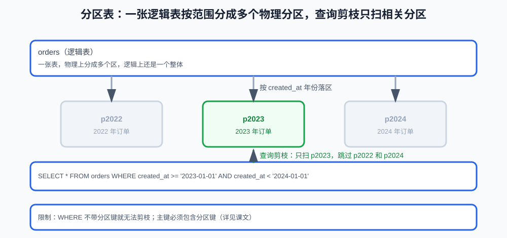

# 数据归档、冷热分离与分区

> 第 13 课讲了备份、恢复与复制。这一篇解决"数据持续增长后，单张表越来越大怎么办"：冷热分离、归档和分区，是大表治理的日常手段，也是分库分表之前先要考虑的选项。
>
> 本篇按知识点讲：为什么需要、三种手段各自是什么、怎么选、边界在哪。

**学习目标：**

1. 能说清数据增长会给大表带来哪些问题；
2. 能解释冷热分离的思路、归档的基本流程和一致性保障；
3. 能说清分区表是什么、分区表达式如何影响剪枝、有什么限制；
4. 能区分归档 / 分区 / 分库分表的边界（各解决什么问题、各付什么代价）。

## 一、数据增长的问题：查询、备份与维护都被全表拖慢

业务跑几年后，核心表（订单、日志）会持续变大：

```text
查询变慢：索引变大，随机 IO 变多，B+ 树层级可能增加
备份变慢变重：全量备份的时间和空间随数据量线性增长
维护变难：ALTER TABLE、统计信息更新、崩溃恢复都更慢
热数据被冷数据拖累：大部分查询只访问近期数据，却被全表拖慢
```

核心矛盾：**查询和运维都是按"全表"来的，但业务只关心"近期"数据**。冷热分离就是把"热"和"冷"分开对待。

## 二、冷热分离

```text
热数据：近期、高频访问（如近 30/90 天的订单）
冷数据：历史、低频访问（一年前的订单，只有审计或报表才碰）
```

思路：把冷数据从主表中移走，让主表只保留热数据，变小变快：

```text
热表（orders_active）：近期订单，承载日常查询
历史表（orders_archive）：历史订单，低频访问，允许更慢的查询
```

冷热分离的收益：主表变小、索引变小、备份变快、日常查询只碰热数据。

冷热分离不只是"两张表"，常见形态还包括：

```text
最小形态：热表 + 历史表（同一实例内）
进一步：历史表搬到独立的历史库 / 只读实例
再进一步：超冷数据落到对象存储或分析型存储（本课只建立边界意识）
```

无论哪种形态，都要回答"冷数据怎么查"：历史表保留可对账的字段和查询索引，应用按时间路由（近期查热表、超过边界查历史表），报表任务直接读历史表或历史库。冷热边界时间（如 90 天）由业务访问频度决定，不是拍脑袋定的。

## 三、归档的基本流程

归档 = 把冷数据从主表搬到历史表/历史库，并删除主表里的副本：

```text
1. 按时间划界：如 created_at < '2024-01-01' 视为冷数据
2. 分批搬移：INSERT INTO orders_archive SELECT ... WHERE 条件
   同时记录已搬移的主键范围
3. 分批删除：DELETE FROM orders WHERE id IN (已搬移的范围)
4. 校验：主表和历史表的行数、金额对账
```

要点：

- 必须**分批**做（第 4 课讲过分批删除），避免一次大事务锁很久；
- 搬移和删除之间要考虑业务：归档期间该范围的订单要停写或和业务约定；
- 历史表可以少建索引、允许更慢查询，但要保证对账能力；
- 归档不是"删了不管"，历史数据仍要有备份和保留策略。

### 1. 搬移和删除之间的一致性

"先搬后删"存在一个窗口：如果只搬不移，主表没变小；如果搬完没校验就删，可能两边都丢数据。可靠的做法是**分批搬、分批校验、分批删**，并且用主键范围作为断点：每个批次记录"已搬到哪个 id / 哪个时间点"，崩溃后从断点继续，而不是从头再来。

```text
搬移批次 1（记录游标：id <= 10000）-> 校验批次 1 -> 删除批次 1
搬移批次 2（记录游标：id <= 20000）-> 校验批次 2 -> 删除批次 2
...
```

删之前要把"已搬移的范围"记牢：`DELETE` 只删已搬移范围内的 id，避免搬移和删除之间新写入的、不该删的数据被误删。

### 2. 大 DELETE 的代价

一次删几十万行不只是"慢"：

- 每个被删行都要写 undo log，**undo log 和历史版本会瞬间膨胀**（第 12 课）；
- `DELETE` 是当前读，会按范围加锁，**锁竞争和死锁概率上升**（第 10 课）；
- 大批量删除回放到从库，**复制延迟会明显拉长**（第 13 课）。

所以归档必须分批、限速，而不是一条 `DELETE WHERE created_at < '2024-01-01'` 清场。

### 3. 更常见的做法：建新表 + RENAME 切换

在几亿行的大表上直接 DELETE，成本高且有风险。很多业务改用"换表"而不是"删表"：

```text
1. 建新表 orders_new（只含热数据结构）
2. 把热数据从旧表分批搬进 orders_new
3. 切换：RENAME TABLE orders TO orders_old, orders_new TO orders;
4. orders_old 作为历史表保留，或搬到历史库后再处理
```

换表方案可以把"搬移、校验、切换"做成相对可控的操作，但切换瞬间仍有写入请求落库的问题，需要和业务约定停写窗口，或用双写保证切换期间的写入不丢。是否采用，取决于表大小、写入量和可接受的停写时间。

## 四、分区表：数据库层面的"分抽屉"

分区（partition）让一张表在物理上分成多个区，逻辑上还是一张表。最常见的是按范围分区：

```sql
CREATE TABLE orders (
    id BIGINT NOT NULL AUTO_INCREMENT,
    created_at DATETIME NOT NULL,
    PRIMARY KEY (id, created_at)
) PARTITION BY RANGE (YEAR(created_at)) (
    PARTITION p2022 VALUES LESS THAN (2023),
    PARTITION p2023 VALUES LESS THAN (2024),
    PARTITION p2024 VALUES LESS THAN (2025)
);
```



分区的好处：

```text
查询剪枝（partition pruning）：WHERE 条件限定分区键时，只扫相关分区，不用全表
滚动管理：过期分区可以直接 DROP，相当于低成本的"归档"
```

分区的限制：

- **所有唯一索引（含主键）都必须包含分区键**（上面的 `PRIMARY KEY` 要含 `created_at`）——唯一性只能在分区内保证；
- 不是所有查询都受益，只有 WHERE 带上分区键才剪枝；
- 分区不改变单分区内部的索引和锁机制；
- 跨分区查询可能反而更慢，分区数量不是越多越好。

### 1. 分区表达式和剪枝

上面的例子用 `PARTITION BY RANGE (YEAR(created_at))`——`YEAR()` 是 MySQL 对 RANGE 分区明确允许的少数函数之一。一般原则是：**分区表达式必须能直接从 WHERE 条件推导出分区范围**。如果对分区键套了额外运算（如 `WHERE created_at + INTERVAL 1 DAY < ...`），优化器无法反推落在哪个区，就不剪枝。

验证剪枝要用执行计划（第 8 课）：EXPLAIN 输出里的 `partitions` 列会显示实际扫描哪些分区。带上分区键的查询应该只列出少数几个分区：

```text
EXPLAIN SELECT * FROM orders
WHERE created_at >= '2023-01-01' AND created_at < '2024-01-01';
# partitions 列：p2023（只扫一个区）
```

### 2. 分区 ≠ 更快：主要收益是管理

单分区内部仍然是 B+ 树，分区不会让单分区内的查询变快。分区的两个真实收益：

```text
管理收益（主要）：过期分区直接 DROP，等价于低成本的归档
剪枝收益（附加）：查询恰好带分区键时，只扫相关分区
```

分区数量也不是越多越好：每个分区都有元数据和缓存开销，分区过多时，连"扫全表"都要访问大量分区，反而更慢。所以分区首先要为"按时间滚动清理"这种管理需求设计，而不是为了"让查询更快"。

## 五、边界：归档 / 分区 / 分库分表怎么选

| 手段 | 解决什么 | 代价 |
|---|---|---|
| 冷热分离 + 归档 | 主表变小、备份变快 | 要维护搬移流程和对账 |
| 分区 | 单表内按范围剪枝、滚动清理 | 所有唯一索引须含分区键、剪枝依赖分区键 |
| 分库分表 | 单实例容量/吞吐上限 | 跨库事务、JOIN、分页变复杂 |

选择顺序：**先确认索引和 SQL 已经合理（第 7、8 课），再考虑归档和分区；分库分表是最后手段**，不能替代前两者。

## 六、常见错误自查清单

- 把所有数据都留在主表，不设冷热边界；
- 归档不校验、不对账，搬完就删；
- 一次性搬删大范围数据，锁表很久；
- 以为分区后所有查询都会变快（没带分区键就不剪枝）；
- 把分区表当成"索引优化"或"分库分表"的替代。

## 七、验收问题

1. 数据增长会给大表带来哪些问题？
2. 冷热分离的核心思路是什么？主表和历史表各承担什么？
3. 归档的基本流程是什么？为什么分批搬、分批删、按批次校验？大 DELETE 有什么代价？
4. 分区表解决什么问题？分区表达式如何影响剪枝？有哪些限制？
5. 归档、分区、分库分表的边界和选择顺序是什么？

## 八、面试回答模板

### 题目：订单表几个亿行，怎么处理？

> 先确认索引和 SQL 已经合理，再考虑数据层面的治理：冷热分离把历史数据归档到历史表/库，让主表变小变快；也可以用分区表按时间范围分区，配合查询剪枝和滚动清理。分库分表是最后手段，会引入跨库事务、JOIN 和分页复杂度，只有在单实例容量或吞吐真的不够时才考虑。

### 题目：分区表有什么好处和限制？

> 好处是按分区键做查询剪枝，只扫相关分区；过期分区可以滚动 DROP，相当于低成本归档。限制是所有唯一索引（含主键）都必须包含分区键，只有 WHERE 带分区键才受益，且分区不改变单分区内部的索引和锁机制。分区的主要收益是管理而不是查询加速。

### 题目：归档的时候，线上还在写入怎么办？

> 归档期间要有数据一致性保障：按主键范围分批搬、分批校验、分批删，记录每个批次的游标，崩溃后从断点续跑；DELETE 只删已经搬移的范围，避免误删新写入的数据。如果停写窗口不可接受，可以采用建新表 + RENAME 切换的方案，把搬移、校验和切换做成受控操作。大批量删除还会带来 undo log 膨胀、锁竞争和复制延迟，所以必须分批限速。

### 题目：分区表一定更快吗？

> 不一定。分区的主要收益是管理：过期分区可以直接 DROP，相当于低成本归档。查询只有在 WHERE 带分区键时才会剪枝，单分区内部的索引和锁机制和普通表一样。分区数量过多反而增加元数据和缓存开销，甚至更慢。所以分区是为滚动清理设计的，不是拿来替代索引优化或分库分表的。

## 九、这一课学到什么程度可以继续

```text
能说清数据增长给大表带来的问题
能解释冷热分离思路、归档流程和一致性保障
能说明分区表的好处、限制和剪枝验证
能区分归档、分区、分库分表的边界
```

下一篇《15-数据库监控与容量》讲大表之外的另一面：怎么知道数据库快要出问题了。
