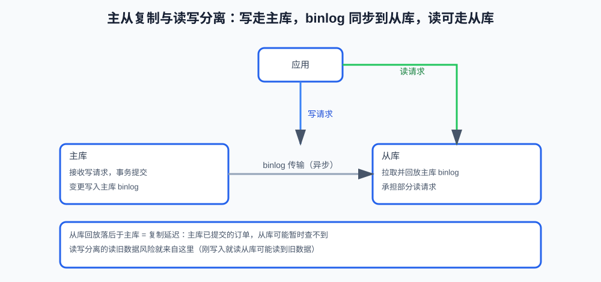

# 第15课:备份、恢复与复制

> 数据安全的三件事：误删了能不能恢复、主库挂了怎么办、读的请求多了扛不扛得住。这一篇把"备份、恢复、复制"讲清楚，并串联第 14 课的 binlog。
>
> 本篇以理解机制为主：备份与恢复的具体操作属于运维流程，依赖环境、备份策略和恢复预案，不在本地练习中执行。

**学习目标：**

1. 能区分备份、复制和高可用，并说清为什么不能互相替代；
2. 能解释全量备份加 binlog 的时间点恢复思路（串联第 14 课）；
3. 能说清 RPO / RTO 分别代表什么；
4. 能解释主从复制的基本流程和复制延迟；
5. 能说清读写分离会带来"读旧数据"问题及常见处理方式。

## 一、备份、复制与高可用：数据安全的三件事

真实业务里数据库不只是"能用"，还要回答三个问题：

```text
误删了数据，能恢复吗？       -> 备份
主库挂了或写不下了，怎么办？ -> 复制 / 高可用
读的请求太多，扛不住怎么办？ -> 读写分离 / 缓存
```

三个概念经常被混在一起：

```text
备份：出了问题后，能否恢复过去的一份数据
复制：数据库变更能否同步到另一个实例
高可用：主实例故障后，能否较快切换并继续提供服务
```

它们可以一起使用，但不能互相替代：

- 主从复制不能替代备份，因为误删可能被同步到从库；
- 有备份不等于高可用，恢复备份可能需要较长时间；
- 有从库不等于一定能自动切换，还需要故障检测、选主和切换流程；
- 备份成功不等于恢复成功，必须定期做恢复演练。

## 二、备份的基本类型

### 1. 全量备份

全量备份保存某个时间点的完整数据：

```text
恢复方式简单
数据完整
备份耗时和存储空间较大
```

恢复时可以先把全量备份作为数据基线。

### 2. 增量变化：binlog

全量备份之后，数据库还会继续产生新的修改。第 14 课讲过 `binlog` 记录逻辑变更（INSERT / UPDATE / DELETE）——它既是复制的来源，也是增量恢复的素材：

```text
全量备份 T0
    -> binlog 中 T0 之后的 INSERT / UPDATE / DELETE
    -> 恢复到某个目标时间点
```

因此，一个常见的时间点恢复流程是：

```text
恢复最近一次全量备份
    -> 找到备份之后的 binlog
    -> 按顺序回放
    -> 在目标时间点停止
```

### 3. RPO 和 RTO

设计备份策略不是问"有没有备份"，而是几个指标：

```text
RPO（Recovery Point Objective，恢复点目标）：最多能接受丢失多少数据（决定备份多频繁）
RTO（Recovery Time Objective，恢复时间目标）：最多能接受服务中断多久（决定恢复多快）
```

```text
RPO 越小 -> 备份和日志越频繁 -> 存储和运维成本越高
RTO 越小 -> 恢复流程越完善 -> 恢复演练越重要
```

## 三、时间点恢复的思路

假设错误删除发生在 15:30，最近一次全量备份是 10:00：

```text
10:00：全量备份
10:00 - 15:30：持续产生 binlog
15:30：误删除
```

恢复时不能只恢复 10:00 的备份，否则会丢失 10:00 到 15:30 之间的正常数据。要"全量 + 增量"两步走：

```text
先恢复 10:00 全量备份
    -> 回放 10:00 之后的 binlog
    -> 在 15:30 误删除之前停止
```

恢复后还要验证：数据行数和关键业务数据校验、外键和唯一性检查、应用读写验证、权限和连接配置检查；必要时把恢复出的数据导入新的实例，再逐步切换。**不要直接在唯一生产实例上试验恢复流程**——恢复演练要在独立环境做。

## 四、主从复制

### 1. 基本流程

第 14 课的 binlog 在这里落地：主库把事务写入 binlog，从库拉取并回放：



```text
主库执行事务
    -> 写入主库 binlog
    -> 从库读取并传输日志
    -> 从库接收日志
    -> 从库回放变更
```

主库通常负责写入，从库可以承担部分读取：

```text
写请求 -> 主库
读请求 -> 主库或从库
```

### 2. 复制延迟

主库已经提交的数据，从库不一定立刻可见：

```text
主库：订单已创建
从库：日志还未传输或回放
读从库：暂时查不到订单
```

常见原因：从库网络延迟、回放速度跟不上主库写入、大事务或大批量操作、从库磁盘和 CPU 资源不足、锁等待阻塞回放。

### 3. 读写分离的业务风险

用户刚完成写入，随后立即查询自己的订单。如果查询被路由到延迟的从库，可能出现"刚写入却查不到"：

```text
写主库成功
    -> 立即读从库
    -> 从库尚未追上
    -> 读到旧数据
```

常见处理方式：

- 关键读短时间内固定走主库；
- 根据复制位点判断从库是否追上；
- 对最终一致的页面接受短暂延迟；
- 由应用明确哪些查询必须读最新数据。

不能把读写分离简单理解成"所有读都去从库"。

## 五、常见错误自查清单

- 把主从复制当成备份：误删操作可能被同步到从库，从库一样丢数据；
- 备份成功后从不做恢复演练：备份存在但恢复不了等于没有备份；
- 只问"有没有备份"，不设 RPO / RTO：不知道能丢多少、多久能恢复；
- 读写分离后所有读都走从库：刚写完的数据可能查不到；
- 把分库分表当成索引优化的替代品（见排查篇）。

## 六、验收问题

1. 备份、复制、高可用有什么区别？为什么不能互相替代？
2. RPO 和 RTO 分别代表什么？哪个决定备份频率、哪个决定恢复流程？
3. 全量备份加 binlog 怎么实现时间点恢复？
4. 为什么恢复后要做验证和恢复演练？
5. 主从复制的基本流程是什么？复制延迟有哪些常见原因？
6. 读写分离为什么可能读到旧数据？常见处理方式有哪些？

## 七、面试回答模板

### 题目：主从复制能替代备份吗？

> 不能。主从复制主要用于变更同步、读扩展和故障切换准备；如果误删操作被复制，错误也可能同步到从库。备份用于恢复历史数据和时间点恢复，两者应当独立设计并定期验证恢复能力。

### 题目：为什么会出现主库有数据、从库查不到？

> 可能是复制延迟：主库已经提交，binlog 还没有传输或从库还没有回放。读写分离场景下，刚写入的数据如果立即路由到从库，可能读到旧版本。关键读可以固定走主库，或者根据复制状态判断从库是否已经追上。

### 题目：备份、复制、高可用怎么理解？

> 备份解决"能否恢复过去的数据"，复制解决"变更能否同步到另一个实例"，高可用解决"故障后能否较快切换继续服务"。三者可以配合使用但不能互相替代：复制不能替代备份（误删会被同步），有备份不等于高可用（恢复要时间）。

## 八、这一课学到什么程度可以收尾

```text
能区分备份、复制和高可用
能解释全量备份加 binlog 的时间点恢复思路
能说清 RPO 和 RTO
能解释主从复制的基本流程和复制延迟
知道读写分离会带来读旧数据问题
```

下一篇《14-数据归档、冷热分离与分区》讲数据持续增长后怎么治理；之后是监控容量、综合排查与综合设计（15~17 课）。
