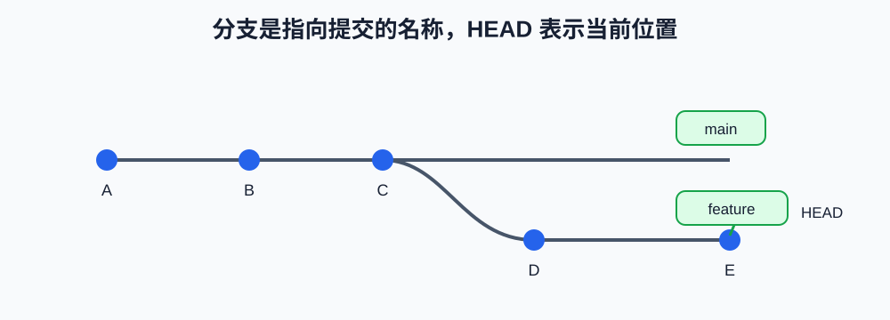

# 第2课:提交、分支与 HEAD

上一课已经完成了第一次提交。本课在此基础上系统学习提交历史、分支和 `HEAD`：分支是什么、为什么需要分支、如何创建和切换分支、在分支上提交后发生什么，以及如何查看和删除分支。

本课只讨论本地仓库，不讨论远程仓库、`push`、`fetch`、合并冲突或 worktree。

## 1. 查看提交历史

假设连续有三个提交：

```text
A —— B —— C
```

每个提交都是一个固定的项目快照，同时记录自己的父提交：B 的父提交是 A，C 的父提交是 B。提交创建后不会因为你继续编辑文件而改变 C；要得到新版本，必须创建新的提交 D。

在第一课的实验仓库中运行：

```bash
git log --oneline
git log --oneline --decorate --graph
```

`--oneline` 把每个提交压缩成一行；`--graph` 用字符显示历史关系；`--decorate` 显示分支名称等标签。

## 2. 分支是什么

分支不是一个新目录、文件复制品或独立代码版本。它是一个指向某个提交的名称，可以把它想象成贴在提交节点上的标签：

```text
A —— B —— C
          ↑
        main
```

这里 `main` 是一个名称，它当前指向提交 C。创建另一个分支后：

```text
A —— B ——   C
          ↑   ↑
        main feature
```

刚创建时，两个分支都指向 C。创建分支不会立即产生新的文件变化。

## 3. 为什么需要分支

分支用于隔离不同方向的工作：`main` 可以保持稳定，`feature` 用于开发新功能，`bugfix` 用于修复问题，`experiment` 用于尝试方案。没有分支时，实验会直接修改同一条历史；使用分支后，可以从同一个提交发展出多个方向。

## 4. HEAD 是当前检出位置

`HEAD` 表示当前检出的位置。正常情况下，它指向当前分支；当前分支再指向一个具体提交：

```text
HEAD → main → C
```

这句话的含义是：当前所在分支是 `main`，`main` 当前指向提交 C，因此 Git 当前检出的是提交 C 的文件状态。

如果切换到 feature：

```text
HEAD → feature → C
```

在 feature 上提交 D 后：

```text
A —— B —— C   ——  D
          ↑       ↑
        main    feature
                  ↑
                 HEAD
```

D 是新创建的固定历史节点；移动的是 feature 这个分支名称，HEAD 继续跟随当前分支。



## 5. 创建分支

### 5.1 只创建，不切换

```bash
git branch feature/hello
```

这条命令创建一个名为 `feature/hello` 的分支，但当前所在分支不变。使用下面的命令确认：

```bash
git branch
git branch --show-current
```

当前分支前面的 `*` 表示 HEAD 当前跟随它。


### 5.2 切换分支

```bash
git switch feature/hello
```

它的前提是 feature/hello 已经存在，例如之前已经执行过：git branch

执行后：
```
HEAD：从当前分支
       ↓
    feature/hello
```

### 5.3 创建并切换

开发新功能时通常会直接创建并切换：

```bash
git switch -c feature/hello
```

其中 `-c` 表示先创建（create）再切换。执行后，`git branch --show-current` 应该输出 `feature/hello`。这条命令不会创建提交，只会创建分支名称并改变 HEAD 的位置。

旧版本 Git 常见写法是 `git checkout -b feature/hello`，本课程使用含义更明确的 `git switch -c`。


### 5.4 分支命名

```text
feature/session-list
bugfix/empty-message
experiment/sqlite-store
docs/git-course
```

命名不影响 Git 行为，但应尽量表达用途。

## 6. 在分支上开发

确认已经进入 feature 分支后，修改文件并提交：

```bash
printf '来自 feature 分支\n' >> note.txt
git add note.txt
git commit -m "Add feature note"
```

此时 main 仍然指向原来的提交，feature 指向新提交。切换回 main：

```bash
git switch main
cat note.txt
git log --oneline --decorate --graph --all
```

你会看到工作区回到 main 所指向的内容。feature 的提交并没有消失，只是当前 main 还没有指向它。

## 7. 查看、切换和删除分支

查看本地分支：

```bash
git branch
```

查看当前分支：

```bash
git branch --show-current
```

切换到已有分支：

```bash
git switch feature/hello
```

删除已经不需要的分支：

```bash
git switch main
git branch -d feature/hello
```

`-d` 是安全删除：如果分支上的提交还没有合并，Git 通常会拒绝删除。删除分支只删除名称，不等于修改其他分支的历史。

## 8. 本课实验顺序

在第一课已经初始化并完成第一次提交的 `code/git/git-state-lab` 中执行：

```bash
git log --oneline --decorate
git branch
git branch feature/hello
git branch --show-current
git switch feature/hello
git branch --show-current
printf '来自 feature 分支\n' >> note.txt
git add note.txt
git commit -m "Add feature note"
git log --oneline --decorate --graph --all
git switch main
cat note.txt
```

每一步都观察：当前分支有没有变、哪个分支移动了、文件内容为什么会随分支切换而变化。

## 9. 本课小结

```text
提交：固定的历史快照
分支：指向某个提交的名称
HEAD：当前检出位置，通常通过当前分支指向提交
git branch：查看或创建分支
git switch：切换分支
git switch -c：创建并切换到新分支
```

## 10. 课后练习

1. 创建 `docs/git-notes` 分支并切换到它。
2. 在该分支中修改 `note.txt`，提交一次。
3. 切换回 `main`，观察文件内容和提交历史。
4. 再切换到 `docs/git-notes`，解释为什么内容又发生变化。
5. 用自己的话解释：为什么说分支是名称，而不是项目副本？
6. 用 `git branch --show-current` 和 `git log --oneline --decorate -1` 说明 HEAD 当前在哪里。

完成这些练习后，再进入第三课学习 `git diff`。
