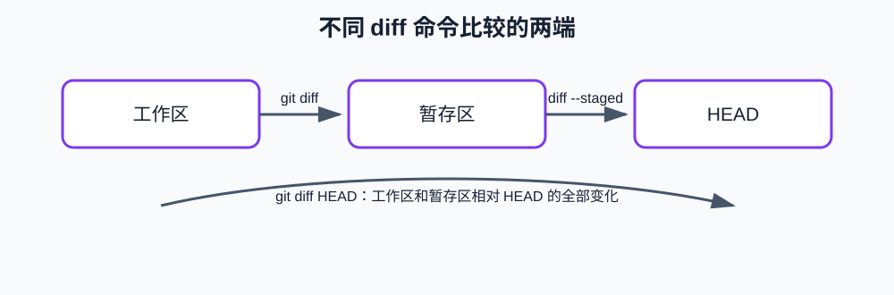

# 第3课:git diff 与变更对比

第一课学习了工作区、暂存区和提交，第二课学习了提交历史、分支和 HEAD。本课学习 `git diff`：如何比较两个状态之间的差异，以及如何使用 diff 检查自己到底修改了什么。

## 1. diff 是什么

`diff` 的意思是 difference，也就是“差异”。Git 中的 diff 不会直接告诉你“代码是否正确”，它只比较两个版本之间的文本变化。

例如，原文件是：

```text
第一行
```

修改后是：

```text
第一行
第二行
```

diff 会告诉你：新增了 `第二行`。

Git 的 diff 通常用下面的符号表示：

```diff
 第一行
+第二行
```

- 以 `+` 开头的行表示新版本中新增的内容；
- 以 `-` 开头的行表示旧版本中存在、但新版本中删除的内容；
- 以空格开头的行是上下文，用来帮助你定位变化；
- `@@ ... @@` 表示这段变化在旧文件和新文件中的行号范围。

## 2. `git diff` 比较什么

上一课中，我们已经知道一个文件可能同时有工作区版本和暂存区版本。

```text
工作区
   │
   │ git diff
   ▼
暂存区
```

不带参数的 `git diff` 比较：

```text
工作区 vs 暂存区
```

因此，`git diff` 只显示“已经保存到工作区、但还没有执行 `git add` 的修改”。

执行：

```bash
git diff
```

如果没有输出，通常表示工作区和暂存区内容相同。

如果有输出，说明存在尚未暂存的修改。

## 3. `git diff --staged` 比较什么

`git diff --staged` 比较：

```text
暂存区 vs 当前已提交版本
```

它回答的问题是：

> 如果现在执行 `git commit`，提交中将包含哪些具体变化？

执行：

```bash
git diff --staged
```

因此，提交前最重要的检查之一就是查看 staged diff。`git status` 只能告诉你哪些文件进入了暂存区，不能告诉你每一行具体改了什么。

## 4. `git diff HEAD` 比较什么

`HEAD` 表示当前检出位置，上一课已经介绍过它。当前提交的内容可以作为一个基准。

`git diff HEAD` 比较：

```text
当前工作区的文件内容 vs HEAD 所在的提交
```

它回答：

> 从当前提交开始，到现在为止，我所有尚未提交的修改是什么？

使用场景是：文件既有已经暂存的修改，又有尚未暂存的修改时，想一次查看从 `HEAD` 到当前文件内容的全部变化。它不是先把工作区和暂存区合并成一个新区域，而是直接把当前工作区与 `HEAD` 比较；因此，工作区相对暂存区的未暂存修改，以及暂存区相对 `HEAD` 的已暂存修改，都会出现在结果中。

## 5. 三种 diff 命令对比



| 命令 | 比较什么 | 回答的问题 |
| --- | --- | --- |
| `git diff` | 工作区 vs 暂存区 | 哪些修改还没有暂存？ |
| `git diff --staged` | 暂存区 vs HEAD | 下一次提交将包含什么？ |
| `git diff HEAD` | 当前工作区 vs HEAD | 从当前提交到现在，所有未提交修改是什么？ |

可以记成：

```text
git diff         = 还没 add 的变化
git diff --staged = 已 add、将要 commit 的变化
git diff HEAD      = 当前文件相对 HEAD 的所有变化
```

## 6. 准备课程实验

使用第一课和第二课的实验仓库：

```bash
cd <本仓库根目录>/code/git/git-state-lab
git status
git branch --show-current
git log --oneline --decorate -3
```

先确认工作区没有你不想参与实验的修改。然后查看当前文件：

```bash
cat note.txt
```

## 7. 实验一：只修改工作区

在当前分支修改文件但不要 `git add`：

```bash
printf '只存在于工作区\n' >> note.txt
git status
git diff
git diff --staged
```

预期状态：

- `git status` 在 `Changes not staged for commit` 中列出 `note.txt`；
- `git diff` 显示新增的那一行；
- `git diff --staged` 不显示这次新增，因为它还没有进入暂存区。

## 8. 实验二：把修改放入暂存区

现在执行：

```bash
git add note.txt
git status
git diff
git diff --staged
```

预期状态：

- `Changes not staged for commit` 消失；
- `git diff` 没有输出，因为工作区和暂存区相同；
- `git diff --staged` 显示新增的那一行，因为它已经成为下一次提交的候选内容。

## 9. 实验三：暂存后再次修改

继续增加一行，但不要再次 `git add`：

```bash
printf '暂存之后才修改的内容\n' >> note.txt
git status
git diff
git diff --staged
git diff HEAD
```

此时：

- `git diff` 只显示最后新增的内容；
- `git diff --staged` 只显示之前已经暂存的内容；
- `git diff HEAD` 显示两部分内容。

这三个输出可以对应到三个内容状态：

```text
HEAD：上一次提交的内容
暂存区：下一次提交准备采用的内容
工作区：当前文件的实际内容
```

这里要特别注意：`git diff HEAD` 的比较两端只有两个——当前工作区和 `HEAD`。暂存区不是它的直接比较对象；暂存区中的内容之所以也能体现在结果中，是因为暂存区的修改通常已经反映在当前工作区里。

## 10. 如何阅读一段完整 diff

示例：

```diff
diff --git a/note.txt b/note.txt
index 8f31a20..c2a1b77 100644
--- a/note.txt
+++ b/note.txt
@@ -1,2 +1,3 @@
 第一行
 第二行
+第三行
```

逐部分理解：

- `diff --git a/note.txt b/note.txt`：正在比较 note.txt 的旧版本和新版本；
- `--- a/note.txt`：旧版本文件；
- `+++ b/note.txt`：新版本文件；
- `@@ -1,2 +1,3 @@`：旧版本从第 1 行开始有 2 行，新版本从第 1 行开始有 3 行；
- `+第三行`：新版本增加了第三行。

初学时最重要的是先看 `+` 和 `-` 行，再逐渐理解其他元数据。

## 11. 提交前的 diff 检查

一个实用的检查顺序是：

```bash
git status
git diff
git diff --staged
git diff --check
```

含义是：

1. 先确认哪些文件处于什么状态；
2. 查看未暂存的具体修改；
3. 查看下一次提交将包含的具体修改；
4. 检查空白错误。

`git diff --check` 会提示某些多余空格或空白问题，但它不会检查代码逻辑。

## 12. 本课小结

```text
git diff         查看未暂存修改
git diff --staged 查看下一次提交内容
git diff HEAD     查看相对当前提交的全部未提交修改
```

## 13. 课后练习

1. 修改 `note.txt`，先运行 `git diff`，再执行 `git add`，最后运行 `git diff --staged`。
2. 暂存一行后再增加另一行，比较 `git diff`、`git diff --staged` 和 `git diff HEAD`。
3. 使用 `git diff --stat` 查看修改统计。
4. 使用 `git diff --name-only` 查看有哪些文件发生了未暂存变化。
5. 使用 `git diff --name-only --staged` 查看下一次提交会涉及哪些文件。
6. 用自己的话解释：为什么提交前要看 `git diff --staged`？

完成这些练习后，再进入第四课学习如何恢复和撤销修改。
