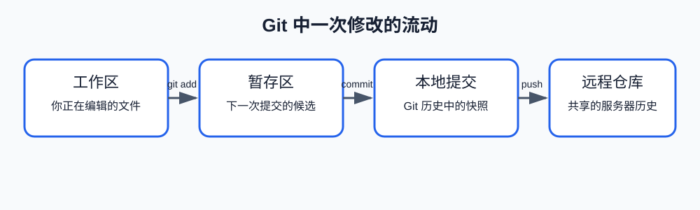

# 第一课：Git 的三个位置和第一次提交

这一课介绍 Git 最基础的工作方式：一个文件在 Git 中会经历哪些位置，以及如何把一个新目录初始化为 Git 仓库，最后完成第一次 `add` 和 `commit`。

## 1. Git 是什么

Git 是一个版本控制系统。它帮助我们保存项目文件的历史版本，并比较文件在不同时间发生了什么变化。

如果没有 Git，我们通常只能手动复制目录：

```text
project/
project-backup/
project-final/
```

这种方式很快会出现问题：不知道哪个目录是最新的，也不知道两个目录到底改了什么。Git 把这些版本组织成可查询的历史记录。

## 2. Git 中的三个位置

本课先学习三个位置：工作区、暂存区和提交。



### 2.1 工作区（working tree）

工作区就是你当前实际编辑的项目目录。你在编辑器中打开的文件、刚刚创建的文件，以及保存到磁盘的修改，都属于工作区。

例如，创建一个文件：

```text
工作区
└── note.txt
```

此时文件已经存在于电脑中，但 Git 还不一定记录了它。

### 2.2 暂存区（staging area）

暂存区是 Git 为下一次提交准备的内容。它可以理解为一份“提交清单”：你明确告诉 Git，哪些文件当前的内容准备放进下一次提交。

执行 `git add note.txt` 后，Git 会把 `note.txt` 当前的内容放入暂存区。文件仍然留在工作区，并不是被移动走了。

所以，`git add` 做的是选择提交内容，不是创建提交。

### 2.3 提交（commit）

提交是 Git 历史中的一个版本快照。执行 `git commit` 时，Git 会根据暂存区中的内容创建一个提交。

提交包含：

- 当时准备提交的文件内容；
- 这次提交的说明文字；
- 提交创建时间和作者信息；
- 它与前一个历史版本的关系。

本课可以把提交理解为：已经正式保存到本地 Git 历史中的版本。

## 3. 三个位置之间的关系

```text
工作区：你正在编辑什么
   │
   │ git add
   ▼
暂存区：下一次提交准备包含什么
   │
   │ git commit
   ▼
提交：已经保存到 Git 历史什么
```

这里发生的是内容被 Git 记录到不同状态，不是文件从一个普通目录移动到另一个普通目录。执行 `git add` 后，工作区文件仍然存在；执行 `git commit` 后，工作区文件也仍然存在。

> [!IMPORTANT]
> 工作区是当前文件的实际内容，暂存区是下一次提交的候选内容，提交是已经写入本地历史的内容。

## 4. 初始化一个 Git 仓库

在开始使用提交之前，需要先让 Git 管理一个目录。这一步叫初始化仓库。

课程实践使用独立目录，不要在正式项目中做本课实验：

```bash
cd /Users/yyma/workspace/agents/lifestyle-manager-study
mkdir -p code/git/git-state-lab
cd code/git/git-state-lab
git init
```

`git init` 会在当前目录创建一个 `.git` 目录。`.git` 是 Git 保存仓库信息的地方，包括提交历史、暂存区信息和配置等。它通常是隐藏目录，平时不需要直接编辑其中的文件。

初始化后，可以运行：

```bash
git status
```

如果目录还没有文件，通常会看到类似：

```text
On branch main
No commits yet
nothing to commit (create/copy files and use "git add" to track)
```

不同 Git 版本或配置可能显示 `master` 而不是 `main`，这不影响本课内容。这里最重要的是：仓库已经初始化，但还没有任何提交。

## 5. 创建文件并读取 `git status`

创建第一个文件：

```bash
printf '第一行\n' > note.txt
git status
```

可能看到：

```text
On branch main
No commits yet
Untracked files:
  (use "git add <file>..." to include in what will be committed)

        note.txt

nothing added to commit but untracked files present
```

逐部分理解：

- `Untracked files`：工作区中有文件，但 Git 目前还没有把它放入暂存区或历史记录。
- `note.txt`：具体处于未跟踪状态的文件。
- 括号中的文字：Git 给出的下一步提示，告诉你可以使用 `git add`。
- `nothing added to commit`：当前还没有任何内容进入提交候选。

这里的“未跟踪”不是文件不存在，而是 Git 还没有把它纳入版本记录。

## 6. 执行 `git add`

现在把文件加入下一次提交的候选：

```bash
git add note.txt
git status
```

可能看到：

```text
Changes to be committed:
  (use "git restore --staged <file>..." to unstage)

        new file:   note.txt
```

逐部分理解：

- `Changes to be committed`：下面列出的内容已经进入暂存区，准备在下一次 `git commit` 中提交。
- `new file`：对于当前历史来说，`note.txt` 是一个新文件。
- 括号中的 `git restore --staged`：这是 Git 提供的取消暂存提示，本课暂时只需要知道它是提示，不需要现在学习恢复操作。

此时的状态是：

```text
工作区：有 note.txt
暂存区：有 note.txt 的第一版内容
提交历史：还没有这个文件，也还没有第一次提交
```

## 7. 执行第一次 `git commit`

确认状态后执行：

```bash
git commit -m "Add first note"
git status
```

`git commit` 的 `-m` 用来提供提交说明，后面的文字是这次提交的消息。

提交完成后，`git status` 通常会显示：

```text
nothing to commit, working tree clean
```

这表示：相对于当前已经保存的提交，Git 没有发现新的工作区或暂存区变化。它不代表程序一定正确，只代表当前没有未提交的文件变化。

此时三个位置可以表示为：

```text
工作区：note.txt 的第一版内容
暂存区：与工作区一致
提交：已经保存 note.txt 的第一版内容
```

## 8. 本课小结

```text
git init   创建 Git 仓库
git add    把文件内容放入下一次提交的候选
git commit  根据暂存区创建本地历史版本
git status  查看当前文件处于什么状态
```

## 9. 课后练习

1. 在 `note.txt` 中增加第二行，执行 `git status`，观察它属于哪个分组。
2. 执行 `git add note.txt`，再次查看 `git status`，比较前后变化。
3. 执行 `git commit -m "Add second line"`，再次查看状态。
4. 创建 `draft.txt`，但先不要执行 `git add`，解释为什么它出现在 `Untracked files`。
5. 用自己的话解释：为什么 `git add` 不等于 `git commit`？

完成这些练习后，再进入下一课学习 `git diff`。
