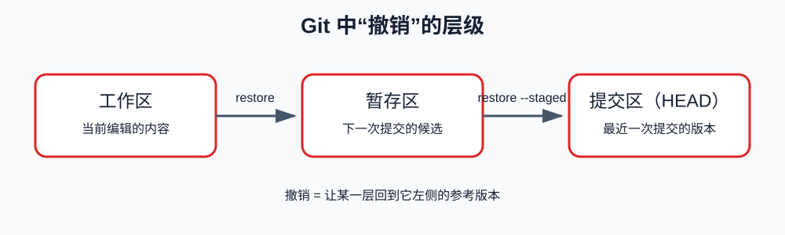

# 第四课：撤销工作区和暂存区中的修改

前三课已经介绍了工作区、暂存区、提交、分支、HEAD 和 diff。本课学习一个非常实际的问题：当你发现修改错了，或者暂存了不该提交的内容时，如何撤销。

本课先学习不会改写提交历史的 `git restore`，再学习如何临时保存未提交修改的 `git stash`，最后介绍 `git reset` 和 `git revert` 的基本区别。

## 1. 撤销之前先确认当前状态

撤销的第一步不是敲命令，而是确认你要撤销哪一部分。一个文件可能有三个版本：

```text
HEAD：    最近一次提交的内容
暂存区：  下一次提交准备采用的内容
工作区：  当前文件实际内容
```

因此“撤销修改”可能有不同含义：

- 只撤销工作区尚未暂存的修改；
- 取消暂存，但保留工作区修改；
- 同时让工作区和暂存区回到 HEAD。



本课中说的“撤销”，主要是沿着这两个层级理解：

```text
工作区  ── git restore ──>  暂存区  ── git restore --staged ──>  HEAD
```

也就是说，第一步是把工作区恢复为暂存区的内容；第二步是把暂存区恢复为 HEAD 的内容。它们分别影响不同的位置。

先运行：

```bash
git status
git diff
git diff --staged
```

`git status` 告诉你文件处在哪个状态，`git diff` 告诉你工作区有哪些修改，`git diff --staged` 告诉你下一次提交会包含什么。确认之后，才选择命令。

> [!WARNING]
 > 任何会丢弃内容的命令，都应该在执行前先查看对应的 diff。已经提交的内容通常可以通过历史找到，但尚未提交的内容可能没有其他副本。

## 2. `git restore`：恢复文件内容

`git restore` 用一个来源版本覆盖工作区文件。最常见的形式是：

```bash
git restore note.txt
```

在没有其他参数时，它把<mark>工作区的 `note.txt` 恢复为暂存区中的版本</mark>。也就是说，它只撤销尚未暂存的修改，暂存区不变。

状态变化：

```text
执行前：
HEAD：    第一行
暂存区：  第一行 + 第二行
工作区：  第一行 + 第二行 + 第三行

执行 git restore note.txt 后：
HEAD：    第一行
暂存区：  第一行 + 第二行
工作区：  第一行 + 第二行
```

第三行被丢弃，第一行和第二行仍然保留。

> [!CAUTION]
> `git restore <file>` 会丢弃该文件尚未暂存的工作区修改。需要保留时，先复制内容或使用其他方式保存。

## 3. `git restore --staged`：取消暂存

如果文件已经执行 `git add`，但你发现暂存范围不对，可以取消暂存：

```bash
git restore --staged note.txt
```

它的作用是把暂存区恢复为 HEAD 中的版本，但保留工作区文件不变。

状态变化：

```text
执行前：
HEAD：    第一行
暂存区：  第一行 + 第二行
工作区：  第一行 + 第二行

执行 git restore --staged note.txt 后：
HEAD：    第一行
暂存区：  第一行
工作区：  第一行 + 第二行
```

所以：

- 第二行仍然在工作区；
- 第二行不再属于下一次提交候选；
- `git status` 会把文件从 `Changes to be committed` 移到 `Changes not staged for commit`。

这条命令不会删除你的工作区修改。

## 4. 两条 restore 命令的区别

| 命令 | 改变什么 | 保留什么 |
| --- | --- | --- |
| `git restore <file>` | 工作区恢复为暂存区版本 | 暂存区内容 |
| `git restore --staged <file>` | 暂存区恢复为 HEAD 版本 | 工作区内容 |

可以记成：

```text
restore 文件              → 动工作区
restore --staged 文件      → 动暂存区
```

## 5. 恢复到 HEAD：同时改变两个位置

如果你确认要放弃某个文件从上次提交之后的全部修改，可以使用：

```bash
git restore --source=HEAD --staged --worktree note.txt
```

它会同时把暂存区和工作区恢复为 HEAD 的内容。执行后，关于这个文件的未提交修改会消失。

这条命令适合在明确确认内容可以丢弃时使用。不要把它当成普通的“刷新文件”命令。

## 6. `git stash`：临时收起未提交修改

有时你不想删除修改，只是暂时需要切换到另一个分支或处理其他事情。这时可以使用 stash。

stash 会把当前未提交的工作区和暂存区修改临时保存起来，并让工作区恢复到干净状态。

保存：

```bash
git stash push -m "WIP: note changes"
```

查看 stash：

```bash
git stash list
git stash show -p stash@{0}
```

恢复但保留 stash：

```bash
git stash apply stash@{0}

// 保留后确认需要删除使用
git stash drop stash@{0}
```

恢复并删除这条 stash：

```bash
git stash pop
```

`apply` 和 `pop` 的区别是：`apply` 恢复内容但保留 stash；`pop` 恢复成功后删除 stash。学习时优先使用 `apply`，确认内容正确后再决定是否删除。

stash 不是正式提交，也不是长期备份。它只是临时收起未提交修改的工具。

## 7. `git reset` 和 `git revert` 的区别

这两个命令都和“回到过去”有关，但行为不同。

### 7.1 `git reset`

`git reset` 可以移动当前分支指向的提交，或者只改变暂存区。常见的取消暂存写法是：

```bash
git reset HEAD note.txt
```

它会取消暂存，但保留工作区内容。效果类似于：

```bash
git restore --staged note.txt
```

`git reset --hard` 还会覆盖工作区，可能丢失未提交修改。本课不使用它作为实验命令。

### 7.2 `git revert`

如果某个提交已经写入共享历史，但内容有问题，可以使用：

```bash
git revert <commit-id>
```

它不会删除原提交，而是创建一个新的反向提交。历史类似：

```text
A —— B —— C —— D
          原提交    反向提交
```

`revert` 适合已经提交、需要保留历史记录的情况。它属于后续协作场景，本课只需要知道它与 reset 的方向不同。

### 7.3 `git commit --amend`：修正最近一次提交

如果刚刚完成一次提交后，发现漏提交了一个文件，或者想把一个小修改补进最近一次提交，可以使用：

```bash
git add <补充的文件>
git commit --amend --no-edit
```

`--amend` 表示修改最近一次提交；`--no-edit` 表示沿用原来的提交消息，不打开编辑器。它会用当前暂存区内容重新生成最近一次提交，因此提交 ID 通常会改变。

它适合用于尚未推送、仍在自己控制范围内的最近一次提交。已经推送或与他人共享的提交，不要随意 amend，因为这会改写提交历史；这种情况下通常应该创建新的提交。

## 8. 本课实验

在课程实验仓库中执行实验前，先确保没有需要保留的修改。

### 实验一：撤销未暂存修改

```bash
printf '工作区修改\n' >> note.txt
git diff
git restore note.txt
git status
```

观察：修改消失，文件回到暂存区版本。

### 实验二：取消暂存但保留修改

```bash
printf '准备暂存\n' >> note.txt
git add note.txt
git diff --staged
git restore --staged note.txt
git status
git diff
```

观察：修改仍在工作区，但不再属于下一次提交候选。

### 实验三：stash

```bash
git stash push -m "Temporary note experiment"
git status
git stash list
git stash apply
git status
```

确认文件恢复后，再根据需要执行 `git stash drop stash@{0}` 清理实验 stash。

## 9. 本课小结

```text
git restore file                   撤销工作区未暂存修改
git restore --staged file           取消暂存，保留工作区修改
git stash push                     临时保存未提交修改
git stash apply                    恢复 stash，保留 stash
git stash pop                      恢复 stash 并删除 stash
git reset                          改变暂存状态或移动历史位置
git revert <commit>                创建反向提交
git commit --amend --no-edit       把暂存内容补进最近一次提交并保留原消息
```

## 10. 课后练习

1. 让同一个文件同时出现在 `Changes to be committed` 和 `Changes not staged for commit` 中，分别运行两种 `restore`，观察哪个位置改变。
2. 创建一条 stash，使用 `stash show -p` 阅读它保存的内容。
3. 使用 `apply` 恢复 stash 后，再用 `pop` 比较两者区别。
4. 用自己的话解释：为什么 `git restore --staged` 不会删除工作区修改？
5. 用自己的话解释：为什么已经进入历史的提交不能简单用 `restore` 撤销？

完成后进入第五课学习分支合并和冲突。
