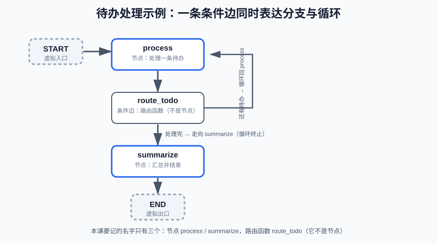

# 第3课:节点、普通边与条件边

前两课的图都是一条固定顺序的链：`START → … → END`，节点依次执行。但 Agent 的核心恰恰是"下一步取决于当前状态"：还有工具要调吗？任务做完了吗？出错要不要重试？这些判断在 LangGraph 里都表达成**条件边**——本课就讲分支和循环：普通边、条件边、路由函数、`Command`，以及图如何表达"循环直到终止"。

条件边也是下一课 ReAct Agent 的骨架：第 5 课的"继续调工具 / 结束回答"就是一条条件边。本课先用纯 Python 逻辑把路由机制讲清楚，不引入工具。`Send` 并行（第 10 课）和 `stream` 流式观察（第 11 课）也不在本课范围。

**学习目标：**

1. 能区分普通边和条件边，说明条件边的路由函数如何决定下一步；
2. 能从注册位置判断一个函数是节点还是路由函数（`add_node` vs `add_conditional_edges`）；
3. 能用条件边实现"分支"和"循环"，说出循环的终止条件在哪里；
4. 能解释一次 `invoke` 内部发生了哪几次状态更新（super-step）；
5. 能用 `Command` 让节点在返回更新的同时决定下一步，能说出"决策依据在节点内部时必须用 `Command`"，并说明它与条件边的取舍；
6. 能把以前手写循环的 `while` / `if` 对照成图的"条件边 + 循环边"。

## 1. 概念与边界：两种边的职责

图的边分两种，职责不同：

- **普通边（add_edge）**：固定顺序。`A → B` 表示 A 执行完一定执行 B，没有条件。目标是**编译期**校验的——写错节点名，`compile()` 直接抛 `ValueError`。
- **条件边（add_conditional_edges）**：从某个节点的出口分叉，由**路由函数**在运行期决定下一步走哪条路。

一句话定义：**普通边回答"下一步去哪"，条件边回答"根据当前状态，下一步去哪"。** 条件边是 Agent 里出现频率更高的那种——因为 Agent 的每一步几乎都要看状态做决定。

**怎么分辨一个函数是节点还是边：** 角色不由函数本身决定，由**注册位置**决定——出现在 `add_node(...)` 里的是**节点**，出现在 `add_conditional_edges(...)` 里的是**路由函数**（条件边的判断部分），`add_edge(...)` 里只有节点名、没有函数。本课起沿用命名约定：`node_*` 是节点函数，`route_*` 是路由函数。分不清某个函数是什么角色时，回去找它的注册语句，那里是唯一答案。

本课的条件边只返回**单个**目标节点；路由函数返回多个目标（fan-out）和 `Send` 是第 10 课的内容。

## 2. 条件边：分支与循环的统一机制

### 2.1 先看全貌：本课的待办示例

本课只用一个例子、三个名字，后面所有代码都围绕它，不再换场景：

- 节点：`process`（处理一条待办）、`summarize`（汇总）；
- 路由函数：`route_todo`（条件边，判断"还有待办吗"）。

唯一例外是第 4 节讲 `Command` 的临时小例子——它演示的是条件边做不到的场景（节点内部异常），会引入自己的几个节点名；除此之外，本课其余代码都围绕这张图。



状态与注册（记住"注册位置决定角色"）：

```python
class State(TypedDict):
    todo: list                       # 待办队列：process 每轮取第一条（覆盖）
    processed: Annotated[list, add]  # 已处理列表（追加）
    round_count: int                 # 循环轮数（覆盖）
    summary: str                     # 汇总结果（覆盖）

graph = StateGraph(State)
graph.add_node("process", node_process)          # node_process 是节点
graph.add_node("summarize", node_summarize)      # node_summarize 是节点
graph.add_edge(START, "process")
graph.add_conditional_edges("process", route_todo)  # route_todo 是路由函数（条件边）
graph.add_edge("summarize", END)
```

这张图同时含分支和循环：`route_todo` 有两条出路，一条回到 `process`（循环），一条走向 `summarize`（分支终止）。下面先讲分支怎么表达，再讲循环。

### 2.2 条件边 API 与路由函数签名

```text
graph.add_conditional_edges(source, path, path_map=None)
  source    节点名：从这个节点的出口分叉
  path      路由函数，签名 (state) -> "节点名" | END，运行期调用
  path_map  （可选）dict：把 path 返回的"语义值"映射到目标节点名 / END
```

路由函数读的是当前 State，返回的是**下一个节点的名字**（或 `END`）。它是个普通函数，写在 `add_conditional_edges` 里注册，和执行时调用是两回事——和 `add_node` 注册节点函数是同一个模式。

### 2.3 分支：if-else 的表达

分支就是"一条出口、两条路"。示例里 `process` 的出口由 `route_todo` 决定，有两种写法，**选一种即可，不要混用**。

**写法一：路由函数直接返回节点名**（不传 `path_map`，返回值就是下一个节点的名字）：

```python
def route_todo(state: State) -> str:
    if state["todo"]:          # 还有待办？
        return "process"       # 继续处理
    return "summarize"         # 处理完，去汇总

graph.add_conditional_edges("process", route_todo)
```

执行路径：`process →(route_todo)→ process（还有待办）` 或 `process →(route_todo)→ summarize（处理完）`。

**写法二：返回语义值 + `path_map` 映射**（`path_map` 把语义值映射到节点名 / `END`，改图结构时不用改函数）：

```python
def route_todo_semantic(state: State) -> str:
    if state["todo"]:
        return "continue"      # 语义值：继续
    return "end"               # 语义值：结束

graph.add_conditional_edges("process", route_todo_semantic, {"continue": "process", "end": "summarize"})
```

**注意不要混用**：路由函数返回的值必须和当前写法匹配——写法一的返回值是节点名；写法二的返回值必须是 `path_map` 的键。如果给了 `path_map` 而返回值不在其中，运行期直接抛 `KeyError`（实测行为，编译期发现不了）。

### 2.4 循环：连回自己的条件边

循环的本质是"条件边连回上游节点"。刚才的图里，`route_todo` 的"还有待办"分支回到了 `process` 自己：

```python
def node_process(state: State) -> dict:
    item = state["todo"][0]
    return {
        "todo": state["todo"][1:],       # 取出第一条（覆盖）
        "processed": [item],             # 追加到已处理列表
        "round_count": state["round_count"] + 1,
    }
```

注意**循环的终止条件在哪里**：不在"循环体"里，而在条件边上——`route_todo` 看到 `todo` 为空就返回 `summarize`，不再回到 `process`。手写循环里 `while` 的判断条件，在图上就是一条条件边。

与手写循环的对照：

| 手写循环 | 图 |
| --- | --- |
| `while 条件:` | 条件边 + 连回上游的边 |
| `if / else` | 条件边分叉 |
| `break` | 条件边返回 `END`（或后续节点） |
| `step += 1`（循环变量） | 写入 State 的计数字段 |

## 3. 一次 invoke 内部发生了哪几次状态更新

**节点每执行一次 = 一个 super-step = 一次状态更新。** 运行课程示例（三条待办），`process` 会执行三次，每次打印一行"处理待办"，最终 `processed` 有三条、`round_count` 为 3——三次循环对应三次状态更新。

这正是第一课"一次 `invoke` 内部发生了什么"的完整版：`invoke` 不是执行一次节点，而是**执行一条执行路径**，路径上有几个节点就发生几次状态更新，循环会重复计数。想看每次状态更新的细节，本课用节点打印观察；第 11 课的 `stream` 是正式的手段。

## 4. Command：节点自己决定下一步

先回答一个自然会冒出来的问题：第 2 节的条件边也能根据状态做判断，为什么要写进节点里？答案在于两者的"视野"不同：

**条件边的路由函数只能读到 State；节点还能看到自己这一轮的局部结果**——函数返回值、临时变量、`try/except` 捕获的异常。当"下一步去哪"取决于这些节点内部的东西时，路由函数根本看不到判断依据，只能用 `Command`。

### 4.1 示例：解析待办，失败由节点自己决定去向

假设用户输入一行文本，`parse` 节点要把它解析成待办。解析可能失败（格式不对），而失败信息只存在于节点内部的 `except` 块里：

```python
from langgraph.types import Command

def parse_todo(text: str) -> dict:
    """解析文本为待办；不包含"待办"二字就抛异常。"""
    if "待办" not in text:
        raise ValueError("未找到待办内容")
    return {"text": text}

def node_parse(state: State):
    try:
        item = parse_todo(state["user_input"])
    except ValueError as exc:
        # 异常只存在于节点局部作用域，路由函数读不到 → 必须节点自己决定
        return Command(
            update={"errors": [str(exc)]},
            goto="retry",          # 回到"请重新输入"节点
        )
    return Command(
        update={"todo": [item]},
        goto="finish",             # 解析成功，走向完成节点
    )
```

```text
Command(update: dict | None, goto: str | None)
  update  要合并进 State 的字段（可省略，省略则不改状态）
  goto    下一个节点名或 END（可省略）
```

换成条件边能不能做？可以，但代价是把失败信息先写进一个 state 字段（比如 `state["parse_error"]`），路由函数再去读——**为了路由而往 State 里塞私有数据，正是 `Command` 要消灭的写法**。

### 4.2 什么时候必须用 Command（判断标准）

| "下一步去哪"由什么决定 | 选什么 |
| --- | --- |
| State 里的数据（如 `todo` 是否为空） | 条件边更清晰 |
| 节点内部的计算、异常、副作用结果 | Command |
| 中断后的人工恢复执行 | 必须 Command（第 7 课展开） |

### 4.3 与条件边的取舍

两者能表达同样的图（第 2 节的"还有待办吗"两种实现都成立），选型看路由逻辑归谁管更清晰：

- **条件边**：路由逻辑独立成函数，适合"多个节点汇聚到同一个出口、再统一分流"的结构——第 5 课的 ReAct 就是典型（LLM 节点和工具节点都汇聚到"判断继续还是结束"）；
- **Command**：路由决定写在节点内部，适合"节点自己知道下一步"，少一个函数、少一次状态传递。

## 5. 一个容易踩的坑：条件边目标写错不会报错

普通边和条件边对"目标节点名"的校验时机完全不同：

- **普通边**：编译期校验。`add_edge("inc", "nope")` 在 `compile()` 时抛 `ValueError: Found edge ending at unknown node 'nope'`，马上能发现；
- **条件边**：运行期才解析。路由函数返回一个不存在的节点名（比如拼错的 `"finiish"`），`compile()` 不会报错，**运行时**只打印一条警告然后默默停止执行——图不会崩溃，但也不会按预期走下去，最终状态停在原地。

排查习惯：路由函数返回的字符串必须和 `add_node` 里的名字**完全一致**；遇到"图执行到一半就停"的问题，先怀疑路由函数返回了错的目标。

## 6. 运行课程代码

```bash
cd c:\0work\project\ai_application_development_study
python code/langgraph/03-edges.py
```

会依次打印：`process` 处理三条待办（循环三轮的观察点）、最终 state、`Command` 演示（解析待办：成功走向完成节点，失败由节点自己决定回到重试节点）。

## 7. 课后作业

作业和课程示例在同一个文件中：`code/langgraph/03-edges.py`，从 `# ===== 课后作业 =====` 开始。

作业要求：

1. 补全 `route_retry`：`success` 为 `True` 时返回 `"finish"`，否则返回 `"attempt"`；
2. 在 `build_homework_graph()` 里补上 `attempt` 的条件边（路由函数 `route_retry`）和 `finish → END` 的普通边；
3. 运行 `homework()`（完成后取消 `__main__` 注释）：`node_attempt` 前两次失败、第三次成功，最终 `attempt_count == 3`、`success` 为 `True`、`result` 非空；
4. 思考题（不要真的运行）：如果 `route_retry` 永远返回 `"attempt"`，会发生什么？循环的终止条件在哪里，谁负责结束它？
5. 思考题：把条件边的目标故意写错（如 `"finiish"`），运行会发生什么？这与普通边写错目标（编译期 `ValueError`）有什么不同？答案在第 5 节。

## 8. 验收问题

1. 普通边和条件边的区别是什么？各自何时校验目标节点名？
2. 怎么分辨一个函数是节点还是路由函数？判据是什么？
3. 条件边的路由函数签名是什么？可以返回什么？
4. 如何用条件边实现循环？循环的终止条件在哪里？
5. 一次 `invoke` 中"节点执行次数"和"super-step 数"是什么关系？
6. 什么时候必须用 `Command`？`Command` 和条件边的取舍是什么？
7. 条件边返回未知节点名会发生什么？和普通边有什么不同？

## 9. 面试高频考点

- 条件边如何决定下一步；图如何表达 `if/else` 和 `while`（对照表见第 2 节）。
- 节点与路由函数的区分——判据是注册位置：`add_node` 里是节点，`add_conditional_edges` 里是路由函数。
- 一次 `invoke` 内部的状态更新次数——"节点每执行一次 = 一个 super-step = 一次状态更新"。
- `Command` 与条件边的取舍：路由逻辑归谁管更清晰（见第 4 节的对比）。
- `Command` 的必要场景：决策依据不在 State 里（节点内部异常/计算/副作用结果）；中断恢复必须用 `Command`（第 7 课）。
- 普通边编译期校验 vs 条件边运行期路由——错误出现的时机不同，排查方向不同。
- （延伸，第 5 课）ReAct 的"继续调工具 / 结束回答"判断就是一条条件边。
