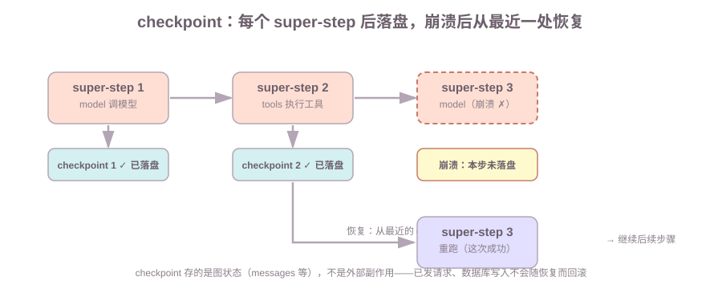
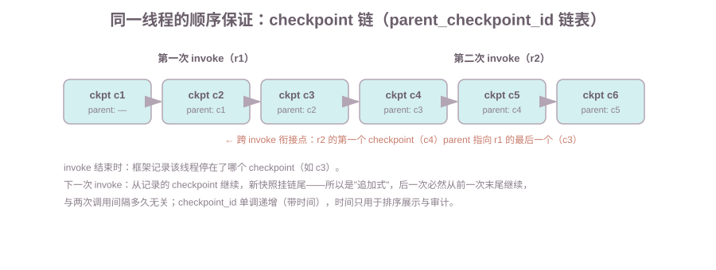

# 第6课:Checkpointer：状态落盘与恢复

第五课的 ReAct Agent 每次 `invoke` 都是"一次性"的：消息历史在内存里，进程退出就没了；两个用户共用一个 Agent 时也分不清谁是谁。要解决这三个问题——记忆丢失、会话混淆、崩溃全没——就得把"执行过程本身"持久化。本课讲 LangGraph 为此提供的机制 **checkpointer**：每个 super-step 结束把 State 快照落盘，用 `thread_id` 隔离会话，进程重启后能恢复。这也是"为什么用 LangGraph 而不是手写循环"最有分量的一课。

范围：本课只讲快照、会话、恢复；`interrupt`（人工暂停/恢复，第 7 课）建立在 checkpointer 之上，本课只预告不展开；`Send` 并行（第 10 课）不涉及。

前置：完成第 2 课（状态与 reducer，特别是"节点更新保持确定性"）和第 5 课（ReAct 图）。演示 B 需要安装 `langgraph-checkpoint-sqlite`。

**学习目标：**

1. 能区分 checkpoint（快照）和 checkpointer（组件），说出存了什么、什么时候存；
2. 能说出 MemorySaver / SqliteSaver / PostgresSaver 的定位；
3. 能用 `thread_id` 实现会话隔离，解释同一线程续聊为什么能"记得"；
4. 能模拟进程崩溃后用同一 `thread_id` 从断点恢复，说明状态来自 DB 而不是内存；
5. 能说清 checkpoint 的边界——只存图状态，外部副作用不会回滚；
6. 能用 `get_state` 查看、用 `delete_thread` 清除会话状态。

## 1. 背景：为什么需要持久化

第 5 课的 Agent 跑完一次 `invoke` 就结束了：消息历史只存在于那次调用的内存里。三个真实的痛：

- **记忆丢失**：用户第二轮问"刚才查的上海天气如何？"，第一轮的消息已经没了，Agent 答不上来；
- **会话混淆**：两个用户共用一个 Agent，谁的上下文是谁的分不清；
- **崩溃全没**：执行到一半进程退出，之前所有状态归零，只能从头再来。

把"执行过程的状态"持久化到磁盘/数据库，这三个问题同时解决。这就是 **durable execution**（持久化执行）：**执行过程本身变成可持久化、可恢复的东西，进程可以随便重启，状态不丢。**

## 2. 概念与边界（当场定义）

- **checkpoint（快照）**：图执行过程中，某个 super-step 结束时对当前 State 的一份**数据快照**（messages、计数、中间结果）。
- **checkpointer（保存器）**：负责"写快照、读快照"的**组件对象**——是 `compile(checkpointer=...)` 传进去的那个东西。MemorySaver / SqliteSaver / PostgresSaver 是它的三种实现。

一句话区分：**checkpoint 是"快照"（数据），checkpointer 是"保存器"（干活的组件）**。本课标题里的 Checkpointer 指的是组件。

边界：checkpoint 只存**图状态**（messages、计数、中间结果），不存**业务数据**（生活记录、用户资料）——这个边界为什么重要、和业务数据库怎么分工，第 6 节专门讲。

常用的三种 checkpointer：

| checkpointer | 存储位置 | 进程死了会怎样 | 适用 |
| --- | --- | --- | --- |
| `MemorySaver` | 进程内存 | 快照一起没 | 测试、单进程演示 |
| `SqliteSaver` | SQLite 文件 | 快照还在，可重启恢复 | 本课演示、单机持久化 |
| `PostgresSaver` | PostgreSQL | 快照还在，多实例共享 | 生产（需独立安装，本课不演示） |

## 3. 机制：什么时候存、崩溃怎么恢复

### 3.1 每个 super-step 结束落盘一次

`compile(checkpointer=saver)` 之后，图在**每个 super-step 结束时**自动把 State 存一份快照。一次 `invoke` 执行了几个 super-step，就有几个 checkpoint（外加初始状态一份）。第 5 课的 ReAct 图一次完整对话（查天气 → 换城市重试 → 回答）有多个 super-step、多份快照。



### 3.2 崩溃恢复的原理

```text
执行：  super-step 1 ──→ checkpoint 1 ──→ super-step 2 ──→ checkpoint 2 ──→ super-step 3（崩溃 ✗ 未落盘）
恢复：  从 checkpoint 2 继续 ──→ 重跑 super-step 3（这次成功）──→ 继续后续步骤
```

崩溃恢复 = 从**最近一个完整的 checkpoint** 继续执行；崩溃的那一步没有落盘，恢复后会**重跑**。这呼应第 2 课的纪律"节点更新保持确定性"——重跑必须得到和原来一样的结果，否则恢复后的状态会"走样"。真实系统里崩溃发生在第 N 个 super-step 之间时，恢复就是从第 N-1 个 checkpoint 继续。

## 4. 实践用法一：会话记忆 thread_id

### 4.1 config 与 thread_id（当场定义）

加了 checkpointer 之后，`invoke` 要带第二个参数 `config`，用 `thread_id` 标识"这是哪个会话"：

```text
config = {
    "configurable": {            # 自定义配置的嵌套 dict
        "thread_id": "user-1",   # 会话标识：LangGraph 预留的键
    },
}
```

**`thread_id`**：会话的标识（`thread` 是"会话线索"的意思，和操作系统的线程没关系）。同一条线索 = 同一个会话，checkpoint 按 `thread_id` 归档。

### 4.2 用法与效果

```python
from langgraph.checkpoint.memory import MemorySaver   # 记忆型 checkpointer（存进程内存）
from langchain_core.messages import HumanMessage     # 用户消息

app = build_react_graph(call_model, TOOLS, MemorySaver())
r1 = app.invoke({"messages": [HumanMessage(content="北京今天天气怎么样？")]},
                config={"configurable": {"thread_id": "user-1"}})
r2 = app.invoke({"messages": [HumanMessage(content="刚才查的上海天气如何？")]},
                config={"configurable": {"thread_id": "user-1"}})
```

```text
同一 thread_id（user-1）续跑：  从上次的 checkpoint 继续，新输入追加进去 → 第二轮看到完整历史
不同 thread_id（user-2）隔离：  和 user-1 互不可见，像两个独立用户
```

这就是"会话记忆"在框架层面的实现：**记忆 = 持久化的消息历史 + 按线程存取**（演示 A 里"刚才"能答出上海天气，靠的就是消息历史还在）。

**同线程多次调用怎么保证顺序？** 不是靠比较调用时间戳，而是靠 **checkpoint 链**：每个 checkpoint 带一个 `parent_checkpoint_id` 指向它的前一个，同线程的快照连成一条链表；每次 invoke 结束时框架记录"该线程停在了哪个 checkpoint"，下一次就从那里继续、新的快照挂在链尾——所以后一次必然从前一次的末尾继续（**追加式**），与两次调用之间隔多久无关。`checkpoint_id` 本身单调递增（带时间部分），"先调用先落盘"是自然结果，时间主要用于排序展示（`get_state_history`）和审计。注意：同一线程同一时刻**只应该有一个执行流**，两个请求并发带同一个 `thread_id` 会抢同一根链尾、互相覆盖——生产里靠外部队列/锁把同一线程的调用串行化（第 8、10 课展开）。



## 5. 实践用法二：崩溃恢复 SqliteSaver

`MemorySaver` 存在进程内存里，进程退出就没了；`SqliteSaver` 把 checkpoint 写进 SQLite 文件，进程可以随便重启。它来自独立的包（langgraph-checkpoint 4.x 起 sqlite 支持被拆出去了）：

```bash
pip install langgraph-checkpoint-sqlite
```

```python
from langgraph.checkpoint.sqlite import SqliteSaver

with SqliteSaver.from_conn_string("lesson06_checkpoints.db") as saver:
    app = build_react_graph(call_model, TOOLS, saver)
    r1 = app.invoke({...}, config={"configurable": {"thread_id": "user-3"}})
```

`SqliteSaver.from_conn_string` 的签名：

```text
SqliteSaver.from_conn_string(path: str) -> 上下文管理器
  path    SQLite 文件路径：不存在的文件会自动创建
  返回值  上下文管理器（context manager）：必须用 with 包住
```

注意 `with` 块结束 = 连接关闭，**等价"这个进程退出了"**——这是演示 B 能模拟进程重启的关键。

演示 B 完整跑一遍"进程崩溃恢复"（流程如下，可对照代码）：

```text
进程 1：with SqliteSaver("lesson06_checkpoints.db") → 跑完一轮对话（快照写入 DB 文件）→ with 结束（进程退出）
进程 2：with 同一个 DB 文件 → 重建全新图实例 → 同一 thread_id 追问"刚才查的上海天气如何？"
        → 能答出来（消息历史从 DB 读到的，不是内存）
```

这就是 durable execution：**图实例可以随意销毁重建，状态不丢**。打开生成的 `lesson06_checkpoints.db`（演示产物，可删除），有两张表：

- `checkpoints`：每个 super-step 一份快照，按 `thread_id`、`checkpoint_id` 记录；
- `writes`：还没合并进快照的待处理写入。

`SELECT thread_id, count(*) FROM checkpoints GROUP BY thread_id` 能看到每个会话的快照数（≈ super-step 数）。

## 6. checkpoint 的边界：只存图状态

**checkpoint 不会、也不能回滚外部副作用。** 如果 Agent 在崩溃前已经发了邮件、写了数据库、调了外部 API，恢复后这些副作用不会"消失"——checkpoint 只管图状态，管不了图之外的世界。

checkpoint 与业务数据库的分工：

| | checkpoint | 业务数据库 |
| --- | --- | --- |
| 存什么 | 图状态（messages、计数、中间结果） | 业务数据（生活记录、用户资料） |
| 谁写 | 框架自动（每个 super-step 后） | 你的代码 |
| 用途 | 恢复执行过程、会话记忆 | 查询业务、持久业务结果 |
| 例子 | `lesson06_checkpoints.db` | Life Manager 的 SQLite |

这个边界带来一个工程要求：**工具要幂等**。恢复后崩溃前的那一步会重跑，如果那一步的工具调用被重复执行，而工具不幂等（比如"发送邮件"发了两次），就会产生重复副作用。第 8 课专门讲工具幂等设计。结论一句话：**checkpoint 管"执行过程的状态"，业务数据仍存业务库，外部副作用靠工具幂等兜底。**

## 7. 查看与清除会话

```text
app.get_state(config)                查看某线程当前的状态（最新 checkpoint）
app.get_state_history(config)        按时间列出该线程的全部 checkpoint
checkpointer.delete_thread(thread_id)  删除整个线程的会话记录（"遗忘"）
```

`delete_thread` 是"清除记忆"的手段——用户要求忘记某个会话、或测试完清理数据时用。

## 8. 常见错误

1. **忘配 checkpointer 就用 `thread_id`**：实测（langgraph 1.2.x）**不报错，但记忆静默失效**——第二轮消息数还是 2（没有累积），线程根本没起作用。排查：`compile()` 里有没有 `checkpointer=...`。
2. **`from_conn_string` 不用 `with` 包住**：返回的是上下文管理器，不包住的话连接不按"进程生命周期"管理，演示 B 的"进程退出"就模拟不出来。
3. **换了 `thread_id` 恢复**：checkpoint 按线程归档，换线程就找不到原会话——"续聊"必须用同一个 `thread_id`。
4. **以为 checkpoint 会回滚副作用**：已发的邮件不会撤回、已写的库不会还原——幂等才是兜底（第 6 节）。
5. **没装 `langgraph-checkpoint-sqlite` 就 import `SqliteSaver`**：`ModuleNotFoundError`（langgraph-checkpoint 4.x 已拆包）。
6. **恢复重跑遇到不确定的节点**：状态"走样"（第 2 课：节点更新要确定，重跑结果必须一致）。

## 9. 运行课程代码

```bash
cd c:\0work\project\ai_application_development_study
python code/langgraph/06-checkpointer.py
```

演示 A（MemorySaver）：`user-1` 两轮对话累积历史、第二轮能答出"刚才"；`user-2` 独立会话。演示 B（SqliteSaver）：进程 1 退出后，进程 2 用同一 DB 恢复同一线程，并打印 DB 表与快照行数。

## 10. 课后作业

作业和课程示例在同一个文件中：`code/langgraph/06-checkpointer.py`，从 `# ===== 课后作业 =====` 开始。

1. 实现 `chat(app, thread_id, text)`：封装一次带 config 的对话调用，返回最终回答字符串；
2. 用 `MemorySaver` 建 app，跑"线程 a 问北京天气 → 线程 b 问北京天气 → 线程 a 问刚才"：断言线程 a 的消息数不被线程 b 影响（a 第二轮历史比 b 多），且 a 能答出"上海"；
3. 用 `checkpointer.delete_thread("a")` 清除线程 a，再问"刚才查的上海天气如何？"，应回答"历史里没有天气记录。"——验证清除生效；
4. 思考题：如果 Agent 在崩溃前已经发了一封邮件，恢复后会发生什么？为什么说 checkpoint 不解决这个问题、工具幂等才解决？（提示：第 6 节的边界 + 恢复会重跑未落盘的一步）

## 11. 验收问题 / 过关清单

能回答（对应学习目标）：

1. checkpoint 和 checkpointer 的区别？存了什么、什么时候存？
2. MemorySaver / SqliteSaver / PostgresSaver 各自定位？
3. `thread_id` 的作用？同一线程续聊为什么能"记得"？
4. 进程崩溃后恢复的原理是什么？为什么要求节点更新是确定性的？
5. checkpoint 与业务数据库的分工？外部副作用为什么不会自动回滚？
6. `get_state` 和 `delete_thread` 分别做什么？

过关清单（能做什么）：能画出"执行 → 落盘 → 崩溃 → 从最近 checkpoint 恢复"的流程；能用 SqliteSaver 模拟一次进程重启后的恢复。

## 12. 面试高频考点

答案分机制和口述模板两层，面试时按模板说：

**Q1：checkpoint 存的是什么？什么时候存？**
口述模板："每个 super-step 结束时，框架把当前 State 存一份快照——存的是图状态（messages、计数、中间结果），不是业务数据。一次 invoke 有几个 super-step 就有几份快照。"

**Q2：`thread_id` 有什么用？同一线程续聊为什么能"记得"？**
口述模板："`thread_id` 是会话标识，checkpoint 按它归档。同一线程再次 invoke 时，框架从该线程最近的 checkpoint 继续、新输入追加进去，所以能看到上一轮的完整历史；不同线程互不可见，天然隔离会话。"

**Q3：进程崩溃后怎么恢复？**
口述模板："从最近的完整 checkpoint 继续——崩溃的那一步没落盘，恢复后会重跑。实现上就是销毁内存里的图实例、用同一个 DB 文件重建、同一 thread_id 再 invoke，状态从 DB 读回来。这要求节点更新是确定性的，否则重跑结果和原来不一致，状态就走样。"

**Q4：checkpoint 和业务数据库是什么关系？**
口述模板："分工不同：checkpoint 管'执行过程的状态'（执行到哪了、聊了什么），业务数据库管'业务数据'（记录、资料）。checkpoint 不会回滚外部副作用——已发的邮件不会撤回，所以工具要幂等。"

**Q5：为什么说状态持久化是 LangGraph 区别于手写循环的关键？**
口述模板："手写循环的状态在局部变量里，进程退出就全丢；LangGraph 把每个 super-step 的状态落盘，进程随便重启、状态不丢（durable execution），还顺带实现了会话记忆和崩溃恢复——这是手写循环做不到的。"

## 下一课预告

第 7 课《interrupt：让图停下来等人确认》：checkpoint 的"断点 + 恢复"机制，就是第 7 课人工审批暂停/恢复的地基——`interrupt` 暂停时图停在某个 super-step，恢复时从那个断点继续。
