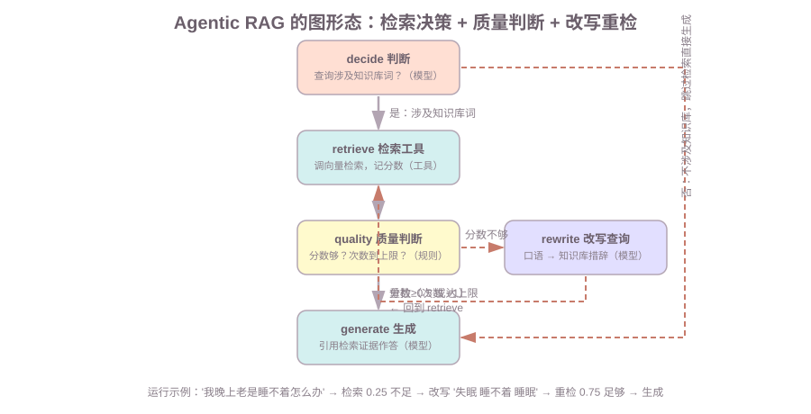

# 第9课:Agentic RAG：检索作为工具

前八课把"工具调用"讲透了：定义、组装、可靠性。第 9 课把**检索**也变成一种工具——把阶段 9 的"固定流程 RAG"升级成"检索即工具"的图：先判断要不要检索，检索完判断结果够不够，不够就改写查询重检索，够了再生成。

范围：RAG 的基础（文档切分、embedding、向量库、相似度检索）在阶段 9 / RAG 课，本课不重讲，只给一个最小模拟基线；本课讲的是**把检索装进图的形态**——检索决策、质量判断、查询改写与重检索。检索工具的可靠性（超时、可观测）用到第 8 课结论，不重复展开。

前置：第 4 课（工具）、第 5 课（ReAct 循环、条件边）、第 8 课（工具可靠性）；阶段 9（embedding 与向量检索、固定流程 RAG）。

**学习目标：**

1. 能画出固定流程 RAG 的流程，说出它的三个问题；
2. 能解释"检索工具化"——为什么检索要变成工具、由模型决定要不要调；
3. 能画出 Agentic RAG 的图形态（判断 → 检索 → 质量判断 → 改写重检 → 生成），说清每步是模型还是规则；
4. 能解释查询改写为什么能救"召回差"（口语查询 vs 知识库措辞）；
5. 能说出何时值得用 Agentic RAG（成本与收益权衡）。

## 1. 背景：固定流程 RAG 的流程与三个问题

定义：**固定流程 RAG 是一条写死的管线**——query → 检索 → 拼上下文 → 生成，每次对话都走一遍，检索只发生一次：

```text
用户问题 → 向量化 → 向量库检索(Top-K) → 拼进 Prompt → 生成回答
            （一次，固定）
```

演示 A 就是这条管线的离线最小版（检索用词表模拟），它有三个问题：

| 问题 | 表现（演示 A） | 后果 |
| --- | --- | --- |
| ① 查询质量依赖措辞 | "我晚上老是睡不着怎么办" 检索相关度只有 0.25 | 召回的证据很弱，答案质量差 |
| ② 只有一次机会 | 相关度 0.25 也硬着头皮生成，没有重试 | 召回差就一差到底 |
| ③ 每次都检索 | "你好"也走一遍向量检索 | 浪费成本，简单问题被过度处理 |

（真实 embedding 下第一个问题同样存在：口语查询的向量和知识库片段的向量距离远。）

## 2. 检索工具化：把检索封装成 @tool（检索决策）

第一个升级：检索不再是一条固定的管线步骤，而是**一个工具**——`retrieve(query)`，和计算器、查天气一样（第 4 课的机制原样复用）：

```python
@tool
def retrieve(query: str, top_k: int = 1) -> str:
    """从生活管家知识库检索与问题最相关的片段（含相关度分数）。

    知识库覆盖：睡眠、运动、饮食、报销、午休。
    """
    hits = search(query, top_k)
    if not hits:
        return "知识库没有与查询相关的内容"
    return "\n".join(f"[{did}] 相关度{score:.2f} {body}" for did, body, score in hits)
```

工具化和固定流程的差别就一个：**"要不要检索"由模型决定，不是流程决定**。演示 B 里，脚本化模型遇到"我晚上老是睡不着怎么办"会发起 `tool_calls` 调 retrieve；遇到"你好"就直接回答，一次检索都不做：

```text
查询 '我晚上老是睡不着怎么办' -> ToolMessage: '[d2] 相关度0.25 每天保证 7 小时睡眠...'
查询 '你好' -> AIMessage: '这个问题不涉及知识库，我直接回答。'
```

知识点：这就是 Agentic RAG 和普通 RAG 的第一个分界——普通 RAG 的检索是"流程步骤"，Agentic RAG 的检索是"模型按需使用的工具"。

## 3. Agentic RAG 的图形态：判断、检索、质量判断、重检索

"模型按需检索"再往前一步：检索完之后，还要判断"结果够不够"——不够就改写查询重检一次。这就是大纲要求的图形态：



五个节点的分工（**谁干什么是关键**）：

| 节点 | 是模型还是规则 | 干什么 |
| --- | --- | --- |
| decide 判断 | 模型 | 查询涉及知识库词？涉及才检索 |
| retrieve 检索 | 工具 | 调向量检索，把分数写进状态 |
| quality 质量判断 | 规则 | 分数≥0.5 或次数到上限？ |
| rewrite 改写 | 模型 | 口语查询 → 知识库措辞 |
| generate 生成 | 模型 | 引用检索证据作答 |

演示 C 的完整运行（难查询走改写重检）：

```text
[decide]    查询涉及知识库词 ['睡不着'] -> 去检索
[retrieve]  查询='我晚上老是睡不着怎么办' -> 最高相关度 0.25，命中 d2
[quality]   相关度 0.25 / 已检索 1 次 -> 分数不够，改写重检
[rewrite]   '我晚上老是睡不着怎么办' -> '失眠 睡不着 睡眠'
[retrieve]  查询='失眠 睡不着 睡眠' -> 最高相关度 0.75，命中 d2
[quality]   相关度 0.75 / 已检索 2 次 -> 分数够，生成
[generate]  用最高分片段生成（相关度 0.75）
```

知识点一：**质量判断 + 改写重检构成一个带终止条件的循环**——分数够 → 生成（循环终止）；不够但没到上限 → 改写重检。这和第 3 课的"计数器循环"、第 5 课的"工具出错后模型重试"是同一个图模式，只是判断标准换成了检索分数。

知识点二：**循环必须有终止条件**。图的终止是 `attempts >= MAX_ATTEMPTS`（演示 C 是 2 次）——改写过一次还是不够，就用现有结果生成，不能无限重检（成本和延迟失控）。

## 4. 查询改写：把口语查询翻译成知识库语言

为什么改写能救召回？因为**用户口语和知识库措辞是两种语言**："我晚上老是睡不着怎么办"里，能对上知识库的只有"睡不着"一个词；知识库片段说的是"睡眠、咖啡因"。向量空间里两者距离远，检索分数就低（0.25）。

改写节点做的，就是把口语查询"翻译"成知识库语言：`睡不着` → `失眠 睡不着 睡眠`。改写成知识库词汇后，相似度从 0.25 直接到 0.75。

知识点：改写的本质是**缩小查询与文档的语义鸿沟**。真实实现里 rewrite 是一次模型调用（成本 +1），它把用户原话转成更贴近知识库措辞的检索词。代价是一轮延迟和 token，收益是召回率。改写时要保留否定词和数量词（"不要看手机"不能改写成"看手机"）——这也是常见错误之一。

## 5. 两种流程的对比：固定 RAG vs Agentic RAG

演示 D 用同一个难查询对比（面试必答）：

| | 固定流程 RAG | Agentic RAG |
| --- | --- | --- |
| 检索决策 | 每次必检 | 模型按需（"你好"不检） |
| 检索次数 | 固定 1 次 | 可多次（改写重检） |
| 查询质量 | 原话直检 | 可改写 |
| 自我修正 | 无 | 分数不够会重检 |
| 模型调用成本 | 1 次（生成） | decide + 可能 rewrite + generate，最多 3 次 |
| 典型结果（难查询） | 0.25 硬生成 | 改写后 0.75 再生成 |

```text
[固定 RAG]     检索 1 次，相关度 0.25 -> 根据知识库：每天保证 7 小时睡眠...
[Agentic RAG]  检索 2 次，最高相关度 0.75 -> 根据知识库：每天保证 7 小时睡眠...
```

结论一句话：**Agentic RAG 用"多一次模型决策"换"更可靠的检索结果"**——固定 RAG 便宜但笨，Agentic RAG 聪明但贵。

## 6. 何时值得用 Agentic RAG：成本与收益的权衡

不是所有场景都值得：

| 场景 | 选择 | 理由 |
| --- | --- | --- |
| 简单问答、FAQ、查询词和库措辞接近 | 固定 RAG | 检索一次就够，多花模型调用是浪费 |
| 用户口语多、知识库专业词汇多（生活管家、客服） | Agentic RAG | 查询改写收益大，召回差一次就毁答案 |
| 多轮对话中检索结果反复不够 | Agentic RAG | 能自我修正，而不是把坏证据一路带到答案 |
| 延迟/成本敏感 | 固定 RAG | 每次改写都是一轮模型调用 + 延迟 |

知识点：判断标准是"**查询措辞和知识库措辞的鸿沟有多大**"。鸿沟大 → 改写值得；鸿沟小 → 固定流程就够。生产里常见折中：先用固定 RAG，badcase 里"检索不到"占比高，再升级成 Agentic。

## 7. 检索工具的可靠性：复用第 8 课防线

检索也是工具，第 8 课的防线原样适用（面试会追问）：

- **schema 合同**：`retrieve` 的 description 写清"什么时候该调、查什么、top_k 是什么"——模型据此决定调不调（第 2 节）；
- **超时**：真实向量库查询也可能慢，给检索工具加超时（第 8 课第 6 节）；
- **可观测**：记每次检索的入参（查询）和出参（片段 + 分数）——"相关度一直低"就是改写的信号（第 8 课第 7 节）；
- **权限**：知识库按用户/租户隔离，检索工具的白名单就是"只能检自己租户的库"（第 8 课第 8 节）。

## 8. 常见错误

1. **重检没有终止条件**：只判断"分数不够 → 改写"却忘了次数上限，查询被改写成什么样都可能无限重检（成本失控）。图里必须有 `attempts` 上限（演示 C）；
2. **改写丢原意**：改写节点把口语转成关键词时丢了关键约束（如"不要看手机"改写成"看手机"），检索结果反而错。改写要保留否定词和数量词；
3. **检索工具化后忘了判断**：模型可能对"你好"也发起检索，判断节点（decide）就是防这个的——检索决策要和工具化配套；
4. **质量判断只看分数不看证据**：分数高不代表答非所问——还要看命中的片段和问题是否同一主题；
5. **对简单场景也上 Agentic RAG**：每次多 1~2 次模型调用，成本翻倍但收益为零（第 6 节）。

## 9. 运行课程代码

```bash
cd c:\0work\project\ai_application_development_study
python code/langgraph/09-agentic-rag.py
```

依次打印：演示 A（固定流程 RAG 基线：难查询相关度 0.25 硬生成）、演示 B（检索工具化：模型按需决定要不要检索）、演示 C（Agentic RAG 图：0.25 → 改写 → 0.75 的完整轨迹）、演示 D（两种流程同查询对比）。全部离线可跑，检索用词表模拟，模型用脚本化替身，不需要 API Key。

## 10. 课后作业

作业和课程示例在同一个文件中：`code/langgraph/09-agentic-rag.py`，从 `# ===== 课后作业 =====` 开始。

1. **可配置重试上限**：实现 `build_agentic_rag_with_limit(max_attempts)`——把重试上限从写死的 `MAX_ATTEMPTS` 变成参数；用 `max_attempts=1` 跑难查询，验证"第一次分数不够也会直接用现有结果生成"（图不会无限重检）；
2. **检索决策**：实现 `decide_no_retrieval(query)`——判断一个问题是否需要检索（出现知识库相关词才需要）；验证 `"你好" -> False`、`"我睡不着" -> True`；
3. **成本对比**：实现 `count_model_calls_agentic(query)`——数一遍 Agentic RAG 的模型调用次数（decide + 可能 rewrite + generate），和固定 RAG 的 1 次对比，写一句结论；
4. 思考题：质量判断为什么用"分数 ≥ 0.5 **或** 次数到上限"两个条件？只用"分数够"会怎样？（答案在第 3 节知识点二：没有终止条件的循环会失控）

## 11. 验收问题 / 过关清单

能回答：

1. 固定流程 RAG 的流程是什么？三个问题各是什么？
2. 检索工具化后，"要不要检索"由谁决定？和固定流程差在哪？
3. 画出 Agentic RAG 图形态，说清五个节点各自是模型还是规则？
4. 查询改写为什么能救召回差？改写算几次模型调用？
5. 什么时候用固定 RAG、什么时候用 Agentic RAG？判断标准是什么？

## 12. 面试高频考点

答案分机制和口述模板两层，面试时按模板说：

**Q1：Agentic RAG 和普通 RAG 的区别？**
机制：普通 RAG 是固定管线——每次必检、只检一次、查询原话直检、结果差无法修正；Agentic RAG 把检索变成工具，模型决定要不要检，检索后判断质量，不够就改写查询重检，够了再生成。代价是多 1~2 次模型调用。
口述模板："普通 RAG 是一次写死的管线：query → 检索 → 拼上下文 → 生成，检索固定发生且只有一次，查询措辞和知识库不一致时召回就差。Agentic RAG 把检索变成工具，模型按需调用；检索完有质量判断，分数不够就改写查询重检索。它用多一轮模型决策换更可靠的召回。"

**Q2：如何减少 RAG 的幻觉？**
机制：幻觉来源是"证据弱还硬答"。Agentic RAG 的两层防护——检索决策（无关问题不检索，不硬编）和质量判断（分数不够改写重检，而不是把弱证据带进答案）；生成时引用来源。
口述模板："一是检索决策：与知识库无关的问题直接答，不编造检索结果；二是质量判断：检索分数低于阈值就改写查询重检，而不是拿弱证据硬生成；三是生成必须引用来源，没检到就明说'知识库没有'。"

**Q3：检索结果不够好怎么办？**
机制：改写查询重检（rewrite 把口语转成知识库措辞，再检索一次），有重试上限防失控；上限到了就用现有结果生成或明说没检到。
口述模板："检索不够好先改写查询再检一次——口语查询和知识库措辞往往对不上，改写能把'我睡不着'变成'睡眠 失眠'，召回率立刻上来。但重检要有次数上限，不能无限改下去。"

**Q4：为什么检索要变成工具而不是固定流程？**
机制：固定流程对"你好"也检索（浪费）、只检一次（没法补救）；工具化后"要不要检索"由模型决定，还能和 ReAct 循环、其他工具组合。
口述模板："检索的本质是'按需取证据'，和查天气、算数一样是工具——要不要用由模型判断。固定流程每次必检、只检一次，简单问题浪费、难问题没机会补救；工具化让检索可以按需调用、多次调用，还能和其他工具在同一循环里组合。"

**Q5：什么时候不该用 Agentic RAG？**
口述模板："查询和知识库措辞接近、一次检索就够的场景（FAQ、固定模板问答），Agentic RAG 多花 1~2 次模型调用，延迟和成本翻倍但召回没有提升。判断标准是查询与知识库的语义鸿沟有多大。"

## 下一课预告

第 10 课《并行、Send 与子图》：本课的图是"一条主链加一个重检回路"，下一课让图"分叉"——用 `Send` 并行调多个工具/子任务再合并，并讲子图与外层图的状态隔离。
