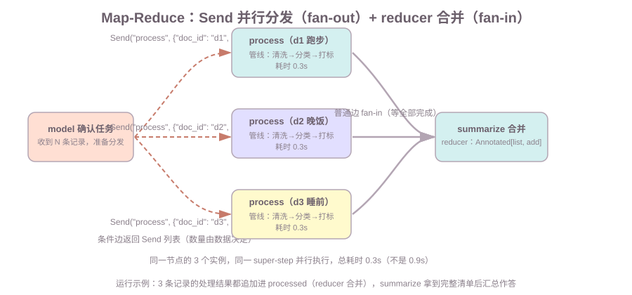

# 第10课:并行、Send 与子图

前九课的图都是"一条链加一个回路"：节点一个接一个跑，循环靠条件边绕回来。但生产里常有"多个独立的事可以同时做"——一次批量处理多条记录（每条走完整处理管线）、一个任务拆成几份并行算、把整个 Agent 嵌进更大的系统。本课讲 LangGraph 的三种图组合能力：静态并行（普通边 fan-out）、`Send` 动态 fan-out、子图嵌套，以及并行带来的注意点。

范围：本课只讲图层面的并行与组合。工具内部的多工具并行执行（ToolNode 一次多个 `tool_calls`）在第 8 课 6.1 提过，那是"同一 super-step 内的并行"，本课讲的是**跨节点的并行分发**。流式输出见第 11 课。

前置：第 2 课（reducer、`Annotated` 合并语义——fan-in 全靠它）；第 3 课（条件边——`Send` 从条件边返回）；第 5 课（ReAct——子图演示用的就是它）。

**学习目标：**

1. 能说出为什么需要并行，静态 fan-out 和 `Send` 动态 fan-out 的区别；
2. 能画出 Map-Reduce：`Send` 分发 → 并行执行 → reducer 合并，说清 fan-in 的屏障作用；
3. 能解释子图的状态隔离：子图只消费/更新自己 State 定义的字段；
4. 能说出并发更新同一字段的规则（无 reducer 报错、有 reducer 合并）；
5. 能说出什么时候不该用并行（成本、限流、调试复杂度）。

## 1. 背景：串行执行的浪费与并行的机会

一个 Agent 请求里经常有**互不依赖**的多个任务：查天气和查空气、批量处理多条记录（每条走完整处理管线）、同时搜多个关键词。第 3 课讲过图按 super-step 串行推进——如果这些独立任务也一个接一个跑，就是在**白白等待**：查天气 0.5s + 查空气 0.5s = 1.0s，而它们完全可以同时进行。

（先划一条边界：如果这些任务是模型按需调的工具，它们在一个 ToolNode 里就并行执行了，不需要画边——那是第 8 课 6.1 讲过的事。本课讲的是**图层面**的分发：把固定的几个任务分给不同节点，或把批量任务动态分给同一节点多次。）

演示 A 直接对比（两个各 0.5s 的独立查询）：

```text
串行（w 完再 a）：耗时 1.0s
并行（w、a 同一 super-step）：耗时 0.5s
```

并行只等最慢的那个任务。但"怎么让它们同时跑"有两种分发方式，本课第 2、3 节分别讲。

## 2. Send：向节点动态批量分发任务（fan-out）

本课三个机制先对个焦——它们都涉及"并行/组合"，但**各自解决不同的问题**，先记住各自的作用再往下看：

| 机制 | 解决什么问题（背景） | 数量由谁定 | 什么时候用 |
| --- | --- | --- | --- |
| 静态 fan-out（2.1） | 几个固定任务同时跑，避免串行浪费 | 图结构写死 | 业务流程固定的小数量并行 |
| `Send` 动态 fan-out（2.2） | 数量不确定 / 数据驱动的批量任务 | 运行时数据 | 每条数据走完整处理管线 |
| 子图（第 4 节） | 大系统组合、Agent 复用、上下文隔离 | — | 把 Agent 当零件、隔离子任务 |

（工具并行——模型一个 `tool_calls` 列表在 ToolNode 里并行——不在本课，那是第 8 课 6.1 讲的节点**内部**并行；本课是图**层面**的分发。）

### 2.1 静态 fan-out：一条边分两叉（workflow 形态）

先分清一个边界，避免误会——你可能想"查天气和查空气不是应该在一个工具节点里并行吗？"。对，**在 ReAct Agent 里，模型决定同时调多个工具，是一个 AIMessage 带多个 `tool_calls`，由 ToolNode 并行执行（第 8 课 6.1 实测）——那不需要画边，是模型在运行时决定的**。本节的静态 fan-out 是另一种并行：**业务流程固定时，由图结构预先编排的并行（workflow 形态）**——写 graph 时就知道"每次都要并行做这两件事"。

例如一个固定流程"每次请求先取天气和空气，再汇总"：

```text
START ──→ w（查天气）──┐
START ──→ a（查空气）──┴─→ merge ──→ END
```

`w` 和 `a` 同一 super-step 并行执行（演示 A 实测：各 0.5s 总耗时 0.5s），`merge` 等两者都完成才执行。缺点（也是和 Send 的关键区别，第 2.2 节展开）：**分几叉是写死的**——要处理 5 条记录就得画 5 条边、5 个节点，而 Send 的数量由运行时数据决定。

**代码：怎么组装（演示 A 的并行图，核心就三组 `add_edge`）**：

```python
class S(TypedDict):
    city: str
    weather: str    # w 节点写这个字段
    air: str        # a 节点写这个字段

def w(state):
    time.sleep(0.5)
    return {"weather": f"{state['city']}：晴，22℃"}

def a(state):
    time.sleep(0.5)
    return {"air": f"{state['city']}：空气优"}

def merge(state):
    return {}       # fan-in 汇合点：什么都不用做，等两个结果都进 state

g = StateGraph(S)
g.add_edge(START, "w")        # ① fan-out：从 START 引两条普通边
g.add_edge(START, "a")        #    w、a 同一 super-step 并行执行
g.add_edge("w", "merge")      # ② fan-in：都汇到 merge
g.add_edge("a", "merge")      #    merge 等两者都完成才执行
g.add_edge("merge", END)
```

两个关键点：

- **并行节点写不同的字段（`weather` / `air`），互不冲突，不需要 reducer**——两个节点各写各的，`merge` 时 state 里两个字段都在。第 2 课的 `Annotated` 合并只在这些并行节点**写同一个字段**时才需要（第 5 节演示 D：不配 reducer 直接报错）；
- fan-out 是"**从同一个起点引多条边**"，fan-in 是"**多条边汇到同一个节点**"——`add_edge` 本身没有"并行"关键字，并行就是"同一 super-step 里有多个待执行节点"这个事实（第 3 课）。**fan-out/fan-in 是模式名，不是函数名**：和"循环是条件边 + 回边表达的模式"一样，它们都是节点、边、状态这几个原语组合出来的形态。

### 2.2 Send：动态分发，数量由运行时决定

`Send` 解决"要并行多少个不确定"的问题——**本课第一个新概念，当场定义**：

- **`Send(node, payload)`**：向指定节点**动态发送一个任务**。`node` 是要执行的节点名，`payload` 是这个任务的部分状态（该节点会收到它）。

`Send` 从**条件边的路由函数**返回（不是从节点返回！实测：节点返回 `Send` 列表会报 `InvalidUpdateError`），一个任务一个 `Send`，要分多少个由运行时的状态决定——下面这个例子里，任务是"每条记录走一遍处理管线"，数量就是记录的条数：

```python
def route_fan_out(state) -> list:
    return [Send("process", {"doc_id": did, "text": text}) for did, text in state["docs"]]

graph.add_conditional_edges("model", route_fan_out)   # ← Send 从这里返回
```

`process` 节点被"同一 super-step 并行执行 N 次"（这里 N=3），每次收到自己的 `payload`（`state["doc_id"]` / `state["text"]` 是不同记录）。演示 B 实测：3 条记录各走 0.3s 的处理管线，总耗时 0.3s。

**为什么不用"查 3 个城市天气"当例子？** 因为那用工具并行就够了——模型一个 `tool_calls` 列表，ToolNode 就并行执行了（第 8 课 6.1）。`Send` 的例子必须是**工具并行做不到**的事：每条记录独立走完"清洗 → 分类 → 打标"整个管线。管线不是模型能塞进一次 `tool_calls` 的函数调用，是图编排出来的处理流程；而且数量由数据决定——写 3 条分 3 个任务，写 100 条分 100 个。

**完整组装（演示 B 的 `build_send_graph`）**：

```python
class TaskState(TypedDict):
    docs: list                                # 输入：[(doc_id, 原始文本)]
    processed: Annotated[list, operator.add]  # fan-in 合并：每条的处理结果追加
    report: str

def model_node(state):
    """模型节点：确认任务（脚本化），真正的分发交给编排。"""
    return {}                                 # 节点必须返回 dict（Send 不从这里回）

def route_fan_out(state) -> list:
    return [Send("process", {"doc_id": did, "text": text}) for did, text in state["docs"]]

def process_node(state):
    """处理管线节点：每条记录一个实例，内部三步（清洗→分类→打标）。"""
    time.sleep(0.3)
    text = state["text"].strip()                       # ① 清洗
    cat = "运动" if "跑" in text else "其他"            # ② 分类
    tag = "#健康" if cat == "运动" else "#日常"         # ③ 打标
    return {"processed": [f"{state['doc_id']}（{cat}{tag}）：{text}"]}

def summarize(state):
    return {"report": "；".join(state["processed"])}   # fan-in：reducer 已攒齐

g = StateGraph(TaskState)
g.add_node("model", model_node)
g.add_node("process", process_node)
g.add_node("summarize", summarize)
g.add_edge(START, "model")
g.add_conditional_edges("model", route_fan_out)   # ① fan-out：Send 从这里返回
g.add_edge("process", "summarize")                # ② fan-in：普通边，等全部完成
g.add_edge("summarize", END)
```

和静态 fan-out 的差别一眼可见：静态版用 `add_edge(START, ...)` 写死几条边；`Send` 版**只画了一条条件边**，发多少个任务由 `route_fan_out` 在运行时返回的列表决定——`processed` 字段配 `Annotated[list, operator.add]`，每条处理结果都追加进去（第 2 课的 reducer，fan-in 全靠它）。

**`Send` 和普通边调用的区别**（面试必答）：

| | 普通边 | `Send` |
| --- | --- | --- |
| 分发数量 | 写死（一条边一个下游） | 动态（一个列表任意多个） |
| 谁决定 | 图结构 | 运行时状态（路由函数返回值） |
| 下游收到什么 | 整个 state | 每个任务自己的 `payload` |
| 用途 | 固定流程 | 批量、不确定数量的并行 |

知识点：`Send` 的 `payload` 是**部分状态**——`process` 节点只能看到 payload 里的字段（如 `doc_id`、`text`），看不到外层 state 的其他字段（比如别的记录）。这和子图的状态隔离是同一个原则（第 4 节）。

**`Send` 并行 vs 工具并行**（都叫"并行"，但层级不同，面试会问）：

| | 工具并行（第 8 课 6.1） | `Send` 并行（本课） |
| --- | --- | --- |
| 并行发生在 | 节点**内部**（一个 ToolNode） | 节点**之间**（目标节点实例化 N 次） |
| 并行单元 | 工具函数调用（calculate、查天气） | 整个节点执行（process 管线跑 N 次） |
| 谁发起 | 模型：一个 AIMessage 带多个 `tool_calls` | 编排：路由函数返回 `Send` 列表 |
| 子任务能做什么 | 无状态函数调用（不碰 state，第 4 课） | 完整节点执行：可读写 state、可内嵌子图 |
| 结果合并 | 每个工具一个 `ToolMessage`，追加 messages | 每份部分状态用 reducer 合并进 state |
| 典型场景 | 一次回答里查天气 + 查空气 | 批量数据处理管线（每条走完整流程）、分发子 Agent |

一句话：**工具并行是"一个节点里多个函数同时跑"（函数级），`Send` 并行是"一个节点被并行实例化多次"（图级）**。两者还能组合——`Send` 的目标节点内部可以再是一个 ToolNode。

## 3. Map-Reduce：并行执行后用 reducer 合并结果（fan-in）

"Map"是分发并行，"Reduce"是合并。演示 B 的完整形态：



三件套：

1. **Map（`Send` 分发）**：`model` 节点拆任务，条件边返回 N 个 `Send`；
2. **并行执行**：目标节点同一 super-step 跑 N 次，每次返回自己的结果；
3. **Reduce（reducer 合并）**：每个任务的结果都追加进同一个字段——**靠第 2 课的 `Annotated` reducer**：

```python
class TaskState(TypedDict):
    processed: Annotated[list, operator.add]   # 每份结果都 append，不是覆盖

def process_node(state):
    return {"processed": [f"{state['doc_id']}（{cat}{tag}）：{text}"]}   # 每次只返回自己那条
```

**fan-in 的屏障作用（实测）**：`summarize` 节点在所有 `process` 任务都完成后才执行——图不会在"只收到 1 条处理结果"时就跑去汇总。演示 B 输出：3 个 process 完成 → summarize 打印"合并 3 条处理结果"。

知识点：Map-Reduce 的模式就是"**分发 → 各干各的 → reducer 攒齐**"。没有 reducer（字段不写 `Annotated`），并行任务各自写同一个字段会直接报错（第 5 节演示 D）。

## 4. 子图：把图当作节点嵌套进另一个图

**背景：一个 Agent 系统变大后，全塞在一个图里会怎样？** 节点越加越多、state 字段互相干扰（这个节点要的字段那个节点不要）、别人写好的 Agent（第 5 课的 ReAct、第 9 课的 RAG 图）没法直接嵌进来用。子图解决的就是这个**组合问题**：把编译好的图当普通节点，嵌进更大的图——像搭积木，而不是一个图越写越大、越写越乱。

**子图 = 编译后的图，作为普通节点嵌入外层图**。本课第二个新概念，当场定义：

- **子图（subgraph）**：一个 `compile()` 过的图对象，可以 `add_node` 到另一个图的某个位置，对外层来说它就是"一个节点"——输入外层 state 的一个子集，返回状态更新。它自己内部照样有节点、边、循环——对外层这一切是黑盒。

演示 C 把一个完整 ReAct Agent（第 5 课形态）当作子图嵌进外层图：

```python
outer.add_node("agent", build_react_subgraph())   # ← 编译好的图当节点

# 外层：router → agent（子图）→ outer_end
```

**状态隔离的准确含义（实测）**：子图只消费/更新**它自己 State 定义的字段**。

- 共享字段：外层 `State` 继承 `MessagesState`，`messages` 传给子图，子图的工具调用链（4 条消息）**完整回填到外层**；
- 隔离字段：外层自己的 `request` / `reply` 字段，子图 State 里没有，**子图节点访问不到、也碰不到**（实测：`outer_end` 看到 `reply` 原封不动）。

```text
[router]    外层字段 request='1+1 等于几？'（子图节点访问不到它）
[outer_end] 外层看到子图回填的最后一条消息：'最终答案：2'
[outer_end] 外层字段 reply='' 没被子图碰过
```

注意一个前提（实测踩过）：**外层必须包含子图 State 的全部字段**，子图才有输入。演示 C 里子图要 `messages`，所以外层继承 `MessagesState`；如果外层没有 `messages`，子图收到空消息，一进去就 `IndexError`。子图嵌套不是"魔法隔离"，而是"字段子集可见"。

子图有什么用：把一个完整 Agent 当"零件"复用（如把第 9 课的 RAG 图嵌进更大的系统）、隔离子任务上下文、多个子图并行（结合 `Send`）。

**子图 ≠ 多 Agent，别混**：子图是**机制**（图套图），多 Agent 是**模式**（多个 Agent 分工协作）——子图是实现多 Agent 的手段之一，但不是多 Agent 本身。演示 C 只有一个 ReAct 子图，那是"单 Agent 封装进更大流程"，不是多 Agent。只有**多个** Agent 子图被编排在一起（子图嵌套、`Send` 分发、共享状态单图）才叫多 Agent；且用了子图，多 Agent 的老问题（任务重复、上下文不一致、级联失败，见 ai-agent 课第 6 课）照样存在——子图只负责隔离上下文，通信和编排还得你设计。

## 5. 并发节点的注意事项

并行不是免费的，三个注意点：

**① 并发更新同一字段：必须配 reducer，否则报错。** 演示 D 实测了两个并行节点同时写 `count`（无 reducer）——图直接失败，不是"后写覆盖"：

```text
count（无 reducer）：图失败 -> InvalidUpdateError: At key 'count':
  Can receive only one value per step. Use an Annotated key to handle multiple values.
logs（有 reducer）：['a', 'b']（两份都在，顺序不定）
```

**规则一句话：并行节点写同一字段，字段必须是 `Annotated[...]` reducer**（第 2 课）。串行时"后写覆盖"没问题，并行时一个 super-step 收到两个值，LastValue 通道只收一个，报错。

**② 外部资源并发访问**：并行节点同时写同一个文件、同一个数据库连接、同一个外部 API，和线程安全问题一样——要加锁、用连接池、或让写操作幂等（第 8 课）。图不帮你管外部资源。

**③ 限流**：N 个任务同时打外部 API，可能触发对方的限流/封禁。真实工程里要控制最大并发（分批 `Send`、信号量），或对每个子任务做超时和重试（第 8 课）。

## 6. 并行不等于更好：成本、限流与调试复杂度

面试常问"什么时候不该用并行"：

| 情况 | 为什么不该并行 |
| --- | --- |
| 任务之间有依赖 | 后一个要用前一个的结果，并行没意义（比如"先查库存再下单"） |
| 外部 API 有限流 | N 个并行请求触发限流/封禁，比串行更慢更糟 |
| 成本敏感 | 并行不改总工作量，只改墙钟时间——token 和费用不变，只是等得快 |
| 调试复杂度 | 并行任务的日志交错、状态合并顺序不定（演示 D 的 logs），badcase 难复盘 |

知识点：**并行的收益是"墙钟时间"，不是"总工作量"**——3 条记录的处理 token/费用，串行并行一样多。判断标准：任务是否独立 + 外部资源是否扛得住 + 调试成本是否可接受。

## 7. 常见错误

1. **把 `Send` 从节点函数返回**：节点必须返回 dict（状态更新），`Send` 列表只能从条件边的路由函数返回——实测会报 `InvalidUpdateError: Expected dict, got [Send(...)]`；
2. **fan-in 字段忘了配 reducer**：并行任务各自写同一个字段，无 `Annotated` 直接 `InvalidUpdateError`（演示 D）；
3. **外层 State 缺子图字段**：子图需要 `messages` 而外层没有 → 子图收到空消息直接 `IndexError`（演示 C 前提）；
4. **把并行当免费提速**：总成本不变，只是等得快；外部 API 有限流时并行反而更慢（第 6 节）；
5. **并行节点共享外部资源不设防**：同时写一个文件/连接，出现竞态——图不管外部资源（第 5 节②）。

## 8. 运行课程代码

```bash
cd c:\0work\project\ai_application_development_study
python code/langgraph/10-send-subgraph.py
```

依次打印：演示 A（串行 1.0s vs 静态并行 0.5s）、演示 B（`Send` 批量记录处理管线 + reducer 汇总）、演示 C（ReAct 子图嵌入外层、状态隔离）、演示 D（并发写无 reducer 报错 vs 有 reducer 合并）。全部离线可跑，不需要 API Key。

## 9. 课后作业

作业和课程示例在同一个文件中：`code/langgraph/10-send-subgraph.py`，从 `# ===== 课后作业 =====` 开始。

1. **可变记录列表的 Send Map-Reduce**：实现 `build_send_graph_v2(docs)`——记录列表从参数来（演示 B 写死 3 条），5 条记录并行走处理管线，验证总耗时 ≈ 单个管线耗时，report 汇总 5 条；
2. **RAG 子图嵌入**：把第 9 课的 Agentic RAG 图作为子图嵌入外层图，外层加 `tag` 字段验证隔离（外层字段子图不碰）；注意外层 State 要包含 RAGState 全部字段（作业里已给出）；
3. **并发写字段观察**：自己再写两个并行节点同时 overwrite 一个 int 字段，记录看到的 `InvalidUpdateError` 文本；改成 `Annotated[list, operator.add]` 后观察合并——把观察写成一两句话；
4. 思考题：`Send` 的 `payload` 为什么是"部分状态"而不是整个 state？这和第 4 节子图的隔离是同一个原则吗？（答案：都是"节点只看到自己该看的字段"，防止并行任务互相串数据）

## 10. 验收问题 / 过关清单

能回答：

1. 为什么需要并行？静态 fan-out 和 `Send` 动态 fan-out 的区别是什么？
2. 画出 Map-Reduce 三件套，fan-in 的屏障作用是什么？合并靠什么？
3. 子图的状态隔离准确含义是什么？外层 State 要满足什么前提？
4. 并发节点写同一字段会怎样？规则是什么？
5. 什么时候不该用并行？

## 11. 面试高频考点

答案分机制和口述模板两层，面试时按模板说：

**Q1：`Send` 和普通边调用的区别？**
机制：普通边一条边一个固定下游；`Send` 从条件边返回列表，按运行时状态动态分发 N 个任务到同一节点，每个任务带自己的 payload。实测 Send 返回位置：条件边路由函数，不是节点。
口述模板："普通边的数量是写死的，Send 是按运行时数据动态决定发多少个——路由函数返回一个 Send 列表，每个 Send 指向同一节点、带自己的参数。典型用途是 Map-Reduce：批量任务并行执行，再用 reducer 合并结果。"

**Q2：子图状态如何与外层隔离？**
机制：子图只消费/更新自己 State 定义的字段；外层 State 必须包含子图需要的字段（如 messages），子图更新会回填外层；子图 State 之外的字段子图碰不到。
口述模板："子图是编译后的图当节点。它只看到自己 State 定义的那些字段，外层 State 里它没定义的字段它访问不到、也不会改。外层要给它喂它需要的字段（比如 messages），它的更新会合并回外层。所以隔离不是'看不到共享消息'，而是'只看得到自己声明的那部分'。"

**Q3：什么时候适合并行，什么时候不该用？**
口述模板："任务独立、没有先后依赖，且外部资源扛得住并发，才适合并行——并行只省墙钟时间，不省总成本。任务有依赖、外部 API 有限流、或者调试复杂度过高时不该并行，串行反而更可控。"

**Q4：并发节点同时更新同一字段会怎样？**
机制：实测——同一 super-step 两个节点写无 reducer 的字段，抛 `InvalidUpdateError: Can receive only one value per step`；配 `Annotated` reducer 则两个值都合并（顺序不定）。
口述模板："必须给这个字段配 reducer。LastValue 通道一个 super-step 只收一个值，两个并行节点都写就直接报错；配了 Annotated（比如 operator.add 追加）两个值都合并进去。所以并行任务的结果字段，定义时就要想好合并语义。"

**Q5：子图和 `Send` 能组合吗？**
口述模板："能。Send 可以把任务动态分发给子图节点——每个 payload 触发一次子图执行，子图内部再自己跑它的节点和循环。这是'并行编排多个 Agent'的基础。"

## 下一课预告

第 11 课《流式输出与 FastAPI 集成》：本课的图是"跑完出结果"，下一课让结果"边跑边出"——`stream_mode` 各值、消息事件结构、把 Agent 接进 FastAPI 的 SSE 接口。
