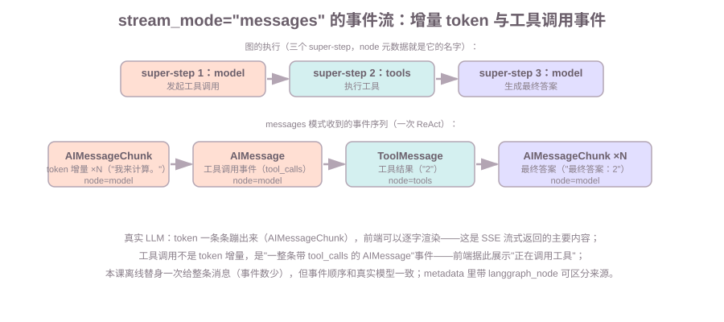

# 第11课:流式输出与 FastAPI 集成

前几课调用图都是"跑完拿结果"（`invoke` 返回最终 state）。但真实产品里用户不想等 Agent 全部跑完——模型生成答案要好几秒，最好**边生成边推**。本课讲 LangGraph 的事件流机制（`stream_mode` 四种模式），并把 Agent 接进 FastAPI 的 SSE 接口：token 一条条推给前端、工具调用事件实时可见、客户端断开能善后。

范围：`stream_mode` 与消息事件结构是本课重点；FastAPI 的 `StreamingResponse`、异步生成器、SSE 数据格式在 FastAPI 第 10 课已讲过，本课只做"把图的事件接进 SSE"这一步。WebSocket 不在本课展开。

前置：第 5 课（`stream` 基础、每 super-step 一个 chunk）；FastAPI 第 9、10 课（异步接口与流式响应）；第 6 课（checkpoint，第 7 节用到）。

**学习目标：**

1. 能说出 `stream_mode` 四种模式各自产出什么、各自用途；
2. 能描述 `messages` 模式的事件结构（消息 + 元数据）与事件顺序（token 增量、工具调用事件）；
3. 能写出 FastAPI SSE 接口：`astream(stream_mode="messages")` 的事件转成 `data: JSON` 推给前端；
4. 能说明客户端断开时发生了什么（`CancelledError`），以及为什么必须 try/finally 清理；
5. 能说出长任务超时/取消和 checkpoint 的关系。

## 1. 背景：流式输出的价值——降低首字延迟

第 5 课讲过 `stream` 是惰性生成器：调用时不执行，迭代时才**一个 super-step 一个 chunk** 地产出。对用户来说，价值是**首字延迟**——模型还在生成第二句时，第一句已经显示出来了。

这里先把两个词钉死（本课反复用）：

- **chunk**：`stream` 迭代的每个产出单位。图跑几个 super-step，`stream` 就产出几个 chunk（默认情况）——一次 ReAct（model → tools → model，3 个 super-step）产出 3 个 chunk；
- **`stream_mode`**：选择"每个 chunk 里装什么"的参数。默认装的是节点更新（相当于第 2 节的 `updates`），但**不同的消费方需要不同的内容**——调试的人要看完整 state，前端要逐 token 的消息，进度条要自定义事件。一个参数装不下所有需求，于是有四种模式，第 2 节逐个展开。

## 2. stream_mode：四种模式各自产出什么

四种模式（第 5 课讲过基础事件结构，这里展开模式差异）：

| 模式 | 每个 chunk 是 | 输出条数（一次 ReAct） | 用途 |
| --- | --- | --- | --- |
| `values` | **完整 state**（所有字段） | 4（含输入） | 调试：看每一步整体状态 |
| `updates` | **节点更新**（`{节点名: 更新}`） | 3 | 调试：谁变了、变了什么 |
| `messages` | **消息事件**（`(消息, 元数据)`） | 消息条数 | 前端流式渲染：token、工具调用 |
| `custom` | **自定义事件**（节点里 `get_stream_writer` 写的） | 自己决定 | 进度上报、阶段通知 |

演示 A 实测输出差异（同一个 ReAct 图）：

```text
values（完整 state，4 个 chunk）：
  chunk0: HumanMessage '1+1 是几？'
  chunk1: AIMessage '我来计算。'
  chunk2: ToolMessage '2'
  chunk3: AIMessage '最终答案：2'

updates（节点更新，3 个 chunk）：
  chunk0: ['model']   <- 只有产生更新的节点
  chunk1: ['tools']
  chunk2: ['model']
```

知识点：`values` 和 `updates` 都是 **super-step 粒度**（一个 super-step 一个 chunk）；`updates` 更省——只给变化的部分，不给完整 state。前端**不要用这两个模式**推给用户（颗粒度太粗），推给前端的是 `messages`。

`custom` 模式（演示 C）：节点内部用 `get_stream_writer()` 写自定义事件，适合进度上报：

```python
def node_a(state):
    writer = get_stream_writer()
    writer({"stage": "a_progress", "pct": 50})   # stream_mode="custom" 时前端收到它
    return {"x": state["x"] + 1}
```

## 3. 消息事件：增量 token 与工具调用事件的结构和顺序

`messages` 模式每个 chunk 是一个 `(消息, 元数据)` 元组。真实 LLM 下，**模型生成的消息是按 token 增量产出的**（`AIMessageChunk` 一条条蹦出来），工具调用和工具结果则是完整事件：



演示 B 实测事件序列（离线替身给整条消息，顺序与真实一致）：

```text
事件0: AIMessage content='我来计算。' node=model     <- 脚本化替身：整条
事件1: ToolMessage content='2' node=tools            <- 工具结果
事件2: AIMessage content='最终答案：2' node=model    <- 最终答案
```

元数据 `metadata` 里有 `langgraph_node`（这个事件来自哪个节点）——前端靠它区分"模型在说话"还是"工具在执行"。真实模型下事件 0 会拆成几十条 `AIMessageChunk`（逐 token），前端逐字渲染；**工具调用不是 token 增量，是一条带 `tool_calls` 的完整 AIMessage**——前端据此展示"正在调用工具"。

事件顺序就是图的执行顺序：模型 token → 工具调用事件 → 工具结果 → 模型 token → ……。前端拿到这个序列，就能渲染出"思考 → 调工具 → 出结果 → 回答"的完整过程。

## 4. 异步节点与异步工具：什么时候值得写 async

第 8 课 6.1 讲过：async 工具必须配 async 图（`ainvoke`/`astream`）。本课补一个判断标准——**什么时候值得把节点/工具写成 `async`**：

| 场景 | 写法 | 理由 |
| --- | --- | --- |
| 工具要调外部 API / 数据库（IO 密集） | `async def` 工具 | `await` 期间不阻塞事件循环，能并发处理多个请求 |
| 节点里做 CPU 密集计算 | 同步节点 | 计算不释放事件循环，写成 async 没有收益 |
| 纯拼字符串 / 规则判断 | 同步节点 | 无 IO，async 只是多一个关键字 |

知识点：async 的收益在 **IO 等待**（网络、数据库、文件）。一个 FastAPI 服务同时收到 100 个 SSE 请求，每个请求的模型调用都在 `await`——事件循环可以切换着处理，而不是一个等完再下一个。CPU 密集的部分写成 async 不会变快。

## 5. FastAPI SSE 对接：把图的事件流转成 text/event-stream

第 2 节的 `messages` 流 + FastAPI 第 10 课的 `StreamingResponse`，接起来就是 SSE 接口（演示 D 的 `build_sse_app`，真实代码）：

```python
from fastapi import FastAPI, Request
from fastapi.responses import StreamingResponse

app = FastAPI()
react_app = build_react_graph()   # 第 5 课的 ReAct 图

@app.post("/chat")
async def chat(request: Request):
    body = await request.json()
    question = body.get("message", "")

    async def gen():
        # astream 惰性生成：边跑图边产出事件
        async for msg, metadata in react_app.astream(
            {"messages": [HumanMessage(content=question)]},
            stream_mode="messages",
        ):
            payload = {"type": type(msg).__name__, "content": msg.content}
            yield f"data: {json.dumps(payload, ensure_ascii=False)}\n\n"   # SSE 格式
        yield "data: [DONE]\n\n"

    return StreamingResponse(gen(), media_type="text/event-stream")
```

运行后前端看到的是（离线也能看，演示 D 打印的 SSE 文本）：

```text
data: {"type": "AIMessage", "content": "我来计算。"}
data: {"type": "ToolMessage", "content": "2"}
data: {"type": "AIMessage", "content": "最终答案：2"}
data: [DONE]
```

**三个关键点**：
1. **用 `astream` + `stream_mode="messages"`**——这是给前端推的流；`updates`/`values` 是调试用的；
2. **SSE 格式是 `data: JSON\n\n`**（FastAPI 第 10 课讲过），每个事件一行 data，`[DONE]` 收尾；
3. **`gen` 是异步生成器，客户端断开时它会被取消**——下一节讲怎么善后。

## 6. 客户端断开与资源清理：协程取消时也要善后

SSE 是长连接：用户中途关页面、切走，连接就断了。FastAPI/Starlette 会**取消**正在跑的异步生成器——`asyncio.CancelledError` 抛到生成器内部（演示 E 实测：任务取消后 `[cleanup] 客户端断开` 打印出来了）。

```python
async def gen():
    resource = 打开数据库连接()
    try:
        async for msg, metadata in react_app.astream(...):
            yield f"data: ..."
    except asyncio.CancelledError:
        resource.close()      # 客户端断开：清理，然后
        raise                 # 重新抛出，让框架正常收尾
    finally:
        resource.close()      # 正常结束也清理
```

**为什么必须 try/except + finally**：断开不是"跑完"，是"被取消"。如果不清理，连接一直挂着、资源一直占用——SSE 服务跑久了资源耗尽。要点：**清理代码必须在 `finally`（或 `except CancelledError`）里，放在 `yield` 之后是不行的**（`yield` 后的代码可能在下次 `next` 才执行，断开了就不执行了）。

## 7. 长任务的超时与取消：结合 checkpoint 续跑

流式接口下"长任务超时"有两种情况：

**情况一：单次请求超时**——Agent 跑了 30 秒还没完。处置：客户端断开/服务端掐断（`asyncio.wait_for` 包住 `astream`，超时抛 `TimeoutError`/取消生成器），走第 6 节的清理逻辑。

**情况二：任务值得继续跑完**——比如写报告这种长任务，用户断开但任务有价值。处置：图配 checkpointer（第 6 课），任务在后台**用同一个 `thread_id` 续跑**——断在哪从哪继续，结果存进 checkpoint，用户下次回来取。这里和第 6 课是同一套机制：`thread_id` 定位会话、checkpoint 记录进度。

**要点（和第 8 课串起来）**：断开 ≠ 任务完成。决定"继续后台跑"还是"取消"，看任务价值；后台跑完的副作用必须幂等（第 8 课）——因为客户端可能重试、可能重复取结果。

## 8. 常见错误

1. **用 `values`/`updates` 给前端推流**：super-step 粒度太粗（一个 chunk 是整个 state 或整个节点更新），前端没法逐字渲染。推给前端用 `messages`；
2. **SSE 生成器不写 finally 清理**：客户端断开 = 任务取消，`yield` 之后的清理代码不会执行——连接和资源一直挂着（第 6 节）；
3. **async 工具配同步图**：`invoke` 调 async 工具直接报 "does not support sync invocation"（第 8 课 6.1），流式接口必须用 `astream`/`ainvoke`；
4. **把工具调用当 token 增量处理**：工具调用是一条完整 `AIMessage`（带 `tool_calls`），不是逐字蹦出来的——前端渲染"正在调工具"要按事件类型判断；
5. **断开的请求还继续消耗资源**：客户端断开后生成器被取消，但如果图在别的任务里继续跑，资源照耗——长任务要么掐断（取消），要么让它在后台带 checkpoint 跑完（第 7 节）。

## 9. 运行课程代码

```bash
cd c:\0work\project\ai_application_development_study
python code/langgraph/11-streaming-fastapi.py
```

依次打印：演示 A（`values` vs `updates` 输出差异）、演示 B（`messages` 消息事件流 + 节点元数据）、演示 C（`custom` 自定义事件）、演示 D（FastAPI SSE 接口构建 + SSE 事件文本；缺 fastapi 时打印原因跳过）、演示 E（客户端断开 → `CancelledError` → 资源清理）。全部离线可跑，不需要 API Key；演示 D 需 `pip install fastapi uvicorn` 才能起真服务。

## 10. 课后作业

作业和课程示例在同一个文件中：`code/langgraph/11-streaming-fastapi.py`，从 `# ===== 课后作业 =====` 开始。

1. **模式对比观察**：实现 `stream_updates_vs_messages()`——对同一个图分别用 `updates` 和 `messages` 跑一遍，打印每个 chunk 的结构，写一段结论（super-step 粒度 vs 消息粒度）；
2. **给多工具 Agent 加 SSE 接口**：实现 `build_sse_for_weather()`——在第 5 课 `05-react-agent.py` 的 ReAct 图（天气+计算器）基础上写 SSE 接口，流式返回消息事件；缺 fastapi 时打印原因；
3. **长任务超时清理**：实现 `long_task_with_timeout()`——用 `asyncio.wait_for` 给一个模拟慢流设 1 秒超时，超时后 finally 打印"资源已清理"，观察清理代码确实执行；
4. 思考题：为什么 `updates` 比 `values` 省？为什么前端不用 `updates`？（答案：`updates` 只给变化节点——调试省；但前端要的是逐 token 的消息流，不是 super-step 粒度）

## 11. 验收问题 / 过关清单

能回答：

1. `stream_mode` 四种模式各自产出什么？前端用哪个、调试用哪个？
2. `messages` 模式的事件结构是什么？真实模型下 token 增量和工具调用事件各长什么样？
3. SSE 接口怎么把图的事件推给前端？（`astream` + `messages` + `data: JSON`）
4. 客户端断开时生成器发生什么？为什么清理必须放 `finally`？
5. 长任务超时了怎么办？"继续后台跑"和"取消"分别怎么做？

## 12. 面试高频考点

答案分机制和口述模板两层，面试时按模板说：

**Q1：`stream_mode` 各值有什么区别？**
机制：`values` 每 super-step 给完整 state；`updates` 只给产生更新的节点；`messages` 给消息级事件（`(消息, 元数据)`，真实模型下是 token 增量）；`custom` 给节点里 `get_stream_writer` 写的自定义事件。
口述模板："values 是完整状态快照，updates 只给变化部分，都是 super-step 粒度、用来调试；messages 是消息级事件流，真实模型下是逐 token 的 chunk，加上元数据里的节点名，适合推给前端逐字渲染；custom 是节点主动写的自定义事件，用于进度上报。"

**Q2：如何把 Agent 跑在后端并流式推给前端？**
机制：后端用 `astream(stream_mode="messages")` 迭代消息事件，每个事件转成 `data: JSON\n\n` 的 SSE 文本，`StreamingResponse(gen(), media_type="text/event-stream")` 返回；前端按 `type` 区分 token 和工具调用事件。
口述模板："图用 astream + messages 模式迭代，每个事件序列化成 JSON 按 SSE 格式 yield 出去，用 StreamingResponse 以 text/event-stream 返回。前端收到 token 逐字渲染、收到带 tool_calls 的 AIMessage 展示'正在调用工具'。"

**Q3：长 Agent 任务超时了怎么办？**
机制：两种取向——取消（`asyncio.wait_for` 掐断，生成器被取消，finally 清理）或后台续跑（配 checkpointer，用同一 `thread_id` 从断点继续，结果存 checkpoint）。判断依据是任务价值；后台跑完的副作用要幂等。
口述模板："看任务价值。没价值的直接掐断：wait_for 超时取消生成器，finally 清理资源。有价值的让它后台跑完：配 checkpointer，用同一 thread_id 续跑，断点状态都在 checkpoint 里，用户下次来取结果。副作用要幂等，因为客户端可能重复取。"

**Q4：流式场景下 checkpoint 有什么用？**
口述模板："流式接口 + 长任务，客户端断开不代表任务该放弃。checkpoint 记录每个 super-step 的状态，后台用同一 thread_id 续跑就能从断点继续，不用从头跑。它把'连接断不断'和'任务完没完成'解耦了。"

**Q5：客户端断开怎么处理？**
机制：Starlette 取消生成器任务，`CancelledError` 抛进生成器；清理代码放 `except CancelledError`/`finally`（`yield` 后的代码在断开时不会执行）。
口述模板："客户端断开时框架取消生成器，CancelledError 抛进来。生成器里必须 try/except CancelledError + finally 做资源清理——数据库连接、文件句柄都要还回去，否则长连接服务跑久了资源耗尽。"

## 下一课预告

第 12 课《Agent 的评估与回归》：流式接口让 Agent"能跑"，下一课解决"怎么知道跑得好不好"——评测集、规则断言 vs LLM-as-judge、轨迹级评估、改提示词/加工具后的回归对比。
