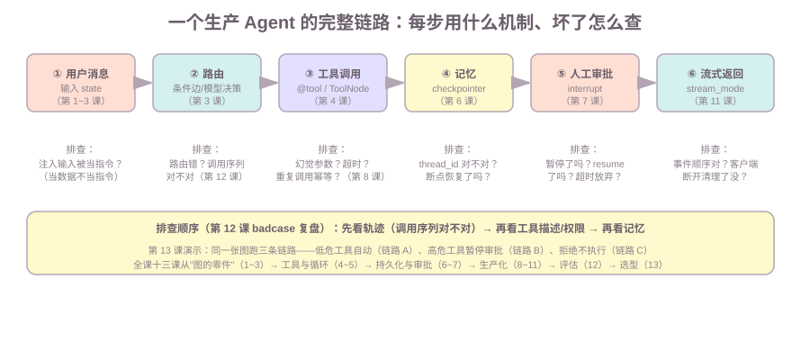

# 第13课:框架选型与综合复盘

前十二课把 LangGraph 从"图的零件"讲到了"评估与回归"。最后一课回答两个问题：**为什么选 LangGraph（选型题）**，以及**全课的机制怎么串成一个生产 Agent（复盘题）**。本课给框架对比矩阵、LangGraph 的边界与坑、多 Agent 编排模式，并用一个综合演示串起"用户消息 → 路由 → 工具调用 → 记忆 → 人工审批 → 流式返回"的完整链路，梳理每步的故障排查。

范围：本课是选型与收束课，不复讲各课机制（只回指）；多 Agent 的概念细节在 ai-agent 课第 6 课，本课只讲编排模式的选型视角。

前置：全课。综合演示用到第 4、5、6、7 课机制。

**学习目标：**

1. 能从状态管理、持久化、人工介入、流式等维度对比 LangGraph / LangChain Agent / AutoGen / CrewAI / 自研循环；
2. 能说出 LangGraph 的三个边界与坑（学习曲线、版本变化、过度抽象）；
3. 能说出多 Agent 三种编排模式（orchestrator-worker、pipeline、层级结构）的适用场景；
4. 能画出完整链路（用户消息 → 路由 → 工具调用 → 记忆 → 人工审批 → 流式返回），说出每步的故障排查手段；
5. 能回答"为什么用 LangGraph 而不是自研循环"。

## 1. 背景：选型题为什么必考

面试问"为什么用 LangGraph"，不是要你背官网卖点，而是要确认你**知道框架解决了什么、没解决什么**。这正好是前十二课的总结：状态管理（第 1~3 课）、持久化（第 6 课）、人工介入（第 7 课）、流式（第 11 课）、并行/组合（第 10 课）——每一课都是 LangGraph 的一个选型理由或边界。

## 2. 框架对比矩阵：LangGraph vs LangChain Agent vs AutoGen vs CrewAI vs 自研循环

五个候选，按七个维度对比（面试对照着说）：

| 维度 | LangGraph | LangChain Agent（旧版 AgentExecutor） | AutoGen | CrewAI | 自研循环（阶段 9） |
| --- | --- | --- | --- | --- | --- |
| 状态管理 | 显式 State + reducer，节点间共享 | 消息列表，隐式 | 会话对象，偏消息驱动 | 角色 + 任务对象 | 自己定义（函数参数/全局） |
| 持久化 | checkpointer（第 6 课），断点续跑 | 无内建，要自己接 | 有会话存储 | 有（较简） | 完全没有，要自己写 |
| 人工介入 | interrupt 审批（第 7 课） | 无内建 | 有 human-in-the-loop | 有 | 自己写 |
| 流式 | stream_mode 四模式（第 11 课） | 有基本流式 | 有 | 有 | 自己写 |
| 图表达 | 显式图（边/条件边/Send/子图） | 线性链为主 | 对话循环 | 角色编排 | 手写循环 |
| 调试 | 图可画出、super-step 可观察（第 12 课可评测） | 链式日志 | 对话日志 | 任务日志 | 全靠 print |
| 生态/学习成本 | 陡：要理解节点/边/状态/checkpoint | 平：链式思维 | 中：要理解会话角色 | 平：角色任务 | 无依赖，但全要自己造 |

**一句话结论**：LangGraph 的差异化在**图 + 持久化 + 人工介入**这三件事同时具备——自研循环能抄图，但 checkpoint 断点续跑和 interrupt 审批自己写要掉一层皮；LangChain Agent 简单但缺状态图和持久化；AutoGen/CrewAI 偏对话/角色编排，图的表达力不如 LangGraph。

## 3. LangGraph 的边界与坑

选型要连同缺点一起说（面试加分点）：

| 坑 | 表现 | 应对 |
| --- | --- | --- |
| 学习曲线陡 | 要同时理解节点、边、状态、reducer、checkpoint、interrupt 才敢动手 | 本课程的前 7 课就是按这个顺序拆的 |
| 版本变化快 | API 在不同版本间有变动（如 ToolNode 的 handle_tool_errors 行为、Send 的返回位置） | 锁定版本；升级先跑评测集（第 12 课） |
| 过度抽象风险 | 简单任务用图反而啰嗦（一个 if-else 也要画条件边） | 判断标准：单 Agent 少工具用 ReAct 就够；复杂编排才上图（第 6 节） |

**边界一句话**：LangGraph 管的是"图的执行模型"，不管模型质量、不管工具本身的安全、不管业务授权——这些要靠提示词工程、工具防护（第 8 课）和业务后端（权限模型第四层）。

## 4. 多 Agent 编排模式：orchestrator-worker、pipeline、层级结构

（概念细节见 ai-agent 课第 6 课，本课从选型角度给三种模式的适用场景）

| 模式 | 长什么样 | 适用 | LangGraph 表达 |
| --- | --- | --- | --- |
| orchestrator-worker | 一个调度者分任务，多个 worker 各干各的 | 任务可拆、可并行、结果独立 | `Send` 分发多个子图/节点（第 10 课） |
| pipeline | 阶段链：A 的输出是 B 的输入 | 流程固定、阶段顺序明确 | 普通边链式图 |
| 层级结构 | 一个大 Agent 内嵌多个子 Agent | 一个系统多个角色，各自隔离 | 子图嵌套（第 10 课第 4 节） |

**什么时候不该用多 Agent**（面试必答）：单 Agent 能做的别拆——多 Agent 引入任务重复、上下文不一致、级联失败三个新问题（ai-agent 第 6 课）；工具少、目标单一、依赖链短的任务，单 Agent / workflow 更可控。

## 5. 完整复盘：一个生产 Agent 的六步链路

综合演示（`13-framework-selection.py`）把全课机制串成"带审批的最小生活管家 Agent"，跑三条链路。完整链路和每步的机制、故障排查：



| 步 | 用什么机制 | 坏了怎么查 |
| --- | --- | --- |
| ① 用户消息 | 输入 state（第 1~3 课） | 注入输入被当指令？（当数据不当指令，ai-agent 第 5 课） |
| ② 路由 | 条件边 / 模型决策（第 3 课） | 路由错？工具调用序列对不对？（第 12 课轨迹断言） |
| ③ 工具调用 | @tool / ToolNode（第 4 课） | 幻觉参数、超时、重复调用幂等？（第 8 课） |
| ④ 记忆 | checkpointer（第 6 课） | thread_id 对不对？断点恢复了吗？ |
| ⑤ 人工审批 | interrupt（第 7 课） | 暂停了吗？resume 了吗？超时放弃了吗？ |
| ⑥ 流式返回 | stream_mode（第 11 课） | 事件顺序对吗？客户端断开清理了吗？ |

演示三条链路的实测：

```text
链路 A（低危，计算）：model → permission(放行) → tools → model   （4 个 super-step，全程自动）
链路 B（高危，记录）：暂停。抛给外部 {'question': ..., 'options': [...]}
                     恢复后最终消息： 完成：已记录：跑步 30 分钟
链路 C（高危，拒绝）：approved: False（工具没执行）
```

**排查顺序一句话**（第 12 课 badcase 复盘方法）：先看轨迹（调用序列对不对）→ 再看工具描述/权限 → 再看记忆。故障在链路上每一步都有对应的课和手段——这就是"复盘"的意义。

## 6. 选型决策框架：给定需求怎么选

选型不是背矩阵，是"需求 → 候选 → 取舍 → 结论"四步（作业 1 就是练习这个）：

1. **列需求**：要哪些能力（多工具？记忆？审批？流式？多 Agent？）；
2. **画候选**：自研循环 / LangGraph / LangChain Agent / AutoGen / CrewAI（至少三个）；
3. **对取舍**：每个候选按需求打分——自研循环在"持久化 + 审批 + 流式"要自己造（第 6、7、11 课的工作量）；LangGraph 三件套内建；
4. **给结论**：需求里"要持久化和人工介入" → LangGraph 胜出；"只要一个工具循环" → 自研或 ReAct 就够，别上框架。

判断标准一句：**图复杂度和持久化/审批需求决定用不用 LangGraph，工具数量和依赖链长度决定用不用多 Agent。**

## 7. 常见错误

1. **背卖点不背机制**：说"LangGraph 支持持久化"却说不清 checkpoint 存什么（第 6 课）——面试要的是"为什么需要 + 怎么实现"；
2. **把选型当唯一解**：所有需求都上 LangGraph——简单任务反而被图结构拖累（第 3 节过度抽象）；
3. **报喜不报忧**：只说 LangGraph 的好处不说坑（版本变化、学习曲线）——选型题考察的是判断力，不是推销；
4. **多 Agent 万能论**：单 Agent 能做的也拆成多 Agent——级联失败、上下文不一致比收益更大（第 4 节）；
5. **复盘只讲"跑通了"**：不梳理故障排查手段——复盘的价值在"每一步坏了从哪查起"（第 5 节）。

## 8. 运行课程代码

```bash
cd c:\0work\project\ai_application_development_study
python code/langgraph/13-framework-selection.py
```

依次打印：链路 A（低危工具自动，4 个 super-step）、链路 B（高危工具暂停 → 确认 → 执行）、链路 C（拒绝不执行）、选型对比矩阵提示。全部离线可跑，不需要 API Key。

## 9. 课后作业

作业和课程示例在同一个文件中：`code/langgraph/13-framework-selection.py`，从 `# ===== 课后作业 =====` 开始。

1. **选型笔记**：实现 `selection_note(requirement)`——给定需求（如 Life Manager 日程助手：多工具调用 + 会话记忆 + 敏感操作审批 + 流式返回），对比至少三个方案（LangGraph / 自研循环 / AutoGen 或 CrewAI），每个方案按需求说"合/不合"，最后给结论（参考第 2 节矩阵和第 6 节框架）；
2. **模拟面试**：实现 `interview_qa(topic)`——按三个主题（"为什么用 LangGraph" / "什么时候不该用多 Agent" / "LangGraph 的局限性"）各输出"机制 + 口述模板"两段（参考第 11 节模板结构）；
3. 思考题：自研循环要补哪三块才能达到 LangGraph 的生产能力？按第 6、7、11 课的工作量估算（答案：checkpoint 断点续跑、interrupt 审批、stream 事件流——每块都是一门课的量）。

## 10. 验收问题 / 过关清单

能回答：

1. 从七个维度对比 LangGraph / LangChain Agent / AutoGen / CrewAI / 自研循环，LangGraph 的差异化在哪儿？
2. LangGraph 的三个边界与坑是什么？怎么应对？
3. 多 Agent 三种编排模式各自适用什么场景？什么时候不该用多 Agent？
4. 六步链路每步用什么机制、坏了从哪查？
5. 选型四步框架是什么？"用不用 LangGraph""用不用多 Agent"的判断标准各是什么？

## 11. 面试高频考点

答案分机制和口述模板两层，面试时按模板说：

**Q1：为什么用 LangGraph 而不是自研循环？**
机制：自研循环（阶段 9）能抄图结构，但三块生产能力要自己造——checkpoint 断点续跑（第 6 课）、interrupt 人工审批（第 7 课）、stream 事件流（第 11 课）；LangGraph 把它们做成内建机制，且图和状态是显式的、可评测（第 12 课）。
口述模板："自研循环能实现工具调用和条件分支，但生产要的三件事要自己造：状态持久化（进程挂了从断点续跑）、人工审批（interrupt 挂起等确认）、流式事件。LangGraph 把这三件做进框架，状态是显式的 reducer 语义，图结构能画出来、能跑评测集做回归。业务逻辑简单时自研没问题，但要持久化和审批，框架省掉的工作量很大。"

**Q2：LangGraph vs AutoGen / CrewAI 怎么选？**
机制：AutoGen 偏对话式多角色会话，CrewAI 偏角色+任务编排；LangGraph 的差异化在显式图（节点/边/状态）+ checkpoint + interrupt。选型看需求：要状态图和持久化选 LangGraph，要现成的角色协作可能 AutoGen/CrewAI 上手更快。
口述模板："AutoGen 是对话驱动的多角色，CrewAI 是角色任务编排，它们上手快；LangGraph 是显式图，节点、边、状态都看得见，加上 checkpoint 和 interrupt 这两个生产关键能力。需求里有状态持久化、人工审批、复杂控制流就选 LangGraph；只要现成的角色协作、不在乎状态图，AutoGen/CrewAI 更省。"

**Q3：什么时候不该用多 Agent？**
机制：单 Agent 能做的别拆——多 Agent 引入任务重复、上下文不一致、级联失败（ai-agent 第 6 课）。工具少、目标单一、依赖链短的任务用单 Agent / workflow 更可控。
口述模板："多 Agent 带来三个新问题：任务重复、上下文不一致、一个 Agent 的错被下一个当事实。工具不多、目标单一、前后依赖明确的任务，单 Agent 或 workflow 更可控。需要角色隔离、并行调研或互相审查时才拆。"

**Q4：LangGraph 的局限性？**
机制：学习曲线陡（节点/边/状态/checkpoint 要一起理解）、版本变化快（API 行为会变）、简单任务过度抽象。且框架只管图的执行，不管模型质量、工具安全、业务授权。
口述模板："三个局限：一是学习曲线陡，要同时理解节点、边、状态、reducer 才敢动手；二是版本变化快，升级要跑回归；三是简单任务用图反而啰嗦。另外框架只管执行模型，模型质量、工具防护、业务授权都要自己在框架外面做。"

**Q5：一个生产 Agent 的完整链路是什么？每步出问题怎么排查？**
机制：六步——用户消息 → 路由 → 工具调用 → 记忆 → 人工审批 → 流式返回；排查顺序先看轨迹（调用序列）再看工具描述/权限再看记忆（第 12 课方法）。
口述模板："完整链路是用户消息进来，路由决定下一步，工具调用带校验和幂等，checkpoint 管记忆，敏感操作走 interrupt 审批，结果流式推给前端。出问题先看整条工具调用轨迹对不对，再查工具描述和权限，最后查记忆有没有被污染——每一步都有对应的机制和日志可查。"

## 课程收束

全课十三课：图的零件（1~3）→ 工具与 ReAct（4~5）→ 持久化与审批（6~7）→ 生产化（8~11）→ 评估（12）→ 选型（13）。学完应能"用节点、边、状态解释任意 Agent，画状态变化，设计工具防护，跑评测回归，回答选型题"。

下一步是综合练习（README 的"综合练习"一节）：用 LangGraph 完整重写 Life Manager 的最小 Agent——工具调用（ReAct）+ 会话记忆（SqliteSaver checkpoint）+ 人工审批（interrupt）+ 流式输出（FastAPI SSE）+ 固定评测集回归，产出可运行代码、全链路状态变化图、一次真实执行的排查笔记。这门课的代码和文档就是综合练习的原料。
