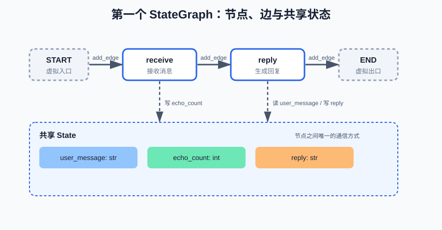

# 第一课：StateGraph：节点、边与状态构成一张可执行图

你此前手写过一个工具调用循环：`while` 里反复"调模型 → 判断是否要调工具 → 执行工具 → 把结果塞回消息历史"。这个循环能跑，但一旦需求变复杂——加记忆、加人工审批、加并行工具——你会发现状态散落在局部变量里，分支和循环缠在同一个 `while` 里，中途崩溃后什么都留不下来。本课从这三个问题出发，引入 LangGraph 的图执行模型，并写出第一个可运行的 `StateGraph`。

本课讲四件事：为什么要框架、图的三要素（**重点：State 是什么、怎么定义**）、怎么跑通最小图、常见错误。字段怎么合并（reducer，第 2 课）、条件边怎么分支和循环（第 3 课）、工具怎么接进图（第 4 课），都只预告不展开。

**学习目标：**

1. 能说出手写 Agent 循环的三个问题，并说明框架解决什么、不解决什么；
2. 能用"节点、边、状态"描述一次执行过程，说明 State 为什么是节点之间唯一的通信渠道；
3. 能用一个 `TypedDict` 定义 State，说出每个字段的角色（入口写入 / 节点读写 / 出口读出）；
4. 能写出双节点 `StateGraph` 并运行，解释 `compile` 和 `invoke` 分别做了什么；
5. 能说出常用的 State（如 `MessagesState`），并说清 LangGraph 和 LangChain 的定位区别。

## 1. 背景：从手写循环的三个问题开始

先回到手写的工具调用循环。它大致长这样：

```python
def run_agent(user_input: str):
    messages = [{"role": "user", "content": user_input}]
    tool_results = []
    step = 0
    while step < MAX_STEPS:
        response = llm.chat(messages)          # 1. 调用模型
        if not response.tool_calls:            # 2. 判断是否还要调工具
            return response.content            # 3a. 结束，返回回答
        args = response.tool_calls[0].arguments
        result = execute_tool(args)            # 3b. 执行工具
        tool_results.append(result)
        messages.append(response)              # 4. 更新"上下文"
        messages.append(as_tool_message(result))
        step += 1
    return "达到最大步数"
```

这个循环能完成一次"模型 + 工具"的执行，但它有三个结构性问题：

**问题一：状态散乱。** `messages`、`tool_results`、`step` 全靠函数里的局部变量传递，节点之间没有统一的"数据约定"。每加一个功能（并行工具、记忆、人工审批）就要新增变量、修改函数签名，逻辑一多就难以维护。

**问题二：分支与循环混在一起。** 顺序执行（调模型）、条件判断（要不要调工具）、循环迭代（回到开头）全挤在同一个 `while` 里。第 3 课会看到，图把这三件事拆成了不同的元素：顺序是"边"、判断是"条件边"、循环是"回到上游节点的边"。

**问题三：不可恢复、不可观测。** 循环中途崩溃，所有局部变量随之丢失，没法从断点继续；执行过程没有结构化记录，事后无法回答"第几步调用了哪个工具、传了什么参数、结果是什么"。

框架解决的是这三类问题：**状态的集中管理、执行结构的显式声明、可持久化、可观测**。但框架不解决另外一些事：提示词写得好不好、工具本身正不正确、模型能力够不够强——它不会让你的 Agent 更聪明，只让执行过程更可控。

## 2. 心智模型：图 = 节点 + 边 + 状态

LangGraph 的核心是一张有向图，只有三个概念，每个一句话定义（细节在后面各自展开）：

- **节点（Node）**：一个处理步骤，本质上就是一个 Python 函数——输入 State 的一部分，返回要更新的字段；
- **边（Edge）**：步骤之间的连接，决定执行顺序（第 3 课引入"条件边"）；
- **状态（State）**：整张图共享的"数据工作区"，是节点之间**唯一的通信方式**——本课第 3 节专门讲它。

## 3. State 专题：它是什么、怎么定义、有哪些常用

三要素里，State 是最容易被"一带而过"的，本课专门讲透。

### 3.1 State 是什么

一句话定义：**State 是整张图共享的一块"数据工作区"，是节点之间唯一的通信方式——节点不直接调用别的节点，只读写 State。**

类比：图是一条流水线，State 是流水线中央的**共享白板**。每个工位（节点）从白板上读它需要的数字，把自己的结果写回白板，下一个工位再从白板读——工位之间不直接递东西，全部经过白板。

为什么不用函数参数传递？手写循环的 `messages`、`step` 靠局部变量在函数之间传（第 1 节问题一）。但图里节点的执行顺序由框架决定，节点之间没有"你调用我、我调用你"的关系——它们唯一的共同点就是都连在同一张图上，而 State 就是这张图的共享内存。

边界：State 只存**数据**（消息、计数、结果），不存逻辑（函数、类）——逻辑在节点里，数据在 State 里。

### 3.2 怎么定义一个 State：TypedDict

State 是一个 **`TypedDict`**。`TypedDict` 是 Python `typing` 标准库提供的"带类型的字典"标注（无需安装）：它声明"这个字典有哪些键、每个键是什么类型"，用法和普通 dict 一样（`state["键"]` 读、`{"键": 值}` 构造），只是多了类型检查。

定义语法：一个类，类名就是 State 的名字，类的属性就是字段：

```python
from typing import TypedDict

class State(TypedDict):
    """图的状态：所有节点共享的数据字段。"""
    user_message: str   # 用户的输入：入口写入，之后的节点只读
    echo_count: int     # 处理次数：receive 节点写，reply 节点读
    reply: str          # 最终回复：reply 节点写，出口读出
```

三个要点：

- **每个字段 = 键（`user_message`）+ 类型（`str`）+ 职责注释**。类型标注不是装饰——第 2 课的合并语义、节点读写的类型安全都建立在它上面；
- **字段名就是节点之间的"接口"**：节点按名字读写，字段名起得清楚，节点之间的契约就清楚；
- **创建初始 State**：`invoke` 时传入一个 dict，字段都要给初值（本课三个字段都要求；"带默认值、可以不给"的写法第 2 课讲）。

### 3.3 字段的角色：本课三个字段

State 的字段通常分四种角色，本课三个字段各占一种：

| 字段 | 类型 | 谁写、谁读 | 角色 |
| --- | --- | --- | --- |
| `user_message` | `str` | 入口写入，之后只读 | 输入数据 |
| `echo_count` | `int` | `receive` 写，`reply` 读 | 计数 |
| `reply` | `str` | `reply` 写，出口读出 | 最终结果 |

写这个表格时就能发现一个规律：**每个节点只应该碰自己负责的字段**——`receive` 只写 `echo_count`，`reply` 读前两个、写 `reply`。这就是第 4 节组装图时节点函数的样子。

### 3.4 常用的 State：MessagesState

Agent 的 State 里最常见的字段是**消息历史**（用户问题、模型回答、工具结果），所以 LangGraph 预置了一个直接能用的 State：

**`MessagesState`**：`langgraph.graph` 里预置的 TypedDict，只含一个 `messages` 字段，专门装消息列表。它带 `add_messages` reducer——即"每次写入都是追加而不是覆盖"（reducer 是第 2 课的内容，这里只需要知道：消息历史必须追加，覆盖会丢上下文）。

本课先用自己的 `State`（三个简单字段，都是"覆盖"语义），把"怎么定义 State、节点怎么读写字段"搞清楚；第 5 课组装 ReAct Agent 时换成 `MessagesState`，那时你只需要理解多出来的那个"追加"合并规则。

### 3.5 State 的 Schema 决定节点的契约

State 的字段声明同时规定了每个节点能读写什么——节点之间靠**字段名**形成隐式接口：

```python
class State(TypedDict):
    user_message: str   # 入口写入，之后的节点只读
    echo_count: int     # receive 写，reply 读
    reply: str          # reply 写，出口读出
```

每个节点只应该读写它负责的字段。任何一个字段的语义被改动（比如把 `echo_count` 从 `int` 改成 `list`），消费它的节点可能立刻出错——所以改 State 的 Schema 前，先看谁在读写它。

## 4. 第一个 StateGraph：双节点链

先安装：

```bash
pip install langgraph
```

在课程虚拟环境中安装即可。本课只需要 `langgraph` 本身，工具相关的依赖从第 4 课开始引入。

课程代码在 `code/langgraph/langgraph_lesson01.py`。核心部分拆开看：

**第一步：声明状态。** 用第 3.2 节的方式定义一个 `TypedDict`：

```python
class State(TypedDict):
    user_message: str   # 用户的输入
    echo_count: int     # 已经处理过的节点数
    reply: str          # 生成的回复
```

**第二步：写节点函数。** 节点是普通函数：输入 State，返回**要更新的字段组成的 dict**——这体现了 State 专题说的"读、写"两个动作：

```python
def node_receive(state: State) -> dict:
    print(f"[node_receive] 输入 state: {state}")
    return {"echo_count": state["echo_count"] + 1}   # 只写自己负责的字段


def node_reply(state: State) -> dict:
    print(f"[node_reply] 输入 state: {state}")
    return {"reply": f"收到你的消息：{state['user_message']}（第 {state['echo_count']} 次处理）"}
```

注意两点：节点**只返回自己需要更新的字段**，其余字段原样保留（合并的细节在第 2 课展开）；节点之间不互相调用，只通过 State 通信（3.1 的"共享白板"）。

**第三步：把节点和边组装成图。** `START` 是图的虚拟入口，`END` 是虚拟出口：

```python
def build_graph():
    graph = StateGraph(State)
    graph.add_node("receive", node_receive)
    graph.add_node("reply", node_reply)
    graph.add_edge(START, "receive")
    graph.add_edge("receive", "reply")
    graph.add_edge("reply", END)
    return graph.compile()
```

执行路径就是 `START → receive → reply → END`。图中虚线框表示虚拟节点（不执行任何逻辑，只标记入口和出口），实线框是真正的节点，下方是与所有节点共享的 State：



本课用到的 API 签名（`langgraph` 当前版本的核心用法，参数只列本课用到的）：

```text
StateGraph(State)            构造图对象；State 是一个 TypedDict，键即状态字段
graph.add_node(name, fn)     注册节点：name 是节点名（字符串），fn 是 (state) -> dict 的函数
graph.add_edge(src, dst)     加一条有向边；src/dst 可以是节点名，也可以是 START 或 END
graph.compile()              校验图结构，返回可执行对象（内部类型 CompiledStateGraph）
app.invoke(input_state)      从 START 执行到 END，返回最终 state（dict）
```

几个容易混的点：`add_node` 的第一个参数是给节点起的**名字**，和函数名无关，边用这个名字连接；`START`/`END` 不是节点函数，不能 `add_node`，只能出现在 `add_edge` 里；`invoke` 传入的是**初始状态**，返回的是**最终状态**，中间过程可以用第 11 课的 `stream` 观察。还有一个必须先记住的点：**必须先 `compile()` 才能 `invoke`**——`StateGraph` 只是构建器，本身没有 `invoke` 方法；`compile()` 校验结构并生成可执行对象（`app`），之后同一个对象可以反复 `invoke`（一次编译、多次运行）。

**第四步：运行。** `compile()` 把图编译成可执行对象，`invoke()` 传入初始状态、返回最终状态：

```python
app = build_graph()
result = app.invoke(
    {"user_message": "帮我安排明天的会议", "echo_count": 0, "reply": ""}
)
print("最终 state：", result)
```

输出会先打印两个节点的 `输入 state`，再打印最终状态。观察 `node_reply` 的输入：`user_message` 原样保留，`echo_count` 已经变成 1——节点只返回部分字段时，其余字段保持上一次的值。

## 5. 一次 invoke 内部发生了什么

`compile()` 并不执行节点，它把节点和边整理成一个可执行图（做一遍结构校验）。`invoke()` 才是真正执行，过程是：

1. 用传入的 dict 初始化 State；
2. 从 `START` 出发，沿着边依次执行节点；
3. 每执行完一个节点，把它的返回值**合并**进 State——这一步合并叫一个 **super-step**，后面课程会反复用到这个词；
4. 走到 `END` 停止，返回最终 State。

本课的双节点链只有固定顺序，所以执行路径是唯一的。图怎么表达分支和循环，是第 3 课的内容；合并"覆盖"还是"追加"由 reducer 决定，是第 2 课的内容。

## 6. 运行课程代码

```bash
cd c:\0work\project\ai_application_development_study
python code/langgraph/langgraph_lesson01.py
```

会先打印两个节点的输入状态（观察执行顺序和状态变化），再打印最终 state。

## 7. 常见错误

1. **把 State 当普通 dict 用、不写 `TypedDict`**：State 的"契约"（有哪些字段、什么类型）没了，节点里 `state["拼错的键"]` 会在运行时才暴露 `KeyError`。
2. **`invoke` 时漏给字段初值**：本课的字段没有默认值，初始化时都要给（"可以不带初值"的默认值写法是第 2 课的内容）。
3. **节点返回了 State 里没有的键**：实测（langgraph 1.2.x）**不报错，那份更新被静默丢弃**——你以为是写进去了，其实没有。排查：对照 `State` 的字段名检查节点返回的 dict。
4. **节点之间直接调用对方的函数**：破坏了"唯一通信渠道"，图执行时顺序不可控，数据也不在 State 里（调试时看不到）。节点只读写 State。
5. **忘了 `compile()` 直接 `invoke`**：`StateGraph` 构建器没有 `invoke`，直接报 `AttributeError`（见第 4 节 API 签名）。

## 8. 课后作业

作业和课程示例在同一个文件中：`code/langgraph/langgraph_lesson01.py`。上半部分可以直接运行；下半部分从 `# ===== 课后作业 =====` 开始。

作业要求：

1. 完成 `node_finish`：读取 `state["reply"]`，返回一个 dict，把 `reply` 改成以 `[完成]` 开头的新值，同时把 `echo_count` 再 +1；
2. 在 `build_homework_graph()` 里注册 `finish` 节点，并把 `reply` 和 `END` 之间缺的两条边补上（`reply → finish`、`finish → END`）；
3. 完成后取消 `__main__` 中 `homework()` 的注释并运行：最终 state 的 `reply` 以 `[完成]` 开头、`echo_count` 为 2，程序打印"作业通过"；
4. 思考并回答：如果 `node_finish` 只返回 `{"reply": ...}` 而不返回 `echo_count`，最终 state 里的 `echo_count` 是多少？为什么？
5. 再想一个问题：本课里 `echo_count` 每次都被"覆盖"成新值；如果想让某个字段"每次执行都累加"，现在的写法会在哪里出问题？（第 2 课解答）

## 9. 验收问题

1. 手写 Agent 循环的三个问题分别是什么？框架解决什么、不解决什么？
2. 用"节点、边、状态"描述一次"调模型 → 调工具 → 得到回答"的执行过程。
3. State 是什么？为什么是节点之间唯一的通信渠道？（"共享白板"类比）
4. 怎么定义一个 State？`TypedDict` 的三个要点是什么？
5. 本课三个字段各是什么角色？常用的 `MessagesState` 是什么？
6. 节点函数的输入和输出分别是什么？节点只返回部分字段时，其余字段会发生什么？
7. `compile()` 和 `invoke()` 分别做了什么？一次 `invoke` 内部按什么顺序执行？
8. LangGraph 和 LangChain 各自解决什么问题？

## 10. 面试高频考点

- 为什么用 Agent 框架而不是手写循环——用第 1 节"三个问题 + 框架边界"作为回答框架。
- 节点、边、状态三要素，以及一次 `invoke` 的执行顺序（初始化 → 逐节点执行 → 合并状态 → 到 END 停止）。
- State 是什么、怎么定义：`TypedDict`，字段名就是节点间的契约；节点只读写自己负责的字段。
- 常用 State：`MessagesState`（预置的 `messages` 字段，追加语义，第 2 课展开）。
- Node 与 State 的关系：读取、写入、合并三步；State 作为唯一通信渠道的意义（"节点之间怎么传数据"的标准答案）。
- LangGraph 和 LangChain 的关系；Agent 框架解决什么、不解决什么。
- （延伸，第 13 课展开）LangGraph 与 AutoGen、CrewAI 的选型对比。

## 下一课预告

第 2 课《State、Channel 与 Reducer》：本课所有字段都是"覆盖"（后写覆盖先写），第 2 课讲"追加"——为什么消息历史必须追加、reducer 是什么，以及并发写同一字段会发生什么。
