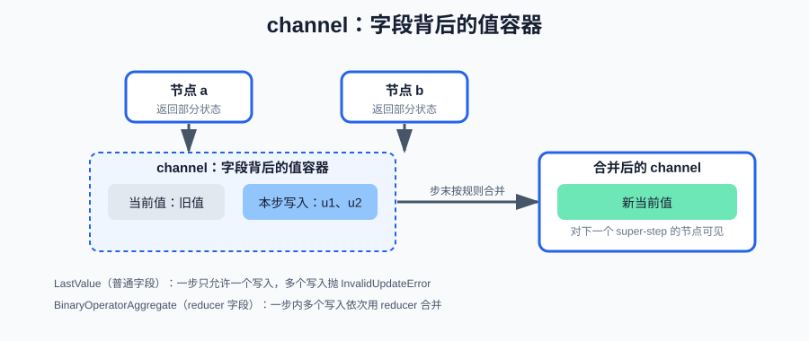
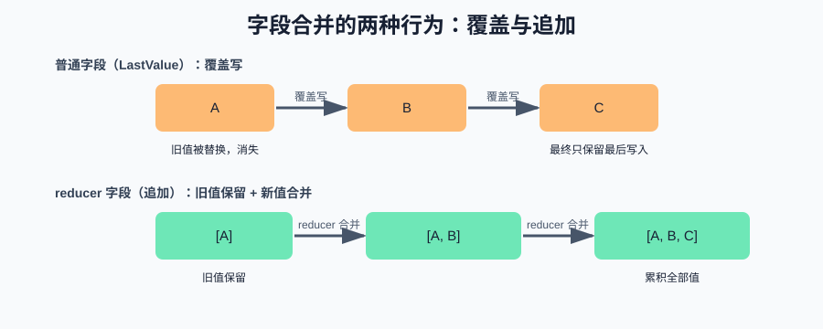
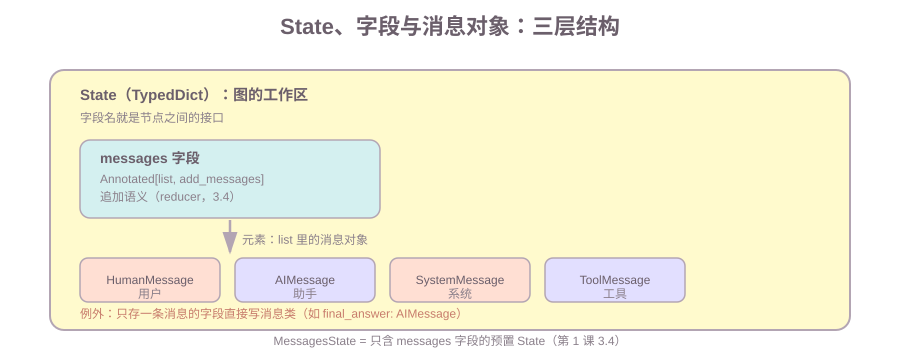

# 第二课：State、Channel 与 Reducer

第一课的关系 1 里有个词被一带而过：返回的 dict 要"经过 reducer 合并进 State"。本课把它讲透。上一课所有字段都是"覆盖"——后写覆盖先写，这能满足计数、最终答案这类字段；但真实 Agent 里更常见的是"追加"：消息历史每轮加一条、工具结果一条条累积。如果消息历史是覆盖语义，第二轮就会丢掉第一轮的上下文，Agent 直接"失忆"。

本课讲四件事：channel 是什么、为什么需要 reducer、怎么声明追加字段（含消息这个最常见的追加对象）、并发写同一字段会发生什么，顺带解释节点更新为什么建议保持确定性。条件边（第 3 课）、工具（第 4 课）、checkpoint 持久化（第 6 课）都不在本课范围；但 reducer 是它们的地基——第 6 课恢复执行、第 10 课 Map-Reduce 都依赖本课的合并语义。

**学习目标：**

1. 能解释为什么"覆盖"不够用，举例一个必须"追加"的 Agent 字段；
2. 能解释 channel 是什么、由哪两部分组成、合并发生在什么时候；
3. 能说出 channel 的两种行为（保存单值 / reducer 累积），分别对应哪类字段声明；
4. 能说出常见的 reducer 有哪些，区分 `operator.add` 与 `add_messages` 的适用场景；
5. 能说出 LangGraph 消息的类型和基本字段（content、id、type），解释消息 id 在 `add_messages` 中的作用；
6. 能用 `Annotated` 声明追加字段、写自定义 reducer（去重追加），知道不能原地修改 current；
7. 能解释两个并发节点写同一字段时：普通字段报错、reducer 字段合并，并说明原因；
8. 能说明"节点更新保持确定性"与第 6 课 checkpoint 恢复的关系。

## 1. channel 是什么：字段背后的值容器

先复习第一课的关系 1：节点返回 dict → 合并进 State。这里的"合并"发生在哪？答案是**每个字段背后的 channel**。

一句话定义：**channel 是 LangGraph 运行时中，State 每个字段背后的"值容器"——负责存当前值、收写入、按规则合并**。TypedDict 只描述了"有哪些字段"（Schema），channel 才是字段运行时真正干活的东西。

一个 channel 由两部分组成：

- **当前值（current value）**：字段此刻的值，节点读到的就是它；
- **更新规则**：一个 super-step 里收到的写入（updates）如何变成新的当前值。

合并发生的时机要放在"super-step"里看（第一课第 5 节提过这个词）：

1. 一个 super-step 开始：被调度的节点并行执行，各自返回部分状态；
2. 框架把每个节点的返回 dict 按字段拆开，投递到对应 channel；
3. super-step 结束：每个 channel 把这一步收到的所有写入，按自己的规则和当前值合并成新值；
4. 进入下一个 super-step，新值对后续节点可见。



所以"节点只返回部分字段，其余字段保持上一次的值"（第一课观察到的现象）的本质是：其余字段的 channel 在这个 super-step 里**没有收到任何写入**，合并后自然不变。

### 1.1 两种 channel 行为

LangGraph 里 channel 分两类，正好对应字段声明的两种方式：

- **LastValue（保存单值）**：只存一个当前值，不收集累积写入。一个 super-step 最多收一个写入，收到第二个就抛 `InvalidUpdateError`。对应普通字段（`step_count`、`summary`）。
- **BinaryOperatorAggregate（reducer 累积）**：除了当前值，还有一个"更新累积器"。一步内的所有写入都先收进来，步末用 reducer 依次应用：`当前值 + 写入1 → 中间值 + 写入2 → …`。对应 `Annotated[T, reducer]` 字段。

这个区别直接解释第 4 节"并发写同一字段"的两种结局，先记住结论：**保存单值的 channel 没有合并策略，两个写入只能报错；带 reducer 的 channel 有合并策略，两个写入变成两次合并。**

## 2. 为什么需要 reducer：消息历史必须"追加"

回到手写的工具调用循环：每一轮模型调用、每一条工具结果都要加进 `messages`，下一轮才能看到之前的对话。在 LangGraph 里这就是同一个需求——`messages` 必须能"累加"。

如果 `messages` 是覆盖语义：第二轮写入时，第一轮的 `assistant` 消息和工具结果全部被替换，模型失去上下文。覆盖字段只适合"最终值"（计数、当前步骤、最终答案），不适合"流水"（消息、工具结果、记录列表）。

| 字段类型 | 合并行为 | 适用场景 | 例子 |
| --- | --- | --- | --- |
| 普通字段 | 覆盖（保存单值） | 只关心"最新的一个值" | `step_count`、`summary` |
| reducer 字段 | 按规则合并（累积） | 关心"全部值" | `messages`、工具结果、记录列表 |



## 3. 声明追加字段：Annotated 与 operator.add

### 3.1 用 Annotated 给字段挂一个 reducer

在 `TypedDict` 里，字段后面跟 `Annotated[类型, reducer函数]` 即可改变合并规则：

```python
from operator import add
from typing import Annotated, TypedDict

class State(TypedDict):
    records: Annotated[list, add]  # 追加语义
    step_count: int                # 覆盖语义
    summary: str                   # 覆盖语义
```

本课用到的两个标准库 API（无需安装）：

```text
Annotated[T, reducer]       typing 标准库的泛型标注；T 是字段类型，reducer 是合并函数
operator.add(a, b)          Python 标准库 operator 模块；等价于 a + b
```

reducer 的完整签名是 `(current, update) -> new`：

- `current`：字段的当前值（合并前）；
- `update`：节点本次返回的、要合并进来的值；
- 返回值：合并后的新值，会替换 `current` 成为字段的新状态。

`operator.add` 对 `list` 来说就是列表拼接：`[1, 2] + [3] = [1, 2, 3]`。所以节点只要返回 `{"records": [一条新记录]}`，reducer 就会把它拼到已有列表末尾——效果就是"追加"。如果节点一次返回 `[多条]`，也会一次性全部拼进去。

一个细节：字段也可以声明默认值，让初始输入不必提供它。写法是 `Annotated[list, add, {"default": []}]`，本课示例为了看得清楚，显式传入空列表。

### 3.2 常见的 reducer 有哪些

LangGraph 的 reducer 就是一个 `(current, update) -> new` 函数，可以是任意 Python 函数。实际使用中常见的有四类：

| reducer | 来源 | 行为 |
| --- | --- | --- |
| （不声明） | 默认 | 覆盖——字段只保留最后写入的值（LastValue） |
| `operator.add` | 标准库 `operator` | 列表拼接、数值累加，通用"追加" |
| `add_messages` | `langgraph.graph.message` | 消息列表专用：按 id 追加 / 替换 / 删除 |
| 自定义函数 | 自己写 | 任意合并规则：去重、合并 dict、取最新…… |

最常见的是 `operator.add`（通用追加，3.1 已介绍）和 `add_messages`（消息历史专用，3.4 展开），本课详细讲这两个；自定义 reducer 在课后作业里练。其余规则按需自写即可。

### 3.3 消息 Message：最常见要追加的东西

Agent 的状态里最常被"追加"的字段是消息历史 `messages`。在讲它的专用 reducer 之前，先认识消息本身。

LangGraph 里的消息是 `langchain_core.messages` 里的对象（已随 langgraph 自动安装），按角色分四类：

| 类型 | 类 | 代表谁 | content 例子 |
| --- | --- | --- | --- |
| 用户 | `HumanMessage` | 用户的输入 | `"帮我安排明天的会议"` |
| 助手 | `AIMessage` | 模型的回答（可能带工具调用，第 4 课） | `"好的，我来查一下日程"` |
| 系统 | `SystemMessage` | 系统提示词，一般放在列表最前 | `"你是生活助理"` |
| 工具 | `ToolMessage` | 工具执行的结果（第 4 课） | `"已创建日程"` |

每个消息都有几个基本字段：

- **content**：消息正文，字符串（也可以是更复杂的内容块，本课不展开）；
- **id**：消息的唯一标识。不传时框架自动生成 uuid；`add_messages` 靠它识别"同一条消息"；
- **type**：消息类型名（`"human"`、`"ai"`、`"system"`、`"tool"`），序列化/反序列化时用；
- **name**（可选）：角色或工具的名字。

关键是 **id**：`add_messages` 的"追加 / 替换 / 删除"全部以它为准——同一个 id 再来一条 → 替换；新 id → 追加。所以代码里给消息显式传 `id` 不是必须的（不传会自动生成），但需要"更新同一条消息"时就必须带上。

**消息和 State 的关系（先分清三层）**：消息对象（`HumanMessage` 等）**不是 State**，而是 State 里 `messages` 字段的**元素**。三者关系是：

```text
State（图的工作区，第 1 课）
  └ messages 字段（一个格子）
      └ 元素：HumanMessage / AIMessage / SystemMessage / ToolMessage（一条消息）
```

所以在 `TypedDict` 里声明时，`messages` 字段的类型是 **`list`**（元素是消息对象），**不是直接写消息类**：

```python
from typing import Annotated, TypedDict

from langchain_core.messages import AIMessage, HumanMessage, SystemMessage, ToolMessage
from langgraph.graph.message import add_messages

class State(TypedDict):
    # 字段类型是 list；Annotated[list, add_messages] 表示"追加"合并（3.4 讲）
    messages: Annotated[list, add_messages]
```

只有一种情况字段类型直接写消息类：你的 State 只想存**一条**消息（比如把最终回答单独放一个字段 `final_answer: AIMessage`）——但消息**历史**必须是列表。第 1 课 3.4 提过的预置 `MessagesState`，就是"只含这一个 `messages` 字段的 State"。



### 3.4 add_messages：消息历史的专用 reducer

```python
from langgraph.graph.message import add_messages
```

`add_messages` 是 LangGraph 内置的、专门处理消息列表的 reducer（`langchain_core` 已随 langgraph 自动安装，无需单独装）。它是 Agent 场景里出现频率最高的 reducer——`messages` 字段几乎都用它。

对普通列表，"追加"用 `operator.add` 就够了；但消息列表有三个特殊需求，`add_messages` 内置处理：

1. **新 id 追加**：id 没见过的消息直接追加到列表末尾；
2. **同 id 替换**：id 已存在的消息会**替换**旧消息而不是追加——这是工具调用结果回填的关键（模型先生成带 `tool_call_id` 的 `AIMessage`，工具结果再更新成同一条消息，第 4 课展开）；
3. **删除**：传入 `RemoveMessage(id=...)` 可以删掉指定消息——记忆修剪（第 6 课的记忆管理）就靠它。

两个常见 reducer 的对比：

| | `operator.add` | `add_messages` |
| --- | --- | --- |
| 适用字段 | 任意 list / 数值 | 消息列表 |
| 合并规则 | 纯拼接 / 累加 | 按 id：新消息追加、同 id 替换、RemoveMessage 删除 |
| 典型场景 | 工具结果、记录列表、计数 | `messages` 消息历史 |

LangGraph 还预置了一个直接用它组合好的状态：`MessagesState`，本质就是 `messages: Annotated[list, add_messages]`——第 5 课写 ReAct Agent 时会直接使用。代码里的 `demo_add_messages()` 演示了上述三种行为。

### 3.5 示例：生活记录流水线

课程代码 `code/langgraph/langgraph_lesson02.py` 用生活记录做例子，三个节点依次执行：

1. `node_collect` 追加一条原始记录（"早上跑步 5 公里"）；
2. `node_clean` 追加一条清洗后的记录（"运动：跑步 5 公里"）；
3. `node_summarize` 读取已有 `records`，覆盖写入 `summary`。

```python
def node_collect(state: State) -> dict:
    record = {"id": 1, "text": "早上跑步 5 公里", "clean": False}
    return {"records": [record], "step_count": state["step_count"] + 1}
```

注意 `node_collect` 同时做了两种写入：`records` 是追加（返回列表，reducer 拼接），`step_count` 是覆盖（返回新 int，直接替换）。一个节点可以同时写覆盖字段和追加字段，互不干扰。

### 3.6 运行并观察

运行命令见第 6 节。重点看两处输出：

- 最终 `records` 有两条（collect 的和 clean 的），说明追加字段把两次写入都累积下来了；
- 最终 `step_count` 是 1、`summary` 是最后写入的那一条，说明覆盖字段只保留最后的值。

## 4. 并发写同一字段：一个会报错的 super-step

第 1 节说过，节点可以并行：一个上游节点连两条边到两个下游，两个下游会在**同一个 super-step** 里同时执行。这时如果两个节点都写同一个字段，会发生什么？答案取决于字段类型。

**普通字段：直接报错。** 两个节点同时写 `step_count`，运行会抛出 `InvalidUpdateError`：

```text
At key 'step_count': Can receive only one value per step.
Use an Annotated key to handle multiple values.
```

原因：保存单值的 channel 一步只能收一个值，同时收到两个更新时没有"合并策略"可言，框架选择显式报错而不是悄悄丢掉一个——这是设计上防止歧义，不是 bug。

**reducer 字段：两个更新都生效。** 两个节点同时向 `records` 追加，两条记录都会进列表（顺序由调度决定）。

课程代码里的 `demo_concurrent_write()` 同时演示这两种情况。这个对比是面试高频题，也是理解 reducer 价值的钥匙：**reducer 的本质就是把"一步多个更新"从冲突变成合并。**

## 5. 共享状态与副作用：节点更新保持确定性

图不禁止节点有副作用——第 5 课的工具调用本身就是副作用。但有一条纪律：**节点的状态更新部分应当确定**：同样的输入 state，必须返回同样的 dict。

为什么？第 6 课的 checkpoint 恢复依赖"重放"：进程崩溃后，框架从最近的 checkpoint 重新执行节点。如果节点返回不确定的更新（比如在 reducer 里读随机数、改全局变量），恢复后得到的状态会和执行时不一样，图就"回不到过去"了。

对应的两条直接规则：

- **自定义 reducer 不要原地修改 `current`，要返回新对象**。原地修改会污染上一份状态，恢复/回放时会出错；
- reducer 里不要做随机、读外部数据等不确定操作，它应该是个纯函数。

## 6. 运行课程代码

```bash
cd c:\0work\project\ai_application_development_study
python code/langgraph/langgraph_lesson02.py
```

会依次打印：三个节点的追加/覆盖过程、最终 state、并发演示（普通字段报错 + reducer 字段合并）、`add_messages` 的三种行为。

## 7. 课后作业

作业和课程示例在同一个文件中：`code/langgraph/langgraph_lesson02.py`，从 `# ===== 课后作业 =====` 开始。

作业要求：

1. 补全 `dedup_append`：按记录 `id` 去重后追加。返回一个新列表：先复制 `current`，再把 `update` 中 `id` 尚未出现过的条目加进去；**不要原地修改 `current`**；
2. 运行 `homework()`（完成后取消 `__main__` 注释）：节点 a 追加 `id=1、id=2`，节点 b 追加 `id=2`（重复），最终 `records` 的 id 列表应为 `[1, 2]`，重复的 `id=2` 被丢弃；
3. 思考题：占位实现 `return current + update` 时断言为什么失败？（提示：重复的 `id=2` 没有被过滤，结果变成 `[1, 2, 2]`）；
4. 思考题：把 `HomeworkState.records` 的 `Annotated[list, dedup_append]` 改成普通字段 `list`，再运行 `homework()`。思考最终 `records` 只剩什么、为什么——这个问题的答案就是"为什么需要 reducer"。

## 8. 验收问题

1. channel 是什么？它由哪两部分组成？合并发生在什么时候？
2. channel 的两种行为是什么？分别对应哪类字段声明？
3. 举一个必须"追加"而不能"覆盖"的 Agent 字段场景，并解释原因。
4. 消息有哪几种类型？每个消息有哪些基本字段？id 的作用是什么？
5. 常见的 reducer 有哪些？`operator.add` 和 `add_messages` 各自适合什么字段？
6. reducer 的函数签名是什么？`operator.add` 对 list 做了什么？
7. `add_messages` 的三个行为是什么？按 id 替换有什么用？
8. 自定义 reducer 有什么注意点？为什么不能原地修改 current？
9. 同一步内两个节点写普通字段会发生什么？写 reducer 字段呢？为什么有这种区别？

## 9. 面试高频考点

- channel 是什么：字段背后的值容器，由"当前值 + 更新规则"组成，合并发生在 super-step 末；LastValue 与 BinaryOperatorAggregate 的区别。
- LangGraph 的消息模型：HumanMessage / AIMessage / SystemMessage / ToolMessage，字段 content / id / type；id 在 `add_messages` 去重替换中的作用。
- reducer 是什么、为什么需要——用"消息历史必须追加"作为例子回答。
- 常见的 reducer：`operator.add`（通用拼接/累加）与 `add_messages`（消息专用，按 id 追加/替换/删除）的区别与适用场景。
- append 和 overwrite 的区别与各自适用场景（对照表见第 2 节）。
- `add_messages` 按 id 替换/删除的意义——工具调用结果更新、记忆修剪（第 4、5 课展开）。
- 两个并发节点写同一字段：普通字段抛 `InvalidUpdateError`、reducer 字段合并——原因（保存单值的 channel 没有合并策略）。
- 自定义 reducer 的规则：签名 `(current, update) -> new`、返回新对象不原地修改、保持纯函数。
- 节点更新为什么保持确定性——联系第 6 课的 checkpoint 恢复/重放。
