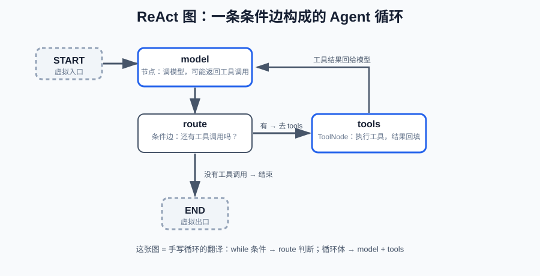

# 第五课：ReAct：把工具接进循环

第 4 课把工具讲透了：定义、schema、`ToolNode`、消息数据流。本课做组装——把模型节点、工具节点和一条"还有工具要调吗"的条件边拼成 **ReAct 图**，这是 Agent 的标准形态。你此前手写过这个循环——`while` 里反复调模型、执行工具、把结果塞回消息历史。本课把它翻译成图，逐行对照。

范围：工具本身的机制（`@tool`、`bind_tools`、`ToolNode`）见第 4 课，本课只组装不再展开；本课前半部分组装 ReAct，后半部分（第 6 节）收拢"图的执行方式"（invoke / stream / config）；记忆与持久化（第 6 课）、人工介入（第 7 课）、并行（第 10 课）、流式（第 11 课）都不在本课范围。

前置：完成第 4 课（工具的定义、注册与执行）；理解 tool calling 的消息格式。

**学习目标：**

1. 能画出 ReAct 图的三要素（model 节点、tools 节点、条件边）并说出执行路径；
2. 能写出 `route_after_model`（读最后一条消息的 `tool_calls`），说明它等价于手写循环的 `while` 条件；
3. 能组装 model / tools / route（工具在第 4 课），说明图与模型解耦；
4. 能说明工具异常回给模型的配置（`handle_tool_errors`）与模型的自我修正；
5. 能把以前手写的工具调用循环逐行对照成图，说出图和循环各自的优缺点；
6. 能说清 `invoke` 的输入输出与一次执行经过的 super-step，区分 `invoke` / `ainvoke` / `stream` / `astream`；
7. 能用 `config` 的 `recursion_limit` 防失控，解释 `stream` 事件与 super-step 的对应（`thread_id` 预告，第 6 课展开）。

## 1. 概念与边界：ReAct 的三要素

ReAct 循环的基本形态：模型"推理"决定要不要调工具、调哪个 → 执行工具 → 结果回给模型 → 模型再看下一步。循环终止条件：模型不再返回工具调用，给出最终回答。

在图上，这个循环正好是三样东西：

| 手写循环里的东西 | 图上的对应 |
| --- | --- |
| 调模型 | `model` 节点 |
| 执行工具 | `tools` 节点（`ToolNode`） |
| "还有工具要调吗"（while 条件） | `model` 出口的**条件边** |

执行路径：`START → model →(有工具调用?)→ tools → model → …`，当条件边判断"没有工具调用"时走向 `END`。本课的边界：只讲这一种单 Agent 循环，图里不加记忆、不加并行；工具怎么定义、怎么进图是第 4 课的内容。

## 2. 三要素怎么拼

### 2.1 工具：直接使用第 4 课的成果

本课使用第 4 课定义的两个工具（`calculate` 计算器、`search_weather` 查天气，后者会模拟外部依赖偶发报错），白名单 = 只把它们传进 `ToolNode` 和 `bind_tools`。工具的定义与校验机制不再重复，见第 4 课。

### 2.2 模型节点：调模型 + 追加消息

模型节点用第 4 课的 `bind_tools` 让模型知道工具，然后调用模型、把返回的 `AIMessage` 追加进消息历史：

```python
def call_model_real(state: MessagesState) -> dict:
    response = llm_with_tools.invoke(state["messages"])
    return {"messages": [response]}
```

`messages` 用的是 `add_messages` reducer（第 2 课），整条工具调用链（用户问题 → 模型调用 → 工具结果 → 模型再答）必须完整保留，模型下一轮才能看到上下文。

### 2.3 工具节点：ToolNode

`ToolNode(tools)` 读取最后一条 `AIMessage` 的 `tool_calls`，逐个执行，把结果包成 `ToolMessage` 回填（机制见第 4 课）。**注意新版 LangGraph 的工具异常默认会直接抛出让图失败**——要让"工具报错 → 模型看到错误 → 自我修正"，必须显式配置：

```python
graph.add_node("tools", ToolNode(tools, handle_tool_errors=lambda e: f"工具执行失败：{e}"))
```

两种策略的取舍（第 4 课讲过）：包成错误消息回给模型（模型有机会换参数重试，Agent 更有韧性）vs 直接抛出（快速失败）。本课用前者。

### 2.4 条件边：route_after_model（本课核心）

路由函数读最后一条消息：有 `tool_calls` 就去 `tools`，没有就 `END`：

```python
def route_after_model(state: MessagesState) -> str:
    last = state["messages"][-1]
    if last.tool_calls:
        return "tools"
    return END
```

这条边就是手写循环里的 `while` 判断条件——第三课说的"循环的终止条件在条件边上"，在这里具象化了。

## 3. 组装：ReAct 图

```python
def build_react_graph(call_model, tools):
    graph = StateGraph(MessagesState)
    graph.add_node("model", call_model)
    graph.add_node("tools", ToolNode(tools, handle_tool_errors=lambda e: f"工具执行失败：{e}"))
    graph.add_edge(START, "model")
    graph.add_conditional_edges("model", route_after_model)
    graph.add_edge("tools", "model")
    return graph.compile()
```

注意 `build_react_graph` 返回的是 `graph.compile()` 的结果——**它已经不是 `graph` 了**，而是编译后的"可执行图对象"，代码里习惯命名为 `app`：

- `graph`（`StateGraph`）是**构建器**：只能 `add_node` / `add_edge` / `compile`，它自己没有 `invoke`；
- `app`（类型 `CompiledStateGraph`）是**编译后的可执行对象**：`invoke`、`stream` 都在它身上。

第一课说的"必须先 `compile()` 才能 `invoke`"就是这个原因——`invoke` 是 `app` 的方法，不是 `graph` 的。本课后面所有 `app.invoke(...)` / `app.stream(...)` 里的 `app`，指的都是 `graph.compile()` 返回的这个对象；`build_react_graph()` 函数把"建图 + 编译"打包成一步，所以 `app = build_react_graph(...)` 拿到的直接是可执行对象。



一个值得注意的设计：**图结构和模型无关**。`build_react_graph` 的参数是 `call_model`（一个"输入消息、输出 AIMessage 更新"的函数），脚本化模型和真实 `ChatOpenAI` 都满足这个接口——换模型不用改图。这就是"model 与 runtime 解耦"在框架层面的含义。

## 4. 运行与观察

```bash
cd c:\0work\project\ai_application_development_study
python code/langgraph/langgraph_lesson05.py
```

演示 A（工具报错 → 模型自我修正，离线可跑）：天气服务对"北京"抛错，错误以 `ToolMessage` 回给模型，模型换成"上海"重试成功，再给出回答——真实模型遇到外部依赖故障时也是这个行为。

演示 B（连续多轮工具调用，离线可跑）：计算器先算 `1+1`，结果回填后模型再调 `2+3`，两轮后总结。

演示 C（真实模型）：需要先安装并配置：

```bash
pip install langchain-openai
# 设置环境变量：OPENAI_API_KEY（必填），OPENAI_BASE_URL（可选，兼容端点），OPENAI_MODEL（可选）
```

缺 Key 或未安装时，`main()` 会打印原因并跳过，不崩溃。

演示 D / E（执行方式，第 6 节）：`stream` 逐 super-step 观察 ReAct 图（能看到 `AIMessage → ToolMessage → AIMessage` 逐步出现）；`recursion_limit=3` 把失控模型掐断，抛 `GraphRecursionError`。

## 5. 对照手写循环

| 手写循环 | ReAct 图 |
| --- | --- |
| `while step < MAX_STEPS:` | `route_after_model` 条件边 + `tools → model` 回边 |
| `response = llm.chat(messages)` | `model` 节点 |
| `execute_tool(tool, args)` | `tools` 节点（ToolNode） |
| `messages.append(...)` ×2 | 节点返回 `{"messages": [...]}`，`add_messages` 合并 |
| `step += 1` | super-step 自然计数（第 3 课） |
| 崩溃后一切丢失 | checkpoint 恢复（第 6 课） |

图和手写循环的取舍：图的优点是结构显式（每一步、每条边都看得见）、可持久化、可观测；代价是要先理解"节点/边/状态"这套抽象。手写循环简单直接，但状态、分支、循环混在一起，复杂之后难改难恢复——这正是第一课三个问题的落点。

## 6. 图的执行方式：invoke、stream 与 config

前面组装好了 ReAct 图，本节回答"图怎么被调用"：`invoke` 到底怎么跑、除了 `invoke` 还有哪些执行方式、怎么用 `config` 控制执行、`stream` 能看到什么。这些知识之前散在第 1、3 课里，这里收拢成一个完整机制。

### 6.1 一次 invoke 的执行语义

`invoke` 是第 3 节那个 `app`（`graph.compile()` 返回的可执行对象）上的方法，本课用到的签名与参数如下：

| 参数 | 类型 | 含义 | 必填 | 默认值 |
| --- | --- | --- | --- | --- |
| `input` | `dict` | **初始状态**：键 = State 字段名，值 = 该字段的初值 | 必填 | 无 |
| `config` | `RunnableConfig` | 执行配置：`recursion_limit`（步数上限，6.3）、`configurable`（`thread_id` 等，第 6 课） | 可选 | `None` |
| 返回值 | `dict` | **最终 state**：执行路径走完后所有字段的值 | — | — |

`input` 具体长什么样？它就是一个普通 dict，键对应 State 的字段。本课的 State 是 `MessagesState`（只有 `messages` 一个字段），所以初始状态是：

```python
app.invoke(
    {"messages": [HumanMessage(content="1+1 是几？")]},   # messages 字段的初值：一条用户消息
    config=None,
)
```

字段多时形态不变——第 1 课双节点链的初始状态就是三个键各给初值：

```python
app.invoke(
    {"user_message": "帮我安排明天的会议", "echo_count": 0, "reply": ""},
)
```

一个补充：`input` 还可以传 `Command`（第 7 课 `interrupt` 恢复时用），本课只用 dict。

**先回答两个最容易混的点：谁在调用 invoke？一次 invoke 之后图就结束了吗？**

`invoke` 由开发者或后端代码调用，是图的"入口"。

```text
你调用：app.invoke(input_state, config=None)
  → 框架用 input_state 初始化 State
  → 框架的执行循环从 START 出发，逐 super-step 直接调用节点函数
  → 每执行一个 super-step 合并一次状态
  → 走到 END 停止，把最终 state 返回给你
```

执行节点的是**框架的执行循环**（每执行一个节点 = 一个 super-step，第 3 课），不是 invoke 套 invoke。**一次 invoke 之后图就结束了**——返回的就是走到 END 的最终 state，没有后台残留；下次想执行（比如用户又发来一条消息），再调用一次 `invoke` 即可（带 checkpoint 时同一 `thread_id` 就是"续聊"，第 6 课）。唯一的例外是 `interrupt`（第 7 课）：图被暂停，需要再一次 `invoke` 恢复。

**一个最容易混淆的点**：节点内部还有 `llm.invoke(...)`（模型节点调用模型，第 4 课）——但那是**模型的 invoke**，不是图的 invoke 嵌套。`app.invoke`（图的入口，你调用）和 `llm.invoke`（模型节点里调模型，框架执行节点时触发）是两个不同对象的同名方法，含义完全不同，不构成嵌套：

```text
app.invoke(...)   ← 图的入口：一次完整执行（你调用）
    └ 框架执行循环逐 super-step 调节点
        └ model 节点内部：llm.invoke(messages)   ← 调用模型，不是图再 invoke
```

节点抛异常时 `app.invoke` 直接失败，拿不到部分结果——想看"出错前执行到哪一步"，用下面的 `stream`，或 checkpoint（第 6 课，崩溃前已落盘）。

### 6.2 stream：逐 super-step 观察

**谁在调用**：`stream` 和 `invoke` 一样，是第 3 节那个 `app` 上的方法，由**你**（开发者或后端代码）调用——它是"四种执行方式"之一（6.4 的表），不是图内部调用的东西。区别只在返回方式：`invoke` 等图跑完一次性返回最终 state；`stream` 边跑边把每个 super-step 的更新吐出来。

本课用到的签名与参数：

| 参数 | 类型 | 含义 | 必填 | 默认值 |
| --- | --- | --- | --- | --- |
| `input` | `dict` | 初始状态（和 `invoke` 完全一样） | 必填 | 无 |
| `config` | `RunnableConfig` | 执行配置（和 `invoke` 完全一样） | 可选 | `None` |
| `stream_mode` | `str` | 事件粒度：本课用 `"updates"`（每 super-step 一个更新） | 可选 | `"values"` |
| 返回值 | 迭代器 | 逐 super-step 产出 chunk（dict） | — | — |

完整使用形式（for 循环逐个消费 chunk，就是演示 D 的代码），底层使用“生成器的方式”：

```python
app = build_react_graph(call_model_fake, TOOLS)
for chunk in app.stream({"messages": [HumanMessage(content="1+1 是几？")]}, stream_mode="updates"):
    for node, update in chunk.items():          # 一个 chunk = {节点名: 该步的状态更新}
        last = update.get("messages", [None])[-1]
        print(f"  super-step 节点={node}: {type(last).__name__}({getattr(last, 'content', '')!r})")
```

下面这段输出**不是示意，就是运行上面代码（演示 D）的真实打印结果**——注意它来自"离线替身"模型 `call_model_fake`（脚本化、每次输出都一样），不是真实 LLM；真实 LLM 的回答内容会变，但"每 super-step 一个 chunk"的结构不变。运行 `python code/langgraph/langgraph_lesson05.py` 可以复现：

```text
super-step 节点=model: AIMessage('我来计算。')              ← 模型发起工具调用
super-step 节点=tools: ToolMessage('2')                    ← 第一轮工具结果
super-step 节点=model: AIMessage('第一轮是 2，再算一轮。')    ← 模型继续调下一个工具
super-step 节点=tools: ToolMessage('5')                    ← 第二轮工具结果
super-step 节点=model: AIMessage('两轮计算完成，最终结果：2 和 5')  ← 给出最终回答
```

**事件 = 一次状态更新**，和 super-step 一一对应。`stream_mode` 还有其他取值（`values`、`messages`、`custom`），机制细节在第 11 课（本课只需要记住这个本质）。流式还兑现了第 1 课埋的伏笔：**可观测**——调试 Agent 时能看到"哪一步调了哪个工具、结果是什么"。

### 6.3 config：recursion_limit 防失控

`invoke` / `stream` 的第二个参数是 `config`（`RunnableConfig`），本课用到两个键：

```text
config = {
    "configurable": {...},      # 自定义配置：thread_id 等（第 6 课展开）
    "recursion_limit": N,       # 框架级步数上限：执行超过 N 步就抛 GraphRecursionError
}
```

运行演示 E：一个"永远想调工具"的失控模型，`config={"recursion_limit": 3}` 时图在第 3 步被掐断，抛 `GraphRecursionError`。它和第 7 节的作业 `MAX_STEPS` 是两种防失控：

| | `recursion_limit` | 业务计数（MAX_STEPS） |
| --- | --- | --- |
| 层级 | 框架级硬限制 | 图里自己实现的软限制 |
| 超限表现 | 抛 `GraphRecursionError`，图失败 | 路由函数走 `END`，图优雅结束 |
| 适用 | 兜底，防止任何失控 | 业务上"最多 N 轮"的正常约束 |

生产里两层都要：业务计数决定"最多跑几轮"，`recursion_limit` 保证"就算模型失控也不会死循环烧钱"。

### 6.4 四种执行方式

同一个编译好的图有四种调用方式，同步/异步 × 一次性/流式：

| 方式 | 同步 | 返回什么 | 什么时候用 |
| --- | --- | --- | --- |
| `invoke(input)` | ✅ | 最终 state（一次执行完） | 脚本、请求-响应 |
| `ainvoke(input)` | ❌ | 最终 state（async/await） | 异步后端（第 11 课） |
| `stream(input)` | ✅ | 逐 super-step 的事件 | 观察过程、调试 |
| `astream(input)` | ❌ | 逐 super-step 的事件（异步） | 后端流式推送（第 11 课） |

`stream` 家族"看过程"，`invoke` 家族"要结果"。第 6 课之后 `invoke` 还会多出两种形态：带 `thread_id` 的"续跑"（会话记忆、崩溃恢复）、`interrupt` 的"恢复执行"（第 7 课）——执行方式的底打好了，后面都是在这个底上做的扩展。

## 7. 课后作业

作业和课程示例在同一个文件中：`code/langgraph/langgraph_lesson05.py`，从 `# ===== 课后作业 =====` 开始。

给 ReAct 循环加"最多 3 轮"的防失控机制（对应手写循环的 `MAX_STEPS`）：

1. 给 `ReActState(MessagesState)` 加 `step_count` 字段（int，覆盖语义）；
2. 完成 `call_model_with_limit`：调用模型并返回 `{"messages": [...], "step_count": state["step_count"] + 1}`；
3. 完成 `route_with_limit`：最后一条消息还有工具调用、且 `step_count < 3` 时返回 `"tools"`，否则 `END`；
4. 在 `build_homework_graph()` 里用 `ReActState` 组装图（仿照 `build_react_graph`）；
5. 运行 `homework()`（完成后取消 `__main__` 注释）：`call_model_greedy` 是"永远想调工具"的失控模型，但图必须在第 3 轮强制结束，`step_count == 3`；
6. 思考题：这个防失控机制对应手写循环的什么？生产里 Agent 为什么必须有它？（提示：失控的模型会无限调工具，消耗 token 和外部服务配额）；
7. 思考题：用 `recursion_limit=3` 跑同一个 `call_model_greedy`，对比 `GraphRecursionError`（框架硬限制）和你实现的 `MAX_STEPS`（业务软限制）——生产里为什么两者都要？（答案在第 6.3 节）

## 8. 验收问题

1. 画出 ReAct 图，说明一次"调工具再回答"的执行路径经过了哪几次 super-step。
2. `route_after_model` 读什么、返回什么？它对应手写循环的什么？
3. 组装 ReAct 图需要哪几行代码？`call_model` 换成真实模型需要改图吗？
4. 工具异常有两种策略，本课怎么配置的、为什么？模型拿到错误后如何自我修正？
5. 把以前的手写循环翻译成图，`while` 条件和 `MAX_STEPS` 各对应什么？
6. 图和手写循环各自的优缺点是什么？
7. 一次 `invoke` 的执行语义是什么？四种执行方式怎么选？
8. `stream_mode="updates"` 的一个事件对应什么？`recursion_limit` 超限会发生什么？和业务 `MAX_STEPS` 的区别？

## 9. 面试高频考点

- ReAct 循环的图表达：`model → tools → model` 加一条"还有工具调用吗"的条件边；`route` 就是 while 条件。
- 组装三行：模型节点 + `ToolNode` + 条件边；工具机制（`@tool`/`bind_tools`）在回答时引用第 4 课。
- 工具异常处理——新版默认会抛出使图失败，要回给模型必须配置 `handle_tool_errors`。
- 为什么消息用 `add_messages` 追加：完整上下文 + 同 id 替换支持工具结果更新。
- 图与模型解耦：换 `call_model` 不用改图（model / runtime 边界）。
- 防失控：`MAX_STEPS` 在图上 = 计数字段 + 条件边（本课作业）。
- invoke / stream / ainvoke / astream 的区别（"要结果" vs "看过程"，同步 vs 异步）。
- `app.invoke`（图的入口，你调用）与 `llm.invoke`（模型节点内部调模型）是**不同对象的同名方法，不嵌套**——图内部由框架执行循环逐 super-step 调节点，一次 `invoke` 跑完整个执行路径后结束。
- config 里有什么：`recursion_limit`（框架硬限制）、`configurable`（thread_id，第 6 课）。
- 防失控的两层：业务计数（软、优雅结束）vs `recursion_limit`（硬、抛错兜底）。
