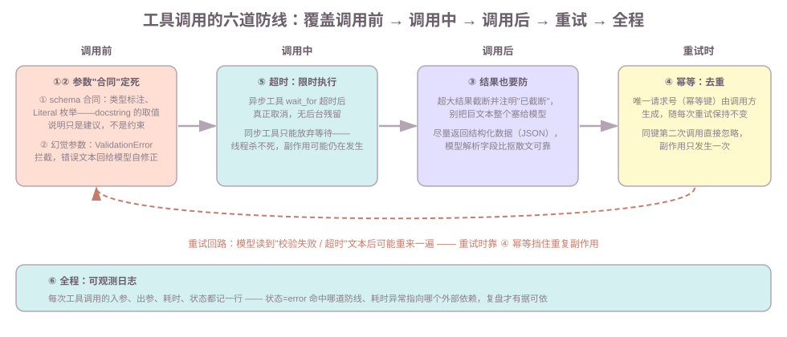
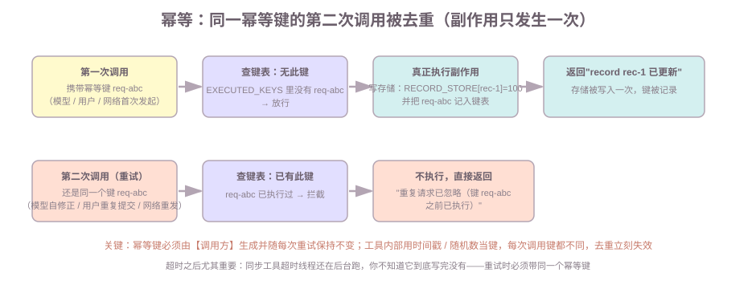

# 第八课：工具调用的可靠性与防护

前几课的工具都很"听话"：第 4 课教定义，第 5 课把它接进 ReAct 循环，第 7 课让敏感操作等人确认。但那些场景里模型是脚本化的、外部服务是模拟的。生产环境里工具会"变坏"：模型编造参数、工具卡死、被重复调用、结果异常、出错后没法复盘。本课把工具在生产里的真实问题排成**六道防线**，覆盖一次工具调用的"调用前 → 调用中 → 调用后 → 重试时 → 全程"。

范围：工具的定义、加入环节（`bind_tools` / `ToolNode`）见第 4 课，ReAct 组装见第 5 课，本课只讲**防护**，不重讲组装。权限模型在第 8 节收拢第 4、7 课的结论。

前置：第 4 课（工具、`args_schema` 校验、`ToolNode`）、第 5 课（ReAct、`handle_tool_errors`）、第 7 课（`interrupt` 审批）。

**学习目标：**

1. 能说出工具在生产里的四类真实故障，六道防线各自防什么、在哪一环；
2. 能解释"docstring 的取值说明不是约束"，并写出两种真约束（`Literal`、函数体校验）；
3. 能画出"模型编造参数 → 校验拦截 → 错误文本回给模型 → 模型修正重试"的循环，说清每步是谁干的；
4. 能设计一个幂等工具（调用方生成幂等键、同键去重），解释为什么同步工具超时后重试必须幂等；
5. 能说明异步工具和同步工具超时的本质区别（可取消 vs 只能放弃等待）；
6. 能说出工具调用日志要记哪几项，并用日志复盘一次调用链。

## 1. 背景：工具在测试环境之外会怎么坏

第 4、5 课里工具"很听话"，是因为模型是脚本化的。真实模型 + 真实外部服务下，一次工具调用有四个真实故障源：

| 故障 | 表现 | 后果 |
| --- | --- | --- |
| 幻觉参数 | 模型编造参数名 / 参数值（`actionx`、`"fly"`） | 校验不过，或执行了不该执行的 |
| 重复调用 | 模型自修正重试、用户重复提交、网络重发 | 副作用发生两次（邮件发两遍、记录建两条） |
| 卡死 / 超时 | 外部 API 慢、网络挂 | 图和模型无限等待 |
| 结果异常 | 结果超大、格式烂、为空 | 上下文被撑爆、模型解析失败 |

再加上一个"复盘难"：出错了不知道是哪次调用、入参是什么、耗时多少。本课就按"调用前 → 调用中 → 调用后 → 重试时 → 全程"排六道防线，整体位置先看图：



## 2. 防线一：把 schema 设计成"合同"（调用前）

定义：**schema 是工具和模型之间的"合同"**——模型根据它决定参数怎么填，校验器根据它决定参数能不能过（第 4 课）。合同写得不清楚，模型就只能猜。

先说清这个"校验器"是谁做的（第 4 课讲过机制，这里点明）：**是 Pydantic 库，而且用 `@tool` 时自动完成，不需要你手写任何 pydantic 代码**。两件事都是自动的——装饰时 `@tool` 用 `inspect.signature` 拿你的类型标注，动态生成一个 pydantic 模型（就是 `args_schema`，实测确认它是 `pydantic.BaseModel` 的子类）；调用时 `tool.invoke({...})` 先让这个模型校验参数，不合法就抛 pydantic 的 `ValidationError`，**底层函数根本不执行**（实测：函数体里放打印，校验失败时打印不出现，合法参数时才出现）。你要做的只是把类型标注写对、把枚举写成 `Literal`。

合同要写清楚的三个方面，按重要性排：

1. **`description` 说清"什么时候用"**：工具是干什么的、参数什么含义——模型靠它决定"这种情况该不该调我"；
2. **参数类型标注**：`str` / `int` / `float` / `list`——类型错了校验直接拦（第 4 课）；
3. **取值约束**：如果参数只能取少数几个值，用 `Literal` 把枚举写死。

**知识点（实测，最容易踩）**：docstring 里写"action 取值 create/update/delete"**不是约束**，只是给模型的建议。模型照样传 `"fly"`，工具照常执行。真正的约束是 `Literal`——它在 schema 里生成 `enum` 字段，校验器会拦。运行演示 B 直接看两种写法的差异：

```text
普通 str 的 action 约束： {'title': 'Action', 'type': 'string'}                  ← docstring 说了也不拦
Literal 的 action 约束：  {'enum': ['create', 'update', 'delete'], 'title': 'Action', 'type': 'string'}  ← 真约束
传 action='fly'：
  普通 str -> record r1 fly done    （执行了！）
  Literal -> ValidationError: Input should be 'create', 'update' or 'delete'
```

一句话：**schema 里写出来的才是约束，docstring 里写的是提示。** 想加 schema 表达不了的规则（如"金额必须 > 0"），就在函数体里校验——第 4 课 `calculate` 的字符白名单就是例子。

## 3. 防线二：幻觉参数——校验兜底 + 错误回喂给模型（调用前 / 失败时）

定义：**幻觉参数 = 模型生成的、不符合 schema 的参数**。常见三类：参数名写错（`actionx`）、必填缺失（少传 `action`）、取值超范围（`fly`）。

合同写得再好，模型也可能编造——所以防线二靠"校验器兜底 + 把错误喂回给模型"：

```text
模型发起调用（参数是幻觉的：actionx）
  ↓
args_schema 校验（第 4 课）：ValidationError 拦截，函数体根本没执行
  ↓
错误文本作为 ToolMessage 回给模型（handle_tool_errors，第 5 课）
  ↓
模型读错误文本，定位问题，修正参数重试
```

运行演示 A 是完整循环。关键在中间那条 ToolMessage——**错误文本本身就是"可行动的提示"**：

```text
ToolMessage: "工具执行失败：Error invoking tool 'update_record' with kwargs
             {'record_id': 'r1', 'actionx': 'create'} with error:
             action: Field required          ← 模型靠这一行知道"缺 action 字段"
             Please fix the error and try again."
```

模型读到"缺 action 字段"，第二次调用就带上了 `action: "create"`，执行成功。**整个循环里没有一行你自己的代码**：校验是 args_schema 干的，回喂是 ToolNode 的 `handle_tool_errors` 干的，修正重试是模型干的。

两个实测边界（演示 A 输出佐证）：

- **校验拦得住**：参数名写错、必填缺失、`Literal` 取值超范围 → `ValidationError`；
- **校验拦不住"多传参数"**：多传一个 schema 里没有的参数，pydantic 默认**静默忽略**，不报错。所以敏感工具里，对入参做白名单（只认自己定义的字段）比指望校验更稳妥。

再分清一个对比（这正是"工具会坏"和"工具可靠"的分界）：

| 异常来源 | 默认行为（实测） | 配 `handle_tool_errors` |
| --- | --- | --- |
| 校验失败（`ValidationError`） | 包成 ToolMessage 回给模型，图不崩 | 错误文本（可加自定义前缀）回给模型 |
| 函数体抛异常（如 `ConnectionError`） | **图直接失败** | 错误文本回给模型，图继续 |

生产里**必须显式配 `handle_tool_errors`**：让工具错误走"回喂 → 模型自修正"这条路，而不是让整个 Agent 崩掉。第 5 课组装时就配了，原因在这里。

## 4. 防线三：结果异常——截断与结构化返回（调用后）

校验过了、执行成功了，结果也可能"不能用"：

1. **结果过大**：工具返回 1 万字符的文本，直接追加进 messages 会撑爆上下文。处理：**在返回前截断**，并在文本里注明截断了——模型需要知道结果不完整：

```text
截断：原长 10000 -> 返回 218 字符，末尾注明：…（已截断，原文 10000 字符）
```

2. **格式异常 / 自由文本**：工具返回散文式文本，模型要从里面抠数字，容易错。处理：**结构化返回**——返回 JSON，字段清晰：

```json
{"city": "上海", "temp": 22, "weather": "晴", "humidity": 0.45}
```

3. **结果为空**：返回明确的结构化空值（如 `[]`、`{"found": false}`），而不是 `None` / 空串——模型才能区分"没查到"和"工具坏了"。

知识点：**模型解析的是 content 文本**，文本的"可解析性"直接决定下一轮模型能不能用上结果。截断发生在**工具函数内部**（返回前），不是图里——工具自己知道自己的结果多大。

## 5. 防线四：幂等——用唯一请求号去重（重试时）

定义：**幂等 = 同一个操作执行多次，效果和只执行一次相同**。对 Agent 工具来说，就是"同一请求重试 N 次，副作用只发生一次"。

为什么必须幂等：工具会被重复调用，来源有三个——

- **模型自修正重试**（第 3 节：校验失败后模型会再调一次）；
- **用户重复提交**（前端没收到响应，用户点了两下）；
- **网络重试**（调用链上任何一层重发）。

不幂等的后果：邮件发两遍、记录建两条。第 7 课还有一个来源：**节点重跑**——`interrupt()` 之前的副作用代码会执行两次，当时预告"保证幂等（第 8 课）"说的就是本课。

设计（标准做法）：**调用方生成幂等键，随参数传给工具；工具记录"这个键执行过没有"，执行过就忽略**：



运行演示 D 的输出：

```text
第 1 次调用： record rec-1 已更新为 100.0
第 2 次调用（同键重试）： 重复请求已忽略（键 req-abc 之前已执行）
存储内容： {'rec-1': 100.0}（只被真正写入一次）
```

**最容易踩的坑（实测）**：幂等键不能用工具内部生成的时间戳 / 随机数——每次调用键都不同，去重立刻失效。幂等键必须由**调用方**生成，并且**每次重试保持同一个键**。生产里的来源一般是用户请求的 `request_id` 或业务单号。

### 5.1 幂等键放哪里：三个层次，从入口到工具

**第一层（最常用）：入口生成 `request_id`，放进 `config.configurable`。** 它和第 6 课的 `thread_id` 并列，图里任何工具都能拿到：

```python
cfg = {"configurable": {"thread_id": "s1", "request_id": "req-001"}}
```

工具声明一个 `config: RunnableConfig` 参数就能读到——这是 langchain 的标准注入：**config 参数自动传入、不进 schema**（实测：`book_room(room, date, config)` 生成的 schema 里只有 room 和 date）：

```python
@tool
def book_room(room: str, date: str, config: RunnableConfig) -> str:
    """预订会议室。"""
    rid = config["configurable"]["request_id"]   # ← 幂等键从这里来
    if rid in EXECUTED:
        return f"重复请求已忽略（{rid}）"
    EXECUTED.add(rid)
    return f"预订 {room} {date}（请求号 {rid}）"
```

**第二层：state 字段。** 把 `request_id` 定义成 state 字段（第一次 `invoke` 传入、之后不变）也可以，但要留意：模型生成工具参数时**不会自动带上它**——需要节点或包装器注入，不如 `config` 直接。

**第三层（无外部请求号时）：工具用参数 hash 生成确定性键。** 幂等键 = `hash(工具名 + 参数)`，同一参数永远同键，天然幂等（实测：同参数第二次调用被忽略，参数不同不误杀）：

```python
key = hashlib.md5(("add_reminder|" + json.dumps({"text": text}, ensure_ascii=False)).encode()).hexdigest()[:12]
```

**核心原则：键必须放在"重试之间不变"的地方。** 节点的重跑（第 7 课 `interrupt` 恢复、工具失败后模型重试）会重新执行节点代码——如果每次执行都 `uuid.uuid4()` 现场生成，重试时键就变了，去重失效。所以键要么**入口生成一次放进 config/state**，要么**用参数算（确定性）**，绝不能"用的时候现场生成"。

常用形式一览：

| 形式 | 例子 | 适用 |
| --- | --- | --- |
| `uuid4()` | `6130f745-df6c-406d-be7e-0dd4a805444a` | 通用、无业务含义 |
| 业务单号 | `req_20261026_0001` | 可追溯、对账 |
| 组合键 | `user-7:工具名:参数hash` | 按用户/操作隔离 |
| 参数 hash | `md5(工具名+参数)` | 无外部请求号、天然幂等 |

## 6. 防线五：超时——给工具调用设一个最长时间（调用中）

定义：**超时 = 给一次工具调用设定最长时间，超过就按失败处理**。没有它，外部 API 卡住时图和模型就无限等下去。

两个实现路径，行为完全不同（运行演示 E 实测）：

**路径一：异步工具 + `asyncio.wait_for`——超时后真正取消**：

```python
result = await asyncio.wait_for(slow_weather.ainvoke({"city": "上海"}), timeout=1.0)
# 1 秒没返回 -> 抛 asyncio.TimeoutError，协程被真正取消，没有后台残留
```

**路径二：同步工具 + 线程池 `future.result(timeout)`——只能"放弃等待"，线程杀不死**：

```python
with ThreadPoolExecutor(max_workers=1) as ex:
    fut = ex.submit(slow_sync.invoke, {"city": "北京"})
    fut.result(timeout=1.0)   # 1 秒没返回 -> TimeoutError（调用方不再等）
# 但后台线程还在跑——同步代码无法中途停止
```

两条路径的对比：

| | 异步 + `wait_for` | 同步 + 线程池 |
| --- | --- | --- |
| 超时后 | 协程被**真正取消**，无残留 | 线程**杀不死**，还在后台跑 |
| 副作用 | 超时 ≈ 没执行 | 超时 ≠ 没执行，可能已写入 |
| 结论 | 首选（工具写成 `async`） | 至少保证"调用方不再等"，但重试必须幂等 |

**知识点（串起第 3、5 节）**：超时发生后，把"工具超时：等待超过 N 秒"当成一条工具错误回给模型（走第 3 节的回喂路径），让模型决定重试还是放弃。但**同步工具超时后别假设"没执行"**——线程还在跑，副作用可能已经发生，所以重试必须带幂等键（第 5 节）。超时和幂等是一对：**一个管"别无限等"，一个管"等不到也别重复做"**。

再分清两个"失控"：`recursion_limit`（第 5 课）防**图循环**失控，超时防**单次工具调用**失控——一个是"转圈太多"，一个是"一步卡死"。还要分清本课"中断"和第 7 课 `interrupt`：`interrupt` 是图在审批点等人（可以等无限久），超时是工具限时（超过就失败）。两者可以组合：审批等人可以无限等，真正执行必须限时。

### 6.1 工具的同步与异步：先分清是哪一层

面试被问到"工具是同步还是异步"，第一反应先分清楚指**哪一层**——Agent 里"同步/异步"有四个层面，混在一起答必乱：

**层面一：图与调用链（模型 ↔ 工具之间）——默认同步。**
图按 super-step 串行推进：模型节点返回 → 状态更新 → 工具节点执行 → 结果回填 → 模型节点再决策。下一步依赖上一步，必须等（实测：同步图 `model → tools` 串行推进）。这就是你说的"工具调用和模型调用之间都是同步的"——对的，**图层面是同步的**。

**层面二：工具代码形式（`async def`？）——两种都支持，但必须配对。**
工具可以写成 `async def`（IO 密集时用协程，`await` 不阻塞）。实测一个硬性规则：**async 工具必须配 async 图（`ainvoke` / `astream`）**——同步 `invoke` 调 async 工具直接报错：

```text
NotImplementedError: StructuredTool does not support sync invocation
```

配对关系（实测）：

| 工具写法 | 图的执行方式 | 结果 |
| --- | --- | --- |
| 同步 `def` | `invoke` | 正常（常规路径） |
| 异步 `async def` | `ainvoke` / `astream` | 正常 |
| 异步 `async def` | `invoke` | **报错**（不支持同步调用） |

**层面三：工具内部执行方式——可以设计成"提交即返回"（异步任务模式）。**
"等外部结果"和"提交任务就返回"是两种设计：查天气这类快操作同步等结果（2 秒返回）；发邮件这类慢操作（10 秒+）可以让工具**提交任务、返回任务 ID**——"正在发送，完成后通知你"，主循环不等它。这就是工具层面的异步，和第 7 课 `interrupt` 不是一回事（那是等人拍板），和超时联动（提交任务也要限时、也要幂等）。

**层面四：多个工具之间（一次多个 `tool_calls`）——LangGraph 默认并行。**
实测：ToolNode 收到两个各 1.5 秒的工具调用，总耗时 1.5 秒——**同一 super-step 内并行执行**，不是串行。（这和第 10 课 `Send` 的 fan-out 并行不同：那里是跨节点动态分发任务。）

**一句话收束（面试口述）**：模型和工具的调用链是同步的（super-step 串行、状态一致）；多个工具调用在 LangGraph 里默认并行；async 工具要配 async 图；工具内部可以设计成"提交即返回"的异步任务模式。

## 7. 防线六：可观测性——每次调用留下入参、出参、耗时（全程）

定义：**可观测性 = 每次工具调用都记一条日志：入参、出参、耗时、状态**。没有它，出错了只能猜。

课程用自建日志（LangSmith 这类平台课里不依赖，原理相同）：给工具函数加一个日志装饰器（演示 F 的 `logged`），每次调用打印一行：

```text
[tool-log] log_weather 入参={'city': '上海'} 状态=ok 出参='上海：晴，22℃' 耗时=0.0ms
[tool-log] log_weather 入参={'city': '北京'} 状态=error 出参='天气服务暂时不可用' 耗时=0.0ms
```

日志里**必须记入参**——只记结果，出了问题没法判断是"参数就是错的"还是"工具执行坏了"。错误也要记（状态=error），异常照常抛出交给上层处理（第 3 节的回喂路径）。

复盘时看什么（演示 F 的调用链示例，一次幻觉参数 + 自修正的完整轨迹）：

```text
[tool-log] calculate     入参={'expression': '1+1'}              状态=ok    耗时=12.3ms
[tool-log] update_record 入参={'record_id': 'r1', 'actionx': 'create'}  状态=error  耗时=0.4ms   ← 幻觉参数命中校验
[tool-log] update_record 入参={'record_id': 'r1', 'action': 'create'}   状态=ok    耗时=3.1ms    ← 模型自修正后成功
```

- `状态=error` 且耗时几乎为 0 → 校验拦截（幻觉参数），不是执行失败；
- `状态=ok` 但耗时 >100ms → 外部依赖慢，考虑加超时（第 6 节）；
- `状态=error` 且耗时接近超时值 → 工具真的卡过，重试是否幂等（第 5 节）。

## 8. 权限模型：四层拼装（收拢）

第 4 课权限边界给了三层，第 7 课实现了其中一层。本课把它收拢成完整的四层模型，从外到内：

| 层 | 机制 | 在哪实现 | 拦什么 |
| --- | --- | --- | --- |
| ① 工具白名单 | 只把允许的工具传进 `bind_tools` / `ToolNode` | 第 4 课第 5 节 | 模型永远调不到列表外的工具 |
| ② 参数校验 | `args_schema` 类型 + `Literal` 枚举（本课第 2、3 节） | 工具定义 | 幻觉参数：参数名错、缺失、超范围 |
| ③ 敏感操作二次确认 | `interrupt` 审批，执行前等人拍板 | 第 7 课 | 不可逆副作用：发邮件、删记录 |
| ④ 后端授权 | 工具真正执行时，在服务端再验一次权限（调用者是谁、有没有权限做这个操作） | 业务后端 | 绕过 Agent 直接调 API、越权操作 |

**面试关键一句**：**LangGraph 没有内置权限系统**——权限是这四层"拼"出来的：白名单挡范围、校验挡参数、审批挡敏感操作、后端授权挡越权。前三层在 Agent 内部，第四层必须在 Agent 外部（业务后端）兜底，因为任何 Agent 的防护都可以被绕过——直接调 API。

## 9. 常见错误

1. **把 docstring 的取值说明当约束**：写了"action 取值 create/update/delete"，模型传 `fly` 照样执行（演示 B）。要约束就用 `Literal` 或函数体校验；
2. **幂等键用工具内部的时间 / 随机数生成**：每次调用键都不同，去重失效。幂等键必须由调用方生成并随重试保持不变（演示 D 末尾）；
3. **同步工具超时后假设"没执行"**：线程杀不死，副作用可能已发生。重试必须带幂等键（演示 E2）；
4. **日志只记结果不记入参**：状态=error 时无从判断是参数错还是执行错（演示 F）；
5. **错误文本回喂给模型但信息太干**：只回"失败"不回"缺哪个字段"，模型没法自修正。校验错误文本天然带字段名（演示 A），自定义 `handle_tool_errors` 时别把信息吞掉；
6. **截断后不告诉模型**：模型不知道结果不完整，可能把截断当全貌。截断要在返回文本里注明（演示 C）。

## 10. 运行课程代码

```bash
cd c:\0work\project\ai_application_development_study
python code/langgraph/langgraph_lesson08.py
```

依次打印：演示 A（幻觉参数 → 校验拦截 → 模型自修正的完整循环 + 错误文本形态）、演示 B（docstring vs `Literal` 枚举约束对比）、演示 C（截断与结构化返回）、演示 D（幂等去重）、演示 E（异步超时可取消 vs 同步超时只能放弃等待）、演示 F（日志包装器 + 调用链复盘）。全部离线可跑，不需要 API Key。

## 11. 课后作业

作业和课程示例在同一个文件中：`code/langgraph/langgraph_lesson08.py`，从 `# ===== 课后作业 =====` 开始。

1. **超时包装器**：实现 `search_with_timeout(city, timeout)`——用 `asyncio.wait_for` 包一个慢工具，超时返回 `"工具超时：..."` 而不是抛异常（这样超时错误能像普通工具错误一样回给模型）；
2. **幂等工具**：实现 `add_reminder(reminder_text, idempotency_key)`——用模块级 `REMINDERS` 列表，同键第二次调用返回"重复请求已忽略"，列表里只有一条；
3. **日志复盘**：实现 `review_tool_logs(logs)`——输入 `(工具名, 状态, 耗时ms)` 三元组列表，输出一段复盘文字，至少指出一次失败和一次耗时异常；
4. 思考题：为什么"超时后重试"和"幂等"必须成对出现？（答案在第 6 节末尾：等不到 ≠ 没执行）

## 12. 验收问题 / 过关清单

能回答：

1. 工具在生产里会怎么坏？六道防线各自防什么、在哪一环？
2. docstring 的取值说明和 `Literal` 有什么区别？想要真约束有哪两条路？
3. "模型编造参数 → 自修正"循环里，每一步是谁干的（校验 / 回喂 / 修正）？错误文本为什么要有字段名？
4. 幂等键由谁生成？为什么不能用工具内部的时间戳？同步工具超时后为什么重试必须幂等？
5. 异步工具和同步工具超时后行为差在哪？为什么说超时和幂等是一对？
6. 工具调用日志必须记哪几项？复盘时状态=error、耗时异常分别指向什么？
7. 权限模型四层是哪四层？为什么说 LangGraph 没有"内置权限系统"？

## 13. 面试高频考点

答案分机制和口述模板两层，面试时按模板说：

**Q1：工具调用失败（校验失败 / 工具抛错）怎么办？**
机制：校验失败由 `args_schema` 拦截（函数体不执行）；工具错误通过 `handle_tool_errors` 变成 ToolMessage 回给模型；模型读错误文本自修正重试。不配 `handle_tool_errors` 时，函数体异常会让整个图失败（实测）。
口述模板："工具错误分两类：参数问题在校验层就被拦下，执行问题通过 handle_tool_errors 把错误文本回给模型，让模型读错误重试。错误文本要包含缺失字段或合法取值，模型才能自修正。生产里必须显式配 handle_tool_errors，否则一个外部服务报错就拖垮整个 Agent。"

**Q2：如何防止模型乱调工具或编造参数？**
机制：四道闸——schema 合同写清 description 和 `Literal` 枚举（docstring 不是约束）；`args_schema` 校验拦截幻觉参数；白名单限制可选工具；敏感工具加 `interrupt` 审批 + 后端授权。
口述模板："三层防：第一，schema 合同——description 说清什么时候该调，Literal 把取值写死，但 docstring 的说明不是约束，要 Literal 或函数体校验；第二，白名单——bind_tools 只传允许的工具；第三，敏感操作人工审批（interrupt）+ 后端再验权限。"

**Q3：工具幂等为什么重要、怎么设计？**
机制：模型自修正、用户重复提交、网络重试都会重复调用；副作用（发邮件、写库）重复就出事。设计：调用方生成幂等键，工具记录已执行键集合，同键第二次调用忽略；幂等键不能用工具内部时间戳。
口述模板："工具会被重试，重试不幂等就会重复副作用。做法是调用方生成幂等键随参数传入，工具执行前查'这个键执行过没'，执行过直接返回忽略。键必须由调用方生成并随重试保持不变，工具内部生成的时间戳每次都不一样，等于没做。"

**Q4：工具执行超时如何处置？**
机制：异步工具 `asyncio.wait_for` 超时真正取消协程；同步工具线程池 `future.result(timeout)` 只能放弃等待、线程杀不死。超时后把"工具超时"当错误回给模型，让它决定重试或放弃；重试要带幂等键。
口述模板："给每次工具调用设时限。异步工具超时可以被真正取消；同步工具只能让调用方放弃等待，线程还在后台跑，所以超时后不能假设没执行。超时错误回给模型让它重试或放弃，重试带上幂等键防重复副作用。"

**Q5：LangGraph 有权限系统吗？**
口述模板："没有内置权限系统。权限是四层拼出来的：工具白名单挡范围、参数校验挡幻觉参数、interrupt 审批挡敏感操作、后端授权挡越权。前三层在 Agent 内部，第四层必须在业务后端兜底。"

**Q6：工具是同步的还是异步的？**
机制：分四层——图与调用链默认同步（super-step 串行，结果回填才决策）；多个 `tool_calls` 在同一 super-step 内并行（实测两个 1.5s 工具总耗时 1.5s）；async 工具必须配 async 图（`ainvoke`/`astream`），同步 `invoke` 会报 "does not support sync invocation"；工具内部可设计成"提交任务返回 ID"的异步模式。
口述模板："要看指哪一层。模型和工具之间的调用链是同步的——图按 super-step 串行推进，工具结果回填后模型才做下一步。但多个工具调用在 LangGraph 里是并行执行的；async 工具要配 async 图，同步 invoke 调 async 工具会报错；工具内部也可以设计成提交任务立即返回的异步模式，比如发邮件这类慢操作。"

## 下一课预告

第 9 课《Agentic RAG：检索作为工具》：本课的工具都是"计算、查天气"这种小能力，下一课把**检索**也变成工具——先判断要不要检索、检索结果不够就改写查询重检，第 8 课的可靠性思路（schema、超时、可观测）会原样用在检索工具上。
