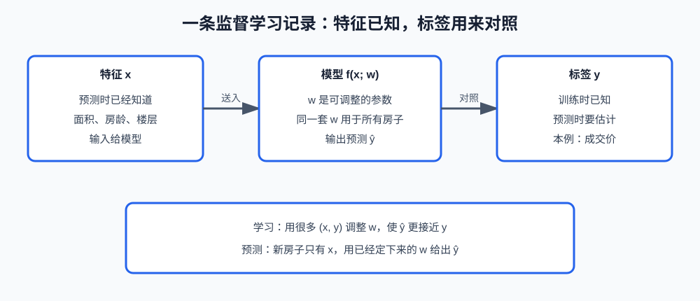
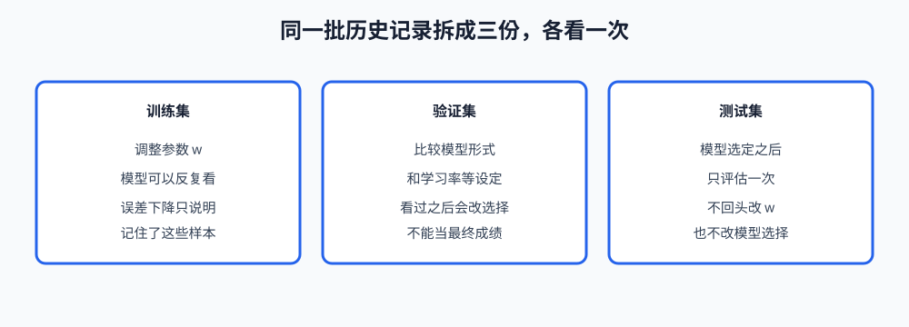

# 第1课:机器学习在学什么

机器学习课程从"一次预测在回答什么问题"开始。后面的损失、梯度、线性模型和树模型，都默认你已经能指出：输入是什么、要预测的量是什么、参数在训练时改、在预测时不改。如果这几个对象混在一起，后面的公式只是符号。

本课只建立这套对象。不讲损失函数怎么写，不推导梯度，不训练任何一个模型。损失和梯度下降是第 2 课；线性回归、逻辑回归从第 3 课开始。

**学习目标：**

1. 能用"有没有标签、标签从哪来"区分监督学习、无监督学习和强化学习；
2. 能说明分类、回归、排序各自要预测的量，以及排序为什么不是多分类；
3. 能指出一条记录里哪些是特征、哪个是标签、哪些是参数；
4. 能说明训练集、验证集、测试集各自允许做什么，以及独立同分布假设破了以后评估为什么失效。

## 1. 三种学习问题

一条记录里，如果既有预测时能拿到的信息，也有事后才知道的正确答案，这就是**监督学习（supervised learning）**。房价记录里，面积在挂牌时就有，成交价在成交后才有；训练时两者都在，预测新房时只有面积。

如果记录里没有这种"事后正确答案"，只是要发现数据自己的结构，这就是**无监督学习（unsupervised learning）**。把客户按消费金额和频次分成几群，群的编号不是事先标好的标签，而是算法划出来的。聚类和降维留到第 12 课，本课只确定它和监督学习的分界：没有外部给出的 y。

**强化学习（reinforcement learning）**也不给每一步的标准答案。主体做动作，环境返回奖励，目标是让累计奖励变大。下围棋时没有人在每一步旁边写"正确着法"，只有终局胜负。它和监督学习的差别不在"有没有模型"，而在反馈是延迟的、并且动作会改变后面看到的状态。本课不讲策略和价值函数。

| 问题 | 训练时有什么 | 要得到什么 | 本课程 |
| --- | --- | --- | --- |
| 监督学习 | 特征 x 和标签 y | 对新的 x 预测 y | 第 2 课起的主体 |
| 无监督学习 | 只有 x | 分组、压缩或结构 | 第 12 课 |
| 强化学习 | 动作之后的奖励 | 选择动作的策略 | 只划边界，不展开 |

面试里"是不是机器学习"不是这张表的判断标准。判断标准是：学习时改的是不是一套可复用的参数，以及预测时缺的是不是标签。把历史均价直接报出去，没有参数被数据调整过，那就还不是学习。

## 2. 监督学习里的三种预测

监督学习内部还要再分一次，因为"标签是什么形状"决定后面用什么损失、看什么指标。

**分类（classification）**的标签是有限个类别。邮件是垃圾或不是垃圾；订单是成交或未成交。模型可以先输出每个类别的分数或概率，最后取一个类别。类别之间通常没有"垃圾比正常大 3"这种顺序。两个类别叫二分类，多于两个叫多分类。

**回归（regression）**的标签是连续数值。房价 312 万、配送时长 27 分钟，差 1 个单位是有大小的。分类和回归的差别不是"用了什么算法名"，而是 y 能不能比较大小、差值有没有意义。把房价四舍五入成整数，它仍然是回归，因为 311 和 312 的差距是一万元，不是两个互不相关的类别名。

**排序（ranking）**要的不是单个样本的类别，而是一组候选的相对顺序。搜索结果、推荐列表关心"相关的排在前面"，并不一定要给每条结果一个绝对类别。把排序说成"给每条结果做一个二分类"会漏掉一件事：评估时看的是顺序，两条都判成"相关"但前后颠倒，分类可能算对，排序已经错了。排序的指标放到第 6 课，本课只记住它的预测对象是顺序。

```text
分类  输出一个类别          垃圾 / 正常
回归  输出一个数值          312 万
排序  输出一组候选的先后    文档 A 在文档 B 前面
```

## 3. 一条记录里有什么

一条监督学习记录写成 (x, y)。x 叫**特征（feature）**，是预测时已经知道的量；y 叫**标签（label）**，是训练时用来对照、预测时要估计的量。一条记录也叫一个**样本（sample）**。很多条样本放在一起，就是数据集。

特征可以有多个，写成一个向量。预测房价时，x 可以同时包含面积、房龄、楼层。标签在这个任务里只有成交价一个。换一个任务，同一套房子的"是否成交"也可以当标签，那时面积仍然是特征。所以一个字段是特征还是标签，不由字段本身决定，由这次要预测什么决定。

**参数（parameter）**不属于某一条房子。它是模型里可调整的数，例如"面积每增加 1 平方米，预测价增加多少"。训练就是用很多条 (x, y) 把参数定下来；预测新房子时，参数不再改，只把新的 x 代进去。



还有两类容易和参数混在一起的数。

**超参数（hyperparameter）**在一次训练开始前就定好，训练过程本身不把它当成要拟合的未知数。学习率、树的棵数属于这一类。第 2 课会碰到学习率；本课只需要知道：它影响训练怎么进行，但不是"面积系数"那种从数据里估出来的参数。

**预测值**写成 ŷ，是模型对 y 的估计。它不是标签，也不是参数。训练时拿 ŷ 和 y 比较，才知道参数该往哪边改；比较的具体做法是损失函数，留到第 2 课。

用同一笔房子把四个词分开：

```text
特征 x     面积 89、房龄 8、楼层 6     挂牌时就有
标签 y     成交价 312                  成交后才有；预测时缺失
参数 w     面积、房龄、楼层各自的系数   所有房子共用，训练时调整
预测 ŷ     308                         由 x 和当前的 w 算出来
```

标签必须是预测当时确实还不知道的量。用"成交价"去预测"成交价"，或者用成交之后才产生的字段（例如实际贷款审批结果）去预测成交价，模型在训练数据上看着很准，是因为它看见了未来。这种错误叫**特征泄漏（feature leakage）**。第 14 课专门讲怎么查；这里先记住判断标准：这个字段在真正要做预测的那一刻，能不能拿到。

## 4. 模型是从特征到预测的函数

本课把模型写成：

```text
ŷ = f(x; w)
```

f 是函数形式，决定"特征怎样组合成预测"。w 是这套形式里的参数。线性回归规定 f 是特征的加权和再加一个常数，这是第 3 课的内容；决策树规定 f 是一连串是否判断，这是第 8 课的内容。本课不比较它们谁更好，只固定这一个事实：换模型，换的是 f 的形式；训练一个已经选定的模型，改的是 w。

**假设空间**就是选定 f 之后，所有可能的 w 能表达的预测规则。只允许"预测价 = 面积 × 一个系数"时，假设空间里没有"房龄越老越便宜"这条规则，因为房龄根本没进 f。训练再认真，也变不出特征里不存在、形式里也写不出来的关系。

因此"模型不准"至少有两种不同原因：w 还没调好；或者 f 和现有特征表达不了这个关系。第二种情况不是把学习率改小就能解决的。

## 5. 训练集、验证集、测试集

历史数据不能全部拿去改参数，然后再用同一批数据宣布"预测得很准"。模型可以记住训练集里的个别样本，那份误差会变小，却没有回答"没见过的房子准不准"。

所以同一批样本要拆开，三份的职责不同：



**训练集（training set）**用来调整 w。模型可以反复读取它。

**验证集（validation set）**不参与这一次的参数更新。它用来比较不同的 f，或者比较学习率、正则强度这类超参数。你看了验证集的结果之后，会回去改选择，所以验证集已经被你的决策使用过了。用它当最终成绩，会偏向那些碰巧在这批验证样本上好看的设定。

**测试集（test set）**在模型形式、超参数和参数都选定之后才使用，只评估一次。测试集上的结果如果不好，可以记录下来，但不应该据此再换一个模型，然后把新结果继续叫作"测试成绩"。那样做等于把测试集变成了又一个验证集。

三份必须按样本切开。同一套房子的记录如果既在训练集里改参数，又在测试集里报成绩，评估的就不是新房子。按时间收集的数据还有另一种切法：用过去训练，用后来的时间段测试。随机打乱再切分，和按时间切分，防的不是同一个问题。具体指标和第 6 课一起讲；本课的规则只是：改参数的样本、选模型的样本、报最终成绩的样本，三者分开。

## 6. 独立同分布假设

把测试集上的误差当成"以后也大概是这个水平"，中间有一个假设：**独立同分布（independent and identically distributed，i.i.d.）**。

"同分布"是说，训练样本和将来要预测的样本来自同一种数据生成方式。房价模型如果只用城区成交训练，却拿去预测远郊，面积和价格的关系可能已经变了，测试集如果也只从城区抽，就发现不了这件事。

"独立"是说，样本之间不要带着评估没切开的关联。同一小区、同一卖家的多套房如果被随机拆进训练集和测试集，模型记住的是这个小区的特殊情况，测试误差会偏低。按小区整体划到同一侧，才更接近"来了一个新小区"。

i.i.d. 不是数据自动满足的属性，而是你声称"测试误差代表未来误差"时必须检查的前提。分布变了，就叫**分布偏移（distribution shift）**。偏移之后，训练误差、甚至旧测试集上的误差，都不再是新数据上的误差。

## 7. 用代码看一次切分

课程代码在 `code/machine-learning/01-what-learning-is.py`。它不训练模型，只处理一张很小的成交表，把第 3 节和第 5 节的对象打印出来。

数据是元组的列表。每个元组是一条样本：小区、成交月份、面积、房龄、成交价。前四项在这个任务里是特征来源，最后一项是标签。

`split_rows` 的签名是本课用到的全部参数，不是某个机器学习库的接口：

```python
def split_rows(
    rows: list[tuple[str, int, float, int, float]],
    validation_count: int,
    test_count: int,
) -> tuple[list[tuple[str, int, float, int, float]], list[tuple[str, int, float, int, float]], list[tuple[str, int, float, int, float]]]:
```

`rows` 要求已经按成交月份从早到晚排好。`validation_count` 和 `test_count` 是从末尾截走的条数，必须是非负整数，并且两者之和小于总条数，这样训练集至少还剩一条。函数返回 `(训练集, 验证集, 测试集)`。它不打乱顺序：测试集是最近的 `test_count` 条，验证集是紧挨在测试集前面的 `validation_count` 条，其余是训练集。副作用是没有的，输入列表不会被修改。

按时间截开，是为了让"过去的成交"去形成参数，"后来的成交"才用来看选择和成绩。若改成随机抽走几条，同一月份的房子会散落在三份数据里，第 6 节说的时间顺序就没了。

运行方式：

```bash
cd <本仓库根目录>
conda run -n agent_dev python code/machine-learning/01-what-learning-is.py
```

输出里应能看到：每条训练样本的特征是 `(面积, 房龄)`，标签是成交价；验证集和测试集的月份都晚于训练集；参数在这份代码里只有名字，没有数值，因为本课还不估计它。

## 8. 课后作业

作业在同一个文件 `code/machine-learning/01-what-learning-is.py` 下半部分，从 `# ===== 课后作业 =====` 开始。示例用成交价做回归标签；作业改成另一个预测问题，并换一种切分单位。

作业要求：

1. 实现 `records_for_task`：输入与示例相同的成交表，任务名只能是 `"price"` 或 `"district_price_level"`。`"price"` 时标签是成交价本身；`"district_price_level"` 时，先按小区计算该小区在**训练集中**的成交价中位数，再把每条样本标成 `"高"` 或 `"低"`（等于中位数时标 `"低"`）。验证集和测试集必须使用训练集算出的中位数，不能用全表中位数，否则标签里混进了未来成交。
2. 实现 `split_by_district`：同一个小区的全部样本必须落在同一份数据里。按小区第一次出现的顺序，把小区轮流分进训练集、验证集、测试集，但要保证三个集合的小区数尽可能接近，且训练集的小区数不少于验证集、测试集。返回三份样本列表。
3. 函数只返回数据，不打印。小区无法在训练集里算出中位数时抛出 `ValueError`。
4. 完成后取消 `__main__` 里 `homework()` 的注释。应能看到：价格任务的标签是浮点数，价位任务的标签只有 `"高"` 和 `"低"`；任何一个小区都不会同时出现在两份数据里。

## 9. 验收问题

1. 监督学习、无监督学习、强化学习，各自在训练时拿到的反馈是什么？
2. 为什么"预测房价是 311 万还是 312 万"仍然是回归，不是 300 多个类别的分类？
3. 特征、标签、参数、超参数、预测值，各举房价例子里的一个。
4. 验证集和测试集都"没有用来更新参数"，它们的使用规则差在哪里？
5. 测试集误差很低，但上线后预测变差。请用独立同分布的两个词，各说一种可能原因。

## 10. 面试高频考点

- 监督学习、无监督学习、强化学习的分界：有没有标签，以及反馈是不是延迟的奖励。
- 分类、回归、排序分别在预测什么；排序为什么不能直接说成逐条二分类。
- 一条样本上，特征、标签、参数分别是什么；预测时哪一个必须已经定下来。
- 训练集、验证集、测试集的职责；为什么看过之后又改模型的数据不能再叫测试集。
- 独立同分布假设在说什么；分布偏移或样本不独立时，测试误差为什么不能代表以后的误差。
