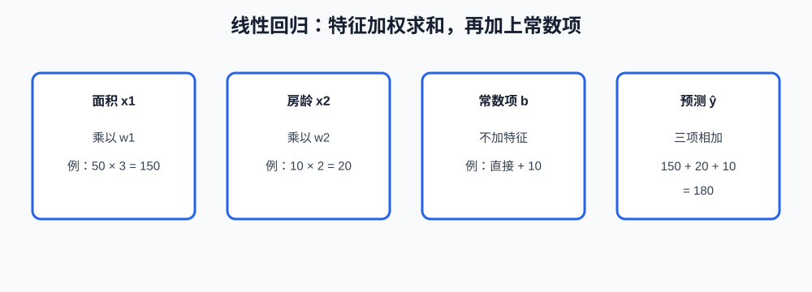
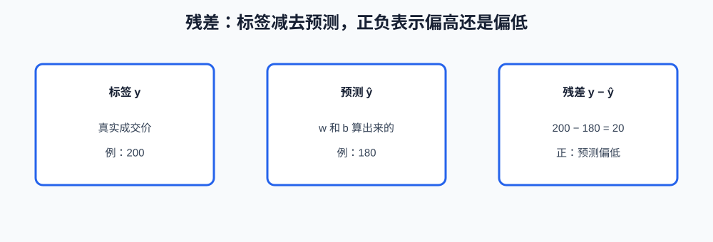

# 第3课:线性回归

第 2 课用 $\hat{y} = wx$ 说明了损失和梯度。那个式子只有一个特征和一个系数，是为了把一步更新算完。本课把模型写成线性回归：多个特征各自乘上一个系数，再加一个常数项。训练仍然最小化均方误差。

这一课按求解的顺序往下走。先写清一条样本怎么预测；再把整张表收成设计矩阵，后面的两种解法才有同一个 $X$ 和 $y$ 可用。矩阵写好之后，用正规方程法直接求解；样本很多、或不想对大矩阵求逆时，用梯度下降法求解同一个最小值。参数算出来以后，用残差看拟合还差在哪里。最后看共线性：它会让正规方程求不出唯一解，也会让单个系数无法解释。

逻辑回归和正则项留到后面。多重共线性只讲到“参数不再唯一”，不引入矩阵的病态度量。

**学习目标：**

1. 能写出 $\hat{y} = w_1 x_1 + \cdots + w_d x_d + b$，并说明每个系数和常数项在预测里加的是什么；
2. 能把常数项收进设计矩阵，写出正规方程，并在本课的三条样本上验算 $\hat{w}$；
3. 能用梯度下降法对同一批样本更新参数，并说明它和正规方程法差在求解方式，不差在优化目标；
4. 能用残差判断预测偏高还是偏低；能说明两个特征成倍数关系时，为什么两组系数给出同样的预测。

## 1. 线性回归的预测式

一条样本怎么变成一个预测，要先定下来。后面的矩阵、正规方程和梯度都是在求这组系数，不是在换一种预测形式。

### 1.1 加权和与常数项

一条样本有 $d$ 个特征 $x_1,\ldots,x_d$。线性回归规定预测只能是它们的加权和，再加上一个不乘特征的常数：

$$
\hat{y} = w_1 x_1 + w_2 x_2 + \cdots + w_d x_d + b
$$

$w_j$ 是第 $j$ 个特征的系数，$b$ 是**常数项（偏置，bias）**。第 1 课的 $w$ 在这里拆成了这些系数和 $b$。函数形式 $f$ 已经选定：特征之间只做乘法和加法，不做“先相乘再相加”的交叉项。面积和房龄若存在“又大又旧才降价”这种关系，这个 $f$ 表达不出来，除非事先造一个新特征。

用一组具体系数看一次预测。面积 $x_1 = 50$，房龄 $x_2 = 10$，系数 $w_1 = 3$、$w_2 = 2$，常数 $b = 10$：

$$
\hat{y} = 3 \times 50 + 2 \times 10 + 10 = 150 + 20 + 10 = 180
$$



### 1.2 系数和常数项各表示什么

系数的含义依赖“其他特征不变”。$w_1 = 3$ 表示面积增加 1、房龄不变时，预测价增加 3。它不是“面积的重要性排名”。若面积和房龄一起变化，预测的变化量是两项之和，不能把 3 单独当成因果效应。

$b$ 是所有特征都为 0 时的预测。面积为 0、房龄为 0 往往没有实际房子，所以 $b$ 常常只是一条拟合直线的截距，不要解释成"空地值 10 万"。特征如果先减去了各自的平均值，$b$ 会接近标签的平均值，这个变换第 13 课再讲。

单条预测式还不能对一整张成交表求损失。下一节把每条样本收成矩阵的一行，损失和两种解法才作用在同一张表上。

## 2. 设计矩阵

第 2 课的损失是对很多条样本取平均。线性回归也一样：不能只把面积 50 的那一条写清楚，还要把每条房子的特征和标签排到一起。

### 2.1 用一列 1 表示常数项

为了把 $b$ 和系数写成同一种乘法，给每条样本补一个永远等于 1 的特征。这个矩阵叫**设计矩阵**。每一行是一条样本，最后一列全是 1。参数写成一个向量后，所有样本的预测就是 $\hat{y} = X\hat{w}$。第一行展开仍是 $50 w_1 + 10 w_2 + b$，和第 1 节的式子相同。

### 2.2 本课的三条样本

手算用三条样本。前两条是 $(50, 10)$ 和 $(80, 4)$，第三条面积 $60$、房龄 $6$。标签都按 $w_1 = 3$、$w_2 = 2$、$b = 10$ 生成，所以三点落在同一条直线上。后面算出的结果应回到这组系数，用来检查算术，而不是检查优化器。

$$
X =
\begin{bmatrix}
50 & 10 & 1 \\
80 & 4 & 1 \\
60 & 6 & 1
\end{bmatrix}
,\qquad
\hat{w} =
\begin{bmatrix}
w_1 \\ w_2 \\ b
\end{bmatrix}
,\qquad
y =
\begin{bmatrix}
180 \\ 258 \\ 202
\end{bmatrix}
$$

第三条的预测是 $3\times 60 + 2\times 6 + 10 = 202$。这里样本数等于参数个数，而且三列谁也不能由另外两列线性表出。只有两条样本时，三个未知数没有唯一解，下一节的 $X^{\top} X$ 也不可逆。

设计矩阵和标签都有了，训练就变成：选 $\hat{w}$，使这三条的均方误差最小。下一节用正规方程法求解。

## 3. 正规方程法求解

正规方程法不一步步挪参数。它把“均方误差对每个参数的导数都等于 0”写成线性方程组，直接解出最小值点的 $\hat{w}$。

### 3.1 正规方程

这个方程组的解写成：

$$
\hat{w} = (X^{\top} X)^{-1} X^{\top} y
$$

$X^{\top}$ 是 $X$ 的转置，行和列互换。$(X^{\top} X)^{-1}$ 是方阵 $X^{\top} X$ 的逆：乘上原矩阵得到单位阵的那个矩阵。式子里没有学习率，也没有 epoch。它一次给出的就是训练均方误差最小的参数。

### 3.2 计算 $X^{\top} y$ 和 $X^{\top} X$

先算 $X^{\top} y$：

$$
X^{\top} y =
\begin{bmatrix}
50\times 180 + 80\times 258 + 60\times 202 \\
10\times 180 + 4\times 258 + 6\times 202 \\
180 + 258 + 202
\end{bmatrix}
=
\begin{bmatrix}
41760 \\
4044 \\
640
\end{bmatrix}
$$

再算 $X^{\top} X$。面积列与自己的内积是 $50^2 + 80^2 + 60^2 = 12500$；面积与房龄是 $50\times 10 + 80\times 4 + 60\times 6 = 1180$；面积与常数列是 $50+80+60 = 190$。其余格子同样按列做内积：

$$
X^{\top} X =
\begin{bmatrix}
12500 & 1180 & 190 \\
1180 & 152 & 20 \\
190 & 20 & 3
\end{bmatrix}
$$

### 3.3 代回验证

$3\times 3$ 的逆不必手算完。把候选解 $\hat{w} = \begin{bmatrix}3 \\ 2 \\ 10\end{bmatrix}$ 代回，检查它是否满足 $(X^{\top} X)\hat{w} = X^{\top} y$：

$$
\begin{bmatrix}
12500 & 1180 & 190 \\
1180 & 152 & 20 \\
190 & 20 & 3
\end{bmatrix}
\begin{bmatrix}
3 \\ 2 \\ 10
\end{bmatrix}
=
\begin{bmatrix}
12500\times 3 + 1180\times 2 + 190\times 10 \\
1180\times 3 + 152\times 2 + 20\times 10 \\
190\times 3 + 20\times 2 + 3\times 10
\end{bmatrix}
=
\begin{bmatrix}
41760 \\
4044 \\
640
\end{bmatrix}
$$

左右相等，所以这组系数就是正规方程的解，而且是唯一解。样本数少于参数个数，或某一列能被其余列线性表出时，逆不存在。后一种情况在第 6 节用加倍后的房龄列算开。

正规方程法要形成 $X^{\top} X$ 并求逆。样本有成千上万、特征只有几十个时，这样做直接、也不用选学习率。特征多到这个方阵放不下时，就改用下一节的梯度下降法，去求同一个最小值。

## 4. 梯度下降法求解

第 2 课已经有 $w \leftarrow w - \eta g$。这里要补上的是：线性回归有多个参数时，每个参数的梯度用哪一列，以及走两步之后和正规方程的解是什么关系。

### 4.1 每个参数的梯度

第 2 课的单参数梯度是 $g = -2(y-\hat{y})x$。多个参数时，每个系数使用自己的特征，常数项对应的特征是设计矩阵里那一列 1：

$$
\frac{\partial L}{\partial w_j} = -2(y-\hat{y})\, x_j, \qquad \frac{\partial L}{\partial b} = -2(y-\hat{y})
$$

训练集上把每条样本的梯度取平均，再更新全部参数。优化目标仍是训练均方误差，和第 3 节相同。

### 4.2 从全 0 参数看第一步方向

当前 $w_1=0$、$w_2=0$、$b=0$ 时，三条样本的预测都是 0。第一条的残差是 $180-0=180$，它对面积系数的梯度是：

$$
g_{w_1} = -2 \times 180 \times 50 = -18000
$$

这是一条样本的梯度，还不是三条的平均。梯度为负，面积系数会增大，预测价会从 0 往成交价的方向走。正规方程法直接得到 $w_1 = 3$；梯度下降法要很多步，步长还受学习率限制。面积的数值是 50 这种尺度时，梯度很大，学习率必须很小，否则和第 2 课一样会发散。

### 4.3 和正规方程法怎么选

两种方法的最小值是同一个。线性回归的均方误差只有一个谷，学习率合适时，梯度下降法靠近的就是正规方程的那组系数，不是另一个目标。

梯度下降法多出来的超参数是学习率和步数。它适合样本很多、特征很多，以及第 5 课加上正则之后仍想沿用同一套更新的情况。正规方程法没有学习率，但要求 $X^{\top} X$ 能求逆，并且放得进内存。

参数无论用哪一种方法得到，损失都只是一个总数。下一节把这个总数拆回每一条样本，看预测偏在哪一边。

## 5. 残差

残差用来检查已经求出的参数，不代替求解。正规方程法或梯度下降法给出 $\hat{w}$ 之后，才对每条样本算一次。

### 5.1 残差的符号

一条样本的**残差（residual）**是：

$$
e = y - \hat{y}
$$

沿用第 1 节的系数。若真实成交价是 200，而 $\hat{y} = 180$，则 $e = 20$。正残差表示预测偏低，负残差表示预测偏高。均方误差把残差平方后再平均，所以损失只保留大小，不保留正负。要看“整体偏高还是偏低”，得回到残差本身。



### 5.2 残差随特征怎么变

若大房子的残差全是正的、小房子全是负的，说明一个全局系数没有把“面积越大、误差方向越偏”表达出来。可能是缺了特征，或关系本来就不是一条直线。这时把学习率改小，只是更慢地走到同一个不合适的 $f$。

若残差正负交错、和哪个特征都看不出关系，训练误差再降，多半是在拟合单条样本的偶然波动。那是第 5 课偏差和方差要处理的事。阅读顺序是：先看残差的方向以及它随特征怎么变，再决定改模型形式，还是改学习率。

本课这三条样本刚好落在直线上，残差都是 0。这只说明这组 $w$ 记住了训练集，不能说明下一套房子的残差也是 0。第 1 课的测试集仍然要分开看。

第 3 节还留了一个条件：某一列若能被其余列线性表出，正规方程就不能求逆。下一节用成倍数的两列把这个条件算出来。

## 6. 共线性

**多重共线性（multicollinearity）**指两个或多个特征几乎能互相线性表示。极端情况是一列正好是另一列的倍数。这时第 3 节的逆不存在，第 1.2 节那种“其他特征不变”的系数解释也不成立。

### 6.1 重复列使解不唯一

把第 2 节的房龄换成对应面积的两倍，设计矩阵变成：

$$
\begin{bmatrix}
50 & 100 & 1 \\
80 & 160 & 1 \\
60 & 120 & 1
\end{bmatrix}
$$

第二列 = 第一列 $\times 2$。于是“把 $w_1$ 增加 2、同时把 $w_2$ 减少 1”对每一行的预测都不变：

$$
(3+2) x_1 + (2-1) x_2 = 3x_1 + 2x_1 + 2x_2 - x_2 = 3x_1 + 2x_2
$$

因为 $x_2 = 2x_1$。$(5, 1, 10)$ 和 $(3, 2, 10)$ 的训练误差一样。这样的参数有无穷多组，正规方程里的 $X^{\top} X$ 不能求逆。梯度下降法即使停在其中一组，换一批几乎同样的样本，也可能停在另一组。

### 6.2 单个系数不能再解释

这时不能说“面积系数是 3，所以面积更重要”。数据只确定了组合 $w_1 + 2w_2$，没有单独确定 $w_1$。处理办法是删掉重复列，或合并成一个特征。正则如何在这种情况下把系数缩小，是第 5 课的内容。

## 7. 用代码求解

课程代码在 `code/machine-learning/03-linear-regression.py`，使用 NumPy。设计矩阵的每一行是 `(面积, 房龄, 1)`，样本就是第 2 节那三条。

### 7.1 正规方程法

```python
def normal_equation(features: np.ndarray, labels: np.ndarray) -> np.ndarray:
    """返回使均方误差最小的参数向量。"""
```

`features` 的形状是 `(样本数, 参数个数)`，已经包含常数列。`labels` 的形状是 `(样本数,)`。返回值形状是 `(参数个数,)`，顺序与列一致：面积系数、房龄系数、常数项。它解的是 $(X^{\top} X)\hat{w} = X^{\top} y$，不修改输入数组。两列成为倍数、矩阵不可逆时，NumPy 会报错；课程示例的两列不是倍数。

### 7.2 梯度下降法

```python
def gradient_step(
    features: np.ndarray,
    labels: np.ndarray,
    weights: np.ndarray,
    learning_rate: float,
) -> np.ndarray:
    """用全部样本的平均梯度走一步，返回新的参数向量。"""
```

平均梯度的每个分量是 $-\frac{2}{n}\sum (y_i-\hat{y}_i) X_{ij}$。`learning_rate` 必须为正。返回新向量，不改传入的 `weights`。

```bash
cd <本仓库根目录>
conda run -n agent_dev python code/machine-learning/03-linear-regression.py
```

正规方程法应打印出 `[3, 2, 10]`。初始权重全 0 时，第一条样本对面积系数的梯度是 $-18000$。学习率取 $10^{-5}$ 时，两步之后训练损失应小于初始损失，但系数还到不了 3。这是梯度下降法走到一半，最小化的仍是同一个均方误差。

## 8. 课后作业

作业在同一个文件的 `# ===== 课后作业 =====` 之后。示例的三条样本残差为 0；作业改用三套没有落在同一条直线上的房子，并检查一列重复特征。

作业要求：

1. 实现 `residuals`：输入设计矩阵、标签和参数向量，返回每条样本的 $y - \hat{y}$，形状与标签相同。
2. 实现 `drop_duplicate_column`：若某一列（不含最后的常数列）正好是另一列原始特征的常数倍，删掉列号较大的那一列，返回新的设计矩阵。常数列保留。没有重复列时，返回原矩阵的拷贝。
3. 用文件里给出的三套房子调用正规方程，打印三个系数和三条残差。残差不应同时为 0，因为三个点不一定共线，而模型只有面积、房龄和常数三项。
4. 把房龄列换成面积的 2 倍后调用 `drop_duplicate_column`，结果应只剩下面积列和常数列。不要在这一步对不可逆的矩阵硬解。

## 9. 验收问题

1. $\hat{y} = 4x_1 - 2x_2 + 7$，当 $x_1=10$、$x_2=3$ 时，预测是多少？$-2$ 表示房龄增加 1 时预测怎么变？
2. 为什么设计矩阵要加一列 1？不加这一列时，模型少了哪个参数？
3. 正规方程法和梯度下降法都在最小化训练均方误差。它们的差别在解的形式，还是在求解步骤？
4. 残差是 $-15$ 表示预测偏高还是偏低？若大面积房子的残差都是很大的正数，应先检查学习率，还是先检查模型形式？
5. 两列特征满足“第二列 = 第一列 $\times 2$”时，为什么 $(w_1, w_2) = (3, 2)$ 和 $(5, 1)$ 可以给出同样的预测？

## 10. 面试高频考点

- 线性回归的预测式：加权和加常数项；系数表示其他特征不变时，该特征增加 1 个单位，预测变化多少。
- 正规方程法：$\hat{w} = (X^{\top} X)^{-1} X^{\top} y$ 直接给出训练均方误差的最小值。
- 梯度下降法求解同一目标；学习率和步数是超参数。样本很大或特征很多时用它，因为不必形成并求逆 $X^{\top} X$。
- 残差 $y-\hat{y}$ 的正负表示预测偏低或偏高；残差随特征值系统性变化，说明预测式不够，不是先把学习率调小。
- 多重共线性使多组系数给出几乎相同的预测，正规方程不可逆，单个系数也不能再解释成“这个特征有多重要”。
