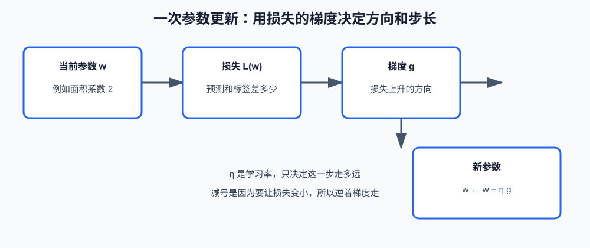
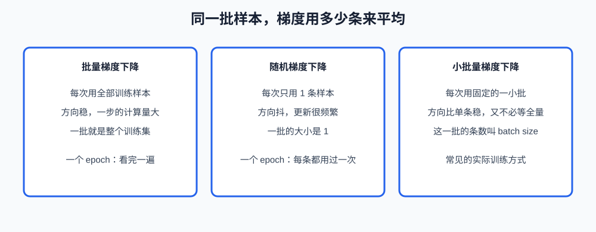

# 第二课：损失与梯度下降

第 1 课把预测写成 $\hat{y} = f(x; w)$：参数 $w$ 在训练时调整，预测时不再改。本课回答"往哪边改、改多大"。判断的依据是**损失（loss）**；改参数的方法是**梯度下降（gradient descent）**。

本课用一个只有"面积"的房价模型把计算走完：预测价等于面积乘以一个系数。多个特征、正规方程、逻辑回归都不在这里。线性回归的完整形式是第 3 课。

**学习目标：**

1. 能说明损失函数在比较什么，以及为什么训练时优化的是全部训练样本的平均损失；
2. 能写出均方误差，并说明 0-1 损失为什么不能直接拿来做梯度下降；
3. 能用"梯度是损失上升的方向"解释 $w \leftarrow w - \eta g$，并说明学习率过大或过小会怎样；
4. 能区分批量、随机、小批量梯度下降，以及 epoch 和 batch 各数的是什么；能说明特征尺度不同时，同一步学习率为什么不合适。

## 1. 损失是"差多少"的一个数

一条样本上，模型给出 $\hat{y}$，标签是 $y$。损失把这一对变成一个数：越小表示越接近。它不负责更新参数，只负责打分。更新参数是后面梯度下降的事。

房价例子里，面积 $x = 80$ 平方米，当前系数 $w = 2$，预测 $\hat{y} = 160$ 万，真实成交价 $y = 200$ 万。两者相差 40 万。损失要把"差 40"变成一个可比较的数，并且当预测改成 190 时，这个数应该变小。

单个样本的损失写成 $L(y, \hat{y})$。训练集上有很多条，训练时看的是它们的平均，叫**经验风险（empirical risk）**：

$$
J(w) = \frac{1}{n}\sum_{i=1}^{n} L(y_i, f(x_i; w))
$$

除以 $n$ 是为了让样本条数变化时，损失的数值仍表示"平均每条差多少"，而不是"条数越多、总和越大"。梯度下降最小化的是 $J(w)$，不是某一条碰巧很大的损失。一条特别难的样本会拉高平均，但不会单独决定参数。

损失和评价指标不是同一个东西。损失必须能随着参数连续变化，后面才好算梯度。业务上最后汇报的准确率、成交率，可以和损失不一致。

## 2. 均方误差

回归里最常用的损失是**均方误差（mean squared error，MSE）**。单个样本是差的平方，整个训练集再取平均：

$$
L(y, \hat{y}) = (y - \hat{y})^2, \qquad J(w) = \frac{1}{n}\sum_{i=1}^{n}(y_i - \hat{y}_i)^2
$$

平方有两个直接后果。差 40 的损失是 1600，差 10 的损失是 100，大的偏差被放得更大，参数会优先去减那些偏差大的样本。差是正是负都变成正数，预测高了 40 和低了 40，损失一样大；方向信息留在后面的梯度里，不留在损失的正负号里。

上面的数字：$(200 - 160)^2 = 1600$。如果把系数从 2 改成 2.5，预测变成 200，这一条的损失变成 0。均方误差能反映这次改动是变好了。

有时人们把前面乘上 $\frac{1}{2}$，写成 $\frac{1}{2}(y-\hat{y})^2$。求导时平方的 2 会被约掉，公式更好看。它不改变最小值出现的位置，只改变损失和梯度的倍数。本课的代码用没有 $\frac{1}{2}$ 的形式，避免和"看印刷习惯"混在一起。 

绝对误差 $|y-\hat{y}|$ 也衡量差多少，而且不会把大偏差放得那么重。它在 0 这一点不可导，梯度下降要单独处理。本课不把它当作主要算法，只作为对照：损失的形状会改变"更在意哪一种错"。

## 3. 0-1 损失为什么不能当梯度的来源

分类可以定义一个很直观的损失：**0-1 损失**。预测类别和标签相同，损失是 0；不同，损失是 1。平均之后就是错误率。

它不适合直接做梯度下降。参数轻微变动时，预测类别常常不变，损失是平的，斜率是 0，参数不知道往哪边挪。一旦变动大到让类别翻转，损失从 0 跳到 1，中间没有"稍微更对一点"的坡度。

梯度下降需要的是一条有坡度的曲线：参数移动一点，损失也跟着连续变化一点。分类训练里实际使用的对数损失、交叉熵，就是用来代替 0-1 损失的光滑函数。它们和 sigmoid、逻辑回归连在一起，是第 4 课的内容。本课只要记住替换的原因：不是 0-1 损失"不算对错"，而是它的坡度几乎处处为 0，给不了更新方向。

## 4. 梯度是损失上升的方向

只有一个参数时，**梯度（gradient）**就是损失对这个参数的导数。导数为正，说明把 $w$ 增大一点，损失会上升；导数为负，说明把 $w$ 增大一点，损失会下降。多个参数时，梯度是每个参数对应的偏导数排成的向量，含义相同：它指向损失上升最快的方向。

本课的模型是 $\hat{y} = wx$，均方误差对 $w$ 的导数可以写成一条样本上的：

$$
g = \frac{\partial L}{\partial w} = -2(y - \hat{y})\, x
$$

$y - \hat{y}$ 是"还差多少"，$x$ 是这条样本的特征。预测偏低时，$y - \hat{y}$ 为正，前面的负号使梯度为负（$x$ 是正的面积），这表示增大 $w$ 才能让预测变高、损失变小。预测偏高时梯度为正，应该减小 $w$。

用前面的数：$y - \hat{y} = 40$，$x = 80$，梯度 $g = -2 \times 40 \times 80 = -6400$。负号说明下一步应该把系数加大。

参数不止一个时，每个参数有自己的梯度分量。面积的系数看面积这一列，房龄的系数看房龄这一列。第 3 课再写成向量。本课的规则已经够用：每个参数都沿着自己的梯度分量往损失下降的方向走。

## 5. 梯度下降与学习率

知道上升方向之后，下降就是减去梯度：

$$
w \leftarrow w - \eta g
$$

$\eta$ 是**学习率（learning rate）**，一个在训练前选定的正数，属于第 1 课说过的超参数。梯度决定方向和学习的陡缓，学习率决定这一步乘上多大的倍数。



继续用 $w = 2$、$g = -6400$。学习率如果取 $0.0001$，更新量是 $-0.0001 \times (-6400) = 0.64$，新系数是 $2.64$。预测从 160 变成 $2.64 \times 80 = 211.2$，比原来更接近 200，但一步走过了头。学习率再大，例如 $0.001$，一步就会把系数加上 6.4，预测变得更远，下一步梯度往往反向，数值来回跳，这就是学习率过大。

学习率过小则相反。取 $10^{-8}$ 时，这一步只给系数加上 $0.000064$，预测几乎还是 160。方向是对的，但同样的数据要走非常多步才看得出损失下降。

所以"损失不下降"不一定是梯度公式错了。学习率过大时，损失会抖动甚至变大；过小时，损失下降慢到像停住。合适的大小和梯度的数值有关，而梯度的数值又和特征的尺度有关，这是第 7 节的问题。

一个参数的损失如果只有一个最低点，沿着梯度往下走会靠近它。损失如果有很多个谷，梯度下降只能走到当前这个谷，不保证是所有谷里最低的。本课的均方误差配合 $\hat{y}=wx$ 只有一个谷；更复杂的模型不一定如此。看到"训练停了但损失还很高"，除了学习率，还可能是停在了不好的谷里。

## 6. 批量、随机和小批量

上面的 $g$ 如果只来自一条样本，这一步就被这一条房子主导。如果来自全部训练样本，就要先把每条的梯度加起来再平均。三种做法的差别只在"这一步的梯度用了多少条样本"。



**批量梯度下降**（batch gradient descent）每次用整个训练集计算平均梯度，再更新一次参数。方向稳，因为没有"这一步只看到一套便宜的小房子"这种偶然。代价是样本很多时，走一步之前要算完所有样本。

**随机梯度下降**（stochastic gradient descent，SGD）每次只抽一条样本，用它的梯度立刻更新。方向抖动，一条异常样本会把参数拽偏一下；抖动有时也能帮参数离开一个差的谷。计算上不用等全量算完才动一次。

**小批量梯度下降**（mini-batch gradient descent）每次用一组固定条数的样本，例如 32 条，求这组的平均梯度再更新。它介于两者之间：比单条稳，又不必每次扫过整个训练集。实际训练几乎都用这种。这一组的条数叫 batch size（批大小）。

epoch（轮）是另一个计数：所有训练样本都被用过一遍，叫一个 epoch。batch 是一步更新用的条数，epoch 是整张表被覆盖的次数。1000 条样本、batch size 为 100，一个 epoch 里大约更新 10 次，不是更新 1 次，也不是更新 1000 次。

样本的使用顺序一般要打乱后再切成批。如果表是按小区排的，前几批全是同一个小区，梯度会在这一小段时间里只反映那个小区。打乱的是"每一批里有谁"，不是把验证集混回训练集。第 1 课的三份数据仍然分开。

## 7. 特征尺度把梯度放大

梯度里带着特征本身。单参数公式 $g = -2(y-\hat{y})x$ 里，面积如果写成 80（平方米），梯度里就有一个 80；如果有人把同一列写成 800000（平方厘米），梯度和参数的更新量会跟着放大，即使用的是同一个学习率。

两个特征放在一起时更明显。面积的数值是几十到一百，房龄的数值是几到二十。同样的预测误差，面积系数的梯度分量往往比房龄系数大一个数量级。一个学习率要同时服务这两个分量：对面积可能已经一步迈太大，对房龄还几乎不动。

处理办法是在训练前把各列缩放到接近的数值范围，让梯度分量不要仅仅因为"单位不同"而差出很多倍。缩放的具体做法（标准化等）放在第 13 课。本课的结论是：学习率调不好，有时不是 $\eta$ 这一个数的问题，而是特征没放在可比较的尺度上。

## 8. 用代码看一步更新

课程代码在 `code/machine-learning/ml_lesson02.py`。模型固定为 $\hat{y} = wx$，损失是不带 $\frac{1}{2}$ 的平方误差。程序先打印一条样本的损失和梯度，再分别用三个学习率走若干步，最后用全部样本做小批量更新。

单条梯度的函数是：

```python
def squared_error_gradient(x: float, y: float, weight: float) -> float:
    """返回 (y - w*x)^2 对 weight 的导数。"""
```

`x`、`y`、`weight` 都是 `float`。返回值是 $g = -2(y-\hat{y})x$，其中 $\hat{y} = wx$。它不修改任何参数，只计算这一条样本、这一个权重下的导数。

多步更新的函数是：

```python
def train_full_batch(
    rows: list[tuple[float, float]],
    weight: float,
    learning_rate: float,
    steps: int,
) -> list[float]:
    """用全部样本的平均梯度更新 weight，返回每一步之后的损失。"""
```

`rows` 的每条是 `(面积, 成交价)`。`learning_rate` 必须为正，`steps` 必须为正整数。返回长度为 `steps` 的损失列表，每个数是更新之后、在全部 `rows` 上的平均平方误差。函数不改输入列表；权重只在函数内部变化，通过损失的变化看出来。

```bash
cd /Users/yyma/workspace/agents/lifestyle-manager-study
conda run -n agent_dev python code/machine-learning/ml_lesson02.py
```

面积 80、成交价 200、系数 2 时，损失应为 1600，梯度应为 -6400。三个学习率里，过小的那个损失几乎不动，过大的那个损失会上升或来回跳，居中的那个损失应逐步下降。

## 9. 课后作业

作业在 `code/machine-learning/ml_lesson02.py` 的 `# ===== 课后作业 =====` 之后。示例只用面积；作业改成两个特征，并手写按 batch size 切分。

作业要求：

1. 实现 `row_gradients`：一条样本是 `(面积, 房龄, 成交价)`，预测是 $\hat{y} = w_1 x_1 + w_2 x_2$，没有常数项。返回两个偏导数组成的元组，分别对应 $w_1$ 和 $w_2$。公式与单特征相同，只是各自乘上自己的特征：$\partial L/\partial w_j = -2(y-\hat{y}) x_j$。
2. 实现 `mini_batch_epoch`：输入样本列表、两个权重、学习率和 batch size。按列表当前顺序切成连续的批（最后一批可以不足 batch size），每批用平均梯度更新一次两个权重。一个 epoch 结束后返回新的 `(w_1, w_2)`。不要在这个函数里打乱顺序，打乱留给调用方，便于你检查切分。
3. `batch_size` 小于 1，或学习率小于等于 0 时，抛出 `ValueError`。
4. 取消 `homework()` 的注释后运行。用课程文件里准备的 4 条样本、`batch_size=2`，你应能说明一个 epoch 里更新了 2 次，而不是 4 次或 1 次。

## 10. 验收问题

1. 训练时最小化的是某一条样本的损失，还是训练集上的平均损失？除以 $n$ 改变了什么？
2. 0-1 损失已经直接表示"猜错没有"，为什么梯度下降还要换一个损失？
3. 梯度是负的时候，参数应该增大还是减小？学习率在这个更新里乘在哪里？
4. 1000 条样本、batch size 为 50，一个 epoch 大约更新几次？随机梯度下降的 batch size 是多少？
5. 面积用平方米、另一列用"元"做单位，同一个学习率可能出什么问题？

## 11. 面试高频考点

- 损失函数和评价指标的分工：损失用来产生可下降的坡度，指标用来报告任务做得怎么样。
- 均方误差对大偏差更敏感；0-1 损失不可直接求有效梯度，所以分类要换成光滑损失。
- 梯度下降的更新式 $w \leftarrow w - \eta g$：减号的含义，学习率过大、过小分别是什么现象。
- batch、mini-batch、SGD 和 epoch 的差别：一步用多少条样本，一遍数据更新多少次。
- 特征尺度会乘进梯度；学习率不稳定时，先看各列数值是不是差了几个数量级。
