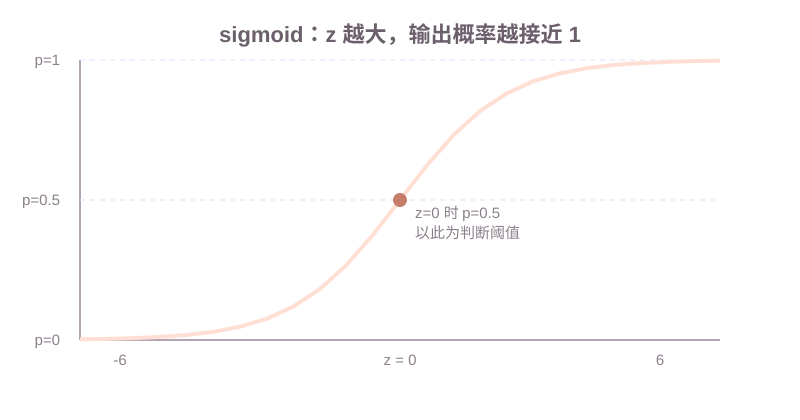

# 第四课：逻辑回归

第 3 课的线性回归输出连续数值，回答"成交价是多少"。本课换到分类：标签是有限个类别，模型输出每个类别的概率。预测"这套房子是否会高价成交"，标签只有 0 和 1，模型要输出"高价成交的概率"。这个概率从哪里来、用哪个损失、参数怎么更新，是本课的三条主线。

本课只讲二分类，用一个 sigmoid 把线性组合变成概率；决策边界仍然是线性的；交叉熵和最大似然是一件事；最后把二分类推广到多分类的 softmax，并对照判别模型和生成模型。正则项、多分类的各种实现细节不在本课展开。正则留到第 5 课；生成模型在第 7 课用朴素贝叶斯对照。

**学习目标：**

1. 能写出 sigmoid 和 log-odds 的关系，并说明为什么逻辑回归的决策边界仍然是直线；
2. 能写出二分类交叉熵，并解释"最小化交叉熵 = 最大化似然"；
3. 能写出逻辑回归的梯度 $(p-y)x$，并说出 $p-y$ 的符号在告诉参数往哪个方向改；
4. 能用 softmax 输出多类概率，并说明它和"多个二分类"的差别；
5. 能说明逻辑回归是判别模型，直接建模 $P(y|x)$。

## 1. 二分类模型输出的是概率

分类的标签是 0 或 1，不能把线性回归的输出直接拿过来用：线性回归的输出没有上下界，可能是 -30 或 400，而概率必须在 0 和 1 之间。逻辑回归的做法是：先按线性回归那样算一个分数，再把分数压缩到 $(0,1)$ 区间，让输出可以当概率读。

用本课的房价例子：特征 $x=(面积, 房龄)$，标签 $y=1$ 表示"成交价超过 300 万"。模型算一个分数 $z$，再把它变成概率 $p$。接下来的问题是：用什么函数压缩，压缩之后决策边界还是不是直线，用什么损失训练。

## 2. sigmoid：把线性组合压到 0 和 1 之间

压缩函数叫 **sigmoid**，记作 $\sigma$：

$$
\sigma(z) = \frac{1}{1 + e^{-z}}
$$

$z$ 越大，$e^{-z}$ 越小，$\sigma(z)$ 越接近 1；$z$ 越小，$e^{-z}$ 越大，$\sigma(z)$ 越接近 0。$z=0$ 时 $\sigma(0) = \frac{1}{1+1} = 0.5$。几个数值：

| $z$ | $e^{-z}$ | $\sigma(z)$ |
| --- | --- | --- |
| -6 | 403.43 | 0.0025 |
| -3 | 20.09 | 0.0474 |
| 0 | 1 | 0.5 |
| 3 | 0.0498 | 0.9526 |
| 6 | 0.0025 | 0.9975 |



逻辑回归的完整预测式：$z = w_1 x_1 + w_2 x_2 + b$，$p = \sigma(z)$。预测 $p$ 是"属于正类（$y=1$）的概率"，$1-p$ 是"属于负类（$y=0$）的概率"。

**几率（odds）**是同一件事的另一种写法：$odds = \frac{p}{1-p}$，表示"正类概率是负类概率的几倍"。把 $p=\sigma(z)$ 代进去：

$$
\log\frac{p}{1-p} = z = w_1 x_1 + w_2 x_2 + b
$$

左边叫 **log-odds（对数几率）**。这个式子说明逻辑回归其实是在用线性组合去拟合 log-odds：log-odds 每增加一个单位，$z$ 增加一个单位。sigmoid 只是把这条"log-odds 直线"折叠回概率区间。这也是"逻辑回归名字里带回归"的原因：它在对 log-odds 做回归。

## 3. 决策边界：p=0.5 处仍然是一条直线

拿 $p$ 做判断时需要一个阈值：$p \ge 0.5$ 判为正类，$p < 0.5$ 判为负类。因为 $\sigma$ 单调递增，$p \ge 0.5$ 等价于 $z \ge 0$。于是分界线是：

$$
w_1 x_1 + w_2 x_2 + b = 0
$$

解出 $x_2$：$x_2 = -\frac{w_1 x_1 + b}{w_2}$。这是 $x_1$ 的线性函数，所以**决策边界是一条直线**。sigmoid 把输出压成了曲线，但没改变"分数为 0 的地方"是直线的性质。

例：$w_1 = 0.4$、$w_2 = -1.5$、$b = -6$ 时，边界是 $x_2 = \frac{0.4 x_1 - 6}{1.5}$。面积 $60$ 时 $x_2 = 12$：房龄小于 12 的房子 $z>0$，判高价；房龄大于 12 判低价。面积 80 时边界抬到 $x_2 = 17.33$，因为面积大本身就把分数抬高，需要更老的房龄才把它压回负类。

特征之间的关系也只能是直线：如果"又大又新才高价、又大又旧反而低价"，一条直线分不开，那是第 3 课说过的 $f$ 形式不够，不是阈值选错。

## 4. 交叉熵：分类的光滑损失，也是负对数似然

0-1 损失（第 2 课）没有坡度，不能给梯度。均方误差也可以用在分类上，但它有两个问题：$y-\hat{y}$ 里混着标签的数值，且 $p$ 饱和时梯度趋近 0，更新很慢。分类训练用的是**交叉熵（cross-entropy）**。单样本二分类：

$$
L(y, p) = -\big[\, y\log p + (1-y)\log(1-p) \,\big]
$$

拆开看：$y=1$ 时只剩 $-\log p$，$p$ 越接近 1 损失越小；$y=0$ 时只剩 $-\log(1-p)$，$p$ 越接近 0 损失越小。

| $y$ | $p$ | 损失 |
| --- | --- | --- |
| 1 | 0.9 | $-\log 0.9 = 0.105$ |
| 1 | 0.5 | $-\log 0.5 = 0.693$ |
| 1 | 0.1 | $-\log 0.1 = 2.303$ |

预测和标签一致时损失小，预测错得越离谱损失越大，而且从 $0.5$ 到 $0.1$ 的损失差比 $0.9$ 到 $0.5$ 大——错得越离谱惩罚越重。

**和最大似然的关系**：训练集上的似然是"模型给每条样本真实标签的概率"的乘积：

$$
\mathcal{L} = \prod_{i=1}^{n} p_i^{y_i}(1-p_i)^{1-y_i}
$$

取负对数，乘积变求和，得到的就是所有样本交叉熵之和（除以 $n$ 是平均）。所以**最小化交叉熵 = 最大化似然**：同一个目标，一个从损失角度说，一个从概率角度说。面试问到"逻辑回归为什么用交叉熵"，一条线答到底：0-1 损失没有坡度 → 需要光滑替代 → 交叉熵光滑且凸 → 它又恰好等于负对数似然，概率上有解释。

## 5. 梯度：预测和标签的差，乘上特征

有了损失，套用第 2 课的梯度下降。关键结果是逻辑回归的梯度长得很整齐。对 $z$ 求导，利用 sigmoid 的导数性质 $\sigma'(z) = \sigma(z)(1-\sigma(z))$，得到：

$$
\frac{\partial L}{\partial z} = p - y
$$

这个式子值得拆开看一次推导，面试常问。设 $L = -y\log p - (1-y)\log(1-p)$，$p = \sigma(z)$：

$$
\frac{\partial L}{\partial z}
= -y\frac{1}{p}\sigma' - (1-y)\frac{1}{1-p}(-\sigma')
= -y\frac{\sigma'}{p} + (1-y)\frac{\sigma'}{1-p}
$$

代入 $\sigma' = p(1-p)$，前一项 $-y(1-p)$，后一项 $(1-y)p$，相加就是 $p-y$。

再按链式法则乘上各自的偏导：

$$
\frac{\partial L}{\partial w_j} = (p - y)\, x_j, \qquad \frac{\partial L}{\partial b} = (p - y)
$$

**$p - y$ 是"预测概率和标签的差"**，符号决定方向。$y=1$ 而 $p=0.7$ 时，$p-y = -0.3$，损失对 $z$ 的导数为负，说明增大 $z$ 会降低损失——预测偏低，参数把 $z$ 往抬高的方向推，$p$ 升高。$y=0$ 而 $p=0.7$ 时，$p-y = +0.3$，预测偏高，参数把 $z$ 压低。**$p-y$ 为负表示正类概率给低了，为正表示给高了，更新方向总是让 $p$ 向 $y$ 靠拢。**

整批样本上，第 2 课的平均梯度照用：每个参数的更新量是所有样本 $(p_i - y_i)x_{ij}$ 的平均，再乘学习率。逻辑回归用交叉熵时，训练目标对参数是凸的，梯度下降能找到全局最优；改用均方误差时这个凸性会丢，这也是选交叉熵的又一原因。

## 6. softmax：多分类的 sigmoid

房价要分成"低价 / 中价 / 高价"三档时，一个 0~1 的 sigmoid 不够。**softmax** 把 $K$ 个分数变成 $K$ 个概率，和为 1：

$$
p_k = \frac{e^{z_k}}{\sum_{j=1}^{K} e^{z_j}}
$$

例：三个分数 $z = (1, 2, 3)$。$e^1=2.72$、$e^2=7.39$、$e^3=20.09$，分母 $30.2$，概率 $(0.09, 0.24, 0.67)$。分数最高的类拿到最大的概率，而且归一化到总和 1。

**为什么不用三个二分类**：如果对每一档都单独训练一个"是不是这一类"的二分类，三个模型的输出互不相干，可能同时给"中价"和"高价"都打出 0.8，概率之和不等于 1，没法直接比较。softmax 输出的是一个在所有类别上的概率分布，类间互斥、和为 1。二分类的 sigmoid 可以看成 softmax 在 $K=2$ 时的特例。

多分类的交叉熵只惩罚真实类：

$$
L = -\log p_c
$$

其中 $c$ 是这条样本的真实类别。梯度也保持同样的整齐形式：把 $y$ 写成 one-hot 向量，$\partial L/\partial z_k = p_k - y_k$。训练方式和二分类相同，只是 $w$ 从一组系数变成 $K$ 组（每个类一组）。

## 7. 判别模型：直接建模 P(y|x)

机器学习把"从特征到类别"建模成两类思路。**判别模型（discriminative model）**直接建模条件概率 $P(y|x)$：给一条特征，直接说"这个类别的概率"。逻辑回归就是判别模型，$p=\sigma(z)$ 直接是 $P(y=1|x)$ 的估计。**生成模型（generative model）**反过来先建模 $P(x|y)$ 和 $P(y)$，再通过贝叶斯公式合成 $P(y|x)$。朴素贝叶斯是生成模型，第 7 课对照。

这个定位决定逻辑回归在后面的课程里是**基线**：树模型（第 8 课起）不假设决策边界形状，能切出非线性的分界；逻辑回归则给出一个可解释、有概率输出、训练快速的对照。业务上线一个新任务，通常先跑逻辑回归建立基线，再换更复杂的模型，看收益是否值得。

## 8. 用代码训练逻辑回归

课程代码在 `code/machine-learning/ml_lesson04.py`。示例做房价二分类：标签是"成交价是否超过 300 万"，特征是面积和房龄。训练用全批量梯度下降，打印每一步的交叉熵损失。

示例函数：

```python
def sigmoid(z: float) -> float:
    """把分数压缩到 (0, 1)。"""

def cross_entropy(y: int, p: float) -> float:
    """单样本二分类交叉熵 -[y log p + (1-y) log(1-p)]。"""

def gradient_step(
    rows: list[tuple[float, float, int]],
    weights: tuple[float, float],
    bias: float,
    learning_rate: float,
) -> tuple[tuple[float, float], float]:
    """用全部样本的平均梯度更新 (w1, w2) 和 b，返回新参数。"""
```

`rows` 的每条是 `(面积, 房龄, 是否高价)`。`gradient_step` 对每条样本先算 $p=\sigma(z)$，再按第 5 节公式累加 $(p-y)x_1$、$(p-y)x_2$、$(p-y)$，取平均后执行更新。初始权重全 0 时每条样本 $p=0.5$，初始损失是 $-\log 0.5 = 0.693$。示例用学习率 $0.002$，跑 1000 步：梯度里乘着面积（数值 50 到 85），学习率定成 $0.05$ 那样会在前几步就把损失顶高，这是第 2 课说过的特征尺度问题。

```bash
cd /Users/yyma/workspace/agents/lifestyle-manager-study
conda run -n agent_dev python code/machine-learning/ml_lesson04.py
```

运行后应看到：初始损失 $0.693$ 附近；随后每 200 步损失持续下降，1000 步时降到 $0.12$ 左右；最后打印的决策边界是一条直线（$x_2$ 关于 $x_1$ 的线性式）。面积大、房龄小的样本标签为 1，训练后边界应大致把这些样本与另一组分开。

## 9. 课后作业

作业在 `code/machine-learning/ml_lesson04.py` 的 `# ===== 课后作业 =====` 之后。示例是二分类 sigmoid；作业改成三分类 softmax，并对比"多个二分类"与 softmax 的输出。

作业要求：

1. 实现 `softmax(scores)`：输入形状 `(样本数, 3)` 的分数，返回同样形状的概率，每行和为 1。
2. 实现 `softmax_cross_entropy(rows, weights)`：输入 `(面积, 房龄, 类别)` 样本和三组权重，返回所有样本的平均损失 $-\log p_c$。`weights` 形状 `(3, 3)`，行对应特征（最后一列是常数项，对应 $b$），列对应三个类别。
3. 实现 `softmax_gradient_step`：用平均梯度 $\partial L/\partial z_k = p_k - y_k$ 更新三组权重。把真实类别写成 one-hot 与预测概率相减，再乘上设计矩阵的转置。
4. 取消 `homework()` 的注释后运行：应看到初始平均损失接近 $1.0986 = -\log(1/3)$（三类等概率时损失最大），2000 步后明显下降；softmax 每行的三个概率由定义保证和为 1。对照思考：若用三个独立二分类，三列各自打分、互不归一化，三数之和通常不等于 1。
5. 思考题（不写代码）：为什么逻辑回归的决策边界是直线，而第 8 课的树能切出任意形状的分界？哪一条是本课第 7 节已经答过的。

## 10. 验收问题

1. 为什么线性回归的输出不能直接当分类概率？sigmoid 改变了什么、没改变什么？
2. 逻辑回归的决策边界在哪个条件下是直线？写出边界的方程。
3. 写出二分类交叉熵；$y=1$、$p=0.1$ 和 $p=0.9$ 的损失各是多少？
4. "最小化交叉熵 = 最大化似然"怎么从乘积变成求和？
5. 写出逻辑回归对 $w_j$ 的梯度；$y=1$、$p=0.7$ 时参数往哪个方向更新？
6. 多分类为什么用 softmax 而不是三个二分类？softmax 输出有什么性质？

## 11. 面试高频考点

- 逻辑回归的预测式：$z=w\cdot x+b$，$p=\sigma(z)$；$p$ 表示正类概率。
- log-odds 与线性组合的关系：$\log\frac{p}{1-p}=z$，名字里"回归"的来历。
- 决策边界为什么是直线：$p=0.5 \Leftrightarrow z=0$，而 $z=0$ 是线性方程。
- 交叉熵：$y=1$ 时 $-\log p$，$y=0$ 时 $-\log(1-p)$；为什么不用 0-1 损失和均方误差。
- 交叉熵与最大似然：负对数似然，最小化交叉熵即最大化似然。
- 梯度 $(p-y)x$：$p-y$ 的符号表示概率给高还是给低，参数沿反方向更新。
- softmax 与多个二分类：一个概率分布、和为 1、类间互斥 vs 各自独立的二分类。
- 判别模型 vs 生成模型：逻辑回归直接建模 $P(y|x)$，朴素贝叶斯建模 $P(x|y)$ 再合成。
- 逻辑回归为什么是树模型的对照基线：可解释、概率输出、训练快，树模型能表达非线性边界。
