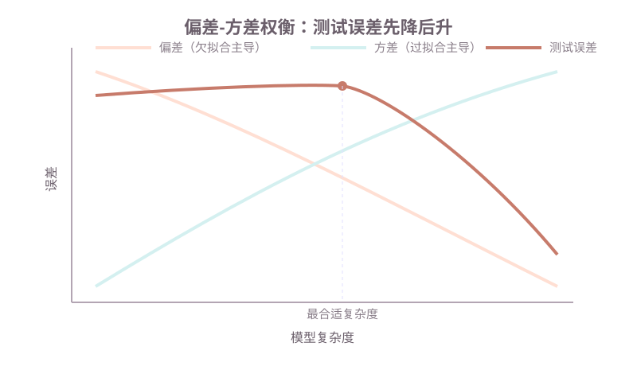

# 第五课：泛化、正则与模型选择

第 3、4 课解决了"给定模型形式，怎么把参数调出来"。本课回答另一个问题：**模型在训练数据上表现好，不等于在新数据上表现好。** 一个模型该多复杂、该用哪些特征、该不该加正则，取决于泛化，而不是训练误差。

本课先区分过拟合和欠拟合的现象，再用偏差和方差解释"复杂度和误差"的关系；正则（L1、L2）是主动限制复杂度的手段，验证集和 K 折交叉验证是评估复杂度的手段；最后给一张"结果差时先查哪一层"的判断表。本课不推导偏差-方差的数学分解，只用它解释现象。

**学习目标：**

1. 能根据训练误差和验证误差的高低，判断是过拟合还是欠拟合；
2. 能用偏差和方差解释"模型越复杂训练误差越低，但测试误差会回升"；
3. 能写出加正则后的目标函数，并说明 L1 产生稀疏、L2 收缩权重的原因；
4. 能说明验证集和 K 折交叉验证各自防止什么错误；
5. 能用"训练误差高 / 验证误差高"两类现象，决定该加数据、加特征、加正则还是换模型。

## 1. 过拟合与欠拟合：现象和原因

先定义两个词。**过拟合（overfitting）**是模型记住了训练数据的细节，包括噪声，导致训练误差很低、新数据误差高。**欠拟合（underfitting）**是模型太简单，训练误差本身就不低，新数据上同样高。

用本课的回归例子：真实关系是"$y = 3x^2 + 2x + 1$，再加一点噪声"，只有 $x$ 一个输入。三个候选模型在同一份训练数据上：

```text
线性（x 一次）     训练误差高，测试误差高        -> 欠拟合：表达不了弯曲
二次（x 二次）     训练误差低，测试误差低        -> 合适
十五次（x 到 15 次） 训练误差几乎 0，测试误差高    -> 过拟合：把噪声也拟合了
```

过拟合的原因不是"参数多"本身，而是**样本量不足以约束这么多参数**。15 条训练样本配 16 个参数（15 个幂次 + 常数），参数比样本还多，模型可以精确穿过每一条训练点。参数再多，若样本充足，也不会必然过拟合。

判断过拟合和欠拟合，不能只看训练误差——两个都是"训练误差低或高"的混淆项。要看**训练误差和验证误差的差**：训练低、验证高是过拟合；两者都高是欠拟合；都低才是合适的复杂度。第 1 课的验证集在这里派上用场。

## 2. 偏差和方差：复杂度如何影响误差

过拟合和欠拟合背后是**偏差（bias）**和**方差（variance）**的权衡。两个词说的都是"如果用不同批次的训练数据重复训练，会发生什么"。

- **偏差**是模型形式的系统性误差：真实关系是弯曲的，线性模型在哪个数据集上都学不出弯曲，这类误差稳定存在。
- **方差**是模型对训练数据变化的敏感度：十五次多项式换一批样本，拟合出的曲线完全不同；线性模型换一批样本，结果几乎一样。

用数学分解一句话说：新数据上的误差 ≈ 偏差² + 方差 + 不可避免的噪声。偏差大说明模型表达力不够，方差大说明模型太依赖特定样本。两者此消彼长：

```text
模型复杂度   偏差    方差    测试误差
  低      高      低      高（欠拟合主导）
  中      中      中      最低
  高      低      高      高（过拟合主导）
```



这张图解释了第 1 节表里的现象：十五次多项式的训练误差接近 0，是因为它在训练集上的偏差和方差都"看起来很完美"，但换到新数据，方差高得让误差回升。

## 3. 正则：在损失里给大权重加惩罚

欠拟合靠加特征、加复杂度解决；过拟合靠限制复杂度解决。限制复杂度的一种手段是**正则（regularization）**：在训练目标里加一项惩罚，让"参数过大"本身有代价。

线性回归原来的目标是均方误差，加正则后变成：

$$
J(w) = \frac{1}{n}\sum_{i=1}^{n}(y_i - \hat{y}_i)^2 + \lambda\, R(w)
$$

$\lambda$（读作 lambda）是**正则强度**，在训练前选定，属于第 1 课说的超参数。$\lambda = 0$ 就是原来的目标；$\lambda$ 越大，权重越被压小。$R(w)$ 有两种常见写法。

**L2 正则（岭回归，ridge regression）**：$R(w) = \sum_j w_j^2$，对所有权重的平方求和。它的效果是**权重收缩**：每个系数都往 0 缩小一点，但通常不正好变成 0。所有特征都保留，只是贡献变小。公式里的 $\frac{1}{n}$ 和平方让大权重受的惩罚远大于小权重——一个 10 的系数惩罚是 100，一个 1 的系数惩罚是 1。

**L1 正则（套索回归，lasso regression）**：$R(w) = \sum_j |w_j|$，对权重的绝对值求和。它的效果是**稀疏**：一部分系数被压到正好 0。直觉解释：L1 在 0 点有个"尖角"，把系数推向 0 附近时，停在 0 比停在 0.1 更划算——惩罚按绝对值算，0.1 和 0 只差 0.1，但 0 直接把整个特征删掉了。L2 在 0 点附近是平滑的，系数停在 0.1 的惩罚 0.01 很小，没有这种推力。

| | L2 正则（Ridge） | L1 正则（Lasso） |
| --- | --- | --- |
| 惩罚项 | $\sum w_j^2$ | $\sum \lvert w_j \rvert$ |
| 效果 | 权重收缩，特征全保留 | 一部分系数变 0，特征被删掉 |
| 适用 | 特征都不算多，想控制系数大小 | 特征很多，想筛掉无关特征 |

正则改变了最小化目标，所以第 3 课"正规方程求最小值"和第 4 课"梯度下降"都要在含惩罚的目标上重新做——sklearn 的 `Ridge`、`Lasso` 已经封装好了，本课直接用现成库做对照（第 6 节）。

## 4. 验证集和 K 折交叉验证

正则强度 $\lambda$、多项式次数这类超参数，不能拿训练误差选。原因是第 1 课说过的：训练误差永远偏爱更复杂的模型——$\lambda=0$ 的十五次多项式在训练集上误差最小，但它过拟合。也不能拿测试集选：选 $\lambda$ 的过程中反复看测试集，测试集就变成了"另一个验证集"。

**验证集**专门用来比较超参数：在训练集上拟合不同的 $\lambda$，在验证集上比较误差，选验证误差最低的那个。选完之后测试集只看一次。第 1 课的三份划分在这里用上了。

**K 折交叉验证（K-fold cross-validation）**是验证集的一个变体，用于数据不多时把利用率提高：把训练集分成 K 份，轮流拿 1 份当验证、其余 K-1 份当训练，得到 K 个验证误差后取平均。数据充足时用一次划分的验证集就够；数据少时，一次划分的验证集可能只有几十条样本，误差波动大，K 折的平均更稳。K 折仍是"在训练数据内部选超参数"，测试集从头到尾不碰。

## 5. 该加数据、加特征、加正则还是换模型

训练过程结束后，结果差有两种入口现象，处理方向不同：

| 现象 | 原因 | 先做什么 |
| --- | --- | --- |
| 训练误差高 | 欠拟合：模型表达力或特征不够 | 加特征、加深模型；加数据没用——连训练都学不好，更多数据只是更多同样的错误 |
| 训练误差低、验证误差高 | 过拟合：模型记住了训练数据 | 加正则、简化模型、加数据（此时加数据有效，约束噪声）；换更简单的模型 |

"加数据"在两个方向上的效果相反：欠拟合时加数据几乎没用，过拟合时加数据是正解。原因是偏差和方差的差别：欠拟合的误差是偏差（系统性），更多数据改变不了模型形式；过拟合的误差是方差（对样本敏感），更多样本让"某批样本的偶然性"被平均掉。

还有一个常被忽略的检查：先确认数据本身没泄漏。第 1 课提过特征泄漏的判断标准；第 14 课专门展开。结果差时先查数据，再查模型，顺序别反。

## 6. 用代码做对照

课程代码在 `code/machine-learning/ml_lesson05.py`，本课开始引入 sklearn。sklearn（scikit-learn）不是标准库，先安装：

```bash
conda run -n agent_dev pip install scikit-learn
```

它封装了本课需要的三个回归器：`LinearRegression`（普通线性回归）、`Ridge`（L2 正则）、`Lasso`（L1 正则）。三者用法一致，都是"构造对象 → `fit(X, y)` 学参数 → `predict(X)` 预测"。

```python
from sklearn.linear_model import LinearRegression, Ridge, Lasso

model = LinearRegression()   # 普通线性回归
model.fit(X_train, y_train)  # X_train 形状 (样本数, 特征数)，y_train 形状 (样本数,)
y_pred = model.predict(X_test)
```

三个回归器共享的成员：`fit` 之后 `coef_` 是特征系数（形状 `(特征数,)`），`intercept_` 是常数项（标量）。`Ridge` 和 `Lasso` 的构造器都有一个 `alpha` 参数，就是第 3 节的 $\lambda$，默认 1.0。

示例用第 1 节的三组特征跑一遍：线性、二次、十五次。特征列用手工构造：二次是 `[x, x², 1]`，十五次是 `[x, x², ..., x¹⁵, 1]`（造新特征的做法第 3 课说过）。真实数据由"$y = 3x^2 + 2x + 1$ + 噪声"生成，训练集和测试集独立采样，保证同分布。

```bash
cd /Users/yyma/workspace/agents/lifestyle-manager-study
conda run -n agent_dev python code/machine-learning/ml_lesson05.py
```

运行后应看到：

- 线性回归：训练和测试误差都偏高（欠拟合）；
- 二次：训练和测试都低（合适），测试误差接近噪声下限 0.09；
- 十五次：训练误差接近 0（0.012），测试误差最高（24 左右）——过拟合；
- 对十五次特征加 L2 正则（`Ridge(alpha=0.5)`）：测试误差从 24 回落到 0.22，所有 15 个系数都被缩小但不为 0；
- 对十五次特征加 L1 正则（`Lasso(alpha=0.05)`）：测试误差降到 0.11，15 个系数里 13 个正好是 0，剩下 2 个特征。

数值上，本课数据量少、噪声固定，具体数字随运行略有差异；看趋势：十五次特征的测试误差应明显高于二次，加正则后回落，且 Lasso 的 `coef_` 里出现 0 项。

## 7. 课后作业

作业在 `code/machine-learning/ml_lesson05.py` 的 `# ===== 课后作业 =====` 之后。示例用一次划分的验证集；作业改成 K 折交叉验证，在验证误差最小的 $\alpha$ 下报告测试误差。

作业要求：

1. 实现 `k_fold_mse`：输入特征、标签、回归器构造器、`alpha` 列表和折数 `k`，对每个 `alpha` 轮流留 1 折当验证，返回 `(alpha 列表, 每个 alpha 的平均验证误差)`。样本必须按折号划分，不能让同一批样本既训练又验证。
2. 实现 `best_alpha`：从上面结果里挑平均验证误差最小的 `alpha`。
3. 在 `homework()` 里：对十五次特征调用 `k_fold_mse(k=5)`，打印每个 `alpha` 的平均验证误差，指出最优 `alpha`；用最优 `alpha` 在完整训练集上拟合 `Ridge`，报告测试误差。再用 `Lasso(alpha=最优)` 打印 `coef_`，数一数有几个系数是 0，说明 L1 的稀疏作用。注意：样本只有 15 条、每折验证 3 条，验证误差波动大，验证选出的 `alpha` 在测试集上未必是最好的那个——这正是思考题 4 要解释的现象。
4. 思考题（不写代码）：如果数据只有 30 条，为什么一次划分的验证集选 $\alpha$ 可能不可靠？K 折为什么更稳？

## 8. 验收问题

1. 训练误差低、验证误差高，是过拟合还是欠拟合？反之呢？
2. 用偏差和方差解释：为什么模型越复杂，测试误差先降后升？
3. L1 和 L2 正则的惩罚项分别是什么？各产生什么效果？
4. $\lambda$ 为什么不能由训练误差选择？验证集选 $\lambda$ 时测试集为什么不能同时被使用？
5. 欠拟合时加数据有用吗？过拟合时加数据有用吗？为什么方向相反？
6. `Ridge` 和 `Lasso` 的共同接口是什么？`alpha` 代表什么？

## 9. 面试高频考点

- 过拟合 vs 欠拟合：判断标准是训练误差和验证误差的差，不是训练误差本身。
- 偏差和方差：偏差是模型形式系统性误差，方差是对训练样本的敏感度；两者权衡决定测试误差先降后升。
- 加数据为什么只在过拟合时有效：欠拟合是偏差（模型形式限制），过拟合是方差（样本敏感）。
- L1 vs L2 正则：L1 稀疏、特征选择；L2 收缩、保留全部特征。$\lambda$ 控制惩罚强度。
- 为什么 L1 产生 0 而 L2 只收缩：L1 在 0 点不可导，把系数推向 0 更"划算"；L2 在 0 附近平滑。
- 验证集、测试集、K 折的职责：验证集选超参数，测试集只评一次，K 折是数据少时更稳的验证集。
- 正则强度怎么选：不能看训练误差（越复杂越低），用验证集或 K 折选。
