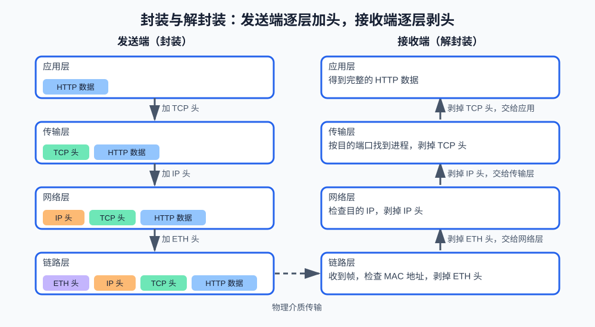

# 第1课:网络分层模型与协议栈

网络课程从"分层"开始。计算机网络由大量硬件和软件协作完成，如果把所有问题混在一起解决，任何人都无法理解整个系统。分层模型把"两台机器之间传输数据"拆成若干个职责单一的层次，每一层只依赖下一层、只服务上一层。

本课先建立分层模型的心智模型，再用一个可运行的程序观察"封装"和"解封装"的过程。socket 等真实的编程接口放到第 5 课专门讲，本课只讲概念和模型。

**学习目标：**

1. 能画出 TCP/IP 四层模型，说出每层的职责和典型协议；
2. 能解释封装和解封装的过程；
3. 能说明 IP 地址、端口、MAC 地址分别属于哪一层；
4. 能回答"为什么业务代码不需要关心 TCP 细节"。

## 1. 为什么网络需要分层

假设你用手机应用向后端服务器发送一条"买牛奶"的提醒。这个请求需要解决的问题包括：用什么格式描述这条数据、对方是哪台机器、走哪条路径到达、中途信号出错怎么办、到达后交给哪个程序处理。

这些问题不可能由一个协议同时解决。分层就是把它们拆开：

```text
应用层  数据应该是什么格式（HTTP 请求怎么写）
传输层  数据怎么从"进程"可靠地到达对方"进程"（TCP）
网络层  数据怎么跨过多个网络从主机 A 到主机 B（IP）
链路层  数据怎么在相邻两台设备之间传过去（以太网、Wi-Fi）
```

分层的核心规则是：每一层只使用下一层提供的服务，并为上一层提供更好的服务。应用层不关心数据走哪条路；传输层不关心信号用什么介质传播。

分层也有代价：每一层都会增加自己的头部信息，传输的数据会变大；层次之间的抽象有时也会让排错变难（问题到底出在哪一层？）。这是面试中"分层的优点和缺点"的标准答案。

## 2. 两种分层模型：OSI 与 TCP/IP

教材和面试中有两套模型，描述的是同一个事实：

| TCP/IP 模型 | OSI 模型对应 | 职责 | 典型协议 / 设备 |
| --- | --- | --- | --- |
| 应用层 | 应用层、表示层、会话层 | 定义进程间通信的数据格式和语义 | HTTP、DNS、TLS、SSH |
| 传输层 | 传输层 | 主机内进程到进程的通信，靠端口区分进程 | TCP、UDP |
| 网络层 | 网络层 | 主机到主机的跨网络转发，靠 IP 地址定位主机 | IP、ICMP；路由器 |
| 链路层 | 数据链路层、物理层 | 相邻设备之间的帧传输和物理信号 | 以太网、Wi-Fi；交换机 |

OSI 是七层模型，是理论上的完整划分；TCP/IP 是实际互联网采用的四层模型。面试时通常先画 TCP/IP 四层，再补充说明 OSI 剩下的三层被合并到了应用层。两者记忆的关键不是层数，而是"每一层解决什么问题"。

## 3. 每一层的职责

### 3.1 应用层

应用层最贴近你写的程序。HTTP 规定请求长什么样（方法、路径、头部、正文）；DNS 规定域名怎么翻译成 IP。应用层数据不是字节流，而是有明确格式的"消息"。当你用浏览器访问 `http://example.com/api/tasks` 时，这条请求遵循的约定就是应用层协议。这一层是后续第 8 至第 10 课的主角。

### 3.2 传输层

传输层解决"主机内哪个进程接收数据"的问题。一台服务器上可能同时运行着数据库、SSH 和网站后端，它们共用同一个 IP 地址；传输层用**端口**区分它们：网站后端常监听 8000 端口，SSH 监听 22 端口。

传输层有两个代表协议：TCP 提供可靠、有序的字节流；UDP 提供不保证送达的快速发送。第 3、5、6 课专门讲它们。

### 3.3 网络层

网络层解决"跨过多个网络找到目标主机"的问题。每个网络设备有一个 IP 地址，路由器根据 IP 地址逐跳转发数据。本机回环地址 `127.0.0.1`（第 2 课详细展开）和公网地址都属于这一层。

### 3.4 链路层

链路层只负责"相邻两台设备之间"的传输：你的电脑到路由器、路由器到下一个路由器。它用 MAC 地址标识相邻设备。数据每经过一个路由器，链路层的头部都会被换掉（因为"下一个邻居"变了），但 IP 层的源和目的地址基本不变。这个对比是理解两层地址区别的关键：**IP 地址负责端到端，MAC 地址负责一跳**。

## 4. 封装与解封装

分层之后，数据在发送端的流动方式叫**封装**：应用层数据交给传输层，传输层在前面加上自己的头部（记录端口），交给网络层；网络层再加 IP 头（记录地址），交给链路层；链路层加以太网帧头（记录 MAC 地址）后在物理介质上发送。



从图中可以直观看到两个规律：头是从外向内依次套上去的，所以最外层的 ETH 头最先被剥掉；HTTP 数据始终是最内层，全程没有被修改。

接收端做相反的事：**解封装**。每一层只看自己的头部，剥掉后把剩余部分交给上一层。传输层剥掉 TCP 头后看到目标端口是 8000，就把数据交给监听 8000 的进程——这个过程叫**分用（demultiplexing）**。

## 5. 用代码模拟一次封装

课程代码在 `code/network/01-encapsulation.py`，模拟了一次 HTTP 请求的封装和解封装。为了便于观察，真实的二进制协议头被简化成可读文本，格式是 `b"层名|控制信息|剩余数据"`。

### 5.1 发送端逐层加头

```python
def add_http_header(payload: bytes, method: str, path: str) -> bytes:
    """应用层：把请求方法和路径作为 HTTP 的控制信息。"""
    header = f"{method} {path} HTTP/1.1".encode("ascii")
    return b"HTTP|" + header + b"|" + payload
```

每个 `add_*_header` 函数做同一件事：接收上层交给本层的数据，返回加了本层头部的新字节串。注意输入和输出都是 `bytes`——网络上传输的永远是字节，不是字符串。中文字符串必须先 `encode("utf-8")` 变成字节。

`build_frame` 按真实顺序组合它们：

```python
def build_frame(payload: bytes) -> bytes:
    """发送端封装：自上而下依次经过应用层、传输层、网络层、链路层。"""
    http_data = add_http_header(payload, "GET", "/api/tasks")
    tcp_data = add_tcp_header(http_data, src_port=53218, dst_port=8000)
    ip_data = add_ip_header(tcp_data, src_ip="192.168.1.8", dst_ip="203.0.113.20")
    frame = add_ethernet_header(ip_data, src_mac="a4:5e:60:11:22:33", dst_mac="3c:22:fb:aa:bb:cc")
    return frame
```

运行后可以看到最终发出的字节串——从左到右正是链路层、网络层、传输层、应用层的头依次套在外面：

```text
ETH|src=a4:5e:60:11:22:33,dst=3c:22:fb:aa:bb:cc|IP|src=192.168.1.8,dst=203.0.113.20|TCP|src=53218,dst=8000|HTTP|GET /api/tasks HTTP/1.1|{"items": ["买牛奶"]}
```

### 5.2 接收端逐层去头

解封装的每一步由 `parse_layer` 完成：

```python
def parse_layer(frame: bytes, layer_name: bytes) -> tuple[dict[str, str], bytes]:
    parts = frame.split(b"|", 2)
    if len(parts) != 3 or parts[0] != layer_name:
        raise ValueError(f"帧格式错误：期望 {layer_name.decode('ascii')} 层，实际开头是 {frame[:24]!r}")
    ...
    return fields, parts[2]
```

它输入当前剩余的字节和期望的层名，输出两个字段值：解析出的头部字段字典，以及剥掉这层头之后的剩余数据。`split(b"|", 2)` 最多分割两次，保证控制信息本身含有 `|` 时剩余数据不被误切。如果最外层不是期望的层名，说明数据在中途被破坏，函数抛出 `ValueError`——协议解析失败就是这种"数据不符合格式"的错误，和你在 Python 第一课学的异常机制是同一件事。

`receive_frame` 从链路层开始逐层调用它，直到取出应用层的 HTTP 请求。运行程序，对比发送端打印和接收端打印，确认数据原样到达。

## 6. 真实场景：Web 应用为什么不需要管 TCP

用任何 Web 框架（FastAPI、Flask、Spring 等）开发过后端的人，都只写过路由函数，从没手写过 TCP 握手。TCP 连接是谁建立的？HTTP 报文是谁解析的？

答案是分层分工：

```text
你的代码        只处理应用层语义（路由、参数校验、业务逻辑）
Web 框架/服务器 应用层：解析 HTTP 报文，调用对应的处理函数
操作系统内核    传输层与网络层：TCP 握手、重传、按端口分用、IP 转发
网卡和驱动      链路层与物理层：收发帧和信号
```

所以"业务代码不需要关心 TCP 细节"不是框架的功劳，而是分层模型的功劳：下层已经把字节流可靠地、按端口递到了进程门口。反过来，当你调用一个外部 API（比如大模型 API）出现超时或连接失败时，问题可能出在任何一层——排错时逐层检查（进程在监听吗？端口通吗？DNS 解析对吗？）比盲目重启更有效，这个方法会在第 12 课综合练习。

## 7. 运行课程代码

```bash
cd <本仓库根目录>
conda run -n agent_dev python code/network/01-encapsulation.py
```

会先打印发送端最终发出的字节串，再打印接收端逐层解封装的过程。

## 8. 课后作业

作业和课程示例在同一个文件中：`code/network/01-encapsulation.py`。文件上半部分可以直接运行；下半部分从 `# ===== 课后作业：解析收到的数据帧 =====` 开始，需要你完成 `parse_frame` 函数。

作业要求：

1. 实现 `parse_frame`：从 ETH 层开始逐层解封装，返回包含 `mac`、`ip`、`tcp`、`method`、`path`、`body` 六个键的字典；前三个键是各层头部字段组成的字典，`method` 和 `path` 从 `POST /api/reminders HTTP/1.1` 这样的请求行中拆出，`body` 保持 `bytes` 类型；
2. 可以复用或仿照 `parse_layer`，但 `receive_frame` 是"边剥头边打印"，你的函数要把结果**整理成字典返回**，函数不打印任何内容；
3. 任何一层层名不符、缺少分隔符或头部字段不完整时抛出 `ValueError`，消息中说明是哪一层出错；
4. 完成后取消 `__main__` 中 `homework()` 的注释并运行：合法帧应完整解析出六个键，损坏帧（TCP 层名被改成 `TC?`）应抛出并打印 `ValueError`；
5. 思考并在验收时回答：损坏帧的 `ValueError` 为什么从 TCP 层开始报，而不是从 ETH 层？

## 9. 验收问题

1. TCP/IP 四层分别解决什么问题？各举一个协议。
2. 为什么说 IP 地址负责端到端、MAC 地址负责一跳？
3. 封装和解封装分别发生在发送端还是接收端？顺序如何？
4. IP 地址、端口、MAC 地址分别属于哪一层？端口解决了什么问题？
5. 为什么接收端拿到帧之后不能直接读出 HTTP 数据，而要一层层剥？

## 10. 面试高频考点

- OSI 七层和 TCP/IP 四层的对应关系，以及"为什么分层、分层的优缺点"。
- 一次 HTTP 请求经过哪些层，每层加了什么信息（封装过程）。
- IP 地址、端口、MAC 地址的层次归属和作用范围。
- `127.0.0.1` 与 `0.0.0.0` 的区别（下一课展开）。
