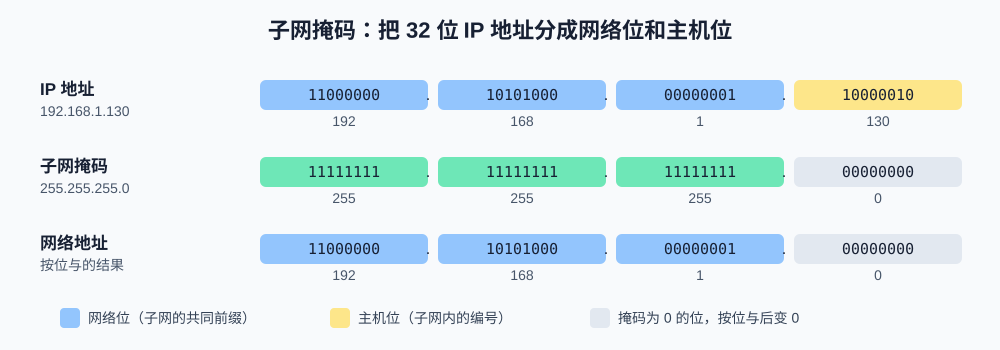
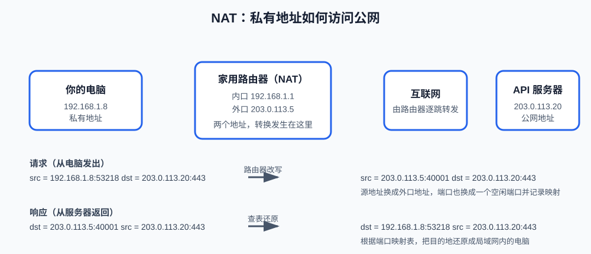

# 第2课:IP 地址、子网与路由基础

第一课建立了分层模型：网络层负责"跨过多个网络找到目标主机"。这一课详细讲清网络层最核心的三个问题：**地址是怎么写的**（IP 地址与子网掩码）、**家里和公司里的地址为什么和公网不一样**（私有地址与 NAT）、**数据包怎么一步步找到对方**（路由与网关）。

本课是概念课，不写 Python 代码，练习都是终端命令。学完后你应该能读懂 `ifconfig` 的输出，能算出一个子网里有多少可用地址，也能解释"为什么我在家里能上外网，但外面的人连不到我的电脑"。

**学习目标：**

1. 能把一个 IPv4 地址写成 32 位二进制，理解点分十进制；
2. 能用子网掩码做按位与，算出网络地址、广播地址和可用主机数；
3. 能区分 `127.0.0.1`、`0.0.0.0`、私有地址和公网地址；
4. 能用自己的话解释 NAT 做了什么；
5. 能读懂路由表，说出默认网关的作用；
6. 能说出 IPv6 和 IPv4 的主要差异。

## 1. IP 地址是什么

### 1.1 32 位数字与点分十进制

IPv4 地址本质上是**一个 32 位二进制数**。为了人类好记，把它按每 8 位（一个字节）分成四段，每段换算成 0~255 的十进制数，中间用点隔开——这就是**点分十进制**：

```text
二进制   11000000 10101000 00000001 10000010
十进制      192  .  168  .   1   .  130
```

每段 8 位，能表示 0（`00000000`）到 255（`11111111`），所以每个位置上的数字不会超过 255。32 位一共能表示 $2^{32} \approx 43$ 亿个地址——这个总量不够全球设备用，是后面 NAT 和 IPv6 存在的根本原因。

一台设备的每一个联网网卡都有一个（或多个）IP 地址：连 Wi-Fi 的笔记本，Wi-Fi 网卡有一个地址；开虚拟机的话，虚拟网卡还会有别的地址。**IP 地址属于网卡（网络接口），不属于整台机器**，这个细节在第 7 节看 `ifconfig` 输出时会直观看到。

### 1.2 地址的两部分：网络号 + 主机号

IP 地址不是一整块编号，而是分成两部分：

```text
IP 地址 = 网络号（它在哪个网络里）+ 主机号（它是这个网络里的第几台设备）
```

类比寄快递：`网络号` 相当于"省市区"，`主机号` 相当于"街道门牌"。路由器只需要看网络号决定包裹往哪个方向走，到了目的地网络内部，再用主机号找到具体设备。

那么一个地址里前多少位是网络号？这就是**子网掩码**要回答的问题。

## 2. 子网掩码与 CIDR

### 2.1 子网掩码如何工作

子网掩码也是一个 32 位数，它的规则很简单：**掩码为 1 的位对应 IP 地址的网络号，为 0 的位对应主机号**。掩码的 1 总是连续地排在前面，例如：

```text
IP 地址     192.168.1.130   11000000 10101000 00000001 10000010
子网掩码    255.255.255.0   11111111 11111111 11111111 00000000
```



判断两台设备是否在同一个子网的方法是**按位与（AND）**：把 IP 地址和子网掩码逐位对齐，两边都是 1 结果才是 1，否则是 0。得到的结果叫**网络地址**，它代表整个子网本身：

```text
    11000000 10101000 00000001 10000010   (192.168.1.130)
AND 11111111 11111111 11111111 00000000   (255.255.255.0)
  = 11000000 10101000 00000001 00000000   (192.168.1.0   ← 网络地址)
```

从图中可以看到规律：掩码是 `255.255.255.0` 时，前 24 位原样保留（网络号），后 8 位清零（主机号被抹掉）。

### 2.2 CIDR 记法

`255.255.255.0` 这种写法太长，实际更常用 **CIDR 记法**（Classless Inter-Domain Routing，无类别域间路由）：在地址后面加一条斜线和"掩码中 1 的个数"。`255.255.255.0` 有 24 个 1，所以 `192.168.1.0/24` 和"地址 192.168.1.0、掩码 255.255.255.0"是完全等价的说法。

几个常用对照：

| CIDR | 掩码 | 网络位 | 主机位 | 可用地址数 |
| --- | --- | --- | --- | --- |
| `/8` | 255.0.0.0 | 8 位 | 24 位 | 约 1677 万 |
| `/16` | 255.255.0.0 | 16 位 | 16 位 | 65534 |
| `/24` | 255.255.255.0 | 24 位 | 8 位 | 254 |
| `/26` | 255.255.255.192 | 26 位 | 6 位 | 62 |
| `/32` | 255.255.255.255 | 32 位 | 0 位 | 1（单个地址） |

### 2.3 一个 /24 子网里有什么

以 `192.168.1.0/24` 为例，主机位 8 位，共 $2^8 = 256$ 个地址，但有两个特殊地址不能分配给设备：

- **网络地址** `192.168.1.0`：主机位全 0，代表整个子网，不是某台设备；
- **广播地址** `192.168.1.255`：<mark>主机位全 1</mark>，发给它的包会送达子网内所有设备。

所以可用主机地址是 `192.168.1.1` 到 `192.168.1.254`，共 **254 个**。面试题"一个 /24 能接多少台设备"，答 254 而不是 256，这两个特殊地址就是考点。

### 2.4 子网划分练习（/26）

把主机位再借两位给网络号，就得到更小的子网。例如 `/26` 表示主机位只剩 6 位，每个子网 $2^6 = 64$ 个地址（可用 62 个）。一个 /24 可以切成 4 个 /26：

```text
192.168.1.0/26    可用范围 192.168.1.1   ~ 192.168.1.62    广播 192.168.1.63
192.168.1.64/26   可用范围 192.168.1.65  ~ 192.168.1.126   广播 192.168.1.127
192.168.1.128/26  可用范围 192.168.1.129 ~ 192.168.1.190   广播 192.168.1.191
192.168.1.192/26  可用范围 192.168.1.193 ~ 192.168.1.254   广播 192.168.1.255
```

规律：每个子网的起点是"块大小"（$64$）的整数倍。面试常给一个地址问它属于哪个子网，例如 `192.168.1.100/26`：$100 \div 64 = 1$ 余 $36$，所以它属于第二个子网 `192.168.1.64/26`。

## 3. 特殊地址：回环、全零与私有地址段

### 3.1 回环地址 127.0.0.1

`127.0.0.0/8`（即 127 开头的所有地址）是**回环地址**：数据包根本不出网卡，在本机内部绕一圈回到自己。最常用的是 `127.0.0.1`，习惯称为 localhost。

开发时"先在本机把服务跑起来自己访问"用的就是它：服务监听 `127.0.0.1:8000`，意味着**只有本机能访问**，外部设备连不上——这是特性而不是 bug，调试期通常正需要这种隔离。

### 3.2 通配地址 0.0.0.0

`0.0.0.0` 不是某台设备的地址，而是"**所有网卡**"的通配写法。服务监听 `0.0.0.0:8000` 意味着：无论是发往 `127.0.0.1`、发往 `192.168.1.8` 还是其他网卡地址的请求，都交给这个服务。想让同一局域网的其他设备（比如手机）访问你电脑上的服务，就要监听 `0.0.0.0`；只监听 `127.0.0.1` 时手机连不到，这是最常见的"本地服务为什么手机访问不了"的原因。

### 3.3 私有地址段

以下三段地址被规定为**私有地址**，只在局域网内部有效，不会出现在公网上：

| 范围 | CIDR | 地址数 | 常见用途 |
| --- | --- | --- | --- |
| 10.0.0.0 ~ 10.255.255.255 | 10.0.0.0/8 | 约 1677 万 | 企业内网 |
| 172.16.0.0 ~ 172.31.255.255 | 172.16.0.0/12 | 约 100 万 | 企业内网 |
| 192.168.0.0 ~ 192.168.255.255 | 192.168.0.0/16 | 65536 | 家庭路由器 |

关键事实：全世界无数个家庭都用自己的 `192.168.1.x`，互不冲突，因为私有地址**不出内网**。那么内网设备怎么访问公网？答案是 NAT。

## 4. NAT：私有地址如何访问公网

NAT（Network Address Translation，网络地址转换）由路由器完成，核心动作是：**数据包经过路由器时，把私有源地址改写成路由器的公网地址，回来时再改回去**。



从图中能看到完整的一来一回：

1. 电脑发出的包源地址是 `192.168.1.8:53218`。这个地址在公网上不可路由，直接发出去就石沉大海；
2. 路由器把它改写成 `203.0.113.5:40001`——换成自己外口的公网地址，端口也换成一个空闲端口，并在**映射表**里记下"40001 ↔ 192.168.1.8:53218"；
3. 服务器只看到 `203.0.113.5`，它的响应发回这个地址；
4. 路由器收到响应，查映射表，把目的地址还原成 `192.168.1.8:53218`，交回电脑。

端口在这里起了关键作用：家里可能同时有多台设备上网，路由器靠**不同的端口**区分"这个响应应该还给谁"。这也解释了为什么 NAT 叫"网络地址（和端口）转换"，以及为什么私有网络能共用一个公网地址。

推论：外面的人**无法主动发起**连接到你家里的 `192.168.1.8`——路由器没有对应的映射记录，不知道转给谁。这就是"内网设备可出不可进"，也是个人电脑靠 NAT 天然获得的一层保护。

## 5. 路由与默认网关

数据包从源到目的往往要经过多个路由器。每个路由器维护一张**路由表**，记录"什么样的目标地址，交给谁（下一跳）"。转发规则可以概括为：

```text
收到一个包 → 看目的地址 → 在路由表里找最匹配的条目
  ├─ 命中直连子网（如 192.168.1.0/24）→ 直接送达目标设备
  └─ 否则 → 交给路由表指定的下一跳路由器
```

| 场景 | 路由表的主人 | 兜底条目叫什么 | 兜底条目的下一跳 |
|------|-------------|---------------|-----------------|
| 你电脑 | 主机 | 默认网关 | 你家路由器（192.168.1.1） |
| 你家路由器 | 路由器 | 默认路由（0.0.0.0/0） | ISP 的路由器 |

你那段资料里说的"默认网关是路由表的兜底条目"——**在家庭网络场景下，说的是你电脑的路由表**。你电脑的路由表里，那条兜底条目就是默认网关。

而我说"路由器那边一般说默认路由"——**说的是路由器自己的路由表**。路由器也有兜底条目，但路由器不叫它默认网关，叫它默认路由。

**默认网关**是路由表的兜底条目：当目的地址不匹配任何具体条目时，包交给它。家庭网络里就是路由器（如 `192.168.1.1`）。所以"你的电脑访问公网"的过程是：先对比目的地址发现不在本子网 → 发给网关 → 网关（NAT 后）再交给运营商的路由器 → 逐跳转发。第一课说过：**每一跳链路层的头都会换掉，但 IP 层的源和目的地址（经 NAT 改写后）全程不变**——IP 地址负责端到端，靠的就是路由器的逐跳接力。

## 6. IPv6 简介

IPv4 只有 43 亿个地址，早已耗尽（NAT 就是补救手段之一）。IPv6 把地址扩到 **128 位**，写法也换成冒号分隔的十六进制：

```text
IPv6 示例：  2408:8756:0000:0000:0000:0000:0000:3a2f
可缩写为：  2408:8756::3a2f      （连续全零段用一个 :: 代替，只能用一次）
```

面试需要掌握的差异：

| 对比点 | IPv4 | IPv6 |
| --- | --- | --- |
| 地址长度 | 32 位 | 128 位 |
| 表示法 | 点分十进制 | 冒号十六进制 |
| 地址配置 | 手动或 DHCP（动态主机配置协议） | 支持自动配置（SLAAC，无状态地址自动配置） |
| NAT | 普遍依赖 | 设计上端到端可达，不需要 NAT |
| 头部 | 可变长，字段多 | 定长，字段精简，转发更快 |

现实是 IPv4 仍占主流、IPv6 在移动网络中已大规模部署，两者长期共存。

## 7. 终端演示：观察本机的 IP、掩码、路由和连通性

以下命令在 macOS 上运行（Linux 对应命令在括号中注明）。建议边运行边对照前文的定义。

### 7.1 查看本机地址

```bash
ifconfig en0          # Linux: ip addr show
ifconfig lo0
```

说明：`ifconfig` 不带参数会列出所有网络接口；接口名写在其后表示"只看这一个"。`en0` 是 macOS 上第一块 Wi-Fi/以太网网卡的接口名（Linux 上通常是 `eth0` 或 `wlan0`），`lo0` 是回环接口（loopback，专门承载 127.0.0.1 的流量）。

典型输出（已简化）：

```text
lo0: flags=8049<UP,LOOPBACK,RUNNING> mtu 16384
	inet 127.0.0.1 netmask 0xff000000          ← 回环地址，掩码 255.0.0.0

en0: flags=8863<UP,BROADCAST,RUNNING> mtu 1500
	inet 192.168.1.8 netmask 0xffffff00 broadcast 192.168.1.255
	          ↑ 本机地址       ↑ 0xffffff00 即 255.255.255.0   ↑ 广播地址
```

对照第 2、3 节验证：`0xffffff00` 换成点分十进制正是 `255.255.255.0`，所以本机在 `192.168.1.0/24` 子网里；`192.168.1.8` 是私有地址。注意 `lo0` 和 `en0` 是两个接口、两个地址——IP 地址属于网卡。

### 7.2 查看路由表

```bash
netstat -rn           # Linux: ip route
```

典型输出（已简化）：

```text
Destination        Gateway            Flags   Netif Expire
default            192.168.1.1        UGSc     en0     ← 默认网关：其他包都给它
127                127.0.0.1          UCS      lo0     ← 回环流量不出机器
192.168.1          link#14            UCS      en0     ← 直连子网：直接送达
```

第 5 节的三种情况在表里各占一行：直连子网、回环、以及兜底的 default。

### 7.3 用 ping 验证三类地址的连通性

```bash
ping -c 3 127.0.0.1        # 本机回环：必通，不经过任何网络设备
ping -c 3 192.168.1.1      # 网关：延迟通常 < 1ms，只经过本地 Wi-Fi
ping -c 3 223.5.5.5        # 公网：延迟几十毫秒，经过完整路由链路
```

观察三点：回环最快（数据包没出门）；网关几乎同样快（只走了一跳）；公网明显慢且有波动（经过十几个路由器）。`ping` 本质是发送 ICMP 报文（Internet Control Message Protocol，互联网控制报文协议，网络层的诊断协议），它不通不代表 TCP 服务不可用，但通了至少说明网络层路径没问题——这也是第 12 课"逐层排错"的第一步。

## 8. 验收问题

1. 为什么 IP 地址每一段不会超过 255？$2^{32}$ 大约是多少？
2. 给定 `172.20.30.45/16`，它的网络地址是什么？可用主机范围和广播地址是什么？
3. `/26` 子网的块大小是多少？`192.168.1.100/26` 属于哪个子网？
4. `127.0.0.1` 和 `0.0.0.0` 有什么区别？服务监听这两个地址分别意味着谁能访问？
5. 描述一次完整的 NAT 改写过程：请求去程和响应回程的源/目的地址分别是什么？
6. 为什么外面的人无法主动连接你家里的电脑？
7. 路由表里的 `default` 条目起什么作用？
8. IPv6 解决了 IPv4 的什么根本问题？

## 9. 面试高频考点

- 子网掩码的作用与按位与运算；`/24`、`/26` 的可用主机数计算（254、62）。
- 网络地址（主机位全 0）和广播地址（主机位全 1）为什么不能分配给设备。
- `127.0.0.1` 与 `0.0.0.0` 的区别，以及"服务监听哪个地址才能被外部访问"。
- 私有地址三段范围；NAT 的原理、为什么需要端口、为什么内网"可出不可进"。
- 默认网关是什么；一次跨网访问中数据包的逐跳转发过程。
- IPv4 与 IPv6 的主要差异、IPv6 为什么不需要 NAT。
