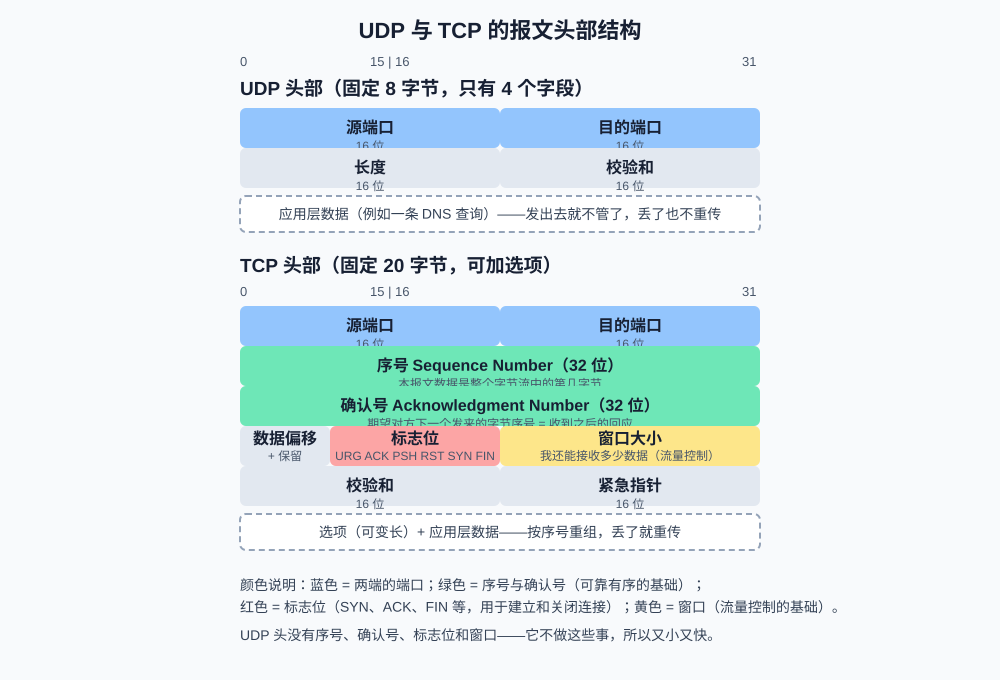

# 第3课:UDP、TCP 与端口

第 1 课说过，传输层解决"主机内哪个进程接收数据"的问题。这一课详细展开传输层的两个协议：**TCP**（可靠、面向连接）和 **UDP**（简单、无连接），以及它们共同依赖的编址机制——**端口**。本课先认识报文结构和基本性质；连接如何建立关闭（握手挥手）放第 4 课，socket 编程放第 5 课（先学完握手再动手），可靠性机制放第 6 课。

本课是概念课，不写 Python 代码，练习用终端命令观察本机的端口状态。

**学习目标：**

1. 能解释端口是什么、为什么需要端口、临时端口和知名端口的区别；
2. 能对照示意图说出 UDP 和 TCP 头部各字段的含义；
3. 能解释"无连接"和"面向连接"分别意味着什么；
4. 能为一个具体场景（DNS 查询、视频通话、网页接口）选择合适的协议并说明理由。

## 1. 端口：同一台机器上区分进程的编号

### 1.1 为什么需要端口

一台服务器只有一个 IP 地址，但上面可能同时跑着网站后端、数据库和 SSH。当网卡收到一个数据包时，操作系统怎么知道该交给哪个程序？答案是**端口**：每个想收发数据的进程都要先向操作系统申请占用一个端口，包到达后，传输层按目的端口把数据递交给对应的进程（第 1 课的"分用"）。

端口是一个 **16 位数字**，范围 0 ~ 65535。按使用惯例分三段：

| 范围 | 名称 | 说明 | 例子 |
| --- | --- | --- | --- |
| 0 ~ 1023 | 知名端口 | 系统保留给常见服务，普通程序绑定需要权限 | 80 HTTP、443 HTTPS、22 SSH、53 DNS |
| 1024 ~ 49151 | 注册端口 | 常见应用自行注册使用 | 8000（常见开发用）、3306 MySQL、5432 PostgreSQL |
| 49152 ~ 65535 | 动态/临时端口 | 客户端发起连接时由系统临时分配 | 浏览器发起请求时用的随机端口 |

一个完整的通信端点由 **IP 地址 + 端口** 唯一确定，第 1 课 socket 演示里 `getsockname()` 返回的元组 `('127.0.0.1', 62662)` 正是这个结构。

两个要点：

- **占用即互斥**：同一个 IP 上，同一个端口同一时刻只能被一个进程监听。第二个进程再绑 8000 会报"Address already in use"——这是开发中最常见的端口冲突。
- **客户端不需要指定端口**：客户端发起连接时，系统自动<mark>分配一个临时端口</mark>，用完即回收，所以浏览器能同时发起成百上千个连接。

### 1.2 为什么端口和 IP 属于不同层

IP 地址回答"哪台机器"（网络层，端到端寻址）；端口回答"这台机器上哪个进程"（传输层，进程间分用）。回忆第 2 课的 NAT：路由器改写地址时**连端口一起改**，因为区分"哪台内网设备"靠的正是端口。

## 2. UDP：无连接的简单传输

### 2.1 报文结构

UDP（User Datagram Protocol，用户数据报协议）的头部只有 **8 字节、4 个字段**，是"最小可用"的传输协议：



四个字段的作用：

- **源端口**：发送方的端口，接收方回应时用它找到你。如果发送方不期待回应（如某些广播场景），可以填 0；
- **目的端口**：接收方按它分用；
- **长度**：头部 + 数据共多少字节；
- **校验和**：检查数据在传输中有没有损坏（只能"发现"损坏，不能修复）。

### 2.2 "无连接"意味着什么

UDP 传输数据**不需要事先建立连接**：拿到对方 IP 和端口，装上头部直接发。这带来四个直接后果：

1. **不保证到达**：包丢了就丢了，UDP 不会重发；
2. **不保证顺序**：先发的可能后到；
3. **没有流量控制**：不管对方忙不忙，只管发；
4. **开销极小**：没有握手、没有确认、头部只有 8 字节，延迟低、效率高。

它的编程模型也简单到极致：一个 `sendto` 发出去，一个 `recvfrom` 收进来（第 5 课写代码验证）。

### 2.3 适用场景

UDP 适合"**丢了代价小，等着的代价大**"的场景：

- **DNS 查询**：一次查询和应答都很小，丢了重查一次就行，不值得为此建连接；
- **音视频通话、直播**：宁可丢掉 0.1 秒的画面，也不愿意等 2 秒后补发一个过时的包；
- **在线游戏**：位置状态包过期即无效；
- **DHCP**：设备还没 IP 地址时广播寻址，天然无法先"建立连接"。

## 3. TCP：面向连接的字节流传输

### 3.1 报文结构

TCP（Transmission Control Protocol，传输控制协议）头部固定 20 字节，字段数量和复杂度远超 UDP。对照上图逐个看核心字段：

- **源端口 / 目的端口**：和 UDP 相同，负责进程间分用；
- **序号（Sequence Number）**：本报文携带的数据是整个字节流的第几字节。TCP 把连接上传输的所有字节**从 0 开始连续编号**，这是"有序"的基础；
- **确认号（Acknowledgment Number）**：我期望对方下一个发来的字节序号，含义是"这个序号之前的我都收到了"——这是"可靠"的基础；
- **标志位**：6 个开关位，其中四个最常用——`SYN`（发起建立连接）、`ACK`（这是一个确认报文）、`FIN`（请求关闭连接）、`RST`（异常重置）。第 4 课的握手挥手就是这几个位的组合拳；
- **窗口大小**：我还能接收多少数据，请对方别发超过这个量——这是"流量控制"的基础（第 6 课展开）。

### 3.2 "面向连接"意味着什么

TCP 在传输数据前要先**建立连接**（三次握手），结束后**关闭连接**（四次挥手），过程中通过序号、确认号、重传机制保证：

1. **可靠**：每个字节都会被确认，超时未确认就重传；
2. **有序**：接收端按序号把乱序到达的报文重新排好；
3. **字节流**：TCP 像一根水管，发送端写入一串字节，接收端按同样顺序读出来。它没有"消息"的概念——发两次和发一次合并成一次，对接收端来说只是一串连续字节。这个特性引发的"粘包"问题在第 6 课重点讲。

代价是：建立和关闭连接需要额外往返、每个报文头部 20 字节起步、确认和重传带来延迟。TCP 的设计目标是"宁可慢一点，也要一个字节不少地按序送达"。

## 4. TCP 与 UDP 的对比与选型

| 对比点 | TCP | UDP |
| --- | --- | --- |
| 连接 | 需要握手建立、挥手关闭 | 无连接，拿到地址直接发 |
| 可靠性 | 确认 + 重传，不丢不重 | 不保证到达 |
| 有序性 | 按序号重组，严格有序 | 不保证顺序 |
| 传输形态 | 字节流（无消息边界） | 独立数据报（有边界） |
| 头部开销 | 20 字节起 | 8 字节 |
| 速度 | 相对慢（机制换来的） | 快（机制少） |
| 典型应用 | 网页、接口调用、文件传输、SSH | DNS、音视频、游戏、DHCP |

选型口诀：**要完整就 TCP，要实时就 UDP**。

几个值得展开的真实案例：

- **调用大模型 API**：走 HTTPS，也就是 TCP。因为答案一个字都不能丢、顺序不能乱——这是典型的"宁可慢也要完整"。即使是流式输出（边生成边传），底层依然是可靠有序的 TCP 字节流；
- **DNS 用 UDP**（53 端口）：查询和应答通常一个报文就装得下，丢失重查的成本远低于维持连接的成本。但 DNS 响应过大或区域传输时也会退回 TCP；
- **QUIC（HTTP/3 的底层）**：用 UDP 实现，但在 UDP 之上自己重新实现了可靠性和有序性——"UDP 快"只是起点，可靠性是可以按需加回来的。第 10 课展开。

## 5. 终端演示：观察本机的端口状态

### 5.1 查看监听中的端口

```bash
lsof -iTCP -sTCP:LISTEN -P -n      # macOS/Linux 通用；Linux 也可用 ss -tlnp
```

一句话说明：`lsof` 用于列出进程打开的文件（macOS/Linux"一切皆文件"，网络连接也算），这串参数组合起来就是"只看状态为监听（LISTEN）的 TCP 连接，并用数字显示端口和地址"。每个参数的具体含义在**第 5 课（命令工具箱）**详细展开，这里先会用即可。

典型输出（已简化）：

```text
COMMAND   PID  USER   FD   TYPE  NODE NAME
rapportd  610  user   10u  IPv4  TCP *:52988 (LISTEN)          ← 系统服务，监听所有网卡的 52988 端口
python   1234  user   34u  IPv4  TCP 127.0.0.1:8000 (LISTEN)   ← 某个开发服务，只监听回环地址
```

NAME 列的结构是 `地址:端口`。`*:8000` 表示监听 `0.0.0.0`（第 2 课的"所有网卡"）；`127.0.0.1:8000` 表示只有本机能访问。对比第 2 课的知识点：**同一端口能否被两个进程绑定，还取决于绑定的是不是同一个地址**——一个进程绑 `127.0.0.1:8000`、另一个绑 `192.168.1.8:8000` 是可以共存的，因为端点（IP+端口）不同。

### 5.2 观察客户端的临时端口

```bash
lsof -iTCP -sTCP:ESTABLISHED -P -n
```

打开任意网页后再运行，能看到大量 ESTABLISHED（已建立）连接，格式如 `192.168.1.8:62345->104.16.132.229:443`：本地地址用的是 49152 以上的**临时端口**，对端是知名端口 443。多开几个网页，可以看到临时端口互不相同——每个连接独占一个端点组合。

### 5.3 复现端口冲突

```bash
python3 -m http.server 8000        # 终端 1：正常启动
python3 -m http.server 8000        # 终端 2：报 OSError: Address already in use
```

这就是第 1 节"占用即互斥"的直接体验。开发中遇到它，先用 5.1 的命令找到占用端口的进程，再决定停掉谁或换端口。

## 6. 验收问题

1. 为什么有 IP 地址还需要端口？端口是几位的，分哪三段？
2. 服务绑 `127.0.0.1:8000` 和 `0.0.0.0:8000`，外部设备能访问哪个？为什么？
3. UDP 头部只有 4 个字段，没有序号和确认号意味着哪些性质？
4. "TCP 是字节流"是什么意思？它和 UDP 的数据报有什么本质区别？
5. TCP 头部里，序号、确认号、窗口大小分别服务于什么机制？
6. 调用大模型 API 用 TCP+HTTPS 而不是 UDP，理由是什么？
7. DNS 通常用 UDP，什么情况下会用 TCP？
8. 一个 /24 内网里 100 台设备同时上网，公网侧需要多少个 IP 地址？NAT 靠什么区分流量？

## 7. 面试高频考点

- TCP 和 UDP 的区别（连接、可靠性、有序性、头部开销），以及"为什么视频通话用 UDP、网页用 TCP"。
- 端口的作用与分类；知名端口举例；临时端口是什么、由谁分配。
- 端口冲突（Address already in use）的成因和排查方法。
- TCP 是字节流、UDP 是数据报——这个区别对应用层设计消息边界意味着什么（第 6 课展开）。
- DNS 为什么用 UDP；QUIC 为什么基于 UDP 又不只有 UDP。
