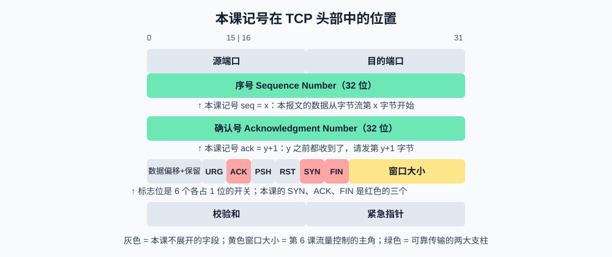
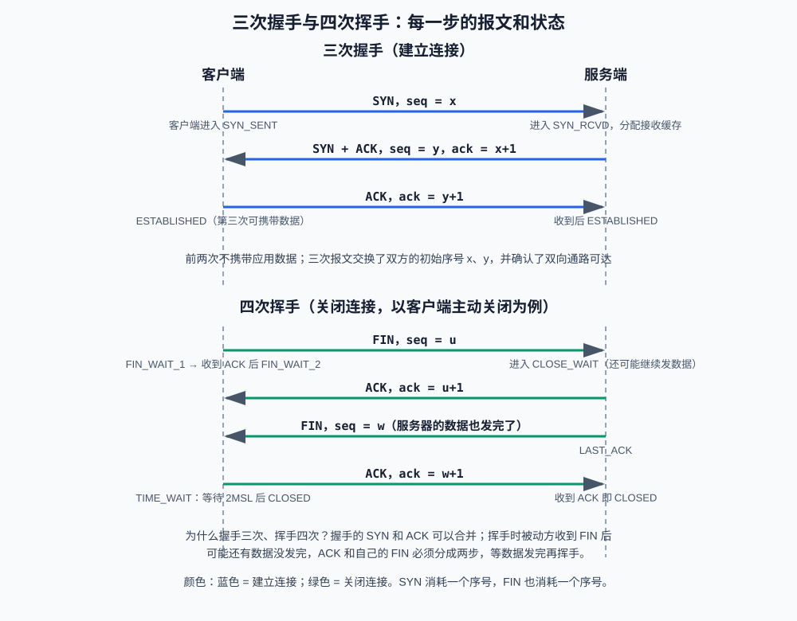

# 第4课:TCP 三次握手与四次挥手

第 3 课认识了 TCP 的字段：序号、确认号、标志位（SYN、ACK、FIN、RST）。这一课把这些零件组装起来，详细拆解 TCP 连接的建立与关闭——这是面试中出场率最高的网络知识点，追问链通常长达四五层，本课争取把每一层都提前讲透。

建立连接要来回传几个报文？教材的答案是"三次握手"。这个数字值得追问：**两次行不行？四次会不会更稳？**这是面试最经典的连环追问。本课的讲法是：先把三次的每一步讲清楚（2.2 节），再顺着追问分析"为什么不能是两次"（2.3 节）和"为什么不用四次"（2.4 节）；关闭连接同理，先拆解四次挥手（第 4 节），再回答"为什么挥手不能像握手那样合并成三次"。后面再遇到"两次""四次"这样的对比，就都是预告过的内容了。

学完本课再进入第 5 课的 socket 编程，你会发现 `connect`、`listen`、`accept` 的行为全部有据可查。

**学习目标：**

1. 能逐步画出三次握手和四次挥手，标出每一步的报文和双方状态；
2. 能回答"为什么握手是三次不是两次/四次"；
3. 能解释 TIME_WAIT 为什么等待 2MSL、大量 CLOSE_WAIT 说明什么；
4. 能区分 TCP keepalive 和 HTTP Keep-Alive 这两个容易混淆的概念；
5. 能用 `ss -tan` 观察本机的连接状态，并理解"握手由内核完成、连接在内核排队"是怎么回事。

## 1. 为什么需要握手

回顾两个前提：

- TCP 是**字节流**协议，每个字节都有序号（第 3 课）；
- TCP 是**全双工**的：连接建立后双方都能同时收发数据。

"连接"的本质是双方各自记下一组状态：我的初始序号是多少、对方的初始序号是多少、我发到哪了、对方确认到哪了。握手的目的就是**安全地交换双方的初始序号（ISN），并确认双向通路都可达**。初始序号不是从 0 开始，而是==随机选取==——==防止上一个连接的旧报文被误当作新连接的数据。==

没有握手的后果可想而知：双方连"从哪个序号开始"都约定不了，可靠传输无从谈起。

## 2. 三次握手逐步拆解


### 2.1 先统一本课的记号

第 3 课只一笔带过 TCP 头部字段，正式拆解前先把本课要用的记号说清——它们都来自 TCP 头部：

| 记号 | 全称 | 含义 |
| --- | --- | --- |
| `SYN` | Synchronize | 同步位，取 1 表示"我想建立连接"，并同时宣告我的初始序号。SYN 消耗一个序号 |
| `ACK` | Acknowledgment | 确认位，取 1 表示"确认号字段有效"。建立连接后所有报文都置 1 |
| `FIN` | Finish | 结束位，取 1 表示"我的数据发完了，请求关闭"。FIN 也消耗一个序号 |
| `seq = x` | Sequence Number | 序号：本报文携带的字节从整个字节流的第 `x` 字节开始 |
| `ack = y+1` | Acknowledgment Number | 确认号：`y` 及之前的字节我都收到了，请发第 `y+1` 字节 |
| `SYN_SENT`（同步已发送）、`TIME_WAIT`（时间等待）等 | 状态名 | 连接在这个时刻处于什么阶段，`netstat`/`ss` 的 State 列显示的就是它们 |

`SYN + ACK` 表示同一个报文里两个标志位同时取 1，各干各的活：SYN 负责宣告序号，ACK 负责确认对方的序号。`seq` 和 `ack` 里的 `x`、`y` 只是举例用的代数记号，实际是很大的随机数。

下面这张图标出了这些记号在 TCP 头部（第 3 课的图）中的确切位置：



### 2.2 三步握手过程



三次握手的三步（对照图中的蓝色箭头）：

1. **客户端发 SYN**：客户端主动发起，发送 `SYN` 报文，携带自己的初始序号 `seq = x`，进入 **SYN_SENT**（同步已发送）状态。SYN 报文虽然不携带应用数据，但**消耗一个序号**——所以下一次发数据的序号是 `x+1`；
2. **服务端回 SYN + ACK**：服务端收到 SYN，做三件事——回复 `SYN + ACK`（`seq = y, ack = x+1`，确认"你的 x 我收到了"）、进入 **SYN_RCVD**（同步已收到）状态、**分配接收缓存等资源**。注意最后一点：此时服务端已经为这个"可能成立的连接"付出成本了——这个细节是第 3 节 SYN 洪泛攻击的根源；
3. **客户端回 ACK**：客户端收到后进入 **ESTABLISHED**（连接已建立），回复 `ACK, ack = y+1`；服务端收到 ACK 也进入 **ESTABLISHED**。第三次握手**可以携带应用数据**，所以"三次握手"并不比"两次"慢一轮（为什么不是两次，2.3 节专门分析）。

### 2.3 为什么不能是两次

假设只要两次（SYN → SYN+ACK 就算建立成功），服务端在第二步就进入 ESTABLISHED 并分配资源。两个致命问题：

1. **服务端无法确认客户端能收到自己的包**。客户端发的 SYN 可能在网络里迷路了很久才到达，这种**历史失效的连接请求**会让服务端白白建立连接、分配资源并傻等数据，而客户端早已放弃。有第三次 ACK，服务端只有确认"客户端确实活着、确实想连"才分配资源；
2. **双方需要各自的序号被确认**。客户端的序号 `x` 由第二次握手确认，但服务端的序号 `y` 需要客户端的第三次 ACK 确认。两次握手下，服务端不知道客户端有没有收到 `y`，后续重传判断会乱套。

一句话总结：**握手本质上是双方对"你的序号我收到了"的相互确认，两次只能确认一个方向。**

### 2.4 为什么不是四次

SYN 和 ACK 的作用互不依赖（一个请求建连、一个确认收包），完全可以放进同一个报文——TCP 就是这么做的（SYN+ACK）。所以"四次"被合并成了三次。挥手不能这样合并，原因见第 4 节。

## 3. 握手由内核完成：两个队列

三次握手有一个容易被忽略的执行者：**操作系统内核**。服务程序在开始工作前，只需要提前告诉内核一句话——"我准备好在某个端口上接收连接了，你帮我盯着"。之后的所有握手动作都由内核自动完成：收到 SYN 就回 SYN+ACK，收到第三次 ACK 就确认连接成立，全程不需要服务程序的代码参与。

内核用**两个队列**管理这些进行中的握手：

| 队列    | 里面是什么                              | 对应状态        |
| ----- | ---------------------------------- | ----------- |
| 半连接队列 | 收到 SYN、回过 SYN+ACK、但还没等到第三次 ACK 的连接 | SYN_RCVD    |
| 全连接队列 | 三次握手完成、等待服务程序"取走"开始处理的连接           | ESTABLISHED |

> [!Note]
> 这里的队列虽然是链表/队列的结构，但是并不是只能先进先出的形式。
> 更合理的叫法是等待处理的链接池


打个比方：服务程序是**柜台职员**，内核是**取号机**。顾客（客户端）完成三次握手，相当于取号成功、进入等候区（全连接队列）坐着；职员忙完手头的事，从等候区叫下一位（程序从队列取出一条连接来处理）。等候区之外还有一道"确认身份"的环节（半连接队列）——身份没确认通过之前，顾客不会被请进等候区。

**SYN 洪泛攻击**就打在半连接队列上：攻击者疯狂发 SYN 但不回第三次 ACK，相当于派一群只取号、永远不接受身份核验的人把取号机挤爆，正常顾客取不了号。常见防御是 `syncookies`（SYN Cookie）：==内核不再为这些半成品连接分配资源==，而是把连接信息编码进 SYN+ACK 的序号里"暂存"在对方手里，收到合法的第三次 ACK 再凭信息重建连接——本质是把"先占资源后确认"改成"确认后再占资源"。

> [!Note]
> 这里的链接信息最重要的是这一步它随机产生的 y。
> 如果没有这个的话，下一步来的任何一个 ACK，它不知道是不是已经完成上面两步了。
> **如果不用 SYN Cookie，内核把 y 存在半连接队列里，第 3 步直接查。**
> **用了 SYN Cookie，内核没存 y。**​ 它把 y 编码进 Cookie 里了。第 3 步收到 `ack = y+1`，内核从 `ack-1` 反推出 y，验证合法，才继续


"服务程序告诉内核"、"从队列取走连接"这两步，对应到编程接口上就是 `listen` 和 `accept` 两个调用，第 5 课写代码时会见到。本课只需要记住结论：**握手发生在内核，排队也在内核，程序只是最后取走成品连接。**

## 4. 四次挥手逐步拆解

以客户端主动关闭为例（对照上图下半部分）：

1. 客户端发 `FIN, seq = u`，进入 **FIN_WAIT_1**（终止等待 1）——意思是"我没有数据要发了"；
2. 服务端回 `ACK, ack = u+1`，进入 **CLOSE_WAIT**（关闭等待）——注意它此时**可能还有数据没发完**，可以继续发；
3. 服务端把剩余数据发完后，发 `FIN, seq = w`，进入 **LAST_ACK**（最后确认）；
4. 客户端回 `ACK, ack = w+1`，进入 **TIME_WAIT**（时间等待）；服务端收到 ACK 即 **CLOSED**（已关闭）；客户端等一段时间后也 CLOSED。

### 4.1 为什么挥手要四次

握手的 SYN+ACK 能合并，是因为服务端收到 SYN 时没什么可"补充"的；而挥手时，**被动方收到 FIN 后可能还有数据要发**——它的 ACK（"你的 FIN 我收到了"）和它自己的 FIN（"我也发完了"）必须分开：ACK 立即回，FIN 等数据发完再回。这就是第 2 与第 3 步不能合并的原因。如果被动方恰好也没有数据要发，中间两步可能合并，退化成"三次挥手"，但协议设计必须按四次来。

### 4.2 TIME_WAIT：为什么等 2MSL

主动关闭的一方在发出最后一个 ACK 后进入 TIME_WAIT，等待 **2MSL**（MSL，报文最大生存时间，Linux 中为 30 秒）才关闭。原因是两条：

1. **保证最后的 ACK 可达**：如果这个 ACK 丢了，服务端会重传 FIN；TIME_WAIT 状态的客户端还能重发 ACK。若直接关闭，服务端将收到 RST，无法正常收尾；
2. **让本连接的旧报文在网络中自然消亡**：等足够久，这条连接的所有报文都会消失，不会污染下一个使用相同四元组（源 IP、源端口、目的 IP、目的端口）的新连接。

推论：**TIME_WAIT 出现在主动关闭的一方**。服务器主动关闭大量短连接时，会积累大量 TIME_WAIT——它无害（只占用少量内存和端口），但可能耗尽临时端口；工程上的应对是开启端口复用或让客户端主动关闭。

### 4.3 CLOSE_WAIT：最常见的代码 bug 信号

CLOSE_WAIT 出现在**被动关闭的一方**：收到对方的 FIN、回过 ACK，但**自己的程序还没调用 close**。一两个 CLOSE_WAIT 正常；**大量 CLOSE_WAIT 几乎必然是代码 bug**——某处收到连接结束信号后忘记关闭 socket，连接资源持续泄漏。这是面试题"服务端出现大量 CLOSE_WAIT 怎么排查"的标准答案：查代码里每条 `recv` 返回空字节后的处理路径是否都调用了 `close`。
##### 为什么会出现大量 CLOSE_WAIT

正常情况：收到 FIN → 回 ACK → 程序处理完剩余数据 → 调 `close()` → 发 FIN → 进入 `LAST_ACK` → 连接关闭。整个过程几毫秒。

**但如果程序忘了调 `close()`：**

```
对方发了 FIN
你回了 ACK
你进入 CLOSE_WAIT
... 然后就永远卡在这了
```
> 对方已经关了，你这边 socket 还占着内存、占着文件描述符。连接泄漏了。


## 5. 两个 Keep-Alive：完全不同的两回事

| | TCP keepalive | HTTP Keep-Alive |
| --- | --- | --- |
| 属于哪层 | 传输层机制 | 应用层约定 |
| 作用 | 连接空闲太久时发探测包，确认对方还活着 | 一条连接处理完一个请求后不关闭，继续给下一个请求复用 |
| 关心的场景 | 对方死机、断网，连接"假活着" | 减少握手挥手开销 |
| 关闭后果 | 空闲连接断开 | 性能略差，功能不受影响 |

面试中被问"keep-alive 是什么"，先反问对方指的是哪一个，再分别作答——这个辨析本身就是加分项。

## 6. 终端演示：观察连接状态

`netstat -an`（macOS 自带；Linux 等价命令为 `ss -tan`）列出本机所有 TCP 连接及其状态，命令详解在第 11 课，这里先会用。State 列就是本课讲的那些状态名。

### 6.1 观察 LISTEN 和 ESTABLISHED

```bash
netstat -an | grep tcp | head -8     # Linux: ss -tan | head -8
```

能找到 `LISTEN`（监听中）和若干 `ESTABLISHED`（已建立）的连接，与第 3 课 `lsof` 的观察互相印证。

### 6.2 观察 TIME_WAIT

```bash
python3 -m http.server 8000          # 终端 1：启动一个 HTTP 服务
curl -s http://127.0.0.1:8000/ -o /dev/null   # 终端 2：发一次请求
netstat -an | grep 8000              # 立刻查看
```

curl 拿到响应后主动关闭，于是本机出现一条 `TIME_WAIT` 的连接（对端是 127.0.0.1:8000）。等待约 30 秒后再查，它消失了——2MSL 已过。

### 6.3 制造 CLOSE_WAIT

```bash
# 终端 1：启动一个"收到连接后 60 秒内什么都不做"的服务器
python3 -c "import socket,time; s=socket.socket(); s.bind(('',9000)); s.listen(); c,a=s.accept(); time.sleep(60)"

# 终端 2：连上它，然后按 Ctrl+C 主动断开
nc 127.0.0.1 9000
```

终端 2 断开时发出 FIN，但终端 1 的 Python 程序正在 `sleep`、没有调用 `close`——此时在任一终端执行 `netstat -an | grep 9000`，能看到服务端那条连接处于 `CLOSE_WAIT`。60 秒后程序退出，连接消失。这正是 4.3 节结论"大量 CLOSE_WAIT 是代码忘了 close"的现场版。

## 7. 验收问题

1. 握手的目的是什么？"连接"在内核里对应哪些数据？
2. 逐步写出三次握手：每一步谁发什么报文、双方状态如何变化？
3. 为什么两次握手不行？说全两个原因。
4. 为什么挥手必须四次而握手可以三次？
5. TIME_WAIT 出现在哪一方？为什么等待 2MSL？它有什么坏处？
6. 大量 CLOSE_WAIT 说明什么？按什么思路排查？
7. TCP keepalive 和 HTTP Keep-Alive 有什么区别？
8. 为什么 `listen()` 之后客户端 `connect()` 就能成功？半连接队列和全连接队列分别存放什么？

## 8. 面试高频考点

- 三次握手全过程（报文 + 状态）；"为什么不能两次"的两个原因；"为什么不是四次"。
- 四次挥手全过程；中间两步为什么不能合并（半关闭）。
- TIME_WAIT 的归属、2MSL 的两条原因、TIME_WAIT 过多的工程应对。
- 大量 CLOSE_WAIT 的含义与排查（代码忘记 close）。
- SYN 洪泛攻击的原理与 syncookies 的防御思路。
- 两个队列：半连接队列（SYN_RCVD）与全连接队列（待 accept）。
- TCP keepalive 与 HTTP Keep-Alive 的辨析。
