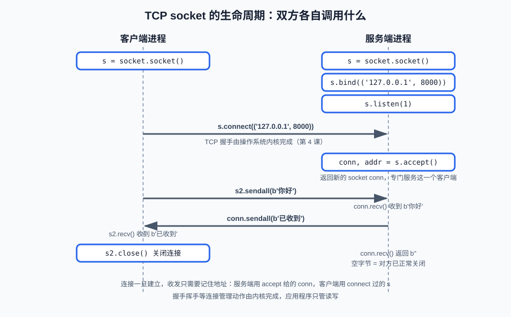
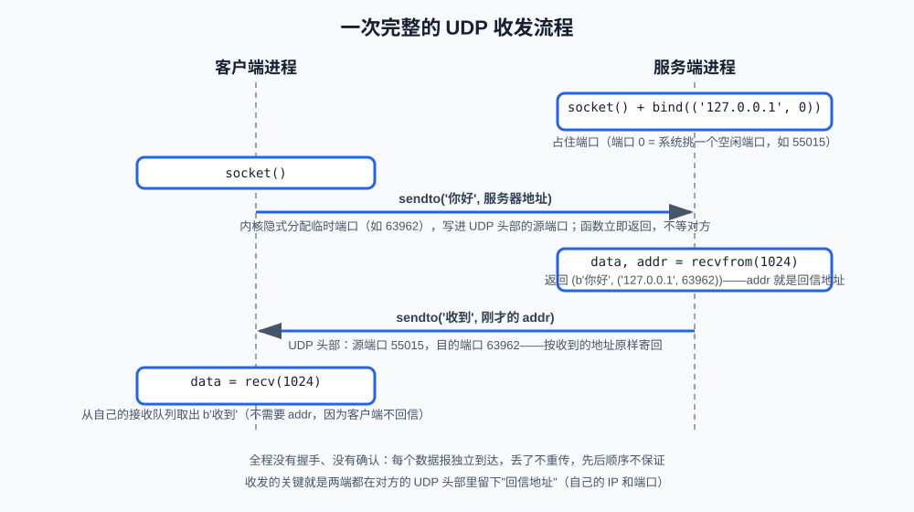

# 第5课:socket 编程

前三课建立了概念：分层模型、IP 地址与端口、TCP 与 UDP 的性质。但概念落地的入口只有一个——**socket**。浏览器、FastAPI、数据库客户端，一切网络程序最终都通过它收发数据。

这一课详细回答四个问题：socket 到底是什么；TCP 的客户端和服务器各自按什么顺序调用哪些方法、每个方法做了什么；UDP 的调用方式为什么不一样；以及程序出错时会发生什么。学完本课，你应该能独立写出最小的 TCP 客户端/服务器和 UDP 服务，并且对"程序为什么卡住了"有准确的解释。

**学习目标：**

1. 能说清 socket 是什么、它位于分层模型的哪一层之间、和 TCP/UDP 是什么关系；
2. 能按顺序写出 TCP 客户端和服务器，并解释 `bind`、`listen`、`accept` 各自的作用；
3. 能解释为什么 `accept` 返回一个新的 socket；
4. 能说清"阻塞"的含义，以及 `recv` 返回空字节代表什么；
5. 能用 socket 写 UDP 收发程序，并解释它和 TCP 的 API 为什么不同；
6. 能识别 `ConnectionRefusedError`、`TimeoutError` 等常见异常的原因。

## 1. socket 是什么

### 1.1 它在分层模型中的位置

socket（套接字）是**操作系统提供的编程接口**，位于应用层和传输层之间：

```text
你的程序            应用层逻辑（HTTP 怎么写、数据是什么格式）
    ↓ 通过 socket 收发
操作系统内核        传输层（TCP/UDP）+ 网络层（IP）+ 链路层
    ↓
网卡与物理网络
```

它是 Python 标准库 `socket` 模块暴露出来的对象，背后对应内核里的一条通信通道。TCP 的握手、重传、排序全部由内核完成，你的程序只做两件事：**往 socket 写字节**和**从 socket 读字节**。第 1 课"业务代码不需要关心 TCP 细节"的承诺，就是靠 socket 这个边界兑现的。

TCP 和 UDP 对 socket 来说只是创建时的一个参数：==`SOCK_STREAM` 创建 TCP socket，`SOCK_DGRAM` 创建 UDP socket==。之后所有调用的行为差异（是否需要 connect、收发用什么方法），都源于两个协议本身的差异——第 3 课已经打过底。

### 1.2 socket 对象和"文件"很像

进程每打开一个 socket，内核就创建一条通信端点记录，返回给程序一个整数编号==（句柄）==。它的使用方式和文件对象类似：打开、读写、关闭。一个进程可以同时持有成百上千个 socket——浏览器同时维持几十条连接就是这个原因。

## 2. TCP socket 的完整生命周期

TCP socket 分为客户端用法和服务器用法，调用顺序不同。完整的交互过程如下：



本课用到的方法汇总（输入、输出和副作用都在这里）：

| 方法                                    | 谁调用 | 作用           | 输入 / 输出               | 副作用                          |
| ------------------------------------- | --- | ------------ | --------------------- | ---------------------------- |
| `socket.socket(AF_INET, SOCK_STREAM)` | 双方  | 创建 socket 对象 | 两个常量；返回 socket        | 无网络动作                        |
| `bind((host, port))`                  | 服务器 | 占住地址和端口      | 地址元组；无返回值             | 端口被占用，失败抛 `OSError`          |
| `listen(n)`                           | 服务器 | 开始监听，n 是排队上限 | 整数；无返回值               | 内核开始接受握手                     |
| `accept()`                            | 服务器 | 取出一条已建立的连接   | 无输入；返回 `(conn, addr)` | **阻塞**直到有连接                  |
| `connect((host, port))`               | 客户端 | 向目标发起连接      | 地址元组；无返回值             | **阻塞**直到握手完成，失败抛异常           |
| `sendall(bytes)`                      | 双方  | 发送全部字节       | bytes；无返回值            | 可能阻塞（对方收不过来时）                |
| `recv(bufsize)`                       | 双方  | 读取数据         | 最多读多少字节；返回 bytes      | **阻塞**直到有数据；返回 `b''` 表示对方已关闭 |
| `close()`                             | 双方  | 关闭 socket    | 无返回值                  | 释放端口；对方会读到 `b''`             |

下面逐个展开关键调用。

### 2.1 创建：`socket.socket(AF_INET, SOCK_STREAM)`

`AF_INET` 指定地址族（IPv4），`SOCK_STREAM` 指定 socket 类型（TCP）。这两个参数决定了后面所有调用的行为——如果想用 UDP，把类型换成 `SOCK_DGRAM` 即可。`socket` 模块名和类名相同，所以写起来是 `socket.socket(...)`。

### 2.2 服务器三步：bind、listen、accept

**`bind(("127.0.0.1", 8000))`**：向操作系统声明"端口 8000 归我了"。参数是 `(IP 地址, 端口)` 元组。如果端口已被占用，抛 `OSError: Address already in use`（第 3 课演示过）。绑定 `0.0.0.0` 表示所有网卡，绑定 `127.0.0.1` 表示只有本机能连（第 2 课的区别在这里生效）。

**`listen(1)`**：通知内核"可以开始接受连接了"。参数是**等待队列长度**：内核替你完成握手、把建好的连接排队，程序还来得及 `accept` 的数量上限。这正是第 4 课讲过的机制——`listen` 之后客户端就能 `connect` 成功，因为握手是内核做的，`accept` 只是**从队列里取出**一条建好的连接。

> 要点解析
>1. `listen(backlog)` 这个参数控制的是**全连接队列的长度**——就是三次握手已经完成、等着你的程序 `accept()` 取走的那些连接。半连接队列（SYN_RCVD 状态）是内核自己管的，不由 `listen()` 的参数控制。
>2. 声明“"我的程序取连接比较慢（或者我故意只设成 1），你帮我排队的已完成连接最多放 1 个。第 2 个完成了也没地方放，==你要么丢要么拒==。"
>3. listen(1) ==不限制你能服务多少个客户端==。它限制的是已建连但==还没被 accept() 取走的连接==最多排 1 个。


**`conn, addr = accept()`**：返回两个值。`addr` 是对方的 `(IP, 端口)`；`conn` 是一个**新的 socket**——这是本课最重要的设计：

- `server`==（监听 socket）只负责"接电话"==，永远站在 `accept` 处等新连接；
- `conn`（连接 socket）负责和**这一个客户端**单独通话；
- 一百个客户端连进来，`accept` 返回一百个不同的 `conn`，互不干扰。

类比总机接线员：`server` 是总机号码，`conn` 是接线后那条专线。把两者混为一谈（比如对 `server` 调 `sendall`）是最常见的新手错误。

### 2.3 客户端两步：connect、然后收发

**`client.connect(("127.0.0.1", port))`**：向目标地址发起 TCP 连接。它会**阻塞**到握手完成；如果目标端口没人监听，抛 `ConnectionRefusedError`。==客户端不需要 `bind`——系统自动分配一个临时端口（第 3 课的"动态端口"）==。

连接建立后，客户端用**原来这个 socket** 收发：`sendall` 发、`recv` 收。它没有"第二个 socket"，因为客户端只有一条连接，不存在"新连接和老连接混在一起"的问题。

### 2.4 收发：sendall 与 recv

**`sendall(data)`**：输入必须是 `bytes`（第 1 课强调过：网络上只有字节）。它保证把全部字节发完才返回。

**`recv(bufsize)`**：输入是"本次最多读多少字节"——**这是上限不是要求**，有多少读多少，立即返回。返回值有三种情况：

1. `b'...'`：读到了对方发来的字节；
2. `b''`（空字节串）：**对方已正常关闭连接**，读完就再也没有数据了，这是判断"连接结束"的标准方式；
3. 抛异常：连接被异常中断（见第 5 节）。

`recv` 的"读不满"特性意味着：应用层消息的边界 TCP 不负责维护——两次 `sendall` 的内容可能被一次 `recv` 读到，也可能一条消息需要几次 `recv` 才凑齐。这就是"TCP 是字节流"的直接后果，第 6 课专门处理它。

> [!Note]
> 空字节就是对方正常关闭的信号，不算一种没有返回

### 2.5 关闭：close 与空字节

`close()` 释放 socket 和端口。对方随后会从 `recv` 拿到 `b''`，于是双方都知道连接结束了。不关闭会怎样？端口和内核资源持续被占用，对方一直等不到结束信号——课程代码里演示了 `client.close()` 之后服务器读到 `b''` 的效果。

```
主动方 → 被动方：FIN.      ← 这个 FIN 是主动方的 close()chu
被动方 → 主动方：ACK        （被动方进入 CLOSE_WAIT）
被动方 → 主动方：FIN        ← 这个 FIN 就是被动方 close() 触发的
主动方 → 被动方：ACK        （双方都关闭）
```

## 3. 阻塞：理解服务器行为的关键

本课的 `accept`、`connect`、`recv`、`sendall` 都是**阻塞调用**：如果事情没发生，函数不返回，程序停在这一行等。

- `conn.recv(1024)`：对方还没发数据，就停在这里等；
- `server.accept()`：还没有客户端连接，就停在这里等。

这带来两个直接推论：

1. **单个 socket 的"一问一答"是自然的**：客户端 `sendall` 之后 `recv` 等回复；服务器 `recv` 收到请求后处理、再 `sendall` 回复。谁先谁后必须配对，否则两边互相等，程序"卡住"；
2. **一个进程很难同时服务多个客户端**：服务器在 `conn1.recv()` 阻塞时，无法处理客户端 2。真实服务器用多线程、多进程或异步框架（FastAPI/uvicorn 就是异步方案）解决，思路都是"别让一个人卡住所有人"。本课程不展开并发，但你要知道瓶颈在哪。

课程代码为了在单个进程里演示双方，把服务器和客户端的代码**交替执行**（就像自己和自己打乒乓球），运行时注意观察打印顺序，它和上图完全对应。真实程序里，这两段代码通常分属两个进程甚至两台机器。


## 4. UDP socket：一次收发的完整流程

### 4.1 先用三句话解决绑定问题

1. **UDP 服务器必须 `bind`**——和 TCP 一样占住一个端口，内核才知道"发往这个端口的数据报放进这个 socket 的接收队列"。没有这一步，数据报到了也没人认领；
2. **UDP 客户端可以不 `bind`**——第一次 `sendto` 时内核自动分配一个临时端口（隐式绑定），效果和手写 `bind` 一样，只是省了几行代码；
3. **端口 0 是一个约定**——`bind(("127.0.0.1", 0))` 不是"绑定 0 号端口"，而是"请系统从空闲端口里挑一个给我"，之后用 `getsockname()` 查实际端口。课程用它避免端口冲突，真实项目通常用配置指定的固定端口（如 8000）。

绑定说完了，下面是本节的正题。

### 4.2 逐步拆解：一个数据报的往返

对照课程示例 `demo_udp_send_receive` 的代码和下面这张图，把一次完整的 UDP 收发拆成 8 步：



1. **服务器 `socket()` + `bind(("127.0.0.1", 0))`**：创建 UDP socket 并占住端口，系统挑中的是 55015，`getsockname()` 返回 `('127.0.0.1', 55015)`。从这一刻起，所有发往 `127.0.0.1:55015` 的 UDP 数据报都会进入这个 socket 的接收队列；
2. **客户端 `socket()`**：什么都不绑，也没有 `connect`——UDP 没有"连接"动作；
3. **客户端 `sendto("你好，UDP", server_addr)`**：内核替你做三件事——给这个 socket 分配临时端口（比如 63962，隐式绑定）、把源端口 63962 和目的端口 55015 写进 UDP 头部、把数据报交给网络层发出去。`sendto` **立即返回**，不等对方收到，也不管对方是否在线——这就是"发出就不管"；
4. **数据报到达**：目的地址是 `127.0.0.1`（回环地址，第 2 课），数据报不出网卡，直接在本机网络层折返；若目标是其他机器，则经路由转发。无论哪种，内核最终按**目的端口 55015** 完成分用（第 1 课），把数据报放进服务器 socket 的接收队列；
5. **服务器 `data, addr = recvfrom(1024)`**：从接收队列取出一个数据报。注意它返回**两个值**：`data` 是数据，`addr` 是**发送方的 `(IP, 端口)`**——从 UDP 头部的源端口来的，这是服务器回信的唯一线索。UDP 的"来件地址写在包裹上"，和 TCP 的"conn 就是专线"形成鲜明对比；
6. **服务器 `sendto("收到，UDP", addr)`**：把响应发往刚才的 `addr`。内核填的 UDP 头部是：源端口 55015（服务器自己的）、目的端口 63962（客户端的）——两个方向的数据报恰好互为镜像；
7. **客户端 `client.recv(1024)`**：从自己的接收队列取出响应。这里用 `recv` 而不是 `recvfrom` 也可以——`recvfrom` 返回地址，`recv` 不返回；客户端不打算回信，地址没用。两个方法可以按需要互换；
8. **结束**：双方 `close()`。没有挥手、没有 `b''` 信号——UDP 的 close 只是释放本机资源，对方毫无感知。

### 4.3 这 8 步里 UDP 没有做的事

对照第 2 节 TCP 的同一段旅程，UDP 少了这些环节，每一个都对应第 3 课的性质：

- **没有握手**：第 3 步发出去就发出去，不需要任何前置准备（对比 TCP 的三次握手）；
- **没有确认和重传**：第 5 步的服务器不知道、也不关心数据报有没有到；中途丢了就丢了，应用层想要就得自己做；
- **没有顺序保证**：连发三个数据报，对方可能按 2、3、1 的顺序取出，内核不负责重排；
- **没有消息边界问题**：一个 `sendto` 对应一个完整数据报、一次 `recvfrom`——这正是第 3 课"UDP 是数据报"的含义（TCP 的对应问题在第 6 课讲粘包）。

### 4.4 收发方法的对照

| 步骤     | TCP                     | UDP                                         |
| ------ | ----------------------- | ------------------------------------------- |
| 创建     | `SOCK_STREAM`           | `SOCK_DGRAM`                                |
| 绑定端口   | 服务器 `bind`；客户端内核隐式分配 | 完全相同：服务器 `bind`；客户端内核隐式分配 |
| 客户端发起  | `connect` 建立连接          | 直接 `sendto(data, addr)`                     |
| 服务器收数据 | `accept` 后用 `conn.recv` | `recvfrom(bufsize)` 收，**返回 `(data, addr)`** |
| 服务器回数据 | `conn.sendall`          | `sendto(data, addr)`，地址来自刚收到的包              |
| 关闭     | 对方读到 `b''`              | 没有"关闭"的概念，包发完即止                             |

### 4.5 与 TCP 的两个关键差异及原因

1. **没有 `accept`、没有 `conn`**：UDP 没有连接，每个数据报都是独立寄出的"包裹"。服务器的回应发到哪？`recvfrom` 返回的 `addr` 里带着寄信人地址，原样 `sendto` 回去即可。也因此 UDP 服务器没有"监听 socket / 连接 socket"的分工，一个 socket 就够了；
2. **没有"对方关闭"**：UDP 无连接可言，自然没有 `b''` 信号。想知道"对方还在不在"，只能靠**超时**：`sock.settimeout(2.0)` 让 `recvfrom` 最多等 2 秒，超时抛 `TimeoutError`，作业里用它防止程序卡死。

## 5. 常见异常与错误路径

| 异常 | 发生时机 | 原因 |
| --- | --- | --- |
| `OSError: Address already in use` | `bind` | 端口已被占用（第 3 课演示） |
| `ConnectionRefusedError` | `connect` | 目标端口没有进程监听，内核直接拒绝 |
| `ConnectionResetError` | `sendall` / `recv` | 对方进程被强杀或异常崩溃，没有走正常关闭 |
| `TimeoutError` | 设置了 `settimeout` 后收发 | 超时时间内对方没有响应 |

排查思路和第 1 课的逐层排错一致：`ConnectionRefusedError` 先确认"对方进程起没起、端口对不对"；`ConnectionResetError` 先看"对方进程还活着吗"；`TimeoutError` 先想"是网络不通，还是对方卡住了"。

## 6. 运行课程代码

课程代码在 `code/network/05-socket-basics.py`，包含三个示例：

1. `demo_udp_send_receive`：UDP 收发一轮，观察 `sendto`/`recvfrom` 和随包附带的来源地址；
2. `demo_tcp_exchange`：TCP 完整生命周期——监听、连接、accept 新 socket、两轮收发、关闭后读到 `b''`；
3. `demo_connection_refused`：连接不存在的端口，观察 `ConnectionRefusedError`。

```bash
cd <本仓库根目录>
conda run -n agent_dev python code/network/05-socket-basics.py
```

建议对照第 2 节的生命周期图逐行核对输出顺序。

## 7. 课后作业

作业在同一个文件的下半部分，从 `# ===== 课后作业：UDP 求和服务的客户端与服务器 =====` 开始。**应用逻辑（`parse_sum_request`，把 `"3,4"` 算成 `"sum=7"`，非法输入抛 `ValueError`）已经写好**，你的任务是写出 4.2 节那 8 步对应的"请求和响应的过程"。

需要完成的两个函数：

1. `run_sum_server()`（对应流程第 1、5、6 步）：创建 `SOCK_DGRAM` socket 并 `bind(("127.0.0.1", SERVER_PORT))`；循环 `recvfrom(1024)`；收到 `"bye"` 打印"服务结束"并结束；其他请求调用 `parse_sum_request`，**捕获它的 `ValueError` 并转换成 `"error: ..."` 响应**（想想该在哪一层处理异常——这正是 Python 第一课的原则），最后 `sendto` 回 `recvfrom` 返回的地址；
2. `run_sum_client()`（对应流程第 2、3、7 步）：创建 socket 并 `settimeout(2.0)`（服务器无响应时抛 `TimeoutError`，而不是永远卡住）；对给定的四个请求依次 `sendto` 到 `("127.0.0.1", SERVER_PORT)`、`recvfrom` 收响应并打印；最后发送 `"bye"`（不用等响应）。

**运行方式和以往不同**：作业是真实的两个进程，需要开两个终端——

```bash
# 终端 1（先启动，阻塞等待请求）
python code/network/05-socket-basics.py server
# 终端 2（后运行）
python code/network/05-socket-basics.py client
```

`__main__` 用命令行参数区分身份：带 `server` 参数就运行服务器，带 `client` 就运行客户端，不带参数运行课程示例。预期客户端输出：`sum=7`、`sum=8`、`sum=7`、`error: ...`，最后一条 `bye` 无响应；终端 1 打印"服务结束"后退出。

思考题（验收时回答）：

1. 为什么 UDP 的服务器**不需要**像 TCP 那样 `accept`？两个 socket 职责怎么分？
2. 先运行客户端、后启动服务器，客户端会发生什么？为什么？
3. 客户端发完 `"bye"` 后，如果把四个请求再发一遍，服务器端会发生什么？

## 8. 验收问题

1. socket 是什么？它和 TCP、UDP 是什么关系？
2. 服务器的 `bind`、`listen`、`accept` 分别做了什么？为什么 `accept` 返回新 socket？
3. `listen(1)` 之后客户端 `connect` 为什么能成功？握手是谁完成的？
4. `recv(1024)` 的 1024 是什么意思？返回 `b''` 代表什么？
5. 什么是阻塞？为什么"一问一答"的顺序配错了程序就会卡住？
6. UDP 服务器为什么不需要 `accept` 和 `conn`？它回复数据时地址从哪来？
7. `ConnectionRefusedError` 和 `ConnectionResetError` 分别在什么情况下出现？

## 9. 面试高频考点

- socket 的概念与位置：应用层使用传输层能力的编程接口，TCP/UDP 由创建参数决定。
- TCP 服务器 `bind`/`listen`/`accept` 三步的含义；监听 socket 与连接 socket 的区别。
- `recv` 返回空字节 = 对方正常关闭；`ConnectionRefusedError` = 目标端口无人监听。
- 阻塞 IO 的含义；单进程单线程服务器为什么难以同时服务多个客户端。
- UDP socket 与 TCP socket 在 API 上的差异及其协议根源。
