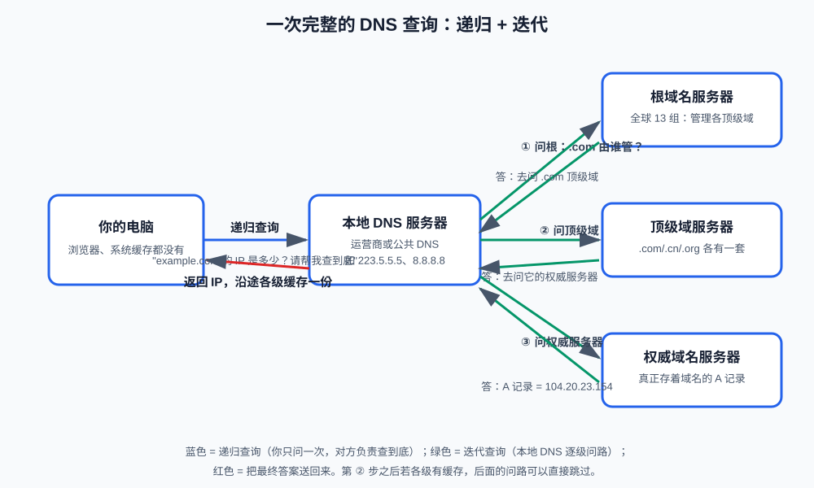

# 第7课:DNS 域名解析

前六课解决了"数据怎么送到一台机器"，但有个前提一直没说清：你怎么知道对方机器的 IP？调用大模型 API 写的是 `api.example.com`，不是一串数字——**DNS（Domain Name System，域名系统）**负责把人类易记的域名翻译成机器使用的 IP 地址。

本课讲清三件事：一次域名解析的完整旅程（含每一级缓存）、"递归"与"迭代"这对必考概念、以及为什么 DNS 跑在 UDP 上。学完本课，"浏览器输入 URL 后发生了什么"这道综合题的前半段就齐了。

**学习目标：**

1. 能画出域名的层级结构，说出根、顶级域、权威域分别管什么；
2. 能完整描述一次 DNS 查询经过哪些环节，区分递归查询和迭代查询；
3. 能解释缓存和 TTL（Time To Live，生存时间）如何加速解析；
4. 能认识 A、AAAA、CNAME、NS 四种常见记录；
5. 能用 `dig` 读出一次查询的答案、CNAME 链和 TTL；
6. 能解释 DNS 为什么通常用 UDP。

## 1. 域名的层级结构

`www.example.com` 从右往左读，层级从大到小：

```text
.        根域（书写时省略，完整写法是 www.example.com. 注意结尾的点）
com      顶级域（TLD，Top-Level Domain）：.com/.cn/.org/.edu……由对应注册局管理
example  权威域（注册人在顶级域下注册的域名）
www      子域/主机名（域主自行定义，常见有 www、api、mail）
```

这个层级结构和 DNS 服务器的分工完全对应：**根域名服务器**不认识 `example.com`，但它知道`.com` 归谁管；**`.com` 顶级域服务器**不存具体 IP，但它知道 `example.com` 的记录存在哪台**权威域名服务器**上；只有权威服务器才真正保存"`www.example.com` → 某个 IP"的答案。DNS 就是一棵全球分布式的查询树。

根域名服务器全球只有 13 组（用 A 到 M 命名），靠任播技术和全球数百个镜像节点提供服务。没有人"每次都去问根"——因为缓存无处不在，这是下一节的主角。

## 2. 一次解析的完整旅程



### 2.1 出发前：先查本地

浏览器拿到 `www.example.com` 后并不会立刻发 DNS 请求，按顺序先查：

1. **浏览器自己的 DNS 缓存**；
2. **操作系统缓存**；
3. **hosts 文件**：`/etc/hosts`（Windows 在 `C:\Windows\System32\drivers\etc\hosts`）。它由用户或管理员手工维护，**优先级高于一切 DNS 查询**——开发时"把某域名指向本机调试"就是改它。hosts 有答案就直接用，没有才进入网络查询。

### 2.2 递归查询：你只问一次

本机把问题交给**本地 DNS 服务器**（运营商自动分配的，或手动配置的公共 DNS 如 `223.5.5.5`、`8.8.8.8`）。这层关系叫**递归查询**：你的要求是"给我最终答案，过程你包了"——本地 DNS 服务器必须跑腿到底，查不到就继续问上级，直到拿到 IP 返回给你。

### 2.3 迭代查询：本地 DNS 逐级问路

本地 DNS 服务器自己也没有答案，它替你跑腿的方式是**迭代查询**——每一级只得到一个"路标"：

1. 问**根服务器**：`.com` 由谁管？答：去问这些 TLD 服务器；
2. 问 **`.com` 顶级域服务器**：`example.com` 的记录在哪？答：去问它的权威服务器；
3. 问**权威服务器**：终于拿到 A 记录，例如 `93.184.216.34`。

对比记忆：**递归是"帮我查到底"，迭代是"告诉我下一步问谁"**。前者发生在"你的电脑 ↔ 本地 DNS"之间，后者发生在"本地 DNS ↔ 各级服务器"之间。同一个词在两段关系里方向不同，这是面试最爱挖的坑。

### 2.4 缓存与 TTL

答案到手后，沿途回来的每一站都会缓存它：本地 DNS 服务器缓存（这也是绝大多数查询根本到不了根服务器的原因）、操作系统缓存、浏览器缓存。==每条缓存记录都有 **TTL（生存时间）**==——权威服务器在答案里声明"这条记录只管 X 秒"，==过期后必须重新解析==。

TTL 是一把两刃的刀：设长（如 86400 秒）解析快、压力小，但换 IP 后全网要一天才更新；设短（如 60 秒）切换灵活，但查询压力大。运维做"域名迁移"前先调低 TTL，就是这个原因。

## 3. 常见记录类型

DNS 的答案不止"域名 → IP"一种，常见记录：

| 类型    | 名称             | 含义                           | 例子                                   |
| ----- | -------------- | ---------------------------- | ------------------------------------ |
| A     | Address        | 域名 → IPv4 地址                 | `example.com A 104.20.23.154`        |
| AAAA  |                | 域名 → IPv6 地址（A 的四倍长度，所以四个 A） | `example.com AAAA 2606:2800:…`       |
| CNAME | Canonical Name | 别名指向另一个域名，"真正的答案请再查它"        | `www.example.com CNAME example.com`  |
| NS    | Name Server    | 这个域的解析由哪台权威服务器负责             | `example.com NS ns1.example.com`     |
| MX    | Mail eXchange  | 收这个域的邮件走哪台服务器（本课不展开）         | `example.com MX 10 mail.example.com` |

CNAME 值得单独说明：它不直接给 IP，而是给"另一个域名"，解析器需要再查一次（可能有长长一条 CNAME 链）。大型网站用它把入口域名指向 CDN 服务商的域名——查询链变长，但换 CDN 时只需改一条记录。

## 4. 为什么 DNS 用 UDP

回忆第 3 课的选型口诀"要完整就 TCP，要实时就 UDP"，DNS 是 UDP 的经典案例：

- **查询和应答都很小**：一个域名加一条记录，一个报文足够（约几十到几百字节）；
- **丢失重试很便宜**：重发一次查询的代价，远低于 TCP 三次握手的代价；
- **无连接意味着低延迟**：一次来回就完成，没有握手开销。

但 DNS 并非只用 UDP，两种情况退回 TCP（53 端口）：**响应超过约 512 字节**（记录太多塞不下一个 UDP 报文）；**区域传输**（主从权威服务器之间同步整个域的数据库）。另外，现代协议 DNS over HTTPS（DoH，把 DNS 查询加密塞进 HTTPS）也在普及，能防止运营商劫持解析结果——本课知道概念即可。

## 5. 解析失败是什么现象

把故障和现象对上号，排错时才不会方向跑偏：

- **域名不存在**：应答状态码 NXDOMAIN（"没有这个域名"）——多半是域名拼错；
- **解析慢或超时**：本地 DNS 服务器不可用——换公共 DNS 验证（如 `dig @223.5.5.5 ...`）；
- **解析正常但连不上**：DNS 已经完成使命，问题在 TCP/应用层——这是第 12 课逐层排错的关键分界线："ping 得通、域名解析对，问题就不在网络层以下"。

## 6. 终端演示：用 dig 观察一次解析

`dig`（domain information groper）是 macOS/Linux 自带的 DNS 查询工具（Windows 可用 `nslookup`），命令详解在第 11 课，这里先会用。

### 6.1 基础查询

```bash
dig www.example.com
```

重点读三段输出：`QUESTION SECTION`（问的是什么）；`ANSWER SECTION`（答案，包含记录类型和 TTL，如 `example.com. 168 IN A 104.20.23.154`——168 就是这条缓存能活 168 秒，一台域名可能对应多条 A 记录）；末尾的 `Query time`（本次查询耗时，几十毫秒；再查一次会变成 0 ms，因为本地 DNS 已缓存）。

### 6.2 观察 CNAME 链

```bash
dig www.baidu.com
```

答案区不止一行：`www.baidu.com` 先是一条 **CNAME** 记录指向 `www.a.shifen.com`，后面才是 `www.a.shifen.com` 的 A 记录——这就是 2.4 节和第 3 节说的 CNAME 链在真实世界的样子。

### 6.3 换一台 DNS 服务器对比

```bash
dig @223.5.5.5 www.example.com    # 指定问阿里公共 DNS，绕过默认配置
dig @8.8.8.8 www.example.com      # 指定 Google 公共 DNS
```

`@` 指定"问谁"。对比两者的 Query time，能直观感受"本地 DNS 选得近不近"的影响。

### 6.4 验证 hosts 文件的优先级

查看 hosts 文件（只读观察即可，修改需要管理员权限，改完记得还原）：

```bash
cat /etc/hosts
```

典型内容如 `127.0.0.1 localhost`。如果某行写了 `127.0.0.1 www.example.com`，那么本机对 `www.example.com` 的所有访问都会指向自己——这就是 2.1 节"hosts 优先于 DNS"的含义，也是开发调试时常走的捷径。

## 7. 验收问题

1. `api.example.com` 从右往左各是什么？根域名服务器、顶级域服务器、权威服务器各自存什么？
2. 描述一次完整的 DNS 查询：本地缓存都没有时，经过哪些环节拿到 IP？
3. 递归查询和迭代查询的区别？分别发生在哪两段关系之间？
4. TTL 是什么？调高调低各有什么影响？运维迁移域名前为什么要先调低 TTL？
5. CNAME 记录返回的是什么？为什么大型网站入口常用 CNAME？
6. DNS 为什么用 UDP？什么情况下用 TCP？
7. hosts 文件和 DNS 谁的优先级高？开发时怎么利用这一点？
8. "域名能解析但接口连不上"，问题最可能出在哪一层？

## 8. 面试高频考点

- DNS 的层级结构与各级服务器职责（根 / TLD / 权威）。
- 递归查询与迭代查询的区别及发生位置——最高频考点。
- 解析顺序：浏览器缓存 → 系统缓存 → hosts → 本地 DNS（含各级缓存与 TTL）。
- A / AAAA / CNAME / NS 记录的含义；CNAME 链的作用。
- DNS 为什么用 UDP，什么时候用 TCP。
- "输入 URL 后发生了什么"的 DNS 部分（与第 9 课 HTTP 部分拼成完整答案）。
