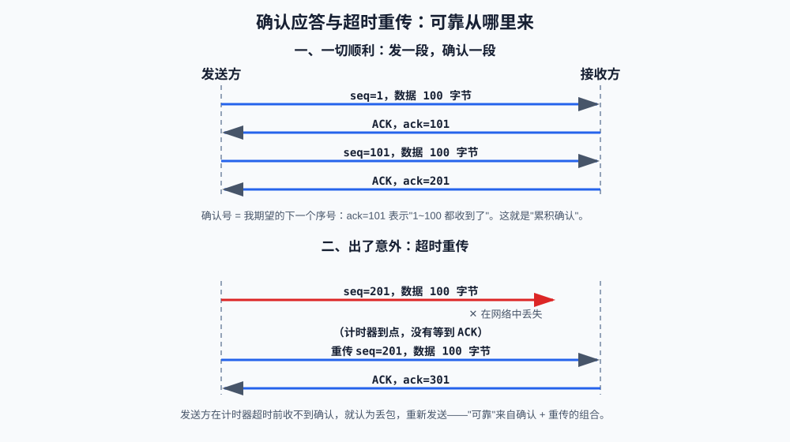
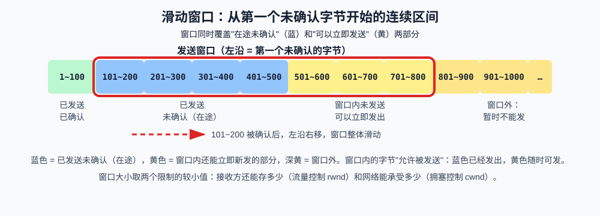

# 第六课：TCP 可靠传输与粘包

第 3 课结尾留了一个伏笔："TCP 是字节流，发两次和发一次合并成一次，对接收端来说只是一串连续字节"，由此引发的粘包问题在第 6 课解决——就是本课。前半部分讲 TCP 实现"可靠、有序"的机制（确认、重传、滑动窗口、流量控制、拥塞控制），后半部分回到代码，亲眼看到粘包，并写出两种消息边界协议。

**学习目标：**

1. 能解释"可靠"是如何由确认和重传组合实现的；
2. 能说明滑动窗口解决什么问题、窗口大小由哪两个因素决定；
3. 能区分流量控制（接收窗口）和拥塞控制（拥塞窗口）；
4. 能解释粘包和拆包的成因，并用分隔符或长度前缀协议正确收发消息；
5. 能说出 HTTP 接口和大模型流式响应各自采用的消息边界方案。

## 1. 可靠传输要解决什么问题

第 2 课说过，IP 层只管尽力转发，不承诺任何东西。数据在网络里旅行时可能遭遇：**丢失**（路由器缓冲区满了直接丢弃）、**乱序**（两条路径速度不同，后发的先到）、**损坏**（比特翻转）、**重复**（重传的副本和原版都到达）。

TCP 在这些不可靠的字节之上做出承诺：交给应用层的字节流**不丢、不重、不乱序**。实现这个承诺的核心手段只有两个词：**确认**（每个字节都要被对方确认收到）和**重传**（迟迟没等到确认就再发一次）。其余机制都是围绕这两个词的性能优化。

## 2. 确认应答与超时重传



### 2.1 确认的时机：每包都确认，还是定时确认？

先回答一个自然产生的疑问：接收方是"每收到一个报文段就立刻回一个确认"，还是"每隔一段时间统一确认一次"？

**基线做法是前者：收到数据就确认。** 但如果对每个报文段都单独回一个纯确认报文（不带数据、只为确认而存在的 ACK 包），报文数量直接翻倍——发 1000 个数据包就要多发 1000 个确认包。这些小包同样占用带宽和路由器缓冲区，反而加剧网络拥塞。所以实际实现的默认策略是两个优化的组合：

1. **延迟确认（Delayed ACK，延迟确认）**：收到数据后不立刻回确认，而是先启动一个很短的定时器（Linux 上常见约 40 毫秒，协议建议的上限是 500 毫秒），在这段时间里等两件事之一发生：
   - 本机恰好有数据要发回去（比如 HTTP 请求的响应），就把确认号**捎带**在数据报文上，一个包同时完成"发数据"和"确认"两件事；
   - 定时器先到期且没有数据可捎带，才单独发一个纯确认。协议还规定：即使一直捎带不上，**每收到两个满尺寸报文段也至少要回一个确认**，不让确认被无限拖延。
2. **累积确认的合并效果**：下一小节会讲到，确认号的含义是"到此为止全部收到"，所以确认天然可以合并——连续收到第 1、2、3 个报文段时不着急逐个确认，最后回一个"请发第 4 段"，就把前三段一次性全部确认了。

所以准确的回答是：**既不是严格"每包必确认"，也不是固定"定时确认"，而是"收到即可确认、默认稍作延迟、能捎带就捎带、一个确认号还能合并覆盖多段"；定时器只是防止确认被无限拖延的兜底。**

有一个重要的例外：**乱序到达的报文段必须立即重复确认，不允许延迟**。接收方发现"我缺中间一段"时，会立刻重复发送"我缺第 X 段"的确认，绝不等定时器——否则下一小节的快速重传就要白白多等几十毫秒。这也是发送方能在极短时间内攒够"三个重复确认"的原因。

补一个真实工程注脚：发送方也有一个类似的"攒小包"优化，叫 Nagle 算法（还有小的未确认数据在途时，先攒一攒再发，减少小包数量）。当"接收端延迟确认 + 发送端 Nagle 攒包"叠加时，交互式程序（每敲一个字符发一次的远程终端、网络游戏）会出现规律的几十毫秒卡顿——两边互相等对方的定时器，谁都不肯先发。这就是很多低延迟程序在 socket 上设置 `TCP_NODELAY`（禁用 Nagle 算法）的原因，第 11 课观察连接参数时会再见到它。

### 2.2 确认：累积确认

对照图的上半部分，结合第 4 课的记号：

- 发送方发数据时报文带 `seq`（这段数据从字节流第几字节开始）；
- 接收方每收到数据就回 `ACK`，确认号 `ack` = **期望收到的下一个字节序号**。`ack=101` 的含义是"1~100 全都收到了，请发 101"——它一次性确认了之前所有字节，所以叫**累积确认**。

### 2.3 重传：计时器 + 快速重传

如果接收方收到了乱序的报文，理论上有两种情况：1. 丢包了，2.延迟了。但是计算后统一按照丢包处理。
发送方每发出一段数据就启动一个计时器，超时还没等到确认，就认为丢包，重传这段数据（图下半部分）。

纯靠超时等待反应太慢——要等一整个往返时间（RTT，Round-Trip Time，往返时间）才知道丢没丢。TCP 还有一个更快发现丢包的信号：**快速重传**。接收方收到乱序报文时会重复确认"我还缺第 X 段"；发送方收到**三个重复的 ACK**，就不等计时器超时，立即重传第 X 段。超时重传是兜底，快速重传是捷径。

## 3. 滑动窗口：从"发一段等一段"到流水线

如果每发 100 字节都停下来等确认，网速再快也快不起来——数据在管道里是一段一段蠕动的。**滑动窗口**的思路：允许发送方**不等确认就连续发送**一批数据，这段"在途未确认"的额度就是窗口。



对照图：发送窗口是"从第一个未确认的字节开始"的连续区间，同时覆盖两种字节——**蓝色是已发出、还在路上等确认的（在途）**；**黄色是窗口内还没发出的，随时可以立即发送**。二者都在窗口内，因为窗口的本质是一个额度："最多允许这么多字节处于'已发出未确认'或'即将发出'的状态"。图中红色虚线箭头标出滑动的触发条件：最左侧的在途字节（101~200）得到确认后，左沿右移，窗口整体滑动，窗口外（深黄）的字节依次获得发送资格。窗口把"停等"变成了"流水线"，网络利用率大幅提升。

窗口多大合适？它受两个因素限制，取较小值：

1. **接收窗口（rwnd，receive window）**：接收方在 TCP 头部的"窗口大小"字段（第 3 课）里实时告诉发送方"我的缓存还能装多少"，发送方不得超过——这就是**流量控制**，防止压垮**接收方**；
2. **拥塞窗口（cwnd，congestion window）**：发送方对网络拥挤程度的自我估计——这就是**拥塞控制**，防止压垮**网络**。

### 3.1 拥塞控制的四个阶段

发送方如何估计网络容量？答案是**试探**：

1. **慢启动**：连接刚开始，==窗口从小值起，每确认一轮就翻倍==，==指数增长==——名字叫"慢"启动，其实涨得很快；
2. **拥塞避免**：窗口涨到阈值后转为==每轮加 1，线性增长==，小心试探；
3. **快重传**：收到三个重复 ACK，判定个别丢包，立即重传（第 2.3 节）；
4. **快恢复**：快重传后==窗口减半再继续线性增长==，而不是从零开始慢启动——个别丢包不代表网络瘫痪。

如果发生**超时**（更严重的信号），窗口直接回到小值重新慢启动。整个过程的直觉：像开车下雾路——先提速试探，视野变差就减速，完全看不见就重来。

面试常见追问"为什么下载开始慢后来快"，答案就是慢启动到拥塞避免的窗口爬坡。

## 4. 粘包与拆包：字节流的代价

机制讲完，回到应用层最切身的问题。

### 4.1 成因

TCP 只保证字节**按序不丢**地到达，它从不维护"消息"的边界。你调用两次 `sendall`，TCP 看到的只是"又来了一段字节"，可以合并成一次投递（**粘包**）；你调用一次 `sendall` 发 180 字节，对方 `recv(64)` 只能先拿到前 64 字节（**拆包**/读不满）。

课程代码 `demo_sticky_and_split` 现场演示了这两个现象：

```text
服务器一次 recv 读到 27 字节：b'第一条第二条第三条'  ← 三条消息粘在一起
180 字节的消息用了 3 次 recv(64) 才拼完整            ← 一条消息拆成多段
```

强调一个容易误解的点：**粘包不是 bug，是 TCP 的正常工作方式**。第 5 课的 `recv(n)` 是"上限不是承诺"，根源也在这里。

### 4.2 解决思路：应用层自己定义边界

既然 TCP 不管边界，边界就由应用层协议定义。三种经典方案：

| 方案   | 做法              | 优点         | 缺点         | 真实例子                         |
| ---- | --------------- | ---------- | ---------- | ---------------------------- |
| 固定长度 | 每条消息都是 100 字节   | 实现最简单      | 浪费空间，内容受限  | 某些心跳包                        |
| 分隔符  | 消息后加分隔符（如 `\n`） | 简单、可变长     | 内容里不能出现分隔符 | 逐行文本日志、SSE 流                 |
| 长度前缀 | 头部写明正文长度        | 可靠、支持任意二进制 | 要处理头部拆包    | HTTP 的 `Content-Length`、本课作业 |

### 4.3 先认识缓冲区：接收端手里的"暂存篮"

讲分隔符协议之前，需要先认识一个贯穿收发两端代码的概念——**缓冲区（buffer）**：程序在内存里开辟的一段临时存放字节的区域，用来协调"数据到达的节奏"和"程序消费数据的节奏"之间的不匹配。

缓冲区不是什么新发明，本课它已经出现过两次，只是没点名：

1. **现象二里的 `received`**：180 字节的消息分 3 次 `recv(64)` 到达，每次读到的碎片先累加进 `received = bytearray()`，攒够 180 字节才算拼完。这个 `bytearray` 就是一个缓冲区——它的存在理由是"一条消息拆成几次到达"；
2. **操作系统内核的接收缓冲区**：第 5 课说过，对方发来的数据先进入内核为这条连接准备的一块内存，你的 `recv` 只是从那里取走一份。内核缓冲区的存在理由是"数据到达时你可能还没调用 recv，总得先有个地方放"。

应用层缓冲区（`recv_line` 里的 `buffer`）是对内核缓冲区的补充：`recv` 取数据时**不管消息边界**，一次取出来的可能粘着两条消息、也可能是半条消息。既然内核不能保证"一次取出正好一条"，程序就自己找地方把取出来的字节暂存起来，凑齐一条处理一条，剩下的留给下一条——这个"自己找的地方"就是应用层缓冲区。

所以 `recv_line` 的处理节奏是：recv 到的字节先进缓冲区 → 在缓冲区里找分隔符 → 找到就切出一条消息，**切剩的部分继续留在缓冲区里**。下一小节会看到这带来的一个重要设计约束。

### 4.4 课程示例：分隔符协议

课程代码给出了完整的分隔符协议实现 `send_line` / `recv_line`，`demo_line_protocol` 用它收发三条消息，即使粘在一起也能正确切开。实现中有两个关键设计值得细读（文档和代码注释对照看）：

1. **缓冲区跟着连接走**：`recv_line(sock, buffer)` 返回"更新后的 buffer"，调用方必须保存并传回。原因正是 4.3 节的暂存篮模型：一次 `recv` 可能粘着两条消息，切走第一条后剩下的必须留到下次，所以缓冲区的生命周期必须长于单次函数调用——这也是"每个连接一份缓冲区"的原因（真实服务器为每个 `conn` 维护独立 buffer，A 连接的残包绝不能混进 B 连接的篮子里）；
2. **循环读直到凑齐**：每次 `recv` 后在缓冲区里找 `\n`，找不到就继续 `recv`——一条消息拆成几次到达也没关系。==收到 `b''` 时如果缓冲区里还有残缺消息，说明协议出了问题==，抛异常而不是默默返回半条。
3. 宁可报错让人知道有问题，也不要"假装成功"让错误悄悄传播。即使是最后一条也需要加分隔符

分隔符协议的缺陷也很直观：消息内容里不能出现 `\n` 本身。想传任意二进制数据，就需要长度前缀——这是本课作业。

## 5. 项目场景：真实系统里的消息边界

- **调用大模型 API 的流式响应**：服务器把生成的文本一段段推给客户端，用的正是分隔符方案（SSE 协议，事件之间用空行分隔）。客户端逐段读取、逐段渲染——你看到的"打字机效果"，就是应用层在字节流上按分隔符切出的一个个事件；
- **普通 JSON 接口**：请求和响应都是一次性完整消息，HTTP 用 `Content-Length` 头部声明正文长度——长度前缀方案在应用层的变体。第 8 课会直接读到这个字段。

## 6. 运行课程代码

```bash
cd /Users/yyma/workspace/agents/lifestyle-manager-study
conda run -n agent_dev python code/network/network_lesson06.py
```

依次观察：粘包与拆包现象、分隔符协议的正确收发。

## 7. 课后作业

作业在同一个文件的下半部分。**应用逻辑（回显服务器，收到什么回什么）已经写好**，你的任务是写出"长度前缀协议"的收发两端——它比分隔符协议更适合传输任意二进制内容。

消息布局：

```text
[4 字节头部：正文长度，大端无符号整数][正文本体]
```

需要完成的两个函数：

1. `send_frame(sock, payload)`：用 `struct.pack(">I", len(payload))` 生成 4 字节头部，与正文拼成一个 `bytes` 后一次 `sendall`（约 2 行）；
2. `recv_frame(sock)`：先循环 `recv` **凑满** 4 字节头部（记住"上限不是承诺"），`struct.unpack(">I", header)` 解出长度 n，再继续循环凑满 n 字节返回；任何一步读到 `b''` 都抛 `ConnectionError`（约 15 行）。这是 `recv_line` 思路的变体：把"找 `\n`"换成"精确收满 n 字节"，而且不需要调用方传缓冲区——因为每条消息的长度已经写在头部里。

**运行方式**（同第 5 课，两个终端）：

```bash
# 终端 1
python code/network/network_lesson06.py server
# 终端 2
python code/network/network_lesson06.py client
```

客户端会发送一条 600 字节的长消息——它必然被拆成多次 `recv`，如果你的 `recv_frame` 实现正确，回显的响应应该有 1356 字节（`"echo: "` 前缀加 600 个汉字的 UTF-8 编码）；实现不正确时常见的症状是长度解出天文数字或程序卡死，正好用来检验"循环凑满"写对了没有。

思考题（验收时回答）：

1. `recv_frame` 为什么不需要像 `recv_line` 那样把缓冲区传进传出？
2. 如果对方发的头部长度是 10 亿，你的实现会发生什么？该怎么防御？
3. 三个重复 ACK 触发快速重传，为什么是三个而不是一个？

## 8. 验收问题

1. IP 层的哪些不保证，由 TCP 的哪两个手段弥补？
2. `ack = 301` 精确表达什么含义？为什么叫累积确认？
3. 超时重传和快速重传分别由什么信号触发？
4. 滑动窗口解决什么问题？窗口大小由哪两个因素决定、各防什么？
5. 慢启动"慢"在哪里？为什么下载开始时速度爬坡？
6. 粘包和拆包的成因是什么？为什么说这不是 bug？
7. 三种消息边界方案各有什么优缺点？HTTP 和大模型流式响应分别用哪种？
8. `recv_line` 的 buffer 为什么必须由调用方保存并传回？`recv_frame` 为什么不需要？

## 9. 面试高频考点

- TCP 保证可靠的机制组合：确认 + 重传 + 有序重组。
- 累积确认的含义；超时重传与快速重传（三个重复 ACK）的触发条件。
- 滑动窗口与流水线传输；流量控制（rwnd，防压垮接收方）与拥塞控制（cwnd，防压垮网络）的区别——高频对比题。
- 拥塞控制四阶段：慢启动、拥塞避免、快重传、快恢复；"下载开始慢后来快"的解释。
- TCP 粘包/拆包的成因与三种解决方案；为什么 UDP 没有粘包问题。
- 用长度前缀或分隔符设计一个应用层协议（结合代码说明）。
