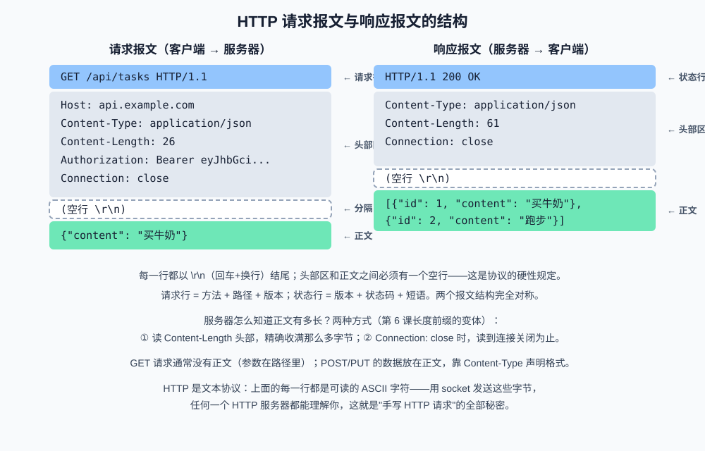
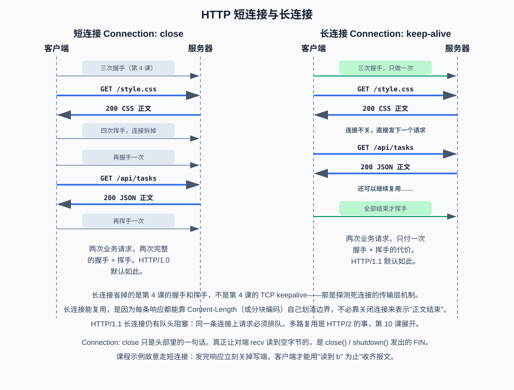

# 第八课：HTTP 基础：报文、方法与状态码

前七课把"数据怎么送到一台机器、送到哪个进程"讲完了：分层、IP、端口、TCP 握手、socket、可靠传输、DNS。现在缺的是**送到之后双方说什么语言**。浏览器、手机 App、调用大模型 API 的客户端，应用层几乎都在说同一种语言——**HTTP（HyperText Transfer Protocol，超文本传输协议）**。

本课把 HTTP 从"会用框架发请求"还原成"能手写一封完整报文"。学完之后你会发现：所谓 Web 框架，不过是帮你拼这几行文本、再帮你从 TCP 字节流里切出下一封报文。HTTPS、Cookie、HTTP/2 放到第 9、10 课；本课只把 HTTP/1.1 的报文本身讲透。

**学习目标：**

1. 能默写出请求报文和响应报文的四段结构，并指出空行的作用；
2. 能解释 GET、POST、PUT、DELETE、PATCH 各自做什么，以及什么叫幂等；
3. 能按 1xx～5xx 分类说出常见状态码，并区分 502 和 504；
4. 能说明 `Content-Type`、`Content-Length`、`Authorization`、`Connection` 各自解决什么问题；
5. 能区分 HTTP 短连接、HTTP 长连接和 TCP keepalive，并解释为什么 `Connection: close` 不会自动关掉 socket；
6. 能用 socket 手写一次 HTTP 请求和一次 HTTP 响应，不用任何 HTTP 库。

## 1. HTTP 是什么：跑在 TCP 上的文本协议

HTTP 是应用层协议。它规定两件事：客户端发出的**请求**长什么样，服务器回的**响应**长什么样。它不负责找机器（那是 DNS 和 IP）、不负责可靠送达（那是 TCP）、不负责加密（那是第 9 课的 TLS（Transport Layer Security，传输层安全））。它只规定**字节流上的消息格式**。

这带来一个非常具体的后果：HTTP 报文就是一段**可读的 ASCII 文本**，后面可以跟一段任意字节的正文。你用 socket 把这些字节 `sendall` 出去，对面任何一个 HTTP 服务器都能读懂——不需要 `requests`、不需要 FastAPI。课程代码就是这样做的。

HTTP 跑在 TCP 上，所以第 6 课的结论全部适用：TCP 只保证字节按序到达，**不维护"一条报文"的边界**。HTTP 必须自己定义边界。本课后面会看到，边界就是"空行 + `Content-Length`"，正是第 6 课长度前缀方案在应用层的标准实现。

一次完整访问网站，到本课为止的链路是：

```text
输入 URL
  → DNS 把域名变成 IP          （第 7 课）
  → TCP 三次握手连上 80 端口    （第 4 课；HTTPS 是 443，第 9 课再加 TLS）
  → 在这条连接上写出 HTTP 请求  （本课）
  → 读回 HTTP 响应              （本课）
  → 四次挥手或复用连接           （第 4 课 + 本课第 6 节）
```

## 2. 报文结构



请求和响应是对称的四段：**起始行、头部、空行、正文**。每一行（正文除外）都以 `\r\n`（回车 + 换行）结尾。空行是硬性规定：没有它，对方不知道头部在哪结束、正文从哪开始。

### 2.1 请求报文

**第一段：请求行。** 三个字段，空格分隔：

```text
GET /api/tasks HTTP/1.1\r\n
│   │          │
│   │          └─ 协议版本。本课只关心 HTTP/1.1
│   └─ 路径。问号后面可以带查询字符串，如 /api/tasks?id=1
└─ 方法。告诉服务器"请对这个路径做什么"
```

路径是服务器眼里的资源名，不是文件系统路径。`GET /api/tasks` 的意思是"请给出 tasks 这个资源的当前表示"，服务器拿什么实现——查内存、查数据库、读文件——HTTP 不管。

**第二段：头部。** 每行一个 `名字: 值`，名字大小写不敏感。头部是请求的"说明书"：正文是什么格式、有多长、连完要不要关掉、调用者是谁。常见字段第 5 节展开。

**第三段：空行。** 单独一个 `\r\n`。它是头部和正文的分界符。课程代码里的 `recv_until(sock, b"\r\n\r\n")` 就是在字节流里找这个分界符——这是第 6 课分隔符协议的直接应用。

**第四段：正文。** GET 通常没有正文，查询参数写在路径里；POST / PUT / PATCH 的数据放在这里。有没有正文、有多长，**不靠猜，靠 `Content-Length` 头部**。

### 2.2 响应报文

结构完全对称，只是第一段换成**状态行**：

```text
HTTP/1.1 200 OK\r\n
│        │   │
│        │   └─ 原因短语，给人看的，程序一般只读数字
│        └─ 状态码，三位数，程序靠它判断成败
└─ 协议版本
```

头部、空行、正文的规则和请求一样。JSON 接口的正文经常是 `{"id": 1, "content": "买牛奶"}` 这样一段 UTF-8 字节；HTML 接口的正文就是整页 HTML。`Content-Type` 声明"这段字节该按什么格式理解"。

### 2.3 空行与 Content-Length：两条边界规则

接收方读一条 HTTP 报文，固定两步：

1. **读到空行为止**，得到起始行和全部头部。TCP 可能一次 `recv` 就把空行后面的正文也带回来，所以多读到的字节必须留下来——这就是 `recv_until` 返回 `(head, rest)` 的原因；
2. **看 `Content-Length`**：值为 n，就再精确收 n 字节作为正文（`recv_exact`，第 6 课作业 `recv_frame` 的变体）。没有这个头部、也不是分块编码时，只能约定"读到连接关闭为止"。

第二条把 HTTP 和"关连接才知道结束"绑在一起，也是下一节长连接能成立的前提：**每条报文必须自己知道自己有多长，连接才能留给下一条报文用。**

分块传输编码（Transfer-Encoding: chunked，分块传输编码）是 `Content-Length` 的替代方案：正文事先不知道总长度时（比如大模型一边生成一边往外推），按块发送，每块前面写本块长度，最后一块长度为 0 表示结束。本课作业和示例都用 `Content-Length`，分块编码知道概念即可，流式场景第 10 课再展开。

## 3. 方法与幂等性

方法写在请求行第一个字段，表示"对这个资源做什么"。**REST（Representational State Transfer，表述性状态转移）**风格的接口把资源看成名词、方法看成动词，常见五个：

| 方法 | 含义 | 正文 | 安全 | 幂等 | 典型用途 |
| --- | --- | --- | --- | --- | --- |
| GET | 读取资源 | 通常无 | 是 | 是 | 查询任务列表、拉模型配置 |
| POST | 创建 / 提交 | 有 | 否 | 否 | 新建一条任务、提交表单 |
| PUT | 整体替换 | 有 | 否 | 是 | 用一份完整数据覆盖 id=1 的任务 |
| DELETE | 删除 | 通常无 | 否 | 是 | 删掉 id=1 的任务 |
| PATCH | 部分修改 | 有 | 否 | 通常否 | 只改任务的完成状态 |

**安全**的意思是"不会改变服务器状态"。GET 被浏览器、爬虫、缓存当成安全方法：预加载、反复刷新都不该产生副作用。所以"用 GET 去下单"是协议层面的误用，不只是风格问题。

**幂等**的意思是：**同一请求发一次和发 N 次，对服务器的效果相同。** 这是面试高频定义，也是超时重试能不能放心做的理论依据。

- GET 读三次，还是那份数据，幂等；
- PUT `/tasks/1` 三次，任务都被替换成同一份内容，幂等；
- DELETE `/tasks/1` 第一次删掉，后两次"要删的东西已经不在了"，最终状态仍是"没有这条"，幂等；
- POST `/tasks` 三次，会新建三条任务，**不幂等**。

所以调用外部 API 超时了能不能重试，先看方法：GET 可以放心重试；POST 直接重试可能下两单——工程上要么改成幂等设计（客户端带唯一请求号），要么先查再决定是否重发。大模型 API 的"同一句话发两次"通常会扣两次费，本质就是 POST 不幂等。

GET 和 POST 还有几条常被追问的对比，不要只答"一个有 body 一个没有"：

- **数据位置**：GET 的参数在 URL 里，会被浏览器历史、服务器访问日志、分享链接看见；POST 在正文里，不会出现在 URL 中；
- **长度**：URL 长度有实际限制（浏览器和中间代理各不相同，常见数 KB 量级），大段 JSON 不该放 GET；
- **缓存**：GET 默认可被缓存、可被代理复用；POST 默认不缓存；
- **语义**：GET 是读，POST 是提交。用 POST 做查询、用 GET 做删除，都能跑通，但缓存、重试、权限中间件会按语义处理，踩坑的是调用方。

## 4. 状态码

状态码是响应行的三位数，按第一位分成五类。记类别比背每一个数字有用：看到 4 开头先查自己，看到 5 开头先查服务器或上游。

| 类别 | 含义 | 谁的问题 | 本课必记 |
| --- | --- | --- | --- |
| 1xx | 信息性，请求还在处理 | 中间状态 | 了解即可，日常几乎碰不到 |
| 2xx | 成功 | 没有问题 | **200 OK**（成功）、**201 Created**（新建成功） |
| 3xx | 重定向，资源换地方了 | 客户端应跟随新地址 | **301** 永久重定向、**302** 临时重定向 |
| 4xx | 客户端错误 | 调用方 | **400** 请求格式错、**401** 没身份、**403** 有身份但没权限、**404** 资源不存在 |
| 5xx | 服务器错误 | 服务方或它的上游 | **500** 内部出错、**502** 网关收到无效响应、**504** 网关等上游超时 |

### 4.1 几个容易混的 4xx

- **400 Bad Request（错误请求）**：请求本身不合法——JSON 解析失败、缺必填字段、id 不是整数。作业里非法 JSON 就回 400；
- **401 Unauthorized（未授权）**：没有提供身份，或身份无效。名字有历史包袱，它其实表示"未认证"。补上合法的 `Authorization` 头通常就能过；
- **403 Forbidden（禁止访问）**：身份已经认出你了，但你没有做这件事的权限。再带一次同样的 Token 也过不去，缺的是授权而不是认证；
- **404 Not Found（未找到）**：这个路径或这个 id 没有对应资源。作业里 `GET /tasks/99` 和乱写的路径都回 404。

401 和 403 的对比是高频题：**401 是"你是谁我还不知道"，403 是"我知道你是谁，但不让你做"**。

### 4.2 502 和 504：网关视角

这两个都出现在**反向代理 / 网关**后面还有上游的结构里（Nginx 反代应用、API 网关调大模型）。客户端看到的是网关，网关才是真正连上游的那一方。

- **502 Bad Gateway（错误网关）**：网关向上游发出了请求，但拿到的响应是无效的——上游进程挂了、连接被重置、返回的根本不是合法 HTTP。含义是"**上游没给出一个能用的答案**"；
- **504 Gateway Timeout（网关超时）**：网关向上游发出了请求，等了自己配置的超时时间，上游一直不回。含义是"**上游可能还活着，但太慢**"。

调用大模型 API 时这两个很常见：上游过载直接断开，网关记 502；模型推理超过网关超时（比如 60 秒），网关记 504。排查方向不同：502 先看上游是否在听、是否崩溃；504 先看上游耗时、再决定加超时还是加流式。第 10 课讲代理时会再碰到它们。

## 5. 常见头部

头部是"给对方的说明书"。本课只把四个几乎每条报文都会见到的讲透，其余用到再查。

**`Host`（主机）。** HTTP/1.1 的必填请求头，值为域名或 `IP:端口`。一台服务器上用同一个 IP、同一个端口托管多个网站时，内核把包送到这个进程，进程靠 `Host` 决定交给哪个站点。没有它，虚拟主机无法工作。课程示例连的是本机，所以写成 `Host: 127.0.0.1`。

**`Content-Type`（内容类型）。** 声明正文的媒体类型。JSON 接口写 `application/json`；带字符集时写成 `application/json; charset=utf-8`。没有这个头，对方只能猜正文是 JSON、表单还是文件。请求有正文时客户端带它，响应有正文时服务器带它。

**`Content-Length`（内容长度）。** 正文的**字节数**，不是字符数。中文 JSON 用 UTF-8 编码后，一个汉字 3 字节，`len(body)` 得到的就是这个值。它是接收方"精确收满"的依据。写错有两种后果：写小了，对方提前结束，JSON 截断；写大了，对方继续 `recv`，而你已经发完——对方就会一直等到超时或连接被关。

**`Authorization`（授权）。** 携带调用者的身份。调用需要密钥的 HTTP API 时常见写法是：

```text
Authorization: Bearer <token>
```

`Bearer` 是一种方案名，表示"持有这个令牌即被允许"。Cookie 和 Token 的取舍是第 9 课的主题；本课只要看到这个头能认出"这是在证明我是谁"。

**`Connection`（连接）。** 告诉对方这条 TCP 连接接下来怎么处理：`close` 表示"处理完这条报文就关"；`keep-alive` 表示"别关，我还有下一条"。下一节专门讲它。

**`Accept`（接受）。** 客户端声明自己能理解的响应格式，如 `application/json`。服务器可以据此决定返回 JSON 还是 HTML。不是必填，但正规客户端会带。

头部的解析规则课程代码已经写好：按 `\r\n` 拆行，用 `partition(b":")` 分成名字和值，名字转小写。转小写是因为规范规定字段名大小写不敏感——`Content-Length` 和 `content-length` 是同一个头。

## 6. 短连接与长连接



### 6.1 两种约定

HTTP 报文走在 TCP 连接上。一条 TCP 连接从三次握手到四次挥手是有成本的（第 4 课）。问题是：**发完一条 HTTP 请求，这条 TCP 连接还留不留？**

- **短连接**：一次请求/响应之后关掉 TCP。HTTP/1.0 默认如此。一个网页要拉 HTML、CSS、脚本、图片，就会握手挥手许多次；
- **长连接**：一次请求/响应之后不关，同一条 TCP 连接上下一个请求接着走。HTTP/1.1 **默认** `Keep-Alive`（保持连接）。浏览器打开一个网站，对同一主机通常复用少数几条连接。

长连接能成立，靠的就是 2.3 节：每条响应用 `Content-Length`（或分块编码）自己划清正文结束位置，接收方不必靠"连接关闭"来判断报文结束。如果没有长度信息，接收方只能把"读到 FIN"当成结束——那连接就没法留给下一条用。

HTTP/1.1 的长连接仍有一个限制：**同一条连接上请求必须排成队**，前一个响应没回来，后一个不能发出去（即使发出去，响应也得按顺序回来）。这就是**队头阻塞（Head-of-Line blocking，队头阻塞）**。一个慢请求会堵住后面所有快请求。HTTP/2 用多路复用解决它，第 10 课展开。

### 6.2 再辨一次两个 Keep-Alive

第 4 课对比过，这里落到 HTTP 报文上再记一次：

| | TCP keepalive | HTTP Keep-Alive / `Connection: keep-alive` |
| --- | --- | --- |
| 哪一层 | 传输层，内核探测 | 应用层，HTTP 头部约定 |
| 干什么 | 空闲太久发探测包，确认对端还活着 | 这条 TCP 连接处理完当前报文后不关闭，留给下一条 HTTP |
| 在报文里吗 | 不出现在 HTTP 文本里 | 就是 `Connection` 这个头 |

被问到"keep-alive 是什么"，先问对方指哪一个。本课说的一律是 HTTP 这一个。

### 6.3 `Connection: close` 不会关 socket

这是本课课程代码里一个必须盯住的细节。

HTTP 头部是**应用层的一句话**。你写上 `Connection: close`，含义是"我希望处理完就断开"；**真正让对端 `recv` 读到 `b""` 的，是 `close()` 或 `shutdown()` 发出的 FIN（结束标志）**。内核不会因为读到这行文本就替你关连接。

课程示例 `demo_get_request` 故意让客户端用"循环 `recv` 直到空字节"收齐响应——这是短连接的读法。所以服务器 `sendall` 完响应之后，必须立刻：

```python
conn.shutdown(socket.SHUT_WR)
```

`shutdown(SHUT_WR)` 的含义是"写端关闭，发出 FIN，但还可以继续读"。它比直接 `close()` 更精确：半关闭写端，对端就会在读完已发送数据后得到 `b""`。如果忘了这一步，客户端的 `while True: recv()` 会一直阻塞——这正是第 5 课"recv 返回空字节才表示对方关闭"的现场版。

`demo_post_with_body` 走另一条路：客户端不靠关连接，而是用 `recv_until` + `recv_exact` 按 `Content-Length` 精确收齐。这是长连接的读法。两条演示对照着看，短连接和长连接的差别就只剩"要不要关 TCP"。

## 7. 分层视角：框架和操作系统替你做了什么

第 1 课说过"业务代码不需要关心 TCP 细节"。本课可以把它写具体：

```text
你写的路由函数     只看到 method、path、JSON 字典，返回一个对象
Web 框架           把对象序列化成正文，补上状态行和头部，按 Content-Length 切读写
socket / 标准库    把这些字节交给内核（课程代码这一层是我们自己写的）
操作系统内核       TCP 握手、序号、重传、窗口、按端口分用
网卡               帧和信号
```

所以：

- FastAPI 里一个 `return {"id": 1}`，框架替你写出 `HTTP/1.1 200 OK` 和 `Content-Type: application/json`；
- `requests.get(url)` 替你拼好请求行、`Host`、空行，再帮你按长度读完响应；
- `python -m http.server` 是标准库 `http.server` 搭的最小服务器，它内部仍然是 socket + 解析这四段报文。

本课不用这些封装，直接在 socket 上读写，是为了把框架藏起来的那几行文本摊开。作业要求你自己实现的 `read_http_request` / `write_http_response`，就是框架里"解析请求、写出响应"那一层的最小版本。

## 8. 终端演示：用 curl 看一封真报文

`curl` 是发起 HTTP 请求的命令行工具，`-v`（verbose，详细模式）会把请求头和响应头都打印出来。命令详解在第 11 课，这里先会看输出。只打本机，不访问外网。

终端 1 用标准库起一个现成的 HTTP 服务器（第 4 课用过）：

```bash
python3 -m http.server 8000
```

终端 2：

```bash
curl -v http://127.0.0.1:8000/
```

重点看四段有没有对上号：

- 以 `>` 开头的是**请求**：请求行 `GET / HTTP/1.1`、`Host: 127.0.0.1:8000`，然后一个空行；
- 以 `<` 开头的是**响应**：状态行（多半是 `HTTP/1.1 200 OK`）、`Content-Type`、`Content-Length`，再空行，再正文；
- 如果看到 `Connection: keep-alive`，说明 HTTP/1.1 默认长连接——`curl` 收齐这一条就会自己退出，服务器那一端连接还在直到空闲超时。

对照课程示意图读一遍输出，比背结构有效。看完终端 1 用 Ctrl+C 停掉 `http.server`。

## 9. 运行课程代码

```bash
cd /Users/yyma/workspace/agents/lifestyle-manager-study
conda run -n agent_dev python code/network/network_lesson08.py
```

依次观察：

1. GET 演示：打印完整请求报文、服务器解析出的方法/路径/版本、客户端收到的 200 响应。服务器发完后 `shutdown` 写端，客户端才能用"读到空字节"收齐；
2. POST 演示：请求带 JSON 正文和 `Content-Length`；服务器用 `recv_until` + `recv_exact` 取出正文；客户端按同样规则精确收齐 201 响应，**不关连接也能结束读取**。

## 10. 课后作业

作业在同一个文件的下半部分。**应用逻辑已经写好**（`TASKS` 字典、`lookup_task`、`add_task`、`dispatch`），你的任务是写出 HTTP 报文的读写两端——对应本课第 2 节。

需要完成的两个函数：

1. `read_http_request(sock)`：用 `recv_until(sock, b"\r\n\r\n")` 读到空行；拆出方法、路径；把头部分成小写键的字典；若有 `content-length`，用 `recv_exact` 收满正文（`already` 传入空行后多读到的字节）。约 15 行，请复用课程示例里的两个辅助函数；
2. `write_http_response(sock, status, reason, body)`：按第 2.2 节的布局拼出状态行、`Content-Type`、`Content-Length`、`Connection: close`、空行、正文，一次 `sendall`。约 8 行。

协议约定：

```text
GET  /tasks/1          -> 200 + {"id": 1, "content": "..."}
GET  /tasks/99         -> 404 + {"error": "not found"}
POST /tasks            -> 201 + 新建的任务（正文是 JSON {"content": "..."}）
其他路径               -> 404
非法 JSON / 缺 content -> 400
```

**运行方式**（同第 5、6 课，两个终端）：

```bash
# 终端 1
python code/network/network_lesson08.py server
# 终端 2
python code/network/network_lesson08.py client
```

客户端会依次发四个请求。实现正确时，你应该看到类似：

```text
GET /tasks/1 -> HTTP/1.1 200 OK
GET /tasks/99 -> HTTP/1.1 404 Not Found
POST /tasks -> HTTP/1.1 201 Created
GET /unknown -> HTTP/1.1 404 Not Found
```

服务器端走的是短连接：每处理完一个请求就 `conn.close()`，所以作业的 `write_http_response` 必须带 `Connection: close`，并且框架在写完后关闭连接——客户端才能收齐。如果你漏写 `Content-Length` 或长度算错，客户端会超时（它设了 2 秒）或读到截断的 JSON。

思考题（验收时回答）：

1. `recv_until` 为什么必须把空行之后多读到的字节返回给调用方？丢掉会怎样？
2. 作业服务器每个请求关一次连接。如果改成 HTTP/1.1 长连接，`read_http_request` / `write_http_response` 还要改什么？
3. POST 三次 `/tasks` 为什么会得到三个不同的 id？这和幂等有什么关系？

## 11. 验收问题

1. 画出 HTTP 请求和响应的四段结构。空行为什么是硬性规定？
2. GET 和 POST 除了"一个通常没正文、一个有"之外，还有哪些差别？
3. 什么是幂等？GET、PUT、DELETE、POST 哪个不幂等？超时重试为什么要先问这个问题？
4. 401 和 403 的区别？502 和 504 的区别？分别该查哪一侧？
5. `Content-Length` 的单位是字符还是字节？写小了、写大了各会发生什么？
6. HTTP 长连接省掉的是什么开销？它和 TCP keepalive 是一回事吗？
7. 为什么只在头部写 `Connection: close`，客户端的 `recv` 循环仍可能不结束？
8. Web 框架和操作系统在一次 HTTP 请求里各自替你做了什么？

## 12. 面试高频考点

- HTTP 报文结构：请求行 / 状态行、头部、空行、正文；空行和 `Content-Length` 如何划分边界。
- GET 与 POST 的区别（数据位置、缓存、安全、幂等、长度限制），不要只答有没有 body。
- 幂等的定义；GET / PUT / DELETE 幂等、POST 不幂等；和超时重试的关系。
- 状态码分类；401 vs 403；502 vs 504（网关拿到无效响应 vs 网关等上游超时）。
- 常见头部：`Host`、`Content-Type`、`Content-Length`、`Authorization`、`Connection`。
- HTTP/1.0 短连接 vs HTTP/1.1 默认长连接；长连接与 TCP keepalive 的辨析。
- "输入 URL 之后发生了什么"的 HTTP 部分：握手之后写出请求、读回响应（DNS 在第 7 课，TLS 在第 9 课）。
