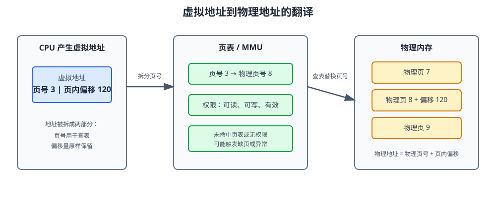

# 第6课:内存管理：虚拟内存与分页

第 2 课里我们把进程地址空间画成代码段、数据段、堆、栈和环境参数五段。那张图看起来像每个进程都拥有一大片连续内存，但机器上的物理内存明明是有限的，多个进程的地址还可以相同。这个“看起来每个进程都有自己的完整内存”的假象，就是**虚拟内存（Virtual Memory）**。

虚拟内存不是为了让内存凭空变多，而是把“程序使用的地址”与“硬件实际存放数据的位置”分离。它同时提供隔离、按需加载和灵活分配，是进程、文件和 IO 能够稳定协作的基础。

**学习目标：**

1. 能解释虚拟地址和物理地址为什么要分离；
2. 能描述 MMU 使用页表完成地址翻译的过程；
3. 能说明多级页表解决了什么问题，以及 TLB 为什么能加速翻译；
4. 能区分内部碎片、外部碎片和虚拟地址空间中的空洞；
5. 能解释 swap 的作用，并理解“申请内存”和“实际占用物理内存”的区别。

## 1. 没有虚拟内存会怎样

假设程序直接使用物理地址：

```text
进程 A：地址 1000 → 物理内存 1000
进程 B：地址 1000 → 物理内存 1000
```

两个进程的地址很容易冲突。A 写入自己的变量，可能直接覆盖 B 的数据；程序还必须知道机器当前有哪些物理内存空闲，无法使用比物理内存更大的地址空间，也很难把程序加载到不同位置。

虚拟内存让每个进程看到自己的虚拟地址空间：

```text
进程 A：虚拟地址 1000 → 物理页 12
进程 B：虚拟地址 1000 → 物理页 47
```

同一个虚拟地址在不同进程里可以映射到不同物理页。内核通过页表控制这种映射和权限，应用程序不需要直接知道物理内存布局。

它带来三层价值：

- **隔离**：进程只能访问页表允许的地址；
- **抽象**：程序看到连续地址，物理页可以分散在内存不同位置；
- **按需使用**：不必一启动就把所有代码和数据放入物理内存。

## 2. 虚拟地址空间和物理内存

虚拟地址空间是进程看到的地址范围，物理内存是机器实际安装的 RAM。两者不是同一个东西：

| 概念 | 谁使用 | 表示什么 |
| --- | --- | --- |
| 虚拟地址 | 应用程序、编译器、指针 | 进程认为自己拥有的位置 |
| 物理地址 | 内存控制器、硬件 | RAM 芯片中的真实位置 |
| 页表 | 内核和 MMU | 虚拟页到物理页的映射和权限 |

第 2 课中的代码段、堆、栈等，是虚拟地址空间里的区域。堆和栈看起来可以连续扩张，但它们对应的物理页可能并不连续；某些虚拟页甚至还没有对应的物理页。

同一份只读代码还可以被多个进程映射到各自的虚拟地址空间，背后共享同一组物理页。共享库就是这种共享的常见例子。可写数据则通常要通过写时复制或独立页保证进程之间不互相破坏。

## 3. 分页：把地址空间切成固定大小

如果按任意大小分配内存，管理会很复杂。操作系统通常把虚拟地址空间切成固定大小的**页（page）**，把物理内存切成同样大小的**页框（page frame）**。常见页大小是 4 KiB，但具体平台可以支持更大的页。

虚拟地址被拆成两部分：

```text
虚拟地址 = 虚拟页号 + 页内偏移
```

页内偏移表示页内的第几个字节，翻译时保持不变；虚拟页号用来查页表，换成物理页框号：

```text
虚拟页号 3 + 偏移 120
        │ 查页表
        ▼
物理页框号 8 + 偏移 120
```



### 3.1 地址翻译的完整过程

1. CPU 执行指令，产生一个虚拟地址；
2. MMU 拆出虚拟页号和页内偏移；
3. 先查询 TLB，命中则直接得到物理页框号；
4. TLB 未命中时，按页表结构查找映射；
5. 检查页表项的有效位和读写执行权限；
6. 将物理页框号与原来的页内偏移拼接，形成物理地址；
7. 如果页表项无效，触发缺页异常，由内核进一步处理。

应用程序只执行一次普通的内存访问，但硬件可能需要完成一次 TLB 查询或页表查询。虚拟内存的便利不是免费的，TLB 正是为了把常见路径加速到接近普通内存访问的速度。

## 4. 页表：记录每一页去了哪里

页表项通常至少包含：

- 物理页框号；
- 有效位，表示映射是否存在；
- 读、写、执行权限；
- 用户态/内核态访问权限；
- 访问位和脏位等硬件辅助信息。

一个进程有自己的页表。切换进程时，内核要让 MMU 使用新进程的页表根，之后相同的虚拟地址就可能得到完全不同的物理地址。这就是进程隔离的硬件基础之一。

### 4.1 为什么单级页表太大

假设虚拟地址空间很大、页很小，虚拟页数量就会很多。如果为每个虚拟页都准备一个页表项，即使程序只使用了很小的堆和代码，也要为整个地址空间准备表项，浪费大量内存。

现实的进程地址空间通常是稀疏的：

```text
代码段   [已使用]
大段空洞
堆       [已使用]
大段空洞
栈       [已使用]
```

### 4.2 多级页表

多级页表把虚拟页号再拆成多段索引。上一级只为实际使用的区域创建下一级页表，未使用的大段地址不需要分配完整表格：

```text
虚拟地址
  ├─ 一级索引 → 页目录
  ├─ 二级索引 → 下一层页表
  └─ 页内偏移 → 页中的具体字节
```

多级页表用额外的查表层数换取空间节省。访问一个新地址时可能需要多次内存访问，因此现代 CPU 依靠 TLB 缓存最近的翻译结果。

## 5. TLB：地址翻译的缓存

**TLB（Translation Lookaside Buffer，快表）**是 MMU 内部缓存的“虚拟页号 → 物理页框号”映射。

- TLB 命中：直接得到物理页框号，速度快；
- TLB 未命中：访问多级页表，完成后通常把结果放进 TLB；
- 进程切换：不同进程的映射不同，可能需要刷新或标记 TLB 中的旧条目。

TLB 之所以有效，是因为程序具有**局部性**：

- 时间局部性：刚访问过的地址很可能马上再次访问；
- 空间局部性：访问某个地址后，附近地址也可能被访问。

数组顺序遍历通常比随机访问更友好，因为相邻数据更可能在同一页或相邻页中。数据结构设计、批处理和内存访问顺序，都会影响 TLB 和 CPU 缓存的命中率。

## 6. 碎片：空间为什么“够”却分配失败

### 6.1 内部碎片

固定大小的页或分配块可能比实际需求大，最后一部分空间用不上。例如申请 5000 字节，按 4096 字节分页至少需要两页，第二页有一部分空闲。这些分配块内部没有被使用的空间叫内部碎片。

### 6.2 外部碎片

可变大小分配可能产生许多分散的小空闲块。总空闲空间足够，但没有一块连续空间能满足大请求，这叫外部碎片。

分页把物理内存按固定页框管理，避免了“必须找到一整块连续物理内存”的外部碎片问题；但页内最后的未使用空间仍属于内部碎片。虚拟地址空间里看到的空洞不等于物理内存浪费，它可能只是尚未映射的地址范围。

## 7. swap：把暂时不用的页移出 RAM

当物理内存紧张时，操作系统可以把暂时不活跃的内存页写到磁盘上的 swap 空间，释放 RAM 给更活跃的页。之后程序再次访问被移出的页，会触发缺页处理，内核把它从 swap 读回。

```text
活跃页：RAM 中，访问快
冷页：暂时移到 swap，释放 RAM
再次访问冷页：缺页 → 从 swap 读回
```

swap 是内存压力下的缓冲，不是“把磁盘当成同速 RAM”。磁盘延迟远高于内存，大量页在 RAM 和 swap 之间来回移动会导致**抖动（thrashing）**，表现为 CPU 使用率不一定高，但程序整体变得极慢。

还要区分：

- 虚拟地址空间很大：不代表已经占用同样大的物理内存；
- swap 已使用：不一定马上是故障，可能只是内核在管理冷热页；
- swap 持续增长并伴随频繁缺页：说明内存压力可能已经影响性能。

## 8. “申请内存”不等于“立即占用 RAM”

语言运行时和操作系统可能把申请地址、提交物理页、真正写入页面分成不同阶段。程序申请一大片虚拟地址范围时，内核可能先建立地址区域记录，只有第一次访问某个页面时才分配物理页。

这就是按需分页的直观表现：

```text
申请地址范围：虚拟地址可用
第一次写入页面：触发缺页，分配或映射物理页
继续写入：页面已经在 RAM 中
```

因此观察内存时要区分虚拟大小、常驻集和共享页。不同平台命令字段名称不完全相同，Linux 第 10 课会详细解释 `VIRT`、`RES`、`SHR`；本课只先理解它们不是同一个指标。

## 9. 进程地址空间的实际布局

第 2 课的五段模型适合建立心智模型。Linux 进程的实际地址空间通常还包含：

- 可执行文件代码和数据；
- 动态链接库；
- 堆；
- `mmap` 区域，用于共享库、文件映射和匿名映射；
- 线程栈；
- 内核为参数、环境变量等准备的区域。

不同操作系统、架构、编译器和运行时会改变具体布局。面试回答时，应先说“这是典型布局”，再说明虚拟地址由页表映射到物理页，不要把示意图当成所有平台的固定地址表。

Linux/macOS 可以使用：

```bash
vmmap <pid>
pmap <pid>
```

命令的可用性和输出格式依平台不同。Windows 可以使用任务管理器、资源监视器或系统提供的进程内存查看工具。第 10 课会从排错角度集中讲这些命令。

## 10. 观察实验：申请地址、触碰页面

本课不新增代码文件，实践以终端观察为主。可以启动一个自己控制的 Python 进程，再观察它的内存映射：

```bash
python -c "import time; data = bytearray(64 * 1024 * 1024); time.sleep(60)"
```

另一个终端中找到这个进程，再使用本机可用的观察工具：

```bash
ps -ef
pmap <pid>
```

这个实验只用于观察自己启动的进程。不同平台、Python 版本和内存分配器的结果会不同，重点不是记住某个数字，而是观察：

1. 进程会有多个映射区域，而不是只有一块连续内存；
2. 虚拟地址区域和常驻物理内存不是同一个数；
3. Python 运行时本身也会申请解释器、堆和共享库相关内存。

如果要进一步观察“写入页面后物理内存逐步增长”，应使用明确的逐页触碰实验，并控制分配大小。不要为了实验耗尽本机内存。

## 11. 真实场景：AI 服务的内存布局

一个 AI 应用服务可能同时拥有：

- Python 解释器和依赖库；
- 模型或 tokenizer 的内存映射；
- 请求对象、缓存和队列；
- 每个线程的栈；
- 网络连接和日志缓冲。

多个 worker 进程启动时，代码段和只读库页可能共享物理页；请求到来后，各进程的可写对象逐渐分开。若每个 worker 都加载一份大型模型，常驻内存可能快速增长；如果模型能以只读映射共享，内存压力会有所不同，但写入行为仍可能触发复制。

排查“服务内存高”时不能只看一个指标，要进一步区分：

- 虚拟地址空间是否只是预留；
- 常驻内存是否持续增长；
- 共享库和共享页占了多少；
- 是否有大量缺页和 swap；
- 是应用对象、缓存、线程栈还是内存映射在增长。

第 7 课会继续讲缺页、页面置换、抖动和 OOM；第 10 课会把这些现象和系统命令对应起来。

## 12. 课后实践

本课不设置代码作业，完成以下终端观察：

1. 启动一个自己控制的 Python 进程，记录 PID；
2. 用系统工具观察它的代码、堆、栈、动态库或映射区域；
3. 申请一块受控大小的内存，比较申请前后的虚拟大小和常驻内存；
4. 解释为什么两个不同进程可以出现相同的虚拟地址；
5. 画出一次 TLB 命中和一次 TLB 未命中的地址翻译流程。

不要主动制造内存耗尽。实验应限制在本机可承受范围内，结束后关闭自己启动的进程。

## 13. 验收问题

1. 虚拟内存解决了直接使用物理地址时的哪些问题？
2. 虚拟地址和物理地址有什么区别？为什么不同进程可以使用相同的虚拟地址？
3. 页、页框和页内偏移分别是什么？
4. MMU 完成一次地址翻译时会经过哪些步骤？
5. 多级页表为什么能节省空间？它带来了什么访问成本？
6. TLB 缓存什么？为什么程序的局部性有助于 TLB 命中？
7. 什么是内部碎片和外部碎片？分页主要缓解了哪一种？
8. 申请内存后为什么物理内存不一定立即增加？
9. swap 解决什么问题？为什么频繁 swap 会造成抖动？
10. 进程虚拟地址空间中为什么会出现大段空洞？

## 14. 面试高频考点

- 虚拟内存通过地址隔离、页表和按需分页，为进程提供独立地址空间。
- MMU 将虚拟页号翻译为物理页框号，页内偏移保持不变。
- 多级页表利用地址空间稀疏性节省页表内存；TLB 缓存最近的地址翻译。
- 分页避免了物理内存分配对连续大块空间的要求，但页内仍可能有内部碎片。
- 虚拟内存大小、常驻内存和共享内存不是同一个指标。
- `malloc` 或语言层申请地址不代表所有页面都已经占用物理 RAM。
- swap 是内存压力下的缓冲，频繁换入换出会导致抖动。
- 典型地址空间包括代码、数据、堆、栈、动态库和 mmap 区，具体布局依平台而变化。
