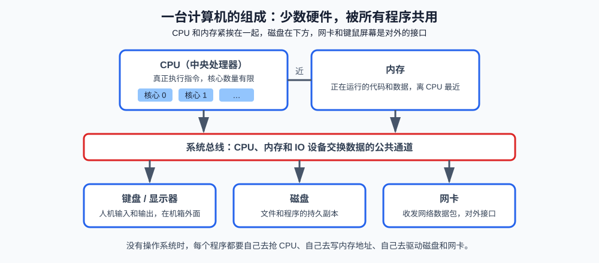
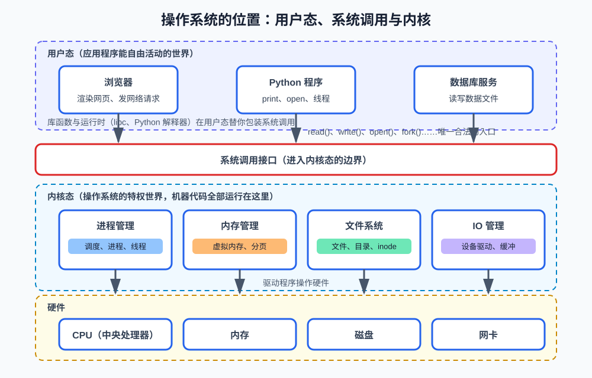
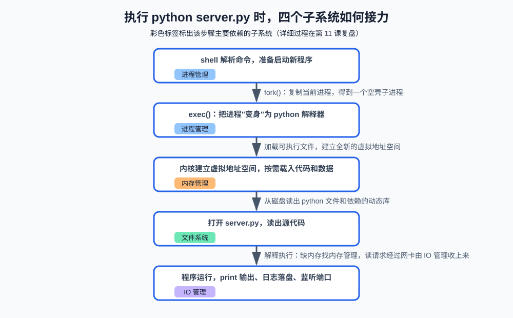

# 第一课：操作系统是什么：四个子系统的总览

操作系统课程从"操作系统到底帮你做了什么"开始。你每天都在运行程序：`python server.py`、打开浏览器、启动数据库。从你的视角看，敲一行命令程序就跑起来了；从机器的视角看，CPU（中央处理器）只有几个核心、内存只有一条、磁盘只有一块，几十个程序却要同时抢着用它们。操作系统就是站在程序和硬件之间的那个"管理者"。

本课先建立操作系统的整体心智模型，认识内核、用户态、系统调用这三个贯穿全课程的概念，再逐一认识操作系统的四个子系统。后续十课就是把每个子系统各拆成两三课讲透。本课是纯概念课，没有代码文件，只有终端演示命令和验收问题。

**学习目标：**

1. 能用自己的话说出操作系统是什么、解决什么问题；
2. 能区分应用程序、库函数、系统调用、内核、硬件五个层次；
3. 能说出内核态与用户态的区别，解释为什么应用程序不能直接操作硬件；
4. 能说出四个子系统各自管理什么资源，并举出它们在日常使用中的对应现象。

## 1. 为什么需要操作系统

先看清机器本身长什么样。一台计算机的核心组成非常少：CPU 负责执行指令，内存存放正在用的代码和数据，两者在物理上紧挨着；磁盘在机箱内部更靠下的位置，保存文件的持久副本；网卡和键盘显示器是对外的接口。它们通过系统总线交换数据。这就是后面四节课分别要管理的那几样硬件。



问题在于：硬件只有这一份，程序却有几十个。假设没有操作系统，你的 Python 程序直接跑在硬件上，会遇到四个问题：

1. **抢夺 CPU**。机器只有 8 个 CPU 核心，但同时要跑浏览器、微信、编译器、数据库。谁来决定谁用 CPU、用多久？没有裁判，一个写错死循环的程序就能让整机卡死。
2. **内存冲突**。程序 A 写死了内存地址 `0x1000`，程序 B 也想用 `0x1000`，两者互相覆盖，谁也不能正确运行。
3. **磁盘格式**。磁盘上只有裸的字节序列。每个程序都要自己实现"文件放在磁盘哪个位置、怎么命名、坏了怎么办"，等于每个程序都自带一套硬盘驱动。
4. **保护失效**。任何一个程序都可以直接读写网卡、擦除磁盘。一个 bug 就能损坏整台机器的数据。

操作系统的答案是把这些问题全部收走，向上提供统一的服务：

```text
操作系统 = 资源的管理者 + 服务的提供者

对下：唯一有权操作硬件的软件，替所有程序管理 CPU、内存、磁盘、网卡
对上：给每个程序"独占整台机器"的假象——你独占一个 CPU 核心独享
      全部内存、独享一个干净的文件系统
```

"给每个程序假象"这一点值得展开：CPU 实际被几十个进程轮流使用，但每个进程感觉自己随时在运行（第 5 课讲调度机制）；内存实际只有一条，但每个进程看到的是一段独立的、从 0 开始的地址空间（第 6 课讲虚拟内存）；磁盘实际是复杂的块设备，但每个程序看到的是一棵目录树（第 8 课讲文件系统）。**制造假象，正是操作系统最核心的价值。**

## 2. 内核、用户态与系统调用

### 2.1 内核是什么

操作系统的代码不是一整块。其中常驻内存、拥有全部特权、负责核心管理工作的那一部分，叫**内核（kernel）**——进程调度、内存分配、文件读写、设备驱动都在这里。Linux 严格说只是个内核；我们日常说的"Linux 系统"是内核加上周边工具。你机器上跑的 macOS 内核叫 XNU，Windows 内核叫 NT 内核。

内核之外的部分（shell、图形界面、各种命令行工具、桌面程序）都是普通程序，跑在内核之外，和你的 Python 程序地位完全相同。所以"操作系统"这个词在面试里通常专指内核，在口语里指整个系统软件包，注意区分场景。

### 2.2 用户态与内核态

CPU 硬件本身提供了特权分级（x86 上叫 Ring 0 到 Ring 3）。操作系统利用这个机制把 ==CPU 分成两种工作状态==：

```text
用户态（user mode）：普通程序运行的状态，不能执行特权指令，
                    不能直接碰硬件、碰别的进程的内存
内核态（kernel mode）：内核运行的状态，可以执行一切特权指令
```

普通代码运行在用户态；内核代码运行在内核态。状态之间的切换由 CPU 硬件强制执行，不是软件"自觉"的结果——这正是保护得以成立的根本：程序想越过操作系统，硬件层面就不允许。

### 2.3 系统调用：进入内核的唯一入口

用户态程序想使用内核的服务（读文件、分配内存、发网络包），只能通过**系统调用（system call）**：应用程序把请求和参数准备好，触发一条特殊指令，CPU 切换到内核态，内核检查参数、执行操作，再把结果带回用户态。



从图中可以看到完整的层次关系，从上到下是：

1. **应用程序**：浏览器、Python 程序、数据库，各自做业务逻辑；
2. **库函数与运行时**：C 标准库（libc）、Python 解释器。它们在用户态把系统调用包装得更好用——Python 的 `print()` 最终落到 libc 的 `write`，`open()` 最终落到 `openat` 系统调用；
3. **系统调用接口**：内核暴露给外界的窗口，数量固定（Linux 上三百多个），是上下两个世界的唯一通道；
4. **内核**：四大子系统住在这里；
5. **硬件**：被驱动程序操作。

三个概念的关系是面试常问点，直接给结论：

| 概念   | 运行在哪     | 举例               | 关系                 |
| ---- | -------- | ---------------- | ------------------ |
| 应用程序 | 用户态      | `server.py`      | 通过库函数间接使用系统调用      |
| 库函数  | 用户态      | `printf`、`fopen` | 系统调用的包装层，可能带缓存和格式化 |
| 系统调用 | 触发后进入内核态 | `write`、`openat` | 真正进入内核执行工作的入口      |

注意"库函数不等于系统调用"：`printf` 先在用户态把数字和字符串格式化好、攒在缓冲区里，攒够或遇到换行才真正发起一次 `write` 系统调用。一次库函数调用可能对应零次、一次或多次系统调用——这既是性能优化的手段（减少昂贵的内核往返），也是面试里"printf 到底做了什么"的完整答案。

系统调用比普通函数调用贵得多，因为每次都要完成一次用户态和内核态之间的切换（保存现场、检查参数、恢复现场）。这个代价是第 9 课讲"缓冲 IO 与零拷贝"的伏笔：减少系统调用次数，本身就是一门工程学问。

### 2.4 为什么不能让应用直接操作硬件

把 2.2 和 2.3 连起来，就是面试题"为什么不能让应用程序直接操作硬件"的完整答案：

1. **保护**：用户态是硬件强制的隔离。一个程序崩溃了，操作系统还能杀掉它、回收资源，其他程序不受影响；如果程序直接操作硬件，一个 bug 就可能破坏所有数据。
2. **公平**：所有资源请求都要经过内核审核和分配，内核才有能力在程序之间仲裁，而不是先到先得。
3. **抽象**：同一套 `read` 系统调用，背后可能是 SSD、机械硬盘或网络文件系统。应用不用关心硬件差异，差异由内核的驱动程序吸收。

## 3. 四大子系统

内核内部按管理的资源分为四个子系统。这一节只建立"每个子系统管什么、没有它会怎样"的直觉，每个子系统后续都有专门的课程展开。

### 3.1 进程管理

CPU 是唯一"能干活"的资源。进程管理负责把 CPU 这几样稀缺资源"虚拟化"成每个进程独享的样子：

- 决定此刻哪个进程上 CPU、跑多久（**调度**，第 5 课）；
- 切换时保存和恢复运行现场（**上下文切换**，第 5 课）；
- 创建、销毁进程，管理进程之间的通信（第 2、3 课）。

没有它：几十个程序抢几个核心，一个死循环程序霸占 CPU，整机失去响应。日常对应现象：活动监视器/任务管理器里能看到每个进程的 CPU 占用率，能"强制退出"一个卡死的程序——都是进程管理在工作。

### 3.2 内存管理

内存是另一条稀缺资源。内存管理给每个进程一段独立的虚拟地址空间：

- 进程 A 和进程 B 都有"自己的"内存，互不可见、互不破坏（**虚拟内存**，第 6 课）；
- 物理内存不够时，把不活跃的数据挪到磁盘（**交换空间 swap**，第 7 课）；
- 记账：哪个进程用了多少内存，谁泄漏了，谁该被杀（第 7 课的 OOM Killer）。

没有它：两个程序同时写 `0x1000` 就互相覆盖。日常对应现象：活动监视器里每个进程的"内存"列，以及系统内存吃满时的卡顿。

### 3.3 文件系统

磁盘是一大块字节序列。文件系统把它组织成"文件和目录"：

- 给字节序列起名字、建目录、支持嵌套（第 8 课）；
- 记录每个文件的元数据：大小、权限、时间戳、数据存在哪些磁盘块上（**inode**，第 8 课）；
- 保证断电、崩溃后文件结构不被破坏（日志文件系统，第 8 课一句话介绍）。

没有它：每个程序自带一套"磁盘布局算法"，且互相看不见对方写的字节。日常对应现象：`ls` 能列出文件、`du` 能统计大小，文件被进程占用时删不掉（第 10 课的 `lsof`）。

### 3.4 IO 管理

输入输出（Input/Output，IO）管理负责内核和所有外部设备之间的数据搬运：

- 管理各种设备的**驱动程序**（键盘、屏幕、磁盘、网卡各不相同，统一成一致的接口）；
- 提供缓冲，让"程序一次读一行"和"磁盘一次读一块"两种节奏能衔接（第 9 课）；
- 支持一个进程同时等待成千上万个 IO 事件（**IO 多路复用**，第 9 课的重头戏）。

没有它：读键盘、读磁盘、读网卡的代码完全不同，且程序必须自己死等每个设备。日常对应现象：`ping` 通了但网页打不开（网络是 IO 的一种）、`top` 里的 `wa` 值高说明 CPU 在等磁盘。

### 3.5 四个子系统如何配合

一个程序通常同时用到全部四个子系统。以最常见的动作——跑一个程序为例：



按图中步骤串一遍：shell 先通过 `fork()`（复制进程）和 `exec()`（载入新程序）创建出 python 进程——这是进程管理的事；内核为它建立独立的虚拟地址空间——这是内存管理的事；从磁盘读出 python 解释器和 `server.py`——这是文件系统的事；程序运行后打印输出、写日志、监听端口——这是 IO 管理的事。全程每一步都通过系统调用往返于用户态和内核态之间。

第 11 课会把这条链路完整复盘一遍，届时每个环节都已经学过了。

## 4. 终端演示：亲眼看见系统调用

"一行 Python 代码底下是几十次系统调用"不是比喻，本课用工具直接观察。以下命令的详解在第 10 课，现在只需要照着运行、看输出。

**Linux 上用 strace（跟踪系统调用的工具）：**

```bash
strace python3 -c 'print(1)'
```

输出是一长串系统调用（节选，机器不同细节不同）：

```text
execve("/usr/bin/python3", ["python3", "-c", "print(1)"], ...) = 0   ← 加载 python 程序本身
brk(NULL)                               = 0x55d...                   ← 向内核要内存
mmap(NULL, 8192, ..., PROT_READ|PROT_WRITE, ...) = 0x7f...           ← 再要一块内存
newfstatat(AT_FDCWD, "/usr/lib/...", ...) = 0                        ← 查文件元数据（文件系统）
openat(AT_FDCWD, "/usr/lib/libpython3.so", O_RDONLY) = 3             ← 打开动态库（文件系统）
read(3, "\177ELF\2\1\1\3", 832)         = 832                        ← 读文件内容
mprotect(0x7f..., 4096, PROT_READ)      = 0                          ← 修改内存页权限（内存管理）
write(1, "1\n", 2)                      = 2                          ← print 的真身：往屏幕写 2 个字节
exit_group(0)                           = ?                          ← 进程退出
```

对着第 3 节的子系统认一认：`brk`/`mmap` 是内存管理，`openat`/`read`/`newfstatat` 是文件系统，`write` 是 IO 管理，`execve`/`exit_group` 是进程管理。一行 `print(1)` 触发的系统调用里，真正属于"打印"的只有最后那条 `write(1, "1\n", 2)`，其余全部是操作系统在铺路。

再看统计视图，观察哪类系统调用最频繁：

```bash
strace -c python3 -c 'print(1)'
```

```text
% time     seconds  usecs/call     calls    errors syscall
------ ----------- ----------- --------- --------- ----------------
 20.35    0.000345           3       132        15 openat
 15.20    0.000258           4        64         1 newfstatat
 11.90    0.000202           3        61           read
  ...
```

**macOS 上**：对应的工具是 dtruss（`sudo dtruss python3 -c 'print(1)'`）。macOS 默认开启系统完整性保护（SIP，System Integrity Protection），会拦截这类追踪工具，可能需要先调整安全设置才能运行；如果暂时开不了，直接阅读上面贴出的真实输出即可，结论完全一致。另外两个无需特权的观察命令：`ps aux` 看进程列表（进程管理），`top` 看每个进程的 CPU 和内存占用（进程管理 + 内存管理），本课先感受现象，第 10 课再讲透。

## 5. 宏内核与微内核

最后一个总览级概念。内核把四个子系统全装在一起、整体跑在内核态的架构叫**宏内核（monolithic kernel）**，Linux 是典型代表：所有子系统互相之间就是函数调用，性能好，但任何一部分出错都可能波及整个内核。另一种思路是**微内核（microkernel）**：内核只保留==最小必需功能（地址空间、进程间通信、基础调度）==，文件系统、驱动等都作为普通服务跑在用户态，互相用消息通信——可靠性和隔离性更好，但消息传递的额外开销使性能吃亏。QNX（车载系统）、Minix 是代表。

面试遇到"宏内核和微内核的区别"，答出"哪些东西放在内核态、子系统之间怎么通信、各自换来什么代价"这三点即可。macOS 的 XNU 是混合内核，两者兼顾，可以作为补充提到。

## 6. 真实场景：调用大模型 API 时操作系统在哪里

基础知识课程不关联具体项目，但"程序调用外部接口"是人人都会遇到的场景，用它检验本课的心智模型：

1. 你的程序调用 HTTP 客户端发请求——客户端库在用户态把请求组织好，通过 `write` 系统调用交给内核；
2. 内核的 IO 管理把数据交给网卡驱动发出——你完全感知不到网卡的型号和协议细节；
3. 等待响应时你的程序处于阻塞状态，CPU 被进程管理调度去跑别的进程——所以"等待"本身不浪费 CPU；
4. 响应到达网卡，内核收包，你的程序被唤醒——IO 管理和进程管理接力完成；
5. 程序把结果写到日志文件——文件系统安排磁盘块、内核缓冲后落盘。

这五步分布在不同子系统，后面每一课学完，你都会回头看懂其中一步。这也是排错的基本框架：接口超时，问题可能出在应用（逻辑慢）、进程调度（CPU 饥饿）、内存（交换抖动）、IO（磁盘满）任何一个子系统——第 10 课的命令工具箱就是按这个框架组织的。

## 7. 课后作业

本课没有代码文件，作业以观察和回答为主：

1. **观察系统调用**：在 Linux 上运行 `strace -c python3 -c 'print(1)'`（macOS 上如无法运行 dtruss，则阅读第 4 节的示例输出），找出调用次数最多的三个系统调用，并把文中列出的每个系统调用归类到对应子系统，写进笔记。
2. **观察进程**：打开活动监视器（macOS）或运行 `top`（Linux/macOS 通用），选一个你认识的进程，记录它的 CPU 占用、内存占用，并想一想：这两列数字分别由哪个子系统负责统计和维护？
3. **思考题**：Python 的 `open()` 是系统调用还是库函数？`print("hi")` 从你写下这行代码到字符出现在终端上，至少经过哪些层次（提示：至少五层）？
4. **预习问题**：查一下你正在用的操作系统（macOS 的 XNU、Linux）属于宏内核、微内核还是混合内核。

## 8. 验收问题

1. 操作系统是什么？它对下管理什么、对上提供什么？为什么说"制造假象"是它的核心价值？
2. 内核态和用户态的区别是什么？切换由谁强制执行？
3. 系统调用、库函数、应用程序三者是什么关系？为什么说一次库函数调用可能对应零次、一次或多次系统调用？
4. 为什么不能让应用程序直接操作硬件？请给出至少两个理由。
5. 四个内核子系统分别管理什么资源？各举一个你在日常使用电脑时能观察到的对应现象。
6. 执行 `python server.py` 的过程中，`fork`、`exec`、建立虚拟地址空间、读源文件、`write` 输出分别属于哪个子系统的职责？

## 9. 面试高频考点

- 操作系统是什么、内核的作用；内核态与用户态的区别及切换方式。
- 系统调用的概念，系统调用、库函数、应用程序三者关系；`printf` 与 `write` 的关系。
- 为什么应用程序不能直接访问硬件（保护、公平、抽象三个角度）。
- 操作系统四大子系统的分工，"执行一个程序的过程中操作系统做了什么"的概述版回答。
- 宏内核与微内核的区别。
