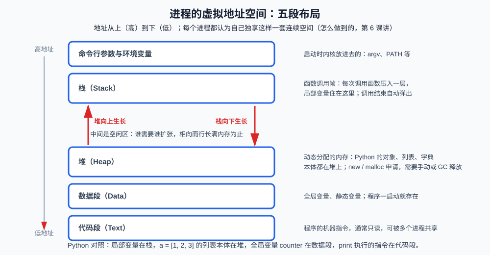
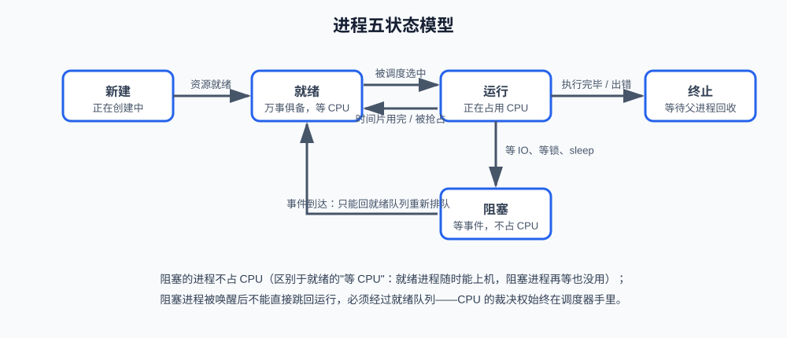
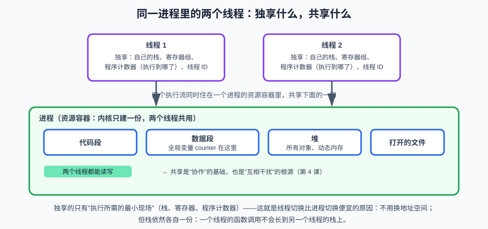

# 第二课：进程与线程

第 1 课把操作系统拆成四个子系统。本课进入进程管理的地基：一个程序跑起来之后，内核眼里它是什么？为什么同一个程序可以同时开两个窗口互不影响？为什么一个服务里又能同时处理很多请求？

答案分三层：**进程（process）**是资源的容器，**线程（thread）**是容器里真正上 CPU 的执行流，**协程（coroutine）**是用户态自己调度的更轻量执行流。本课必须把这三层的边界讲清楚——后续的进程间通信、锁、调度、IO 多路复用，全部建立在这个区分上。

**学习目标：**

1. 能区分程序和进程，说出进程控制块里记录了什么；
2. 能画出进程地址空间的五段布局，指出局部变量、对象、全局变量、指令各住在哪一段；
3. 能画出五状态模型，解释阻塞和就绪的差别，以及"唤醒后为什么不能直接运行"；
4. 能说明 `fork` 和 `exec` 各自做什么，以及写时复制为什么让 `fork` 很便宜；
5. 能列出线程共享什么、独享什么，解释"一个进程崩溃通常不影响别的进程，一个线程崩溃通常拖垮整个进程"；
6. 能用自己的话对比进程、线程、协程，并指出各自适合的场景。

## 1. 进程是什么

### 1.1 程序不是进程

**程序**是一份躺在磁盘上的可执行文件：Python 解释器、`server.py`、浏览器的二进制。它不会自己跑，也不会占用 CPU 或内存。

**进程**是程序被操作系统加载之后、正在运行的那个实例。同一份程序可以对应多个进程：你开两个终端窗口，就有两个 `zsh` 进程，它们跑的是同一份程序，彼此的工作目录、环境变量、正在执行的命令完全独立。

一句话对照：

```text
程序 = 菜谱（静态的指令和数据）
进程 = 按这份菜谱正在做的那一桌菜（动态的运行实例）
```

第 1 课观察过 `python3 -c 'print(1)'` 触发的系统调用：`execve` 把磁盘上的程序"变成"进程，之后的 `brk`/`mmap`、`openat`、`write` 都是这个进程在向内核要资源。本课要回答的是：内核为了记住"这个进程是谁、此刻在干什么"，到底维护了哪些信息。

### 1.2 资源分配的基本单位

操作系统给每个进程分配一套**私有资源**：独立的虚拟地址空间、一份打开的文件列表、一组信号处理方式、独立的权限身份。进程是**资源分配的基本单位**——内核按"进程"记账：这块内存是谁的、那个文件描述符是谁打开的、CPU 时间算在谁头上。

线程是下一节的主角，这里先记一句对比，避免后面混淆：

```text
进程：资源分配的基本单位（容器）
线程：CPU 调度的基本单位（容器里的执行流）
```

一个进程崩溃（访问了非法地址、收到杀进程的信号），内核回收的是**整份资源**：地址空间、文件、该进程创建的线程全部消失。所以"一个进程崩了通常不影响别的进程"——它们的资源从一开始就是隔离的。这是操作系统用隔离换稳定性的设计，不是运气。

### 1.3 进程控制块：内核眼里的进程档案

内核不可能把"进程"理解成你源码里的一个对象。它给每个进程准备一份内核里的数据结构，叫**进程控制块（PCB，Process Control Block）**，Linux 里对应 `task_struct`。你可以把它理解成进程的档案袋，调度器、内存管理、文件系统都来这里查：

| PCB 里的字段 | 记录什么 | 后面哪一课用到 |
| --- | --- | --- |
| PID（进程标识符，Process ID） | 内核给进程的唯一编号 | 第 10 课用 `ps` 看到的就是它 |
| 状态 | 新建 / 就绪 / 运行 / 阻塞 / 终止 | 本课第 3 节 |
| 程序计数器、寄存器 | 上次被换下 CPU 时执行到哪、现场是什么 | 第 5 课上下文切换 |
| 内存管理信息 | 页表：虚拟地址怎么对应到物理页 | 第 6 课 |
| 打开的文件 | 文件描述符表 | 第 8、9 课 |
| 调度信息 | 优先级、已运行时间 | 第 5 课 |
| 父子关系 | 谁创建了我、我创建了谁 | 本课第 4 节的 `fork` |

进程切换时，内核并不需要把整个进程的内存搬来搬去，它切换的是"当前正在使用哪一份 PCB"：保存当前进程的寄存器到它的 PCB，再从下一个进程的 PCB 里把寄存器填回去。PCB 就是进程在内核中的身份。

PID 在用户态也能看到。`os.getpid()` 返回当前进程的 PID，类型是 `int`；它不是进程对象本身，只是一个编号。编号用尽后会循环使用，所以"看到一个 PID"不等于"这还是原来那个进程"。

## 2. 进程的地址空间：五段布局

每个进程都认为自己拥有一段从低地址到高地址的连续内存。这是假象（第 6 课讲虚拟内存如何制造它），但假象内部的分区是真实的、每个进程都一样的。从低到高通常是：



逐段看它解决什么问题：

1. **代码段（Text）**：程序的机器指令。通常只读，这样写飞的指针不会把指令改掉；多个进程跑同一份程序时，内核可以让它们共享同一份物理页，节省内存。
2. **数据段（Data）**：全局变量、静态变量。程序一启动就存在，进程结束才消失。Python 模块顶层的 `counter = 0` 最终会落到类似这里的全局数据区。
3. **堆（Heap）**：动态分配的内存，运行时按需向高地址扩张。Python 里几乎所有对象（列表、字典、实例）的本体都在堆上；`append` 让列表变长，就是堆在生长。
4. **栈（Stack）**：函数调用帧，从高地址向低地址生长。每次调用函数压入一层（返回地址、局部变量、参数），函数返回就弹出。递归太深会把栈用完，这就是栈溢出。
5. **命令行参数与环境变量**：内核在启动进程时放在最高处的 `argv`、`PATH` 等。

堆和栈相向生长，中间是空闲区。这个设计的直觉：事先不知道程序会用多少堆、多少栈，让两边按需扩张，直到撞上对方才算内存耗尽。

一个容易混淆的边界：**变量名在栈上，对象常常在堆上**。`items = [1, 2, 3]` 里，局部名字 `items` 是当前函数栈帧上的一个引用，`[1, 2, 3]` 这个列表对象在堆上。所以"栈上的东西函数一返回就没了"指的是那个名字和栈帧，堆上的对象只要还有别的引用就能继续活着。

## 3. 进程的五状态

进程不是"在跑"或"不在跑"这么简单。它在内核里有一张明确的状态机：



五个状态各自的含义：

| 状态 | 进程在干什么 | 占不占 CPU |
| --- | --- | --- |
| 新建 | 内核正在分配 PCB、地址空间，还不能被调度 | 不占 |
| 就绪 | 万事俱备，排在就绪队列里等 CPU | 不占，但随时能上 |
| 运行 | 正在某颗 CPU 核心上执行指令 | 占 |
| 阻塞 | 等一件自己无法推进的事（磁盘读完、锁被释放、`sleep` 到期、网络数据到达） | 不占，再等也没用 |
| 终止 | 已经执行完或出错退出，PCB 还在，等父进程来收尸 | 不占 |

几条转换值得单独说，因为面试常在这里设陷阱：

**就绪 ↔ 运行。** 调度器从就绪队列挑一个进程上 CPU，它就变成运行；时间片用完或来了更高优先级的进程，它被换下去，回到就绪队列。这个来回是第 5 课的主题。此刻只要记住：被换下去的进程**没有在等任何 IO**，它随时可以再上，所以是就绪而不是阻塞。

**运行 → 阻塞。** 进程自己发起了一个当时完不成的操作：`read` 一个还没写完的文件、`recv` 一个还没到达的网络包、主动 `sleep`。内核把它从 CPU 上拿下来，标记为阻塞，**不会再调度它**，直到那件事情发生。

**阻塞 → 就绪，不是阻塞 → 运行。** 这是五状态图里最容易画错的一条。磁盘数据到了，内核只是把进程放回就绪队列，让它和其他就绪进程一起重新排队。CPU 的裁决权始终在调度器手里——否则一个刚被唤醒的低优先级进程就会抢走正在跑的高优先级进程。

**运行 → 终止。** 进程调用 `exit`、主函数返回、或遇到无法处理的信号。内核回收地址空间和文件，但 PCB 还留着：里面记着退出码，等父进程调用 `wait` 来读取。父进程如果一直不 `wait`，这个已经死掉的 PCB 就变成**僵尸进程（zombie）**——它不再运行，却占着一个 PID。Python 里 `multiprocessing.Process.join()` 做的事之一，就是这个 `wait`。

**就绪和阻塞都"不在跑"，但原因完全不同：** 就绪是"我想跑，轮不到我"；阻塞是"我现在跑不了，再给我 CPU 也没用"。排错时看到进程状态是 `S`（睡眠/阻塞）还是 `R`（运行或就绪），结论完全相反——一个在等 IO，一个在吃 CPU。第 10 课会从 `ps` 的状态列读出这个差别。

## 4. 进程的创建：fork 与 exec

第 1 课把"执行 `python server.py`"画成了 `fork` 再 `exec`。本课把这两个系统调用的语义讲清楚。它们是 Unix 系操作系统创建进程的标准组合；Windows 有自己的 `CreateProcess`，一次完成类似的工作，思想相同。

### 4.1 fork：复制出一个子进程

**`fork`（复制进程）** 的作用是：把当前进程几乎原样复制一份，得到一个子进程。复制完成后，父子两个进程从 `fork` 返回的那一行继续往下执行——所以 `fork` 会**返回两次**：

```text
父进程里：fork 的返回值 = 子进程的 PID（一个正整数）
子进程里：fork 的返回值 = 0
```

靠这个返回值，同一段代码就能走两个分支："我是父亲，去做父亲该做的事"或"我是孩子，去做孩子该做的事"。子进程继承父进程的地址空间副本、打开的文件、寄存器现场，但 PID 不同、父进程指针不同、之后各自的内存修改互不可见。

Python 标准库里对应的是 `os.fork()`，只在 Unix 上可用。本课代码使用更高层的 `multiprocessing.Process`，它在 Linux 上底层常常就是 `fork`，在 macOS 上默认改成 `spawn`（重新启动一个全新的 Python 解释器再导入模块）。对学习者来说，观察结论相同：**子进程有自己的地址空间，改它的变量不会改到父进程。**

### 4.2 exec：把进程"变身"成另一个程序

`fork` 出来的子进程一开始跑的还是父亲的程序。Shell 真正想做的是"去跑 `python`"。于是子进程调用 **`exec`（装入并执行新程序）**：用磁盘上另一个可执行文件覆盖当前进程的地址空间——代码段、数据段、堆、栈全部换成新程序的，PID 不变。`exec` 成功后不会返回到原来的代码，因为原来的代码已经被覆盖了。

所以"启动一个新程序"在 Unix 上是两步，不是一步：

```text
shell（父进程）
  └─ fork() 得到子进程（此时子进程还是 shell 的副本）
        └─ exec("python", "server.py")  子进程变身为 python
```

父进程保留原样，可以继续等子进程结束，也可以继续接下一行命令。这就是终端能同时跑多个程序、自己还不退出的原因。

### 4.3 写时复制：为什么 fork 看起来很便宜

按字面理解，`fork` 要复制整个地址空间，一个占用 2GB 内存的进程 fork 一次就要再分配 2GB，代价无法接受。实际实现用了**写时复制（COW，Copy-on-Write）**：

1. `fork` 当时并不复制物理页，只复制页表，让父子指向同一组物理页，并把这些页标记为只读；
2. 任何一方要**写**某一页时，MMU（内存管理单元，Memory Management Unit）触发一次缺页，内核这时才把那一页真正拷贝一份，让写的那一方用副本，另一方继续用原页；
3. 只读的页（尤其是代码段）永远不用拷贝，父子一直共享。

于是 `fork` 之后立刻 `exec` 的路径极便宜：子进程几乎还没来得及写任何页，`exec` 就把地址空间整份换掉了，物理页基本没有被复制。Shell 每天都在走这条路。

一个概念边界：**写时复制是"延迟复制"，不是"共享内存"。** 一旦有一方写入，那一页就分开了。想让两个进程继续共享同一块可写内存，必须显式使用第 3 课的共享内存机制，不能指望 `fork` 的巧合。

## 5. 线程是什么

### 5.1 调度的基本单位

进程作为容器已经够用了：隔离好、崩溃互不影响。但它有两个代价：

1. 创建一个进程要分配地址空间、页表、文件描述表，即使有写时复制也比"再来一条执行流"重；
2. 同一个程序内部的多个任务（一个请求读数据库、另一个请求算结果）如果各自做成进程，它们想共享一个缓存、一个连接池，还得走进程间通信。

**线程**就是为了在一个进程内部再切分执行流：同一份资源（地址空间、文件、堆）上，同时跑多条"我执行到哪了"。内核调度的对象，现代操作系统里实际上是线程——进程只是线程的容器。所以说：

```text
进程 = 资源容器（地址空间、文件、权限）
线程 = 容器里的一条执行流（栈 + 寄存器 + 程序计数器）
```

一个进程至少有一条线程（主线程）。Python 程序从 `if __name__ == "__main__"` 开始跑的那条，就是主线程。

### 5.2 共享什么，独享什么



**独享（每条线程一份）：**

- **栈**：函数调用和局部变量。线程 1 调用 `foo()` 不会在线程 2 的栈上压帧；
- **寄存器和程序计数器**：这条线程执行到哪一条指令、中间结果在哪个寄存器。切换线程时内核保存和恢复的就是这些；
- **线程 ID**：内核（或线程库）给这条执行流的编号。Python 里 `threading.get_ident()` 返回的就是它。

**共享（整个进程一份）：**

- 代码段、数据段、堆；
- 全局变量、模块级对象；
- 打开的文件、socket、信号处理。

共享是协作的基础：两个线程可以直接改同一个 Python 列表，不必经过管道。共享也是干扰的根源：两个线程同时执行 `counter += 1`，读-改-写交错，最后的值可能对不上——这就是第 4 课要解决的**竞态条件（race condition）**。本课代码会先把这个现象跑出来，先观察，下一课再修。

一个常考的推论：**线程崩溃通常拖垮整个进程。** 线程没有自己的地址空间，一条线程访问非法地址，内核判定的是"这个进程违法了"，整份地址空间一起收回，其它线程全部消失。进程之间没有这个问题，因为页表从一开始就是分开的。

### 5.3 用户级线程与内核级线程

"线程"这个词还要再拆一层，否则后面听到"协程"会搅在一起。

**用户级线程（user-level thread）**：线程的创建、切换、调度全部由用户态的库完成，内核只看到一个进程、一条内核执行流。切换极便宜（一次函数调用的量级），但有两个致命限制：一个线程发起阻塞系统调用，内核会把**整个进程**换下去，其它用户级线程也跟着停；内核不知道有多条执行流，无法把它们派到不同 CPU 核心上。

**内核级线程（kernel-level thread）**：每条线程在内核里都有自己的档案（类似 PCB 的精简版），由内核调度。一条线程阻塞，内核可以调度同一进程的另一条线程；多条线程可以真正跑在多核上。代价是切换要进内核，比用户级线程贵。Linux 的 NPTL（本地 POSIX 线程库，Native POSIX Thread Library）、Python `threading` 模块创建的，都是内核级线程。

历史上还有 M:N 的混合模型（M 条用户线程映射到 N 条内核线程）。对本课来说，记住判断标准即可：**内核看不看得见这条执行流，决定了它能不能独立阻塞、能不能上多核。**

### 5.4 多核上多线程一定更快吗

不一定，分两层看。

操作系统层面：内核级线程可以被调度到不同核心，CPU 密集的纯计算（图像处理、矩阵乘法，且实现里没有额外串行锁）用多线程通常能加速。

语言和程序层面有两个常见反例：

1. **任务其实是串行的。** 线程们都在抢同一把锁、或下一步必须等上一步的结果，核心再多也只能排队。
2. **运行时自己加了一把大锁。** CPython 有 **GIL（全局解释器锁，Global Interpreter Lock）**：同一时刻只允许一条线程执行 Python 字节码。所以 Python 的 CPU 密集循环用 `threading` 几乎加速不了，反而因为切换更慢；IO 密集（等网络、等磁盘）时线程会在系统调用里把 GIL 让出去，这时多线程仍然有用。这是 CPython 的实现选择，不是操作系统做不到——用 `multiprocessing` 开多个进程，每个进程有自己的解释器和自己的 GIL，就能用满多核。

面试里把这两层分开说，比只背"Python 有 GIL"完整。

## 6. 协程：用户态的协作式执行流

线程已经比进程轻了，但创建和切换仍要进内核、每条线程仍要准备自己的内核栈，成千上万条线程的内存和调度开销会明显起来。**协程**把"执行流"再往用户态推一步：

```text
进程     内核分配资源，隔离最彻底，最重
线程     内核调度，同一进程内共享资源，中等
协程     用户态自己切换，内核甚至不知道它存在，最轻
```

协程的关键性质是**协作式调度**：一条协程执行到"我要等 IO 了"，自己主动让出（Python 里是 `await`），事件循环再把 CPU 交给另一条就绪的协程。没有时间片、没有内核抢占——你不让，别人就上不来。所以：

- 切换代价接近一次函数调用，一条线程里可以挂成千上万个协程；
- 协程仍然跑在某条线程上，它**不是**并行的手段，是单线程内把"等待"的空洞填满的手段；
- 一条协程里如果不小心做了阻塞调用（普通的 `time.sleep`、同步的 `requests.get`），事件循环被卡住，所有协程一起停。这是用户级线程那个老问题的重现。

Python 的 `asyncio`、Go 的 goroutine（实现更接近 M:N，有运行时的抢占和多线程 backing）、Lua 的 coroutine，都是这条思路的变体。本课不展开 `asyncio` 的 API，只要能回答"协程解决什么问题、为什么切得快、为什么一次阻塞能拖死一整个事件循环"。

## 7. 进程、线程、协程对照

|  | 进程 | 线程 | 协程 |
| --- | --- | --- | --- |
| 谁来调度 | 内核 | 内核（内核级线程） | 用户态事件循环 |
| 拥有的资源 | 独立地址空间、文件、PCB | 独享栈和寄存器，共享进程资源 | 独享一份很小的用户态上下文 |
| 隔离 | 最强：崩溃通常不连累其它进程 | 弱：一条崩，进程内其它线程一起没 | 更弱：还可能把所在线程的事件循环卡死 |
| 通信 | 必须走 IPC（第 3 课） | 直接读写共享内存，但要加锁（第 4 课） | 同一线程内直接共享，通常靠队列约定 |
| 切换代价 | 最高（要换页表） | 中等（进内核，不换地址空间） | 最低（一次函数调用量级） |
| 能用多核 | 能 | 能（语言运行时另说） | 不能（本身）；要多核得再配多线程/多进程 |
| 典型场景 | 隔离不同服务、CPU 密集且要绕开 GIL | IO 密集的并发连接、共享缓存的计算 | 海量等待型任务（每个连接一个协程） |

没有绝对更好的一层。浏览器把每个标签页做成进程，是用隔离换安全性；Web 服务器在一个进程里开线程或协程处理连接，是用共享换效率。选哪一层，看你更怕崩溃蔓延，还是更怕资源浪费。

## 8. 课程代码：亲眼看到"隔离"和"共享"

课程代码在 `code/os/os_lesson02.py`。它做同一件最简单的事——把一个计数器加 N 次——分别用多进程和多线程来做，对照结果。

### 8.1 先认识两个模块

本课用到的都是 Python 标准库，不需要安装。

**`threading` 模块**创建的是内核级线程。本课用到的对象：

| 对象 / 方法 | 作用 | 输入 / 输出 | 副作用 |
| --- | --- | --- | --- |
| `threading.Thread(target, args)` | 构造一条线程，还不开始跑 | `target` 是可调用对象，`args` 是位置参数元组；返回 `Thread` | 无 |
| `Thread.start()` | 真正向内核申请一条线程并开始执行 `target` | 无返回值 | 新线程开始跑；对同一 `Thread` 调用第二次会抛 `RuntimeError` |
| `Thread.join()` | 等待这条线程结束 | 无返回值 | **阻塞**当前线程，直到目标线程退出 |
| `threading.get_ident()` | 当前线程的标识 | 返回 `int` | 无 |

**`multiprocessing` 模块**创建的是真正的进程。它故意把接口做成和 `threading` 几乎一样：

| 对象 / 方法 | 作用 | 输入 / 输出 | 副作用 |
| --- | --- | --- | --- |
| `multiprocessing.Process(target, args)` | 构造一个进程对象，还不开始跑 | 同 `Thread`；返回 `Process` | 无 |
| `Process.start()` | 创建子进程并在子进程里调用 `target` | 无返回值 | 新进程出现；macOS 上默认用 `spawn`，Linux 上常用 `fork` |
| `Process.join()` | 等待子进程结束（内部会 `wait`，避免僵尸进程） | 无返回值 | **阻塞**当前进程 |
| `os.getpid()` | 当前进程的 PID | 返回 `int` | 无 |

两个模块看起来像一对双胞胎，正是为了让你用几乎相同的代码观察完全不同的隔离语义。差别藏在"target 函数改的那个变量，父进程/主线程看不看得到"。

`Process.start()` 在 macOS 和 Windows 上会**重新导入一遍你的模块**。所以 `target` 必须是模块顶层的函数，不能是嵌套在 `main` 里的闭包；入口也必须用 `if __name__ == "__main__"` 保护，否则子进程导入模块时会再次执行创建进程的代码，无限递归。这是 `multiprocessing` 的常见陷阱，不是操作系统的机制，但写代码时必须知道。

### 8.2 多进程：各加各的，互不影响

```python
isolated_counter = 0

def increment_in_process(times: int) -> None:
    global isolated_counter
    for _ in range(times):
        isolated_counter += 1
    print(f"子进程 pid={os.getpid()} 里的计数 = {isolated_counter}")
```

父进程把 `isolated_counter` 设为 0，启动两个子进程，每个加 `N` 次。每个子进程打印 `N`，父进程 join 之后再打印自己的 `isolated_counter`，仍然是 0。

原因就是第 2 节和第 4 节：子进程有自己的地址空间（`spawn` 是全新的一份，`fork` 是写时复制后的一份），它改的是自己那份 `isolated_counter`，写回不去父亲的内存。两个子进程之间同样看不见对方的计数。

### 8.3 多线程：加的是同一份，结果还对不上

```python
shared_counter = 0

def increment_in_thread(times: int) -> None:
    global shared_counter
    for _ in range(times):
        current = shared_counter
        current += 1
        time.sleep(0)          # 主动让出 GIL，放大交错窗口
        shared_counter = current
```

主线程把 `shared_counter` 设为 0，启动两条线程，每条加 `N` 次，join 之后打印。按"共享"的直觉，结果应该是 `2N`。实际运行你会看到一个**小于 `2N` 的数**。

"小于"而不是"等于"，是因为一次增加并不是原子的，而是读-改-写三步。两条线程的三步可以交错：

```text
线程 1 读到 41
线程 2 读到 41
线程 1 写成 42
线程 2 写成 42     ← 一次增加丢失了
```

这就是竞态条件的最小现场。本课只要求你确认两件事：线程确实在改同一份变量（否则结果不会靠近 `2N`）；同一份变量无保护地并发写会丢更新。怎么保护，是第 4 课的锁要做的事。

CPython 的 GIL 并不能救这里：GIL 保证同一时刻只有一条线程在执行 Python 字节码，但一次增加对应多条字节码，GIL 可以在它们之间被释放。代码里的 `time.sleep(0)` 是为了把这个窗口放大到肉眼可见——紧凑写成 `shared_counter += 1` 时，CPython 常常在一次 GIL 持有期内跑完整次增加，竞态仍然存在，只是更难观察到。

### 8.4 对照着看 PID 和线程 ident

同一段演示还会打印：

- 两个子进程的 PID 与父进程不同，彼此也不同；
- 两条线程的 ident 不同，但 `os.getpid()` 相同。

这是"进程是资源容器、线程是容器里的执行流"的实验证据：线程没有自己的 PID，它们共用进程的那一个。

## 9. 终端里看一眼进程和线程

命令详解在第 10 课，本课只求把代码里打印的 PID 和系统里看到的对上。课程代码跑起来之后，另开一个终端：

```bash
ps -ef | grep os_lesson02
```

`ps` 列出进程，`-e` 是所有用户，`-f` 是完整格式。你应该能看到一个父进程和它启动的子进程（多进程那段正在跑的时候），PID 列就是 `os.getpid()` 打出来的那个数。

macOS 活动监视器或 `top` 里，一个 Python 进程的"线程"列在多线程那段会大于 1。看不到也没关系：本课的打印已经足够证明"线程共享 PID"。

## 10. 真实场景：一个下载任务，三种切法

假设你要同时下载 100 个文件、再对每个文件做一次 CPU 密集的转码：

- **100 个进程**：隔离最好，一个文件的转码崩溃不会带走其它文件；但 100 份 Python 解释器、100 份地址空间，内存会先扛不住。适合"任务少、要隔离、要吃满多核"的情况。
- **少量进程 × 每进程里若干线程**：进程数大约等于 CPU 核心数，用来吃满多核做转码；每个进程里再用线程并发下载（IO 等待时线程让出 GIL 和 CPU）。这是很多下载器、Web 服务的现实结构。
- **一条线程里 100 个协程**：下载这种"大部分时间在等网络"的任务，协程能用很小的内存把等待填满。转码这种 CPU 密集活不能丢给协程，它不会真的并行。

三种切法可以嵌套，没有谁取代谁。本课建立的就是"先选对那一层，再谈锁和通信"的判断力。

## 11. 运行课程代码

```bash
cd /Users/yyma/workspace/agents/lifestyle-manager-study
conda run -n agent_dev python code/os/os_lesson02.py
```

先打印两个子进程各自的计数和父进程的计数（父进程应为 0），再打印两条线程 join 之后的共享计数（小于 `2N`），以及 PID / ident 的对照。

## 12. 课后作业

作业和课程示例在同一个文件中：`code/os/os_lesson02.py`。上半部分可以直接运行；下半部分从 `# ===== 课后作业 =====` 开始。默认入口不会调用 `homework()`，完成后再取消 `__main__` 里的注释。

课程示例观察的是"一个整数加来加去"。作业换成**任务登记**：每个 worker 跑起来以后，登记一条记录 `{"pid": ..., "ident": ..., "worker_id": ...}`，最后由主流程汇总。业务名词换了，还多一个课程示例没有的约束——进程那边**禁止**靠共享 list 传结果。

需要完成三个函数：

1. `register_with_threads(n: int) -> list[dict[str, int]]`：启动 `n` 条线程，每条把当前 `os.getpid()`、`threading.get_ident()` 和自己的 `worker_id`（0 到 n-1）追加到**同一份** list，join 全部线程后返回这份 list。记录条数必须等于 `n`，所有记录的 `pid` 必须相同，`ident` 必须两两不同。
2. `register_with_processes(n: int) -> list[dict[str, int]]`：启动 `n` 个子进程，每条记录同样三个字段。子进程**不能**通过修改父进程的 list 交差，必须用返回值或 `multiprocessing.Queue` 把记录送回父进程。返回的 list 条数等于 `n`，所有记录的 `pid` 必须两两不同，且都与父进程的 PID 不同。
3. `count_unique_pids(records: list[dict[str, int]]) -> int`：返回记录里不同 PID 的个数。线程那份应返回 1，进程那份应返回 `n`。

完成后取消 `homework()` 的注释再运行：函数会用 `n=4` 检查上面这些断言，失败会抛 `AssertionError`。

思考题（验收时回答，不必写进代码）：

1. 如果 `register_with_processes` 也像线程那样往一份普通 list 里 `append`，父进程 join 之后这份 list 是空的还是有 4 条？为什么？
2. 线程那份记录里 `ident` 不同但 `pid` 相同，这和"线程独享什么、共享什么"如何对应？
3. 把 `register_with_threads` 改成对一个共享整数做 `+= 1` 来数"完成了几个 worker"，结果还会稳定等于 `n` 吗？这和第 8.3 节的计数器是不是同一个问题？

## 13. 验收问题

1. 程序和进程的区别是什么？为什么同一份程序可以对应多个进程？
2. PCB 是什么？列出至少四项它记录的内容，并说明进程切换时内核主要切换的是什么。
3. 画出地址空间五段，指出 Python 里局部变量名、列表对象、模块级全局变量、函数指令大致落在哪一段。
4. 就绪和阻塞都"不在 CPU 上跑"，差别是什么？阻塞被唤醒后为什么必须先回就绪队列？
5. `fork` 为什么返回两次？`exec` 成功后还会返回吗？写时复制复制的是什么、什么时候才真正拷贝一页？
6. 线程共享什么、独享什么？为什么一条线程访问非法地址通常会让整个进程退出？
7. 用户级线程和内核级线程的关键差别是什么？Python `threading` 属于哪一种？
8. 协程解决什么问题？为什么说它不是并行手段？一条协程里调用阻塞 IO 会怎样？
9. 多核 CPU 上多线程一定更快吗？请把"操作系统能不能把线程派到多核"和"CPython GIL"分成两层回答。

## 14. 面试高频考点

- 进程和线程的区别：资源分配单位 vs CPU 调度单位；独立地址空间 vs 共享地址空间。
- 一个进程崩溃为什么通常不影响其它进程；一条线程崩溃为什么通常拖垮整个进程。
- 五状态模型，重点是就绪/阻塞的辨析，以及阻塞唤醒后不能直接运行。
- `fork` / `exec` 的语义，写时复制的机制和"fork 后立刻 exec 为什么便宜"。
- 线程共享（堆、全局变量、文件）与独享（栈、寄存器、程序计数器）。
- 用户级线程 vs 内核级线程；协程和线程的差别、适用场景。
- 多核上多线程是否更快：CPU 密集 vs IO 密集，以及 CPython GIL 的额外限制。
- 僵尸进程是什么、父进程 `wait`/`join` 的作用（常作为五状态"终止"的追问）。
