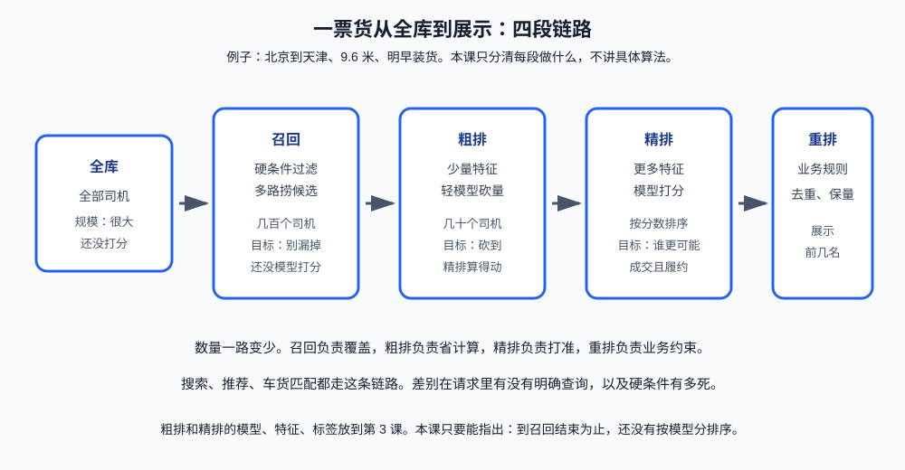

# 第 1 课：搜索、推荐、匹配是三种问题

搜索和推荐解决的是同一件事：库里的东西太多，人不可能逐条看完，系统要决定这一次把哪几条放到他面前，以及按什么顺序放。

差别只有请求从哪来。搜索时，人自己说出要什么，例如在框里输入“北京到天津 9.6 米”。推荐时，人没说，只是打开了页面，系统根据他是谁、人在哪、以前接过什么货来猜。两边最后都给出一份有顺序的短名单，不是一段生成出来的说明文字。

车货匹配是这件事情上的约束，不是另一种产品。货和车必须同时满足路线、车型、时间和载重。无论这票货是搜出来的还是首页推出来的，不满足这些条件就不能接。


贯穿例子固定为一票货：

```text
货单 H1
装货地：北京
卸货地：天津
车型：9.6 米
装货时间：明早 8 点
运费：1800 元
```

平台上还有很多司机和很多其他货。为了能手算，下面把规模收成 10 名司机、100 票货。真实系统只是把这两个数字放大，链路不变。

**学习目标：**

1. 用自己的话说明搜索是什么、推荐是什么，以及一次请求从进入系统到名单展示经过哪些阶段；
2. 用“有没有明确查询”和“有没有必须同时满足的硬条件”区分搜索、推荐、车货匹配；
3. 画出召回、粗排、精排、重排，说出每段的输入、输出和它在优化什么；
4. 说明车货匹配为什么不能只看点击率；
5. 能把同一票货分别讲成搜索一步、推荐一步、匹配一步，并标出模型打分还没发生的位置。

## 1. 搜索是什么，推荐是什么

先不谈模型。用司机找货就能把两个词说死。

**搜索**是人已经有目标，系统负责找。司机知道自己要北京出发、天津卸货、9.6 米的车、明早能装，于是把这些条件交给系统。系统的责任是：别把广州方向、13 米的货混进来，再在符合条件的货里排一个先后。查询是司机给的，不是系统编的。

**推荐**是人还没有把目标说出来，系统负责猜。司机只是打开 App。系统看见他的车是 9.6 米、人在北京、上周跑过京津线，于是首页直接放上几票货，其中可能有 H1。这里没有搜索框里的那句话。系统用的是司机的状态和历史。

推荐不是“搜索框留空，再把空查询提交一次”。空查询没有条件，系统无从找起。推荐是另一条请求：用户身份和上下文代替了那句查询。

两者的产物一样，都是有限的几条结果，而且有先后。第 1 条被看到的机会远大于第 20 条，所以顺序本身就是决定，不只是找没找到。

|        | 搜索          | 推荐                 |
| ------ | ----------- | ------------------ |
| 请求里有什么 | 用户写出的查询     | 用户是谁、在哪、以前做过什么     |
| 系统在做什么 | 按这句话找，再排序   | 猜测此刻该看什么，再排序       |
| 找错了会怎样 | 不符合查询的结果混进来 | 猜的方向本身就错了          |
| 人怎么改   | 改查询词再搜      | 划走、点击、接单，系统靠这些反馈修正 |

车货平台上两个入口通常同时存在。上面是搜索框，下面或旁边是“为你推荐”。不要因为界面长在一起，就把它们当成同一个请求。有没有那句查询，是后面所有技术选择的起点。

## 2. 一次请求怎么走完

无论是搜索还是推荐，一次请求都要穿过同一条流水线。输入不同，后面的阶段相同。下面用“货 H1 已经发出，系统要决定先给哪些司机看”把整段走一遍。司机搜货只是把方向倒过来：库从司机换成货，查询从货单换成搜索框里的字。

```text
请求进入
  搜索：司机提交“北京到天津 9.6 米”
  推荐：司机打开首页，没有查询词
  匹配：货主发出 H1，系统去找司机
    |
    v
召回：从全库捞出还能考虑的候选
    |
    v
粗排：用便宜的办法把候选砍短
    |
    v
精排：用更多信息给剩下的人打分并排序
    |
    v
重排：用业务规则改最终顺序
    |
    v
展示前几名，并记下后来有没有点击、接单、履约
```

这四段不是四个可以互相替代的算法名字。它们是一次计算里按顺序发生的四次缩小和调整。前一段的输出就是后一段的输入。

召回结束时，你手里是一份候选名单，还没有“谁第一”。粗排和精排才产生分数。重排可以不按分数原样展示。展示之后的点击、成交、爽约会变成以后的样本，但那是下一次请求的事，不属于这一次的四段。

100 票货、10 名司机时，人还能逐个比较，看不出为什么要拆成四段。线上货和司机都在持续新增，一次请求又要很快返回。对全库每条都算复杂分数，既来不及，也会把计算花在车型根本不对的人身上。所以先用便宜的办法缩小，再对小名单仔细打分。



四段各自的输入、输出和失败方式，下面分开写。名字就用召回、粗排、精排、重排，不要用“过滤”“打分”“展示”去代替。过滤只是召回里的一种做法，打分同时出现在粗排和精排，展示是重排之后的结果。

## 3. 先看用户到底提出了什么请求

判断不要从“用了什么模型”开始。模型三种问题都能用。判断只看请求里有什么信息。

| | 用户给出了什么 | 系统要决定什么 | 本课例子 |
| --- | --- | --- | --- |
| 搜索 | 一句明确查询 | 哪些结果符合这句话，谁更该排前面 | 司机输入“北京到天津 9.6 米” |
| 推荐 | 没有这句查询 | 此刻该把什么放到他面前 | 司机打开 App，首页直接是货 |
| 车货匹配 | 一票货的硬条件，加上司机能否接 | 哪些司机真能跑这票货，谁更该先看到 | 货 H1 要找明早能接的 9.6 米司机 |

搜索和推荐的分界是一句话：**有没有一句用户自己给出的查询**。有，就是搜索；没有，系统在猜，就是推荐。

车货匹配不是第三种界面，而是这票货上多出来的约束：货和车必须同时满足路线、车型、时间、载重。只是司机“可能感兴趣”不够。一名常跑广州的司机，对“北京到天津”点很多次也没有意义，因为他根本接不了。

所以匹配可以出现在搜索里，也可以出现在推荐里：

```text
司机搜“北京到天津”          这是搜索。结果仍要做车货匹配。
司机没搜，首页推了 H1        这是推荐。结果仍要做车货匹配。
货主发出 H1，系统找司机      这也是匹配。查询来自货单，不是司机敲的字。
```

一面如果问“你们做的是搜索还是推荐”，不要选一个词结束。先说请求从哪来，再说硬条件是什么，最后才说走第 2 节那条召回和排序链路。

## 4. 四段各自做什么

### 4.1 召回

召回的输入是全库和这次请求。输出是一份比全库小得多的候选名单，常见是几百量级。它回答的问题是：谁有资格进入下一轮。

对货 H1，召回至少先问硬条件：

```text
司机的车是不是 9.6 米，或平台允许的替代车型
司机明早 8 点前能不能到北京装货
司机是否愿意跑北京到天津这一方向
载重是否够这票货
```

不满足的司机直接丢掉。这一步通常是规则，不是模型。模型不应该负责“学习出车长不够”。车长不够就是不能接。

召回的目标不是把第一名找出来，而是**别漏掉明显能接的人**。漏掉一名其实很合适的司机，后面的排序再准也排不回来，因为那个人已经不在名单里。所以召回阶段宁可多留，也不要用一个很严的分数把人提前删光。多路召回怎么做，第 2 课再讲。

### 4.2 粗排

粗排的输入是召回留下的几百个候选。输出是更短的名单，常见是几十个。它回答的问题是：这几百个里，谁值得花更贵的计算。

粗排已经在打分，所以它是排序的一部分，不是召回。它只用少量便宜的特征，例如距离、车型是否匹配、司机最近是否活跃。模型要轻，因为候选还比较多。

如果召回已经只剩三十人，粗排可以很薄，甚至直接进精排。段数是为了规模服务的，不是为了凑满四段。面试时要能说出：粗排存在，是因为精排算不动全量候选。

### 4.3 精排

精排的输入是粗排留下的几十个候选。输出是按分数从高到低的顺序。它回答的问题是：这些人里，谁更可能接这票货，并且接了以后能履约。

精排可以用更多特征：历史成交、常跑线路、报价相对行情、这个时段的运力紧不紧。分数高只表示模型认为更好，还不等于最终展示顺序。特征和模型怎么选，第 3 课再讲。本课只要记住精排的产物是**分数和顺序**，不是业务规则。

### 4.4 重排

重排的输入是精排顺序。输出是用户真正看到的前几名。它回答的问题是：只按分数排，会不会违反业务约束。

例如精排前三名都是同一家车队的司机，第四名是一名新司机，分数略低，但平台希望新司机也能看到一票合适的货。重排可以留下一名同车队司机，把一个名额给新司机。这是规则在改顺序，不是重新训练模型。

重排还可以去掉互相冲突的结果、过滤明显亏本的价格。规则为什么不能都塞进精排，第 5 课再展开。本课先记住：精排分数不是用户看到的最终顺序。

## 5. 同一批人，三种请求各走一步

下面只用 10 名司机里的 6 名，把三种问题写成可以对照的一步。100 票货同样只暴露和这一步有关的事实。目标是看清**哪一步还没发生模型打分**。

| 司机  | 车型    | 明早能否到北京 | 是否常跑京津 | 备注         |
| --- | ----- | ------- | ------ | ---------- |
| D1  | 9.6 米 | 能       | 是      | 上周接过类似货并履约 |
| D2  | 9.6 米 | 能       | 否      | 人在北京，但常跑广州 |
| D3  | 13 米  | 能       | 是      | 车太长，这票货用不上 |
| D4  | 9.6 米 | 不能      | 是      | 人在上海，明早赶不到 |
| D5  | 9.6 米 | 能       | 是      | 新司机，没有历史成交 |
| D6  | 4.2 米 | 能       | 是      | 车太短        |

### 5.1 搜索一步

司机 D1 在搜索框输入：

```text
北京到天津 9.6 米 明早
```

系统把这**句话解析成查询条件**，再从 100 票货里找符合的货。H1 符合。另一票“北京到广州、13 米”的货不符合查询，在召回阶段就离开，**不必等模型给它打点击分**。

这一步里，模型打分还没发生的位置是：查询条件过滤结束的时候。名单上剩下的是“像这句查询”的货，谁排第一还没决定。

### 5.2 推荐一步

司机 D1 没有输入任何字，只是打开首页。系统知道他是 9.6 米、人在北京、上周接过京津线。于是首页可能出现 H1。

这里没有查询词。系统用的是司机自**己的状态和历史**，这就是推荐。推荐不是“把搜索框留空再搜一次”。搜索空了，系统不知道用户要什么；推荐是主动用已知信息做猜测。

猜测仍然先召回。D1 的首页不应出现那 100 票货的全部，也不应出现明显超载、方向完全相反的货。召回结束时，同样还没有精排分数。

### 5.3 匹配一步

视角换到货主。H1 已经发出，系统要决定先推给哪几名司机。

按上表的硬条件：

```text
D3、D6 车型不符，召回丢掉
D4 明早到不了北京，召回丢掉
D1、D2、D5 车型、时间和方向上还能留在候选里
```

到这里为止，仍然没有模型分数。D1 历史履约好、D2 常跑方向不合、D5 没有历史，这些比较是后面精排才做的事。如果现在就说“D1 一定排第一”，那是把召回和精排叠在一起了。

D2 为什么还能留在召回里：硬条件只要求车型、时间和“能否接受这条线”，没有要求“历史上常跑”。常跑与否是强弱证据，适合当特征，不适合当一刀切。切早了，就可能永远学不到“人在北京的司机会不会临时接京津线”。这个取舍第 2 课还会再见到。

## 6. 每段到底在优化什么

链路四段容易背下来，一面更常追问的是：你优化的数字是什么。点得多，不等于这票货被接走，更不等于货按时送到。

| 指标       | 它在数什么             | 在车货里的位置             |
| -------- | ----------------- | ------------------- |
| 点击率      | 看到之后有没有点进去        | 只能说明司机有兴趣看，不能说明能接   |
| 匹配率      | 发出的货有没有找到满足硬条件的候选 | 主要看召回有没有把能接的人捞进来    |
| 成交率      | 候选里有没有人真正接单       | 更接近收入，常作为精排要预测的事    |
| 履约率      | 接了之后有没有按约定完成      | 防止“很容易接、但经常爽约”的人排太前 |
| 接到合适货的时间 | 司机多久看到一票自己能跑的货    | 空等也是损失，不只看平台成交一笔    |

信息流推荐经常把点击率当主要离线目标，因为点击又多又快，标签来得及时。车货匹配如果也只追点击率，会出现一种坏结果：标题吸引人、价格看起来很高的货被点开很多次，但车型不对或时间对不上，没有成交。点击率很好看，业务没有变好。

因此本课把目标先绑到业务上，而不是绑到某个模型指标上。精确率、召回率、AUC（ROC 曲线下面积）这些离线指标第 4 课再讲。现在只需要会说：离线数字必须能对应到匹配、成交或履约，否则模型变好了也可能是在优化错误的行为。

定价、补贴、大模型助手都不要另起一条链路。运费 1800 元是这票货的一个属性，会影响司机接不接；补贴会改这个价格；助手可以解释“为什么先给你看 H1”。它们改变的是特征、规则或解释，不代替召回和排序。

## 7. 和检索增强生成差在最后一步

检索增强生成（RAG）也会先从库里捞出相关文档，这一步和召回像。像的部分到此为止。

RAG 捞出文档后，把文档放进上下文，让大模型生成一段回答。车货匹配捞出司机后，让排序模型和规则决定名单顺序，再把名单展示出来。最后一步的产物一个是文字，一个是排序列表。

所以不要把这门课讲成“用大模型做推荐”。JD 里的司机找货助手可以用检索解释推荐理由，那是旁边的系统。助手没有取代“谁先看到这票货”的决定。

## 8. 验收问题

1. 用一句话分别说明搜索和推荐在做什么。一次请求从进入系统到司机看到名单，中间哪四段一定要能按顺序说出来？
2. 司机搜索“北京到天津”，和司机打开首页直接看到货，差别的判断标准是什么？
2. 为什么说车货匹配可以同时出现在搜索和推荐里？
3. 召回结束时，你手里有什么，还没有什么？
4. 粗排和精排都在打分，为什么还要分成两段？
5. 精排第一名为什么不一定是用户看到的第一名？
6. 只优化点击率，在 H1 这票货上可能错在哪里？

## 9. 面试高频考点

**搜索是什么，推荐是什么。** 搜索是用户给出明确查询，系统按这句话从库里找结果并排序。推荐是用户没有给出查询，系统根据用户状态和历史猜测该展示什么，再排序。两者产物都是有顺序的短名单。不要回答成“搜索用关键词，推荐用深度学习”，那是实现手段，不是定义。

**一次请求的流程是什么。** 请求进入后先召回候选，再用粗排把名单砍短，然后精排打分，最后重排按业务规则调整，展示前几名。召回结束还没有名次；精排第一名也不一定是最终第一名。搜索、推荐、给货找司机，输入不同，这条流程相同。

**为什么工业界要分召回和排序。** 全库太大，复杂模型打分来不及，也不能把计算浪费在明显不合格的候选上。召回用便宜的规则和索引把候选缩小，目标是别漏掉；排序只在小名单上追求顺序准。漏召回无法被后面的模型补救。

**车货匹配比普通推荐多了哪些硬约束。** 路线方向、车型、载重、装货时间这些条件必须同时满足。普通信息流里，不相关内容顶多多一次无效点击；车货里，车型不对就是不能成交。硬条件放在召回做过滤，不交给模型慢慢学。历史是否常跑、报价是否合适，是强弱特征，留给精排。

**点击率高是否等于业务好。** 不等于。点击只说明看了详情。车货要看这票货有没有匹配到能接的司机、有没有成交、成交后有没有履约，以及司机多久能看到一票合适的货。只追点击，会把好看但不能接的货排到前面。
