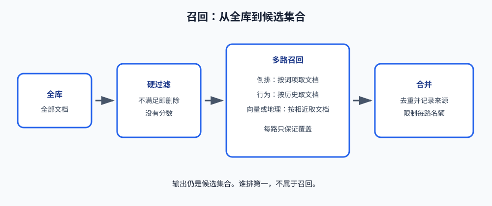

# 第 2 课：召回

第 1 课把一次请求拆成召回、粗排、精排、重排。召回是第一段：从全库里找出值得继续计算的文档，组成候选集合。它不给文档排名。

本课讲这一段里面的三种机制：硬过滤、倒排索引、多路合并。排序模型、离线指标和业务重排规则都不是本课的内容。

**学习目标：**

1. 说明召回的输入、输出，以及它为什么不能直接给全库打分；
2. 能写出硬过滤的判断规则，并区分硬条件和可排序的证据；
3. 能说明正排、倒排和多词查询的交集分别在做什么；
4. 能说明行为召回为什么会在没有历史时失效，以及多路结果如何合并。

## 1. 召回要解决的规模问题

排序希望对每个候选计算一个比较可靠的分数。候选如果是全库，计算量随文档数量线性增长，一次请求的时间预算放不下。更重要的是，有些文档在业务上已经不可能成为结果，对它们打分没有意义。

召回把这个问题拆开。它先删除不可能的文档，再用几种便宜的办法各自找出一批可能相关的文档，最后合成一个有限集合交给排序：

```text
全库
  -> 硬过滤：删除不可能成立的文档
  -> 多路召回：每路按自己的证据取出一批文档
  -> 合并：去重、记录来源、限制每路名额
  -> 候选集合交给粗排
```



这三步的产物都是集合，不是名次。召回漏掉的文档，后面的模型看不到，也就无法把它排回来。因此召回宁可多保留一些边界上的文档，也不能用一个很严的分数提前做最终选择。

## 2. 硬过滤

硬过滤使用的是一条已经由业务确定的规则。规则的结果只有两种：保留或删除。它没有权重，也不能用一项成立去弥补另一项不成立。

把文档记为 $d$，查询记为 $q$。若硬条件是 $P_1, P_2, \ldots, P_k$，则

$$
Keep(d, q) = P_1(d, q) \times P_2(d, q) \times \cdots \times P_k(d, q)
$$

每一项成立时取值 1，否则取值 0。乘积为 1 才保留。过滤后的集合是

$$
Allowed(q) = \{ d \mid Keep(d, q) = 1 \}
$$

后面的倒排和行为召回都只应在这个集合上工作。

车货匹配里，车型、装货地和是否赶得上装货时间就属于这种条件：任意一项不成立，这票货就不能成交。搜索引擎里的权限、库存、地区可售，也是同一种判断。它们的共同点不是“看起来很重要”，而是**不成立时结果在业务上非法**。

另一类条件不适合放进这个乘积。用户是否经常购买某个品类、目的地是否与查询城市相邻，都只是强弱不同的证据。把它们提前做成硬条件，系统就再也观察不到反例。硬过滤回答“能不能出现”，不回答“谁更值得排在前面”。

## 3. 倒排索引

硬过滤之后，文档可能仍然很多。如果每次查询都扫描剩余文档，逐个比较字段，时间还是随文档数增长。倒排索引把比较提前做成一张表，查询时改为查表。

先看系统本来保存的表。一行是一个文档，列是它的字段。这种按文档存放的方式叫**正排**：已知文档，读取它的属性。

倒排把其中一个字段对调过来。已知属性的一个取值，读取拥有该取值的文档编号。这个取值在信息检索里叫**词项**，对应的一行文档编号叫**倒排表（posting list）**。

```text
正排：文档编号 -> 该文档的各个字段
倒排：某个字段的一个取值 -> 具有该取值的文档编号列表
```

一个字段有多少个不同取值，倒排里就有多少行。文档在该字段上的值是什么，它的编号就写进哪一行。编号在一行里的顺序只需要稳定，不表示相关程度。

查询若要求多个字段同时匹配，就取出对应的几张倒排表，再求交集。设查询包含词项 $t_1, t_2, \ldots, t_m$，则

$$
倒排召回(q) = Posting(t_1) \cap Posting(t_2) \cap \cdots \cap Posting(t_m)
$$

交集中的文档才同时满足这些字段。交集不为空，只说明它们通过了布尔条件，其中还没有第一名。实现上按第一张表的顺序检查后续表，可以让同一次查询的结果顺序保持稳定。

倒排有两个直接后果：

- 匹配是精确的。字段值差一个字，就会进入另一行。它不能表达“文字不同但意思接近”。
- 文档发生变化时，对应的倒排表必须同时修改。新文档尚未写入表中，任何查询都取不到它。这时先检查索引是否更新，而不是先调整排序模型。

## 4. 行为召回

倒排的输入是查询词和文档字段。文档的字段与词项不完全相同，这一路就取不到它。行为召回改用已经发生的行为：哪个用户看过、点过或买过哪些文档。它不读取标题，也不做字段比较。

这一路来自协同过滤（Collaborative Filtering），有两个方向。

**用户侧。** 先为当前用户 $u$ 找出行为相近的用户，再收集那些用户接触过的文档。相近用户记为 $Neighbors(u)$，用户 $v$ 的历史文档记为 $History(v)$，则

$$
行为召回(u) = \left(\bigcup_{v \in Neighbors(u)} History(v)\right) \cap Allowed(q)
$$

并集里的文档来自邻居的历史，不要求它们包含当前查询的词项。最后与 $Allowed(q)$ 求交，是因为历史不会自动服从今天的合法性：邻居买过的文档，现在可能已经无货或无权限。

**物品侧。** 方向反过来。已知当前用户已经接触的文档，找出经常和这些文档一起出现的其他文档。输入从“相似用户”换成“共现文档”，输出仍然是文档编号集合，合并时与用户侧没有区别。

$Neighbors(u)$ 具体怎样计算，本课不推导。这里只固定这条路的数据依赖：没有历史，就没有邻居，并集为空。新用户没有行为，新文档也还没有出现在任何人的历史里。这两种情况称为冷启动。冷启动时这一路是空集，只能使用倒排或其他不依赖历史的路，不能把空集解释成没有适合的结果。

行为召回和倒排一样，输出是集合而不是名次。被这一路取出，只说明相似用户接触过它。

## 5. 一路证据覆盖不了所有相关文档

倒排只认识预先定义好的字段和精确取值。有些相关文档的字段并不与查询词相同，但用户历史、地理位置或语义表明它值得进入候选。召回因此使用多路：每一路使用一种证据，各取各的文档，互不替代。

| 一路    | 使用的证据          | 取不到文档的典型情况   |     |
| ----- | -------------- | ------------ | --- |
| 倒排    | 查询中的明确词项       | 字段值与查询词不完全相同 |     |
| 行为    | 用户或相似用户的历史     | 用户或文档还没有历史   |     |
| 地理或向量 | 位置接近，或表示后的语义接近 | 没有位置，或尚未建立向量 |     |

行为这一路通常来自协同过滤（Collaborative Filtering）。它不解析文档内容，而是借用已有行为：与当前用户行为相近的用户接触过哪些文档，或与当前文档一起出现过哪些文档。没有历史，这一路就是空集。新用户和新文档都属于这种情况，称为冷启动。冷启动时退回硬过滤和倒排，不能把空集解释为“没有适合的结果”。

向量召回把查询和文档变成向量，再取空间中的近邻。它补的是倒排的字面遗漏。本课不讨论向量如何训练，也不讨论近邻索引的参数。它在链路中的位置与其他路相同：位于硬过滤之后、排序之前。

任何一路的原始结果都可能包含已经不能保留的文档。历史记录不会因为今天的条件变化而自动消失。所以每一路在进入合并之前，都要再与 $Allowed(q)$ 求交。

## 6. 合并

多路各自给出文档编号。合并不重新判断相关性，只处理三件集合上的事。

**去重。** 同一文档可以被多路同时取出。候选集合里它只能出现一次，否则后面的排序会对它重复计分。去重使用文档编号，不使用某个字段值。

**保留来源。** 被留下的文档记录它来自哪些路。来源用于排查某一路是否失效，不是分数。被多路取出，只说明支持它的证据不止一种。

**配额。** 每一路最多贡献有限个文档。否则返回量很大的一路会占满候选名额，把其他路符合条件的文档挤掉。配额按该路自己的稳定顺序截断，不使用排序模型的分数。召回阶段还没有那个分数。

合并完成后，候选集合交给第 1 课所说的粗排。集合内部为了结果稳定而保留的顺序，不是用户看到的顺序。

## 7. 用代码观察这三步

课程代码在 `code/search-recommend/search_recommend_lesson02.py`，只用 Python 标准库。它用一个很小的货单库把上面三步跑通：先按车型和装货地做硬过滤，再为装货地、车型、卸货地分别建倒排表并求交集，然后把行为名单、地理名单与过滤结果求交，最后按文档编号合并。

`passes_hard_filter` 就是 $Keep$。三个条件依次判断，任一失败立即返回假，函数里没有分数。

`build_inverted_index(cargos, field)` 为 `field` 这一列建立倒排。键是该列的一个取值，值是文档编号列表。`setdefault` 负责在某个取值第一次出现时创建空列表。

`intersect` 计算两张编号列表的交集，并保留第一张列表的顺序。三个词项的查询通过调用它两次完成。

`drop_failed` 把某一路的原始名单限制到硬过滤之后的集合。`merge_paths` 用文档编号去重：编号第一次出现时写入结果，再次出现时只追加来路名称。

运行后重点看四项输出，而不是背具体编号：硬过滤删除了哪些不合法文档；每个词项下面有哪些编号；交集是否比单张倒排表更小；同一个编号是否只剩一行、但保留了多个来源。

## 8. 运行课程代码

```bash
cd /Users/yyma/workspace/agents/lifestyle-manager-study
python code/search-recommend/search_recommend_lesson02.py
```

不需要安装第三方库。默认入口只跑课程示例。

## 9. 课后作业

作业在同一个文件后半部分，从 `# ===== 课后作业 =====` 开始。示例已经完成三词项交集，以及不限名额的多路合并。

1. 实现 `recall_exact_destination`：只为卸货地建立倒排表，并取出指定取值下的文档编号。
2. 实现 `merge_with_quota`：每一路最多贡献 `quota` 个文档，再按文档编号去重并保留来源。不足配额时全部保留；超出时按该路原顺序取前面的文档。

完成后单独运行 `homework()`。输出应能看出卸货地倒排表的一行、它与其他条件求交后的集合，以及配额截断后同一文档的多个来源是否还在。

## 10. 验收问题

1. 召回的输出是什么？它为什么不直接产生第一名？
2. 硬过滤的乘积里，一项为 0 时其余项能否补救？哪些条件不应该放进这个乘积？
3. 正排和倒排分别已知什么、查找什么？多个词项为什么要求交集？
4. 行为召回在什么数据条件下为空？空了以后应退回哪里？
5. 合并时为什么要去重、保留来源并设置每路配额？

## 11. 面试高频考点

**召回和排序的目标有什么不同。** 召回保证候选集合的覆盖，输出是集合。排序只比较集合内部的文档，输出是顺序。召回阶段删除的文档，排序无法恢复。

**硬过滤为什么不交给模型。** 硬条件不成立时结果本身非法，规则的结果必须稳定，而且不需要用分数表示。交给模型只会使非法文档占用候选名额，并把“不能出现”变成一个偶然的低分。强弱证据留给相应的召回路和后面的排序。

**多路召回为什么需要，合并时冲突如何处理。** 每路只掌握一种证据，单独使用都会漏掉另一类相关文档。合并按文档编号去重，记录来源；名额不够时按路截断，不引入排序分数。多个来源表示证据更多，不是最终名次。

**协同过滤为什么在新用户和新文档上失效。** 它依赖已经发生的行为。没有行为就没有邻居，也没有可以取出的文档。这时使用硬过滤和倒排，而不是把空的行为路解释成用户没有需求。
