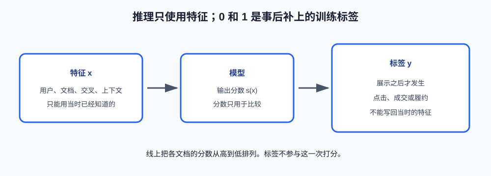

# 第 3 课：排序

第 2 课的召回输出一个候选集合，集合里还没有名次。排序给每个候选一个分数，再按分数从高到低排列。粗排和精排都做这件事，差别只是特征和计算成本。

本课只看**推理**：模型的权重已经有了，一次请求怎样从特征变成名单。权重如何用历史数据求出来，属于训练，本课不讲。倒排、评价指标和重排规则也不是本课的内容。

**学习目标：**

1. 说明排序的线上输出是分数和顺序，不是“是”或“否”两个类别；
2. 说明 0 和 1 只是训练时对历史结果的记录，推理时用不到；
3. 说出逻辑回归、树模型和深度模型在推理时的输入、输出；
4. 分清决策时能用的特征，和展示之后才能知道的标签。

## 1. 线上要的是一份有顺序的名单

一次请求已经有了召回留下的候选。排序对每个候选算一个数，这个数叫分数。分数高的排在前面。系统返回的是这个顺序，不是给每个候选盖一个“成交”或“不成交”的章。

```text
候选 A、B、C
  -> 分数 0.82、0.21、0.67
  -> 展示顺序 A、C、B
```

0.82 不需要变成类别。它只和 0.67、0.21 比较。三个分数都小于某个阈值时，仍然要排出先后；三个分数都很大时，也不能把三篇文档都放在第一名。所以排序使用的是分数的相对大小。

## 2. 为什么训练记录经常写成 0 和 1

分数本身没有天然的正确答案。历史里能够记下的，通常是一件事发生了没有：打开了详情，没有接单，接单后完成了运输。发生记为 1，没发生记为 0。这是**标签**，是训练资料里的一列，不是线上返回给用户的结果。

工业界常用的做法是让分数表示“这件事发生的可能性”。可能性越高，排序越靠前。于是模型在形式上很像二分类：输入是一条样本的特征，训练目标是 0 或 1。推理时不把分数收成 0 或 1，而是保留这个可能性，用来和别的候选比较。

同一条样本在两个阶段看到的东西不同：

| | 手里有什么 | 产出什么 |
| --- | --- | --- |
| 推理（线上排序） | 当时已经知道的特征 | 一个分数，再参与排序 |
| 训练（事后） | 当时的特征，以及后来补上的 0 或 1 | 一组新的模型权重 |

本课停在推理。只需要知道权重来自过去的“特征 + 后来的结果”，不需要知道权重用什么算法求。把 0.82 收成“预测成交”也是多余的一步，那一步做完就不再是排序。

也存在不把结果写成 0 和 1 的学法。例如直接告诉模型“A 应该排在 B 前面”，或者让一整页的顺序去接近历史顺序。它们叫成对排序和列表排序。本课使用 0 和 1，是因为点击、成交、履约都能自然地记成有没有发生，线上系统也最常先做成这种形式。

## 3. 常见模型在推理时看什么

三种模型的推理接口相同：输入是数值形式的特征向量 $x$，输出是一个分数。差别在于分数怎样从 $x$ 算出来。

**逻辑回归**先做加权和，再压到 0 和 1 之间。$w$ 是已经训练好的权重，每一维对应 $x$ 的一列；$b$ 是一个常数。

$$
s(x) = \sigma(w^{\top} x + b), \qquad \sigma(z) = \frac{1}{1 + e^{-z}}
$$

$w^{\top} x$ 表示对应维度相乘后相加。$\sigma$ 只把数值压到 0 和 1 之间，使分数可以解释成一种可能性。权重为正，这一列越大，分数越高。因此可以指出是哪一列把某个候选推了上去。特征种类不多、需要解释排序原因时，推理先用这种模型。它表达不了“两列同时满足才加分”，除非那一列事先已经做好。

**树模型**，常见的是梯度提升决策树。推理时让 $x$ 走一组已经建好的判断，例如“距离是否小于 50”“车型是否一致”。走到叶子后，读出叶子上的分数。表格里的非线性关系可以由这些判断形成。工业界的排序很多使用这一类，因为它适合一行一条样本的表格，计算也比深度模型便宜。本课不写树如何长出来。

**深度模型**的推理同样是 $x$ 进入一个已经训练好的网络，出来一个分数。它适合 $x$ 里包含很长的行为序列，或特征组合多到无法逐个做成列。序列不长、表格列已经够用时，它不是默认的推理模型。本课不写网络结构。

三者并排：

| 模型   | 推理输入         | 推理输出           | 分数怎么来   |
| ---- | ------------ | -------------- | ------- |
| 逻辑回归 | 数值向量 $x$     | 一个 0 到 1 之间的分数 | 加权和再压缩  |
| 树模型  | 同一个 $x$      | 一个分数           | 沿判断走到叶子 |
| 深度模型 | 同一个 $x$，常含序列 | 一个分数           | 网络前向计算  |

选择只看特征形态：先用逻辑回归把分数和特征的方向说清楚；出现明显的非线性时换树模型；长序列成为主要输入时才用深度模型。换模型不改变推理的外部形状，仍然是每个候选一个分数，然后排序。

## 4. 标签按哪件历史事件来记

0 和 1 必须对应一件明确的事。事件选错，事后求出来的权重就会稳定地偏向另一件事。

| 记为 1 的事件 | 什么时候能记下 | 和交易结果的距离 |
| --- | --- | --- |
| 打开了详情 | 很快 | 远。只说明有兴趣看 |
| 接受了这次匹配 | 较慢 | 近。更接近一次交易 |
| 按约定完成 | 更慢 | 最近。排除了成交后失败 |

打开详情的记录多，所以容易用来求权重。它的偏差是：吸引人打开的文档不一定能成交。车货里，价格醒目但不满足运输条件的货会被频繁打开。权重若只根据打开来调整，这种货会排到前面。

成交更接近收入，但记录到来得晚。看到货以后可能过一段时间才接单。若把“到今天还没接”立刻记成 0，最近几天本来会成交的样本会被记错。训练数据要给事件留出观察时间。本课不实现这个窗口，只把它当作标签的一个性质。

履约更慢，也更接近最终交付。它可以用来核对排序有没有优化错行为，不适合作为唯一的早期记录。

## 5. 两种来源的 0 不是同一种样本

标签里的 0 可以有两种来源。

**展示过但没有发生。** 用户看到了文档，但没有点击、成交或履约。它表示一次真实展示中的较差结果。

**随机抽来的文档。** 用户通常没看到。它只表示“库里大多数文档和这次请求无关”，用来补充展示数据没有覆盖到的文档。

前者是用户有机会拒绝，后者是没有被展示。把后者也当成“用户不喜欢”，权重学到的是一种没发生过的交互。只有前者时，模型又看不到从未进入候选的文档。两类 0 在训练资料里要分开；推理时两者都不存在，因为结果还没发生。

展示之后，1 通常远少于 0。这不影响推理时的排序，只影响训练时不能用“猜中了多少个 0”来判断排序好不好。那是第 4 课的指标问题。

## 6. 特征只能是打分前已经知道的数

$x$ 的每一列都必须在计算分数之前能查到。按来源分成四类：

| 类别 | 描述的对象 | 例子 |
| --- | --- | --- |
| 用户侧 | 提出请求的一方 | 历史成交次数、常去的区域、最近是否活跃 |
| 文档侧 | 被排序的一方 | 距离、价格、类目、文档新旧 |
| 交叉 | 两侧是否匹配 | 车型是否一致、价格相对该用户的历史价格 |
| 上下文 | 这次请求的环境 | 时段、供给是否紧张 |

交叉列不是把两侧字段各放一列就会自动出现。逻辑回归只做加权和；“车型一致并且距离近”要么事先做成一列，要么改用能做判断的树模型。

**特征穿越**是把打分之后才知道的信息放进了 $x$。这次后来有没有成交、最终改过的价格、上线后的点击数，都不属于打分当时。训练时结果已经藏在特征里，离线会显得异常地好；线上算分数时这些列还不存在。判断标准是：生成这次分数之前，这个值能不能查到。不能查到，它就只能留在事后的标签里。



## 7. 用四行数据看推理

下面用一条固定规则代替训练好的权重。它不是逻辑回归，因为结果没有压到 0 和 1；它只演示推理的形状：三列进，一个分数出。

$$
s = 0.05 \times \text{历史成交} - 0.01 \times \text{距离} + 0.4 \times \text{车型一致}
$$

| 用户历史成交 | 距离 | 车型一致 | 推理分数 $s$ | 后来是否成交 |
| --- | --- | --- | --- | --- |
| 12 | 30 | 1 | 0.70 | 1 |
| 2 | 80 | 0 | -0.70 | 0 |
| 20 | 25 | 0 | 0.75 | 0 |
| 0 | 20 | 1 | 0.20 | 1 |

推理只读前三列，输出中间的分数。按分数排序，顺序是第三行、第一行、第四行、第二行。最后一列是后来才记下的标签，不参与这四次计算，也不能把分数改成 0 或 1。

第三行分数最高，但车型不一致，后来也没有成交。历史成交的权重把分数抬上去了，车型不一致只是少加了 0.4。第四行没有历史，分数只有 0.20，后来却成交了。这是规则的权重和真实结果不一致。真正的权重要由大量历史样本确定，不能按这四行改系数。若换成逻辑回归，输入列仍然是这三列，输出从“可正可负的分数”变成 0 到 1 之间的分数，排序时同样只比较大小。

## 8. 验收问题

1. 线上排序返回给用户的是什么？为什么不把每个候选收成 0 或 1？
2. 0 和 1 在训练资料里表示什么？推理的时候为什么还没有这一列？
3. 逻辑回归、树模型、深度模型的推理输入和输出有什么相同，分数的算法有什么不同？
4. 打开详情、成交、履约这三种记录，哪一种来得快，哪一种更接近最终交易？
5. 什么样的列不能放进特征？它为什么会让训练看起来很好、线上却做不到？

## 9. 面试高频考点

**排序是不是二分类。** 线上不是。线上对每个候选输出一个分数，按分数排序。训练时经常把点击、成交或履约记成 0 和 1，让分数表示这件事发生的可能性；推理时保留分数，不收成类别。把结果记成“谁应该排在谁前面”也是排序的学法，只是本课采用更常见的 0/1 记录。

**现在要不要会训练。** 推理必须讲清：特征进入已有模型，得到分数，再排序。训练只需要知道权重来自历史特征和事后标签。不需要讲权重怎么求解。标签若用了点击，而业务要的是成交，推理过程再正确，顺序也会偏向“容易被打开”的文档。

**三种模型怎么选。** 推理接口都是向量进、分数出。逻辑回归能指出哪一列在推高分数，适合作为基线。树模型用一串判断处理表格里的非线性。深度模型用于长序列和大量组合。模型不能把事后才知道的信息变成当时可用的特征。

**特征穿越是什么。** 打分之后才发生的结果被放进了输入，例如这次后来是否成交。训练时标签泄漏到特征里；线上构造不了同一组输入。展示过但没发生的 0，和随机抽来、用户没看过的 0，也不能当成同一种训练样本。
