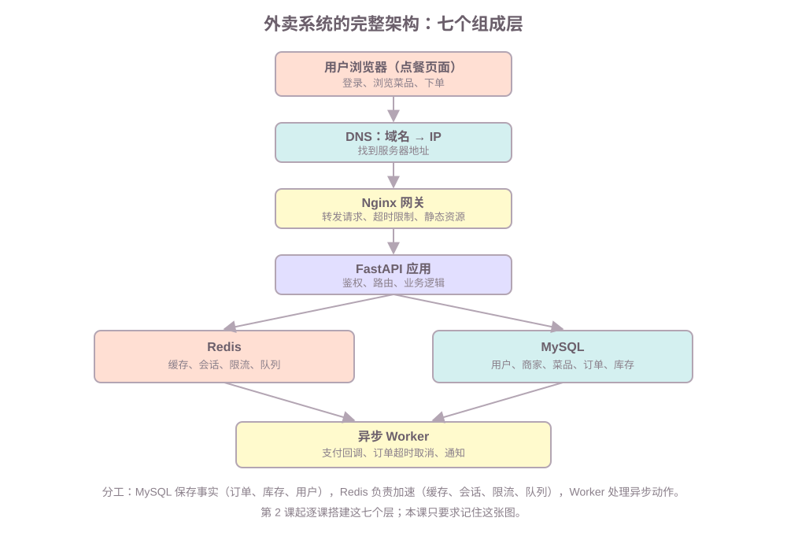
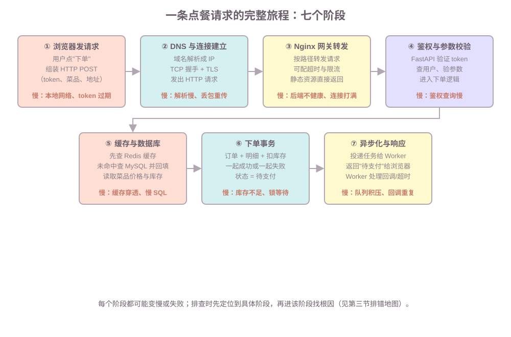

# 第 1 课：全景图——一条点餐请求的完整旅程

本课范围：不写代码，建立"真实系统由哪些部分组成、一条请求如何穿过它们"的心智模型。范围之外：具体命令、代码、算法，全部留给后续各课。

学习目标：学完后能画出外卖系统的七个组成层，能按顺序复述一条点餐请求穿过的七个阶段，能把任意"哪里出了问题"类问题先定位到某一层。

## 一、系统全景：外卖系统的七个组成层

**背景。** 面试里最让人无从开口的是这类问题："我们做了个系统，发现页面打开超时，怎么排查？"答不上不是因为没学过 HTTP 或 SQL，而是脑子里没有一个"完整系统长什么样"的地图——散点知识没有挂靠的地方。

**定义。** 一个完整的外卖系统，从用户到数据可以分成七个组成层：



各层职责如下，括号里是它对应哪门前置课程：

| 层 | 组件 | 主要职责 | 对应课程 |
|---|---|---|---|
| 用户侧 | 浏览器 / 前端 | 发起请求、渲染结果 | 本课第 12 课 |
| 网络 | DNS、TCP、HTTP | 找地址、建连接、传请求 | 网络基础课程 |
| 网关 | Nginx | 接收请求、转发、超时限制 | 本课第 2 课 |
| 应用 | FastAPI | 鉴权、路由、业务逻辑 | FastAPI 课程 |
| 缓存 | Redis | 加速读、会话、限流、队列 | Redis 课程 |
| 数据 | MySQL | 订单、库存等事实数据 | 数据库课程 |
| 异步 | Worker | 支付回调、超时取消、通知 | 本课第 8 课 |

**例子与边界。** 记住这张图时，最容易混淆的是缓存层和数据层的分工——它也是面试必问：

| | MySQL | Redis |
|---|---|---|
| 保存什么 | 事实：订单、库存、用户 | 加速：缓存、会话、限流 |
| 特点 | 事务、约束、可恢复 | 快、可过期、结构灵活 |
| 谁为准 | 长期事实的权威来源 | 可重建的短期数据 |

一句话：**MySQL 保存"事实"，Redis 负责"加速"**。后面每一课都会复用这个分工。

## 二、请求链路：一条点餐请求经过的七个阶段

**背景。** 有了七个层，还要回答"请求是怎么穿过它们的"——这就是完整的请求链路。

**定义。** 请求链路是一条点餐请求从用户点击到响应返回所经过的全部阶段。**例子**：小王在网页上点了一份 38 元的宫保鸡丁，按下"下单"：



逐阶段展开，每一阶段都有明确的执行者和数据：

**① 浏览器发请求。** 前端把购物车、地址和登录 token 组装成一个 HTTP POST 请求，发给下单接口。

**② DNS 与连接建立。** DNS 把域名解析成服务器 IP；随后建立 TCP 连接（三次握手），需要时完成 TLS 握手，最后发出 HTTP 请求。**页面打开超时，很大概率先查这里。**

**③ Nginx 网关转发。** 网关按路径把请求转发给 FastAPI，可在这里配置连接超时和基础限流；静态资源由网关直接返回，不进入应用。

**④ 鉴权与参数校验。** FastAPI 先验证 token（请求者是谁），再校验参数（购物车是否为空、地址是否有效），然后进入下单逻辑。

**⑤ 缓存与数据库。** 读取菜品价格：先查 Redis 缓存，命中直接使用；未命中查 MySQL 并回填。这一步最容易出的是缓存穿透、击穿、雪崩——大量请求绕过缓存打到数据库（Redis 课程第 7 课展开）。

**⑥ 下单事务。** 在一个事务里完成：插入订单主记录、插入订单明细、扣减库存，**一起成功或一起失败**。库存不足会导致超卖，是本课程第 6 课的核心，也是面试高频题。

**⑦ 异步化与响应。** 下单成功后，把"支付回调处理""超时自动取消"投递到异步队列，然后立即返回"待支付"给浏览器；Worker 在后台处理这些动作。

**边界。** 请求链路不是七段串行排队——⑤⑥⑦ 里有并行和异步：缓存与数据库是"先查后回填"，下单是事务性的一次性操作，异步任务则是"响应先行、处理随后"。面试画这条链路时，能点出"哪里是同步、哪里是异步"是加分项。

## 三、故障地图：每一层常见的故障与定位手段

**背景与定义。** 链路学会后，下一个问题是"每层会出什么故障、用什么手段证实"。把七个阶段浓缩成一张排错地图：

| 层 | 常见故障 | 怎么定位 |
|---|---|---|
| 浏览器 | 请求卡住、渲染慢 | F12 Network：哪个请求慢、卡在哪个阶段 |
| DNS / 网络 | 解析慢、连接超时、丢包 | `nslookup`、`ping`、`traceroute`、curl 分阶段计时 |
| 网关 | 转发超时、后端不健康 | 网关日志、健康检查、连接数 |
| 应用 | 接口慢、异常、资源高 | 应用日志、CPU / 内存 / 线程数 |
| 缓存 | 命中率低、连接超时 | `INFO stats` 命中率、Redis 慢日志 |
| 数据库 | 慢查询、连接满、锁等待 | 慢查询日志、`SHOW PROCESSLIST`、连接数 |
| 异步 | 队列堆积、任务失败 | 队列长度、Worker 日志、重试次数 |

**知识点与判断标准。** 使用这张表的核心判断是：**先确定故障在哪一层，再进那一层找原因**。浏览器 Network 面板是免费的"分层探测器"——它直接告诉你卡在 DNS、TTFB（等待后端响应）还是资源下载。TTFB 长意味着问题在后端，立刻进入应用/缓存/数据库层。

## 四、排查框架：界定、分层、定位、验证

**背景。** 面试官不会问"你背过这张表吗"，他会给一个模糊场景。这时需要的是把场景套进固定框架的能力。

**定义。** 任何模糊的排错问题都可以用四步回答：**界定 → 分层 → 定位 → 验证**。

**例子。** "页面打开出现超时，怎么排查？"的完整回答：

> 我先界定范围：是所有用户还是个别？所有页面还是某个接口？持续还是偶发？——这决定排查方向。
>
> 然后沿请求链路分层排查，从离用户最近的地方开始：先用浏览器开发者工具看是哪个请求慢、卡在哪个阶段；如果是 TTFB 长，说明问题在后端——再看网关、应用日志、数据库慢查询和缓存命中率；如果卡在请求发出前，则是 DNS 或网络问题。
>
> 定位到根因后，能复现、能验证修复，并补上监控（接口耗时、错误率、慢查询），防止再犯。

**知识点与边界。** 这个回答没有背任何知识点，只是沿链路逐层排除。**注意"界定"一步的作用**：个别用户超时多半是用户侧网络；所有用户持续超时才是服务端问题——不同答案指向完全不同的排查路径。本课程第 11 课会亲手制造并排查这些故障，把这张地图变成肌肉记忆。

## 五、面试高频考点

### 题目：输入 URL 后发生了什么？

> 可以分四层讲：第一，浏览器先做 DNS 解析，把域名变成 IP；第二，与服务器建立 TCP 连接（三次握手），HTTPS 还要完成 TLS 握手；第三，发送 HTTP 请求，经过网关转发到应用；第四，应用处理（鉴权、业务逻辑、查询数据）后返回响应，浏览器渲染。每一层都可能成为性能或故障点，所以排查时也要按这个顺序分层。

### 题目：如何分层描述一个系统？

> 从用户请求的路径出发：用户侧（前端）→ 网络层（DNS、TCP/HTTP）→ 网关 → 应用层（业务逻辑）→ 数据层（缓存和数据库）→ 异步层（队列与 Worker）。描述时说明每层职责，并点出同步与异步的边界。关键分工是：数据库保存事实，缓存负责加速，异步处理耗时动作。

### 题目：为什么 MySQL 存事实、Redis 做缓存？

> MySQL 提供事务、约束和持久化，适合保存订单、库存这类不可重算的事实数据；Redis 快、支持过期时间，适合保存可以重建的缓存、会话和计数。如果订单只放在 Redis，重启或丢失会造成事实缺失；如果缓存不用 Redis，热点查询会直接压垮数据库。

## 六、这一课学到什么程度可以继续

达到下面的程度，就可以进入下一课：

```text
能画出外卖系统的七个组成层（浏览器 -> 网关 -> 应用 -> 缓存 -> 数据 -> 异步）
能说清每层职责，特别是 MySQL 存事实、Redis 做加速的分工
能按顺序复述一条点餐请求的七个阶段
能指出每层至少一个常见故障点
能回答"页面超时"类问题：界定 -> 分层 -> 定位 -> 验证
```

下一课开始动手，搭第一个真实环境：

```text
怎样用 Docker Compose 把 FastAPI、MySQL、Redis、Nginx 一次跑起来？
Nginx 网关在链路里负责什么？
项目目录和配置怎么组织？
为什么这个项目用 MySQL 而不是 SQLite？
```
