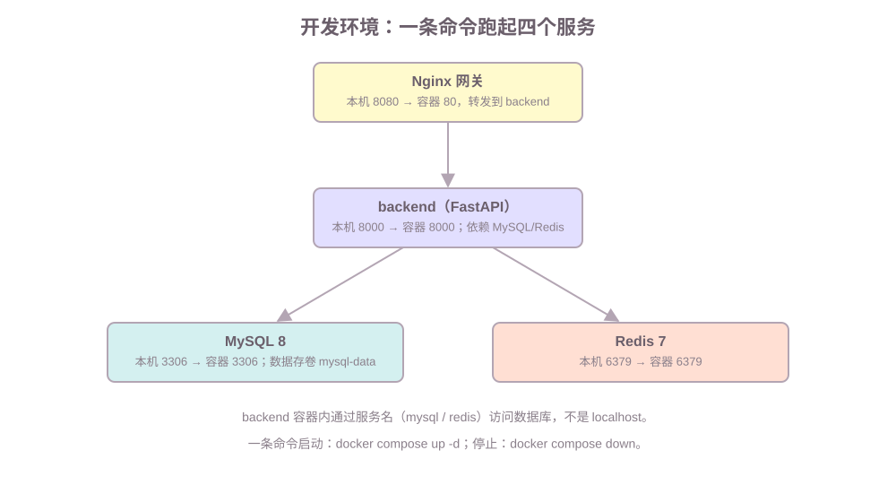

# 第2课:开发环境与项目骨架——一条命令跑起四个服务

本课范围：搭建第 1 课地图里四个服务的开发环境，不写业务代码。范围之外：数据模型（第 3 课）、业务接口（第 5 课起）、缓存与事务（第 6 课起）。

学习目标：学完后能解释四个容器各自干什么、为什么这样连，能用一条命令启动整套环境，并能从网关 curl 通到每一个服务。

## 一、环境全景：四个服务组成的开发环境

**背景。** 第 1 课画了七个组成层，但要动手，第一步是把环境跑起来。手动在 Windows 上装 MySQL、Redis、Nginx 需要下载安装包、配路径、管服务——每个步骤都因机器而异，装完还污染系统。

**定义。** 开发环境由四个容器组成，每个容器只干一件事：



**例子与边界。** 四个服务中唯一需要选择的存储是 MySQL。为什么不沿用 SQLite？

| | SQLite | MySQL |
|---|---|---|
| 形态 | 一个文件 | 独立服务器 |
| 并发写 | 单写者，写时锁整个库 | 行锁、多写者 |
| 事务强度 | 有，但写并发受限 | InnoDB 事务 + 隔离级别 |
| 适合 | 本地、单机、测试 | 真实业务、多进程 Web 服务 |

第 6 课的下单事务会同时写订单、明细、库存三张表，还会有多个请求并发扣库存——这是 SQLite 的单写者模型不擅长的场景（详见 database-sqlite 第 5、6 课），所以本项目用 MySQL。

## 二、Compose 文件：一条命令声明四个服务

**背景。** 手动 `docker run` 四次要写四段参数，服务之间还要自己连网络。Compose 把四个容器的声明集中到一个文件里。

**定义。** `docker-compose.yml` 是一个 YAML 声明文件，用 `services` 列出每个容器，Compose 负责创建网络、按依赖顺序启动。**例子**就是本课的 `code/takeout/docker-compose.yml`，逐个 service 看：

```yaml
services:
  mysql:                      # 服务名：容器内用这个名字互相访问
    image: mysql:8             # 用现成镜像，不需要自己写 Dockerfile
    environment:               # 传给容器的环境变量
      MYSQL_DATABASE: ${MYSQL_DATABASE}   # ${...} 从 .env 文件读取
    ports:
      - "3306:3306"            # 本机端口 : 容器端口（第 1 课的门 A : 门 B）
    volumes:
      - mysql-data:/var/lib/mysql   # 数据卷：容器删了数据还在
    healthcheck:               # 健康检查：等 MySQL 真正能连再往下走
      test: ["CMD-SHELL", "mysqladmin ping -h 127.0.0.1 -uroot -p$$MYSQL_ROOT_PASSWORD"]
```

新出现的写法，逐个解析：

| 写法 | 含义 | 必填 |
|---|---|---|
| `image` | 用什么镜像（没有 Dockerfile 的服务） | 与 `build` 二选一 |
| `build` | 用哪个目录下的 Dockerfile 构建 | 与 `image` 二选一 |
| `environment` | 传给容器的环境变量，`${NAME}` 从 .env 读 | 需要配置的服务必填 |
| `ports` | `本机端口:容器端口` 端口映射 | 需要对外暴露时 |
| `volumes` | 数据卷挂载，`名字:容器内路径` | 需要持久化时 |
| `depends_on` | 依赖关系，`condition: service_healthy` 表示等对方健康再启动 | 有依赖时 |
| `healthcheck` | 容器内的健康检查命令 | 配合 depends_on 使用 |

`redis` 和 `nginx` 服务结构相同（redis 只有端口和健康检查；nginx 把配置文件挂载进容器）。`backend` 用的是 `build: ./backend`，它由 Dockerfile 构建（见第五节运行说明）。

**知识点与边界。** backend 容器里访问 MySQL 和 Redis，用的主机名是服务名 `mysql`、`redis`，**不是 localhost**——因为每个容器有自己的网络空间，localhost 指向容器自己；Compose 创建的私有网络里，服务名就是对方的地址。这是初学者最容易踩的坑（见第六节）。

## 三、Nginx 网关：请求的统一入口

**背景与定义。** 网关是链路的统一入口：浏览器只认识一个地址，网关负责把请求按路径转发给后端。`code/takeout/nginx/nginx.conf`：

```nginx
server {
    listen 80;                       # 容器内监听 80，compose 映射到本机 8080
    location / {                     # 所有路径
        proxy_pass http://backend:8000;   # 转发到 backend 容器
        proxy_set_header Host $host;
        proxy_read_timeout 30s;      # 后端响应最多等 30 秒
    }
}
```

**例子。** 你在本机访问 `http://localhost:8080/health`，实际路径是：

```text
浏览器 -> 本机 8080 -> Nginx 容器 :80 -> backend 容器 :8000 -> FastAPI 响应
```

**知识点与边界。** 网关的价值不止转发：超时配置、静态资源、未来的限流都收口在这一层（第 9 课会把限流放到这里和应用的取舍一并讨论）。本课只用它的转发和超时两个能力。

## 四、配置管理：密钥只走环境变量

**背景。** MySQL 密码如果写死在 `docker-compose.yml` 并提交到仓库，等于把数据库钥匙公开。

**定义与例子。** 密码放在 `.env` 文件里，compose 用 `${NAME}` 引用；`.env` 用 `.gitignore` 排除，仓库只提交一份无秘密的 `.env.example`：

```text
.env.example   ← 提交到仓库，写占位值
.env           ← 本地复制后填真实密码，绝不提交
```

**知识点与边界。** 这一课的环境变量只覆盖连接信息；第 4 课认证会引入 token 密钥，届时同样只走环境变量。规则就一条：**任何密钥都来自环境变量，不写进代码和配置文件本身**。

## 五、全链路验证：从网关通到数据层

**背景与定义。** 环境装好后要证明"链路是通的"。后端提供两个接口：`/health` 检查应用本身，`/api/ping` 检查应用能否连上 MySQL 和 Redis。

**例子。** 本课命令速查表（`#` 后是注释，实际执行时不输入）：

```bash
# 1. 准备密钥文件（只需一次）
cd code/takeout
cp backend/.env.example .env

# 2. 一条命令构建并启动四个服务
docker compose up -d --build

# 3. 查看所有容器状态（Healthy 表示健康检查通过）
docker compose ps

# 4. 从网关入口验证应用（Nginx -> backend）
curl http://localhost:8080/health

# 5. 从网关验证数据层（Nginx -> backend -> MySQL/Redis）
curl http://localhost:8080/api/ping
```

| 命令 | 含义 | 参数说明 |
|---|---|---|
| `docker compose up -d --build` | 构建并后台启动全部服务 | `-d` 后台，`--build` 重新构建 |
| `docker compose ps` | 查看服务状态 | 看 HEALTHY |
| `docker compose logs backend` | 查看某个服务的日志 | 可换成 nginx/mysql/redis |
| `docker compose restart backend` | 重启某个服务 | 改代码后常用 |
| `docker compose down` | 停止并删除容器（数据卷保留） | 加 `-v` 连数据卷一起删 |

`/api/ping` 返回 `{"redis": true, "mysql": true}` 就说明四条链路全通：

```text
curl 8080 -> Nginx -> backend -> Redis   ✓
                     -> MySQL   ✓
```

**知识点与边界。** `docker compose down` 删除容器但保留数据卷，MySQL 数据不丢；只有显式加 `-v` 才清空数据——这是练习环境最值得记住的边界。

## 六、常见错误

### 1. backend 里用 localhost 连数据库

```text
pymysql.err.OperationalError: Can't connect to MySQL server on 'localhost'
```

容器内 `localhost` 是容器自己，不是宿主机的 MySQL。连接 MySQL/Redis 要用 compose 服务名（`mysql`、`redis`），它们在同一个私有网络里。

### 2. backend 启动时 MySQL 还没就绪

表现：`/api/ping` 返回 `"mysql": false`，或 backend 日志一堆连接失败。解决：compose 里已经给 backend 配了 `depends_on: mysql: condition: service_healthy`——如果没生效，先 `docker compose ps` 看 MySQL 是否 HEALTHY。

### 3. 端口被占用

```text
Error response from daemon: Ports are not available: port 8080 is already in use
```

本机 3306/6379/8080/8000 可能被已有服务占用。用 `docker compose ps` 看是否有旧容器，或改 `docker-compose.yml` 里对应的 `本机端口`。

### 4. 改了代码看不到变化

改完 `main.py` 或 `nginx.conf` 要重建/重启才能生效：

```bash
docker compose up -d --build   # 改 Dockerfile 或代码后
docker compose restart backend # 只改代码时
```

### 5. 镜像拉取慢或失败

Windows 直连 Docker Hub 可能失败（回扣 Docker 课程第 2 课）：配置 `registry-mirrors` 或给 Docker Desktop 配代理。

## 七、运行课程代码与作业

**代码位置。** 本课代码在 `code/takeout/`：

```text
code/takeout/
├── docker-compose.yml        # 四个服务的声明
├── backend/
│   ├── Dockerfile            # FastAPI 应用镜像
│   ├── requirements.txt      # fastapi / uvicorn / redis / PyMySQL
│   ├── .env.example          # 密钥占位示例
│   └── app/main.py           # 最小 FastAPI：/health 和 /api/ping
└── nginx/nginx.conf          # 网关转发配置
```

**作业**（迁移练习，非抄示例）：

1. 修改 `code/takeout/backend/app/main.py`：新增 `GET /api/services`，把 `redis_ok` / `mysql_ok` 从返回布尔值改成返回错误信息字符串（如 `"pymysql err: Can't connect"`），组合成一个返回每个服务详细状态的接口；
2. `docker compose restart backend` 后，用 `curl http://localhost:8080/api/services` 验证；
3. 顺手在 `nginx.conf` 里把 `proxy_read_timeout` 改成 60s，重启 nginx 验证配置生效。

## 八、这一课学到什么程度可以继续

达到下面的程度，就可以进入下一课：

```text
能说清四个容器各自干什么、端口怎么映射
能解释 backend 为什么用服务名而不是 localhost 访问数据库
能说出 environment、volumes、depends_on、healthcheck 的作用
能用一条命令启动整套环境，并从网关 curl 通到 MySQL 和 Redis
能说清 .env 和 .env.example 的区别，密钥只走环境变量
能排查端口占用、服务未就绪、改代码不生效三类问题
```

## 九、面试高频考点

### 题目：为什么用 Docker Compose？

> Compose 用一份 YAML 声明多个容器的镜像、端口、环境变量、数据卷和依赖关系，一条命令启动整套环境，还自动创建服务间的私有网络。它让环境可复现：换一台机器，同一个文件跑出同样的环境，避免了手动安装数据库和网关的平台差异。

### 题目：Nginx 在链路里做什么？

> Nginx 是网关，是请求的统一入口：接收浏览器的请求，按路径转发给后端应用，并在这里集中配置超时、静态资源和未来的限流。对外只暴露网关一个端口，后端服务的细节不直接暴露。

### 题目：容器内为什么用服务名访问数据库，而不是 localhost？

> 每个容器有独立的网络空间，容器里的 localhost 指向容器自己。Compose 创建私有网络后，服务名（如 mysql、redis）就是对方的地址，后端通过服务名访问数据库；宿主机的程序和数据库之间才用端口映射。

### 题目：配置和密钥怎么管理？

> 密码、token 等密钥只放在环境变量里，由 compose 的 `.env` 注入容器。仓库只提交无秘密的 `.env.example`，真实的 `.env` 用 `.gitignore` 排除。密钥写死在代码或配置文件里是安全红线。
